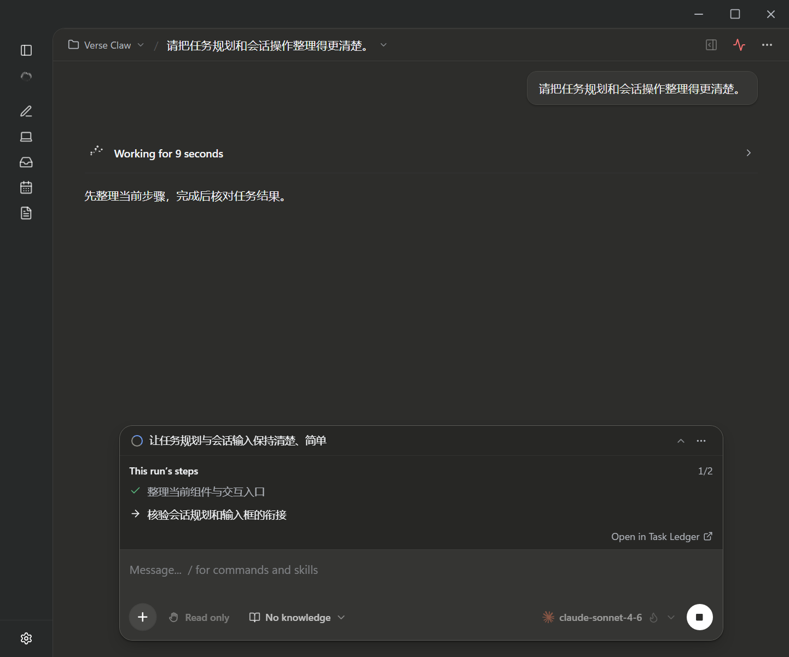
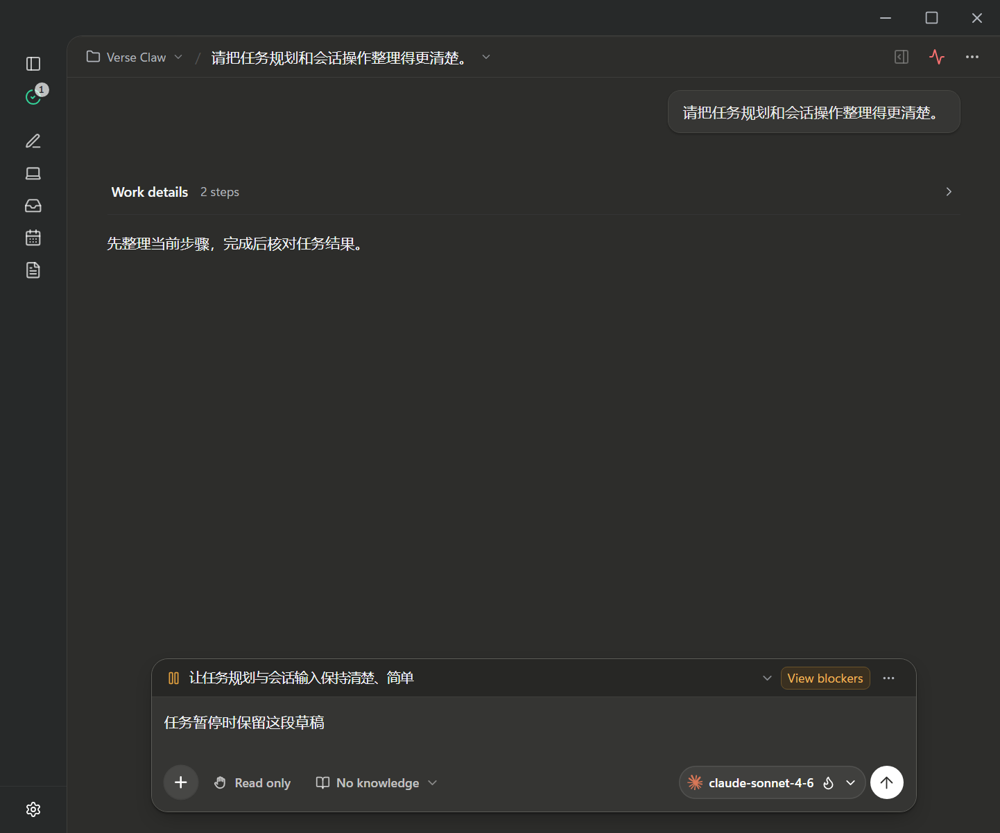
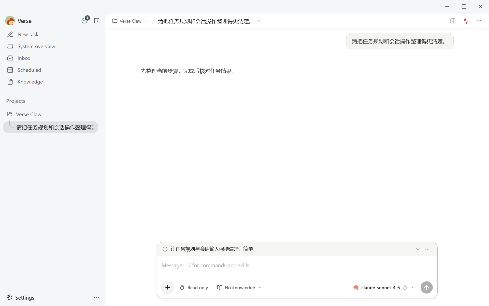

# Carbon 会话材质与任务展示优化

本轮由 Carbon 查看当前界面图片并决定视觉方案，主 agent 负责实现和验收。已移除任务比例圆环、折叠态当前步骤长文和彩色运行状态词，以及输入框 BorderBeam 流光。折叠行保留目标、中性步骤计数和必要操作，完整步骤按需展开。

运行、完成、暂停和读回失败分别以低饱和钢蓝、森林绿、琥珀和砖红微标表达；状态说明回到中性灰，阻塞和刷新使用独立描边按钮。本轮步骤结束继续使用任务 owner 的验收状态。

任务条与输入框共享16px圆角、单层外边与阴影。深色输入底为 `#353533`，取消顶部亮边；已发送消息采用12px圆角、实色底、细边和轻接触阴影，移除模糊。底栏控件保持32px高，圆形发送、停止、继续保持原语义。已有菜单按原位置浮出外框，相关点击与边界检查通过。

184项不同定向单测的最新结果与7条不同Electron旅程的最新结果通过。完整类型检查、最终测试类型、四语、构建及Harness通过；Lint有0个错误、5个既有警告。截图与交互由agent驱动，涵盖明暗、宽窄、触控、四语、键盘与减少动效、任务读取恢复、暂停草稿、审批及排队。所有Electron批次完成清理，残留为空且源码检查通过。逐批候选、原始失败及修正记录见JSON文件。

最终界面候选 `8573ae572aebe9c83aba3a64e858599a8c4da93f`，构建源 `5b86fb04f`，生产源码一致；主目录 `D:/ClawX/dist` 与 `dist-electron` 已同步验证构建。

Carbon设计和复核共4次请求、实际读取7张图片，回执合计51,571 tokens。Carbon明确给出“视觉复核通过，无必修项”。原始设计与复核结论分别见 `DESIGN.md`、`VISUAL-REVIEW.md`。

原始日志和构建备份位于 `D:/tmp/carbon-chat-material-20261123-01a203cc`。运行 `python verify.py` 可核对本包文件与候选身份。
