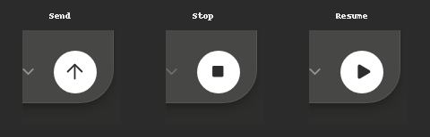
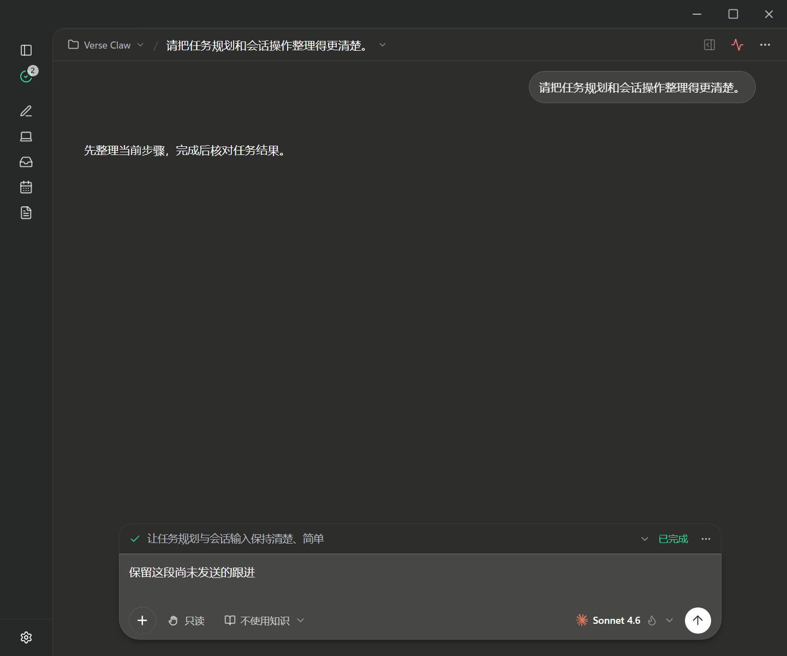

# 会话规划与输入框交付

会话规划、知识入口与输入框已完成统一。模型在底栏显示简短名称，完整名称保留在提示和模型列表；发送、停止和继续按用户图片采用统一圆形按钮，深色主题使用白色圆底、深色图标。

任务条与输入框共享边界，一行显示持久目标、本轮当前步骤和任务状态。实时步骤从任务条展开，历史计划留在对应对话摘要；本轮步骤完成继续读取任务 owner 的验收状态。正常检查点与干预记录按需查看，队列、读取异常、审批和连接故障保持可见。

最终界面候选 `18041f4083293f4030937e7498b12ddc97a6d88e`，实际构建源 `c7c2cb334`；两者生产源码一致，后续提交只调整静态截图断言。218 项不同定向单测与 8 条不同 Electron 旅程的最新结果全部通过，前端、Main、测试类型以及契约、四语、通信回放、Harness 检查通过。完整运行与候选对应关系见 `checks.json`、`electron-checks.json` 和 `candidate.json`。

Electron 验证包含明暗主题、宽窄窗口、375px 触控布局、四语、键盘菜单、运行规划、任务验收、审批恢复、断连反馈、发送排队、知识读取取消和预算回执。截图采用 agent 固定任务与类型化 Runtime 事件；知识服务旅程使用真实本地 Gateway 与脚本模型服务。清理回执通过且无残留，验证检出的源码检查保持干净。

Carbon 实际查看 7 张图片，提供首轮设计和一次复核，3 项复核小修均已落实。两轮共 4 次 Carbon 请求，回执合计 61,425 tokens。调用记录和原图保存在本目录；用户提供的按钮参考图单独保留。

原始失败、完整日志与回执保留在 `D:/tmp/chat-ux-20261123-01a203cc`。全仓 Agent Dev CI 延续上轮记录，本次验收聚焦会话 UI。运行 `python verify.py` 可核对候选记录、验收数据与文件哈希。

主目录 `D:/ClawX/dist` 与 `dist-electron` 已同步这份实际验证过的构建，入口文件哈希一致。旧产物保留在 `D:/tmp/chat-ux-20261123-01a203cc/previous-main-build`。
