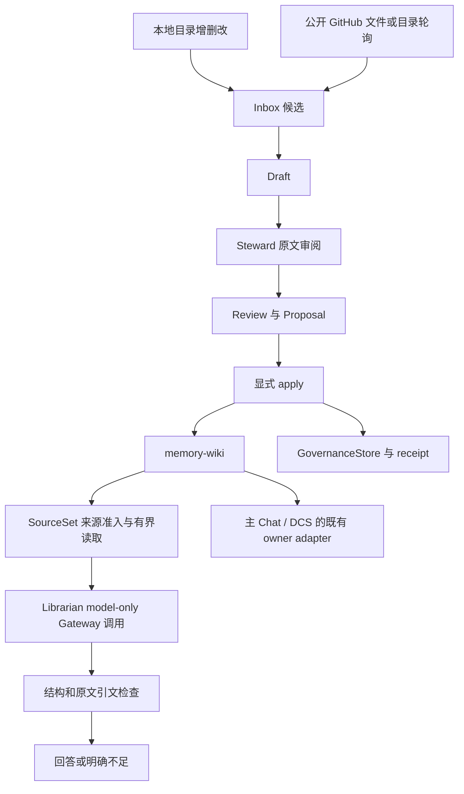

# 知识库、内置角色与治理评测及整改验收

日期：2026-11-05（Asia/Shanghai）。执行者：`codex-knowledge-relay`，`driven_by: agent`。
源码候选：`2b214088527c4bd612e7cf4a4e5d06a399a8b2f5`；树：`f9bc61f52541167e1ae8cc80529cb00082343d08`。
实施树：`D:/ClawX-work/knowledge-relay-20261105`，分支：`codex/knowledge-read-governance-20261105`。
本报告覆盖原评测的后续六项开发 TF-0797..TF-0802；TF-0796 的来源准入证据在相邻 `knowledge-source-set-read-governance/`。
候选运行时工作树干净；后续只添加报告、规范文字和精选证据。详见 `candidate.json`、`evidence.json` 和 `SHA256SUMS.json`。

**结论：当前已经具备可验证的本地受治理知识问答闭环，适合项目知识和工程经验的受控使用。原来的主要读侧缺口已经有实现与专项证据；企业连接、长期质量和大规模检索仍缺少足够验证。**

Librarian 已经从模板摘录升级为读取准入证据后的模型问答，Steward 已经从摘要建议升级为绑定草稿和来源版本的结构化审阅。
两个角色的职责划分合理：Librarian 负责读取和解释，Steward 负责审阅建议，正式写入继续由既有 review/proposal/apply 负责。
没有新增 agent 群、第二套数据库或新的知识权威。此次结果属于范围限定的工程验收，不是发布、GA、长期可靠性或默认写回许可。

## 评测口径

采用代码追踪、原评测反例回归、实际 Windows 文件事件、真实 Electron UI、公开 GitHub 采集和已授权 space-bunny 调用。
所有 UI 操作及数据均由 agent 驱动；没有真人参与证据。模型别名背后的实际供应商/模型身份和费用没有独立核实。
本报告不使用任意总分：测试通过率、答案正确、引用可核验和产品成熟度是不同指标。

| 证据层 | 本轮实际内容 | 不支持的外推 |
|---|---|---|
| 源码与专项测试 | 189 后端 + 109 Renderer/Host 测试，合计 298 项 | 全仓测试全部通过、所有故障场景覆盖 |
| 真实 UI + 受控响应 | 5 个 Electron 场景，浅色/深色/窄窗/错误状态截图 | 真实模型回答质量 |
| 原生文件事件 | 20 并发创建，更新、撤回、停机补扫，共 25 个唯一转换 | 大型目录吞吐、长期监控稳定性 |
| 固定语料 + 实际 provider | 14 个场景，8 次真实推理，其余 6 项由准入规则拒绝 | 全库发现、开放域正确率、统计显著收益 |
| 真实 Electron→Host→Gateway→provider | 1 场景，2 次无工具调用、回答与追问，缺来源不调用模型 | 语义 Steward 的实模型质量、发布版安装、多平台 |
| 实际 GitHub + 受控失效 | 公开 README 生成 1 个待审候选，重复同步不重复；更新/删除/权限变化/重试/重启由专项测试覆盖 | 私有 GitHub ACL、任意企业 SaaS |

## 当前能力判断

| 维度 | 当前判断 | 需要理解的边界 |
|---|---|---|
| 存储与归属 | Markdown Wiki 与 GovernanceStore 分工清楚 | Knowledge、Runtime Memory 和任务上下文仍各有归属 |
| 读取准入 | 主知识问答和 Studio 保留状态、权限、版本、摘要及范围 | 按来源 owner 给出的元数据执行；不是多租户权限系统 |
| 写入治理 | 候选、草稿、审阅、提案、应用的权限继续分离 | 同步成功或模型建议均不授权自动 apply |
| Librarian | 已接通证据问答及有界追问 | 引文存在与答案语义成立不能划等号 |
| Steward | 原文审阅、reviewFocus、结构化发现和并发保护已实现 | 默认仍为启发式；没有实模型审阅精确率/召回率评测 |
| 中文与长文 | CJK bigram 回退、800 行内的相关窗口续读 | 无完整中文分词器；800 行/96k 字符以外无覆盖保证 |
| 语义检索 | 内容寻址向量缓存有 provider/端点/model/凭据隔离 | 当前为进程内有界缓存；没有大型持久向量索引验收 |
| 持续同步 | 本地目录和一个公开 GitHub 文件/目录连接器形成候选闭环 | 上游变化不会直接更新或撤回已审定 Wiki |
| 可观察性 | 回执、拒绝原因、引用、模型状态与原始产物可回读 | 不能用记录数量代替长期效用 |
| 可维护性 | 共用 QA/读取规则，抽出同步、connector、QA、tokenization | `knowledge-api.ts` 仍承担较多编排；未进行大规模拆分 |

## 真实数据路径

知识库助手与主 Chat/DCS 是不同消费入口。本轮长文和 QA 改进不能据此声称所有 DCS/Wiki adapter 的读取范围都已经统一。

## Librarian 设计评测

普通问题和显式 Source Set 都经过 `knowledge.answerFromSourceSet`。没有显式来源时，Main 使用 Wiki 搜索候选，再执行来源准入；
有界历史最多取 8 轮/8000 字符，只用来解析追问语境，助手历史不作为事实来源。
实际请求复用既有 Gateway 的 `agent`/`agent.wait`，使用独立 session、`modelRun: true`、`promptMode: none`、`deliver: false` 和禁用消息工具。

回答采用 `claims[] + citations[] + unknowns[]`。每个 claim 的来源 ID 必须存在，引文必须是已准入原文的子串。
不合格引用或模型失败返回可见降级；没有准入来源或存在已声明的结构化冲突时，不发起综合调用。
截断、未知新鲜度和未解决项使结果保持 partial，删除了固定回答置信度。

这是合理而克制的设计：明确回答证据与执行权限，避免让问答助手拥有知识修改权。
仍需特别注意：引文匹配不证明 claim 被引文蕴含；相互矛盾的自然语言来源也不一定自带结构化 `claimId/stance`。
因此，当前不能声称“grounded 就等于正确”，也不能声称已实现通用语义冲突判定。

源码：`electron/services/knowledge-evidence-qa.ts`、`electron/services/knowledge-source-set-answer.ts`、`electron/services/knowledge-api.ts:3338`、`src/pages/Chat/KnowledgeChat.tsx:164`。

## Steward 设计评测

保留默认 heuristic 和显式 semantic 两种模式。semantic 输入现在包含草稿 revision/digest、有效 reviewFocus 和准入的原始来源，搜索摘要不充当证据。
发现记录 kind/severity/message/citations；引文核对后绑定版本与摘要，重复/冲突需要同时引用草稿与来源，缺证发现保持未核实。
完成推理后重新读取草稿，只有 revision/digest 未变且未应用时才持久化，避免模型等待期间覆盖新编辑。

专项反例覆盖 reviewFocus 生效、来源元数据/引用绑定、缺证标记、失败降级和并发编辑。
Steward 不能直接 apply；审阅成功并不自动升级为 approved Wiki。
仍未验证真实模型对重复、冲突和过期判断的 precision/recall；模型自报分类 confidence 的阈值没有统计校准。
另外，审阅意见进入普通主 Chat 的所有生产消费路径没有在本轮完成统一接线，不以 helper 测试替代生产效果。

源码：`electron/services/knowledge-api.ts:3154`、`:3225` 及 `stewardReview`；测试见 `tests/unit/knowledge-steward-semantic-pass.test.ts`。

## 内部治理与生命周期

| 环节 | 本轮确认 | 剩余限制 |
|---|---|---|
| 读取入口 | Host API 是 Renderer 唯一入口，Main 拥有 Gateway 调用 | 没有新增跨租户权限声明 |
| 来源物化 | revision/digest、ACL、状态、scope、敏感性、范围进入 SourceSet | 政策来自 owner，无法凭空补足源系统权限信息 |
| 失效处理 | stale/revoked/secret/ACL 不合格来源不成为回答证据 | 长期变化传播与 TTL 不能从固定语料推断 |
| 候选写入 | 文件与 connector 先写 Inbox，再推进游标 | 待审期间旧知识可能继续被读取；需要按业务时效处理候选 |
| 审阅绑定 | 草稿与来源版本绑定，并发编辑拒绝陈旧结果写入 | 未测完整跨进程故障矩阵 |
| 应用权限 | 原有 proposal/apply、journal 与 receipt 保留 | 本轮未重新证明所有 crash/unknown-outcome 恢复情况 |
| 退出与资源 | watcher/connector 有 owner，停止计时器与请求；最终 live 账本无存活 Electron | 辅助 CIM sweep 不可用，隔离 profile 保留用于复现 |

文件事件仅作为补扫提示，串行比较有界快照和持久游标。采集失败不推进游标，不完整扫描不推断删除。
捕捉身份包含转换序号和内容摘要，允许 A→B→A、删除再创建，避免把后续合法变化误去重。
同步的游标和 embedding cache 都是可再生辅助状态，不成为新的知识权威。

## 外部连接评测

本轮交付的入口明确为 `github-public-directory`：一个公开文件或单层目录轮询，使用固定 GitHub API，拒绝任意 URL、凭据和重定向。
按 Git blob SHA 验证内容，文件数、字节数和请求时间有上限。来源 ID 稳定，版本/摘要/观察时间/权限变化进入待审候选。
404/private 变化会形成 access-lost 候选；瞬时失败或 rate limit 不推断删除，失败采集不推进游标。

实际 Electron 从公开 `openai/openai-python` 的 README 创建一项 agent 候选，再次同步 `unchanged=1`，没有重复。
更新、撤回、ACL 失效、blob 损坏、rate limit 和重启使用受控网络响应测试；没有擅自修改远端仓库来制造故障。
不宣称 Notion/Drive/Confluence/Slack 连接器、私有仓库权限继承、webhook 或递归全仓抓取。

## 可复算的质量与收益

固定语料 14 项：中文/英文、长文末端答案、冲突、陈旧、撤回、ACL 拒绝、secret、无来源、事实缺失、来源指令诱导、追问、跨来源组合。

| 指标 | 结果 | 解释 |
|---|---:|---|
| 固定任务完成 | 14/14 | 包含 7 个应回答题与 7 个应拒答题 |
| 实际 provider 推理 | 8/8 完成 | 其余 6 项准入后直接拒绝，不能计作模型成功 |
| 引文核验 | 8/8 推理结果 | 证明来源 ID 与原文子串存在，不是事实正确率 |
| 拒答 | 7/7 | 6 项规则层拒绝，1 项事实缺失由模型拒答 |
| 同组可回答题 | 摘录基线 6/7 → 当前 7/7 | 改善项只有 long-tail，无回退项 |
| baseline 类型 | 重建旧摘录行为 | 非历史可执行程序重放，也非双模型 live A/B |

此前直接比较“6/14→14/14”会把原有准入拒绝能力混入新增回答收益；本轮修正为 `pairedAnswerable` 同分母比较。
evaluator 也改为读取生产 SourceSet 的实际 conflictSet 决定拒答，不使用语料的预期 conflict 标签替代运行结果。
中文词法回归证明给定中文问法已有召回；语料的 selected-source 质量不等于全库 discovery 召回率。
原始语料、响应、usage、source binding、reads 和每项耗时在 `quality/`，可据此独立复算。

没有 100/1000 来源冷暖延迟、长期 soak、跨平台、发布版安装或实际业务任务群的统计收益。
embedding provider 的真实延迟与费用也未测；已有 cache 测试证明复用与隔离，不证明供应商服务性能。

## 验收和环境残差

- 后端 11 文件 189 项，Renderer/Host 6 文件 109 项；全部通过，退出码 0。
- node/web/test 三项完整无缓存类型检查、定向 lint、contract、comms replay/compare、Harness validate/dry-run 通过；lint 为 0 errors / 29 warnings。
- Vite/主进程/preload 构建通过；运行时构建与 Gateway ready 冒烟通过。
- 5 个 UI 场景退出码 0；1 个实际 Gateway/provider/GitHub 场景退出码 0，重试数为 0。
- 最终 live 使用 `CLAWX_E2E_KEEP_TEMP=1` 保留隔离 profile：两次默认清理卡住 worker teardown 90 秒，保留回执和失败 JSON，未放宽断言或增加重试。最终 Electron ledger `survivors=[]`、代理 listening=false/sockets=0/requests=0；CIM 交叉扫描 unavailable，不能声称该附加扫描通过。
- Windows Electron profile 使用已有 LocalLow 小目录；日志、trace、截图、编译和长期产物在 D 盘。该 profile 含测试专用凭据，不纳入源码证据包。
- 迁移后需要生成 extension bridge、构建 VerseBrowser 类型和运行时 bundle；依赖目录短暂缺文件导致前两次 build 失败，失败产物留存，最终同源码 build 成功。
- 全仓 `repo:artifacts:check` 仍因 8 个已有 RSI `.log` 路径被 ignore 而退出 1；没有把它算作本线验收通过，也未改动不相关路径。
- 未运行全仓测试、正式 Executor/Verifier 发布验收或全知识库 soak。

## 交付与下一步

六项交付按各自证据表评审，工程结论为 passed-scoped-engineering。正式节点状态以 D:/ClawX 的唯一 Task Forest 为准；不能由报告自行声明图已更新。
推荐下一阶段围绕已证明的限制增加测量：优先测试真实知识库发现召回与语义支持关系，再评估 Steward 实模型质量和长时来源失效传播。
不建议此时再增加角色、工作流编辑器或大型检索架构。现有设计足以作为这些测量的基础。

证据目录中的 `evidence.json` 提供结论与产物映射；`SHA256SUMS.json` 覆盖除自身以外的全部精选文件。
任务图和会话交接保留本地，不随源码提交；全部产物均标明 agent，不声称 real-human。
