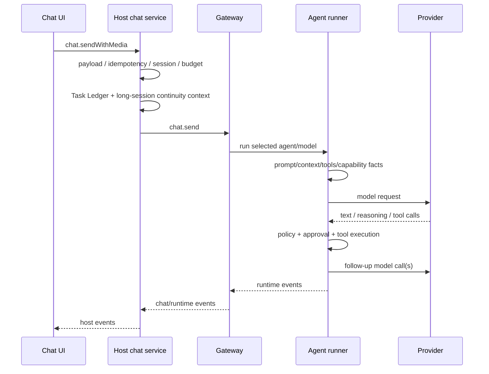

# Repository source snapshot

Origin: docs/modules/llm-and-models.md
Commit: 1a4cc531ee050794b89dc8d7e49ac7c7a1c71ec0

~~~markdown
# LLM 与模型交互

> 面向问题：一次消息怎样变成模型请求？供应商、模型、fallback 和推理强度怎样决定？流式文本、工具调用、审批、成本和缓存状态分别由谁负责？

## 1. 模块定位

模型交互层负责把“用户输入 + 会话历史 + 上下文候选 + 工具清单 + 权限事实 + 模型账户配置”组装成供应商请求，并把流式文本、工具请求、最终消息、错误和 usage 映射回桌面事件。

它不等同于整个 Agent。模型层不拥有：

- 工作区文件写入；
- 最终审批权；
- Task Ledger 状态；
- 会话生命周期；
- 知识持久写入；
- 多智能体任务图。

这些分别由 Host service、permission owner、Task Ledger、session owner、knowledge authority 和 orchestrator 持有。

## 2. 供应商账户

用户入口：`Settings → Models & Providers`，兼容路由 `/models` 会重定向到 `/settings/models`。主实现位于：

- `src/pages/Models/index.tsx`
- `src/components/settings/ProvidersSettings.tsx`
- `src/stores/providers.ts`
- `electron/services/providers-api.ts`
- `electron/services/providers/`
- `electron/shared/providers/types.ts`

### 2.1 内置供应商

当前前端注册表 `src/lib/providers.ts` 定义：

| 类别 | 供应商 |
|---|---|
| 官方/多模型 | Anthropic、OpenAI、Google、OpenRouter |
| 中国区/兼容服务 | ByteDance Ark、Moonshot CN、Moonshot Global、SiliconFlow、DeepSeek、MiniMax CN、MiniMax Global、Model Studio |
| 本地 | Ollama |
| 自定义 | Custom / OpenAI-compatible 或 Anthropic-compatible 端点 |

这不是“所有供应商都内置 SDK”的承诺。`openclaw_runtime/src/llm/providers/register-builtins.ts` 明确说明裁剪后的 runtime 不携带完整内置 SDK；桌面产品通过 provider/account 配置、运行时插件和显式适配器提供实际调用路径。

### 2.2 账户与认证

供应商账户支持：

- 多个账户；
- 一个默认账户；
- API Key、OAuth browser、OAuth device、本地模式；
- 自定义 `baseUrl`；
- 自定义 HTTP headers；
- bearer、自定义 header、query、none 四类请求认证；
- 协议选择；
- 模型 ID 与模型能力声明；
- 手工模型 ID 或从端点拉取模型列表；
- 连接验证和经脱敏的 validation 元数据；
- 账户级 fallback models 与 fallback accounts。

账户保存、默认模型选择及模型配置更新保留声明的推理、视觉和上下文能力。更新同一模型时，能力声明写入运行时配置和各 agent 的 models.json，已有价格记录继续保留。

密钥通过 `electron/services/secrets/secret-store.ts` 和 Electron `safeStorage` 封装存储；Renderer 只应看到 masked 值。OS 加密不可用时，健康检查应报告不可用，而不是把“文件存在”当作可安全解密。

支持的协议类型包括：

- `openai-completions`
- `openai-responses`
- `openai-codex-responses`
- `anthropic-messages`
- `google-generative-ai`
- `github-copilot`
- `bedrock-converse-stream`
- `ollama`
- `azure-openai-responses`

协议存在不等于每个供应商的所有模型能力相同；视觉、推理、工具、上下文窗口等仍取决于模型声明和实际端点。

## 3. 模型选择与 fallback

模型选择不是单一全局值。当前存在四层来源：

1. **账户/供应商默认模型**：设置页为账户选择默认 model。
2. **Agent 持久模型绑定**：`AgentSummary.modelRef` / `overrideModelRef`，并保留是否继承默认模型的事实。
3. **会话级模型覆盖**：`sessions.patchRuntimeModel` 只改变该会话后续运行。
4. **单轮模型覆盖**：`chat.sendWithMedia` 的 `modelRef` 只作用于这一次发送，不持久化到 Agent 或会话。

推理强度也可覆盖：

- Agent 持久值：`auto | minimal | low | medium | high | xhigh | max`。
- 单轮 `reasoningEffort` 与 `runtimeIntensity` 覆盖。

fallback 同步位于 `electron/services/providers/provider-runtime-sync.ts`：

- `fallbackModels` 先转换成当前 provider 下的完整 model ref；
- `fallbackProviderIds` 再解析为其他账户的默认 model；
- 去重后写入运行时模型配置；
- 显式空 fallback 列表可以关闭上层 fallback；
- 运行时进入 failover 时会记录原因，并尝试下一个已配置模型。

Fallback 是“已配置候选”，不是“必然成功”。供应商认证、模型可用性、超时、上下文溢出和策略拒绝仍需按各自错误处理。

## 4. 一轮聊天请求链

### 4.1 Renderer 到 Host

`src/stores/chat/runtime-send-actions.ts` 负责：

- 生成本次发送的 idempotency key；
- 确保目标 session 存在；
- 乐观插入用户消息；
- 传递附件、知识引用、模型覆盖、推理强度、输入模式；
- 处理发送过程中到达的 runtime event；
- 处理 abort、失败和历史重新加载；
- 运行中再次发送时排队而不是静默丢弃。

`electron/services/chat-api.ts` 在发往 Gateway 前还会：

- 读取 session token/cost 用量；
- 执行 1,000,000 tokens / 100 USD 的默认会话预算检查；
- 对长会话 coordinator 做 generation 校验；
- 读取 Task Ledger working context、压缩 artifact、accepted memory、knowledge refs；
- 构造 bounded continuity pack；
- 处理图片附件和文件引用；
- 把 workspace root/fingerprint 传给 runtime；
- 传递知识 scope/mode；
- 传递 deadline；
- 发送 `chat.send` 并等待 RPC acknowledgement。

RPC acknowledgement 只说明 Gateway 接受了运行请求，不等于模型调用成功、工具效果成功或任务完成。

### 4.2 Tool loop

模型返回 tool call 后，runtime 执行闭环：

1. 解析工具名和参数；
2. 应用角色/工具/权限策略；
3. 需要审批时产生 pending approval；
4. 允许后执行工具；
5. 把结构化结果/错误写回消息树；
6. 在必要时发起下一次模型调用；
7. 大工具结果按 80,000 字符上限持久化和投影；
8. 流式事件同步到 UI。

工具 presence 不能推导为已授权。有效权限由 RoleContract、workspace mode、runtime policy、approval 和 session generation 共同决定。

## 5. 流式事件、输入模式与取消

用户可见状态包括：

- 正在发送；
- 正在流式输出；
- tool activity；
- waiting approval；
- pending final；
- completed / failed / aborted；
- queue pending；
- knowledge denials。

输入模式：

| 模式 | 行为 |
|---|---|
| `interrupt` | 中止当前运行并立即接管 |
| `revise-goal` | 中止当前运行并修订目标 |
| `guide` | 不中止，作为非中断指导交给当前 run |
| `queue` | 排队，当前 run 结束后自动发送 |

运行中普通发送默认进入队列，而不是被 store 静默吞掉。`abortRun` 只停止本轮 run，不等同于 session stop、archive 或 delete。

## 6. 推理强度与运行强度

`AgentReasoningEffort` 有 7 档：`auto / minimal / low / medium / high / xhigh / max`。

`RuntimeIntensityPreference` 有 5 档：`baseline / minimal / low / high / xhigh`。它会影响 prompt 密度、skills 暴露、工具结果长度等运行策略，但不替代模型自己的 reasoning 参数。

UI 支持：

- Agent 默认强度；
- 单轮尝试强度；
- 保存为 Agent 默认值；
- 运行时实际强度与来源报告。

## 7. 模型能力自描述

在 provider 请求前，运行时刷新 `ModelCapabilityProfile/v1`。目标是让模型知道“当前会话里什么是真的”，而不是让模型从工具名猜测权限。

Profile 包含：

- 静态 capability/disposition/visibility；
- tool identity 与 callable name；
- driver kind/state/version；
- runtime availability；
- action authorization 与 grant state；
- memory scope/read/write/candidate；
- knowledge applied state/version/digest；
- runtime acknowledgement；
- quarantine；
- catalog identity。

约束：

- availability 不等于 authorization；
- grant pending/expired/revoked 必须保留；
- memory `write=denied` 不能因工具存在而改变；
- knowledge `applied` 与“可写知识”不是同一件事；
- 缺少当前 run/session/gateway generation 的观察会保持 `unverified`；
- 模型能力摘要本身只使用现有 owner 事实，不创建新权限。

实现入口：

- `shared/model-capability-profile.ts`
- `openclaw_runtime/src/agents/runtime-effective-capability.ts`
- `shared/types/session-effective-policy.ts`

TF-0507 使用声明模型与 24 个 agent 驱动场景验证了受控事实下的定位协议；这不等同于对所有模型、所有工具组合或所有权限环境的保证。

## 8. 用量、成本与缓存

### 8.1 Token history

`Settings → Billing` 与 Models 页的 usage 区域读取本地 session transcript 的结构化 `message.usage`，不是抓控制台日志。

数据包括：

- input；
- output；
- cache read / write；
- total tokens；
- 可选成本；
- provider / model / agent / session；
- `available | missing | error` usage 状态。

历史扫描支持正常 `.jsonl`、`.deleted.jsonl` 和 `.jsonl.reset.*` transcript。永久删除会话会移除该会话对后续统计的贡献；archive 会保留 transcript，因此仍可计入历史。

### 8.2 成本

- 成本是按可获得的模型价格与 usage 计算的估算，不是账单。
- 未知价格必须保持未知，不能用 0 冒充。
- 会话默认成本预算为 100 USD；超限时 Host 在发送前拒绝新 turn。
- 本地或自定义模型可以没有可信价格。

### 8.3 Prompt cache

系统会观察 prompt cache 状态与风险事件：

- `warm / warming / cold / at-risk / ineligible / unknown`；
- provider strategy、confidence、reason；
- 风险变更事件与 cancelled/continued 决策。

缓存命中不能由“同一个模型名”推断；必须以供应商返回或可信运行事实为准。

## 9. 错误与边界

- **认证失败**：账户配置保存成功不代表 key 有效；必须看验证和真实请求。
- **模型列表失败**：可以手工输入模型 ID，但不会因此保证端点支持该模型。
- **fallback**：候选不等于成功；重试/降级结果需要可观察。
- **上下文溢出**：runtime 可能触发 compaction/preemptive compaction；压缩摘要不是原始 transcript。
- **工具失败**：模型文本说“已完成”不能替代工具 effect receipt。
- **审批等待**：turn 可能停在 waiting approval；Inbox/run approval surface 是回答通道。
- **超时**：默认 turn timeout 为 30 分钟；Host/Gateway/provider 还各有 deadline。
- **usage 缺失**：显示 missing 或 unknown，不能填猜测值。
- **能力定位漂移**：只有绑定当前 run/session/gateway generation 的 fresh observation 才能转为 effective。

## 10. 关键 API

Host facade 中相关命名空间：

- `providers.*`：账户、凭证、默认账户、模型验证/列表、OAuth。
- `agents.*`：Agent 模型与推理强度。
- `sessions.patchThinking` / `sessions.patchRuntimeModel`：会话级覆盖。
- `chat.sendWithMedia` / `chat.continuityPreview`。
- `usage.*`：token history、aggregate、live usage、context range、prompt cache。
- `gateway.*`：状态、启动、健康与受控 RPC。
- `settings.*`：本地配置读取和写入。

## 11. 当前实现边界

- Windows x64 是主要本地验收目标；其他平台有构建目标，不代表模型/渠道/工具全链路已验收。
- 供应商与模型能力差异化很强；账户配置层统一不代表所有 endpoint 统一。
- 模型 capability profile 的验收只覆盖声明的模型和场景，不是通用模型保证。
- 工具调用流可见不代表每个工具 effect 已验证。
- 本地 token 历史可离线读取，但模型调用本身通常需要网络。
- 没有任何 Host API acknowledgement 可以单独证明最终模型结果；必须结合 runtime completion、transcript、tool receipt 和实际验证命令。

## 12. 源码索引

- `src/lib/providers.ts`
- `src/stores/providers.ts`
- `src/components/settings/ProvidersSettings.tsx`
- `electron/services/providers-api.ts`
- `electron/services/providers/provider-service.ts`
- `electron/services/providers/provider-runtime-sync.ts`
- `electron/services/providers/provider-validation.ts`
- `electron/services/chat-api.ts`
- `electron/utils/secure-storage.ts`
- `electron/services/secrets/secret-store.ts`
- `openclaw_runtime/src/llm/`
- `openclaw_runtime/packages/llm-runtime/`
- `openclaw_runtime/src/agents/provider-transport-fetch.ts`
- `openclaw_runtime/src/agents/embedded-agent-runner/run/attempt.ts`
- `shared/model-capability-profile.ts`
- `shared/types/session-effective-policy.ts`
- `shared/types/usage.ts`

延伸阅读：[架构导读](../architecture-overview.md)、[默认配置矩阵](../dev/default-config-matrix.md)、[产品语义](../clawx-product-semantics.md)。

~~~
