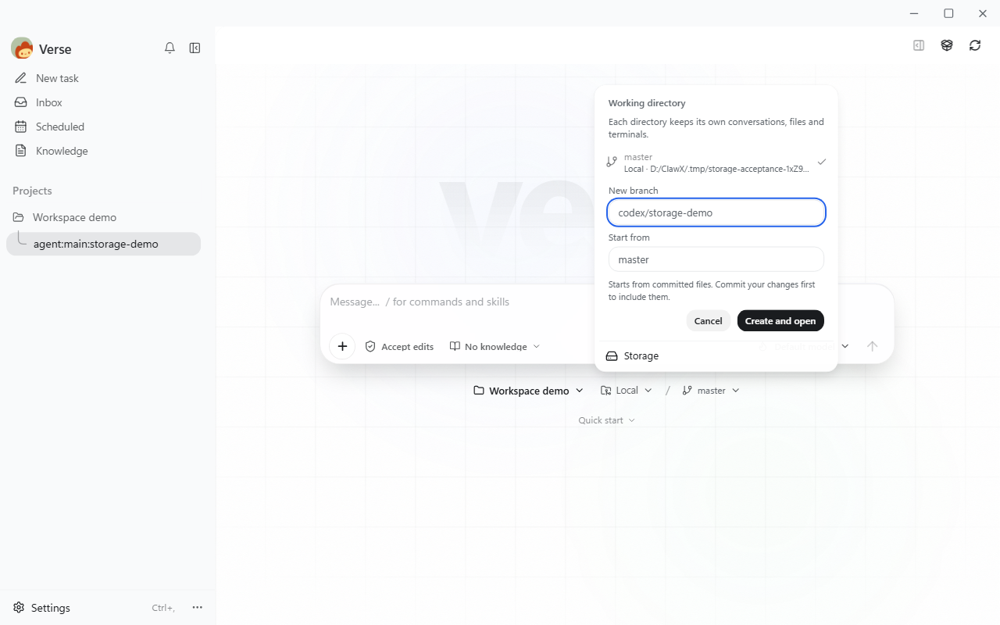
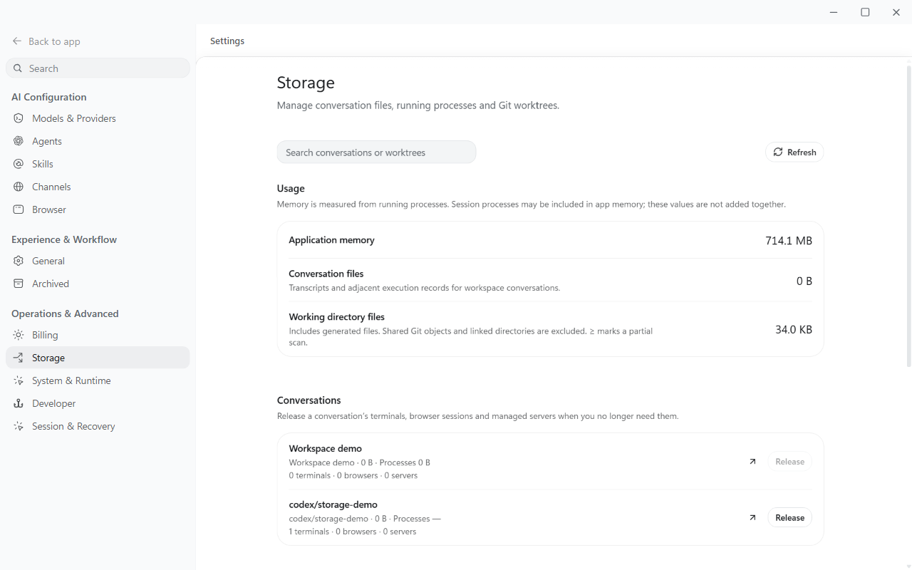
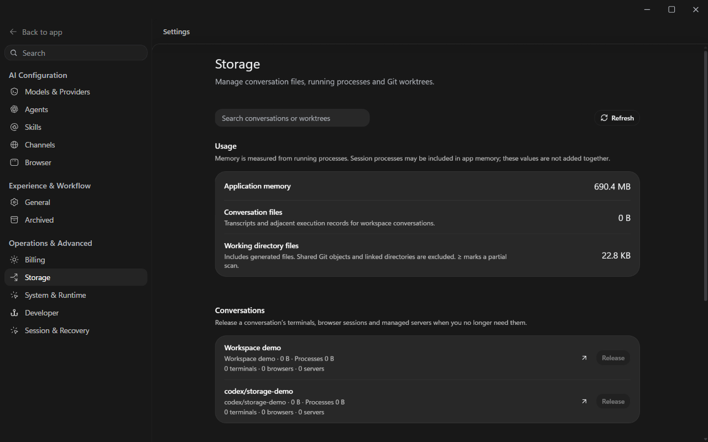
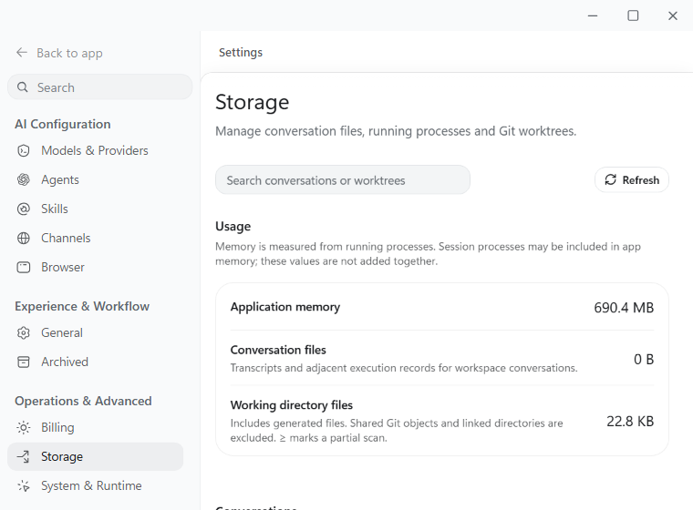
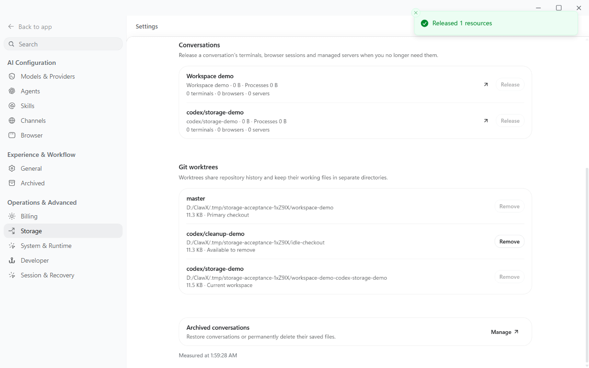
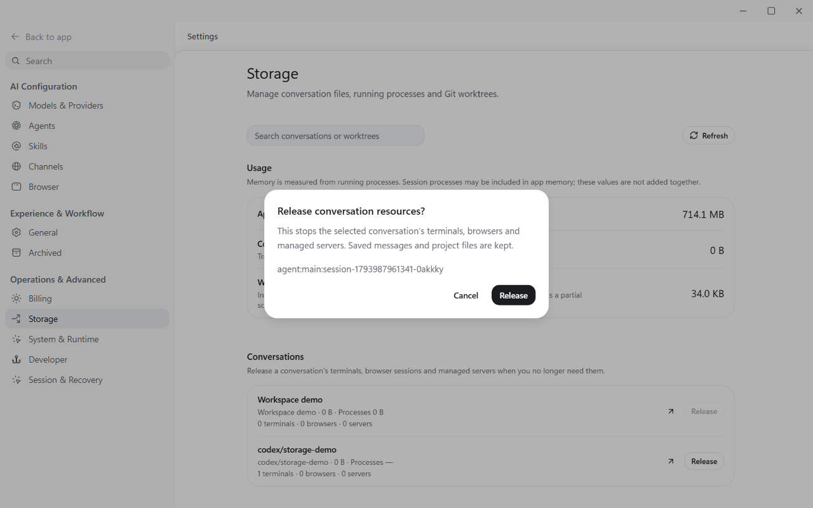
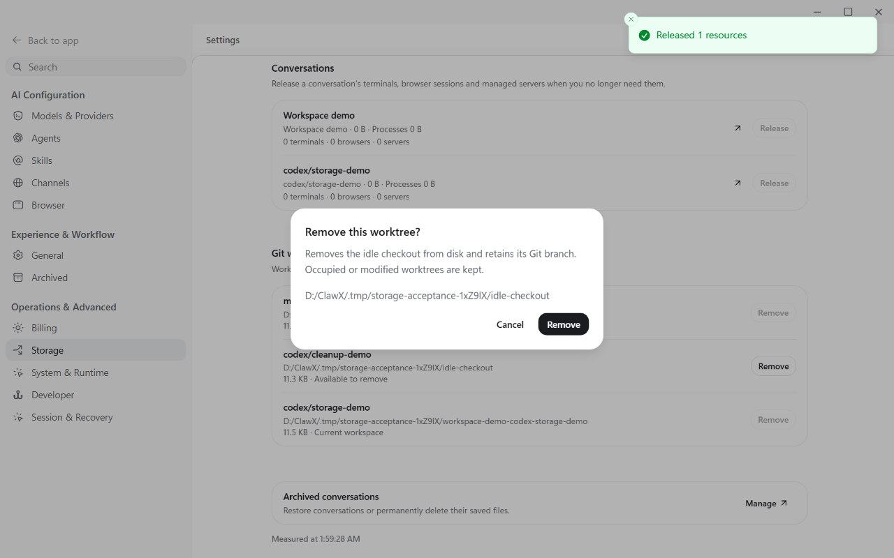

# 会话工作树与存储管理验收

结果：145 项相关测试通过，真实 Electron 流程通过。所有操作由 agent 执行。

- 建立 Git 仓库、创建工作树与独立会话，切回后恢复草稿。
- `/storage` 和设置导航进入同一资源页。
- 在真实终端启动后，通过资源页确认释放，终端列表归零。
- 在真实 Git 仓库中移除空闲工作树，验证分支继续存在。
- 浅色、深色、760×560 窄窗口与两个确认框均经截图检查。
- Electron 用例前后的源码状态一致，测试进程回收后无存活实例。

主记录为 `report.json`、`acceptance.json`、`sources.json` 和 `SHA256SUMS`。
Gateway 使用空闲响应替身；Git、Workspace、Storage、Terminal 使用真实服务。

当前全量 Node 类型检查在 `electron/services/sessions-api.ts:1929` 存在另一处会话作用域签名冲突。完整工作区 Harness 因并行改动超出本任务范围失败；明确文件范围的 Harness 检查通过。历史失败与修正原因保留在报告中。

补充全量基线：`pnpm run harness:ci` 的场景校验和 dry-run 通过，基线测试为 58 通过、1 失败。失败来自 `audit-wiring-quick-fixes.md` 和 `audit-wiring-remainder.md` 缺少 `lifecycleStatus`；后续串联门禁未执行。详见 `harness-ci.txt`。任务 TF-0821 已收口为 done/100，任务图校验及导出完成。
