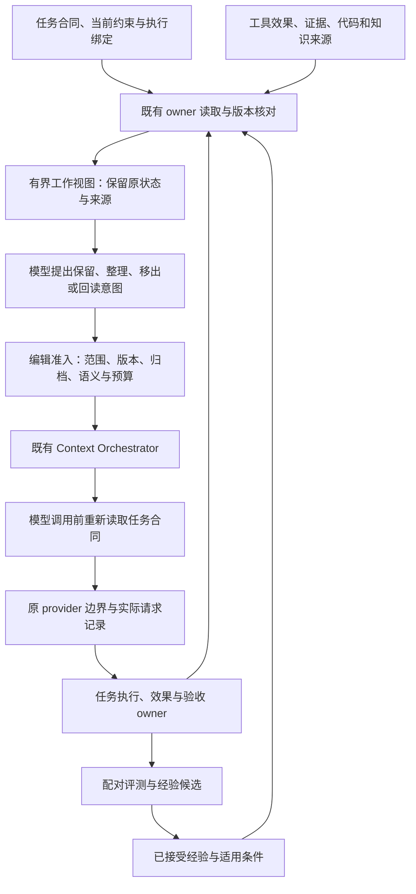

**目标：让系统总控、项目负责人和执行会话在长任务、需求修订、委派与恢复中保持正确的任务判断，并用可复算的证据选择上下文策略。**

这是设计与实施合同。用户于 2026-11-25 授权设计新上下文系统并登记 TF 节点；本轮交付设计、依赖图和验收合同。产品实现按后续叶子推进。源码调查基于 `f18b0d7ea` 及当时工作区；任务状态已通过 Task Forest CLI 回读。规划新增节点主挂 TF-0664，沿用现有自治系统的身份、存储、执行与验收职责。

**现状改变了设计的出发点。**

我们已经有持久目标恢复、语义原子、可回读引用、统一候选装配和经验治理。新系统要贯通这些能力，并让模型在受控范围内选择工作上下文；关键增量是语义状态经过各次转换仍保持原意，以及上下文决策能关联到实际请求和任务结果。

| 模块与实际入口 | 本次核对到的能力 | 新设计的复用与增量 |
|---|---|---|
| `shared/task-system/store.ts`、`runtime.ts` | TaskSystemStore 持有目标、约束、验收、revision、writer epoch、checkpoint；restoreTaskModelContext 在每次模型调用恢复合同，目标超预算会拒绝 | 合同与执行资格继续由 TaskSystem 提供；整理只能改变工作投影，不能改任务状态或验收 |
| `shared/types/task-ledger.ts`、`shared/task-ledger-working-context.ts` | Working Context 已区分 confirmed/proposed/uncertain，支持 proposal/accept/reject | 保留原状态与来源，当前任务材料经明确 TaskSystem 关联读取；旧 Working Context 桥接复用 TF-0929 |
| `shared/long-session-continuity.ts`、`electron/services/chat-api.ts` | continuity pack 包含来源、freshness、排除原因与关键遗漏；Main 检查身份和 criticalOmissions | 补齐逐项语义状态的转换证明。当前 CompressionInput 使用字符串数组，不能从字段名推断原始条目已 verified |
| `openclaw_runtime/packages/agent-core/src/harness/compaction/compression-artifact.ts` | semanticAtoms 已有 verified/unverified/stale/superseded、polarity、scope、conflicts、evidenceRefs | 复用这些字段及 owner 状态映射，覆盖否定结论、临时指令和修订链；不另造全局事实等级 |
| `openclaw_runtime/src/context-engine/context-candidate.ts`、`context-orchestrator.ts` | authority/version/digest 去重、预算和来源；已有 message_replacement 及 stale-history 拒绝 | 受控编辑产生候选，仍在同一 Orchestrator 中选择并提交；增加有界编辑意图及结果身份 |
| `openclaw_runtime/src/context-engine/tools/context-write-tool.ts`、`agents/tools/context-agent-tools.ts` | context_write 只改 notes，按需读取；已有读取、搜索、展开、折叠 | 普通 notes 行为保持；新增工具只改工作投影元数据和模型自有笔记，复用原工具和归档函数 |
| `shared/types/context-item.ts`、`context-engine/registry`、`context-engine/cvk` | ContextItem、生命周期、selector/checksum、资源视图；CRK 不拥有事实接受和权限 | 记录原文引用与显示方式，承接编辑版本与投影审计；当前注册、归档和删除 owner 继续负责持久化 |
| `context-engine/turn-injection-budget.ts`、`agents/embedded-agent-runner/extensions.ts` | 增强通道共享预算，working-memory regather 可选；该预算不是模型整个窗口 | 区分总窗口、增强注入、工具输出、推理/输出及维护预算，统一核算但保留原预算 owner |
| `agents/cross-area/cross-area-facades.ts`、`agents/resource-aware-wave-scheduler.ts` | 当前 ContextBudgetPlanner 组合波次调度，恢复会重算；已启动波次不可重排 | 新策略消费当前资源与模型能力，不能把已有 facade 当成完整 token 分配器；只影响后续未开始的调度 |
| `agents/task-loop-controller.ts`、`agents/mission-control/controller.ts`、`shared/task-system/project-coordinator.ts` | 规划、执行、repair、checkpoint、任务结束与项目接续各有 owner | 上下文提供有界证据缺口及恢复结果；重试、任务取消、完成和未知效果结算仍归原循环及效果 owner |
| `shared/types/session-effective-policy.ts`、`agents/harness/context-engine-lifecycle.ts` | effective backend 能力与 native context/compaction 协商 | 主机能控制请求才启用编辑；原生 backend 只用其声明支持的能力，不能双重压缩或虚报已应用 |
| `shared/knowledge/experience.ts`、`knowledge/sekb`、Role Memory | 经验已有 condition/action/reason、owner pin；接受、撤销、有效期与采用归因已有路径 | 在原 owner 上增加阶段/症状适配与抑制条件的消费，不把全部经验常驻，也不把检索算采用 |
| `runtime-core/memory-context.ts` | shadow/provider/proposeFacts/persist 四个遗留 Runtime Memory flag 已 retired；TF-0500 已 done | 新系统不以恢复这些 flag 或旧 self-edit adapter 为前提；使用当前允许的 Role Memory/Knowledge/SEKB 来源 |
| `context-engine/context-final-snapshot.ts`、`agents/provider-transport-fetch.ts` | 每次调用的最终上下文快照及实际传输边界记录 | 把编辑、筛选、回读、预算、实际字节和任务结果关联起来；缺少 wire 证据时只声称 projected |
| `electron/services/resource-envelope.ts`、`shared/permission-effect-contract.ts` | 容量、权限、效果在各自 owner 准入 | 整理和回读消耗原任务预算；缓存热度或上下文内容不能放行工具、释放资源或重放未知效果 |

上述“已有”指当前代码与合同存在。历史完成证据仍绑定其原候选：TF-0686 的报告记录 204 单测、2 Electron、30 组结构配对，`liveModelQuality=not-measured`；TF-0687 的治理证据另有候选。后续比较必须冻结新基线，不将这些计数移记为新系统通过。

**已有任务与文档漂移按当前图处理。**

- TF-0493、TF-0500、TF-0640、TF-0686、TF-0687、TF-0843、TF-0855/0856 已 done，复用它们的合同与成果，不重开历史。
- TF-0688 ready，承担跨目标、效果、成本的统一追溯；新解释视图依赖它。TF-0689 proposed，保留原整体验收，新上下文评测向它贡献独立证据。
- TF-0913 的会话协作中心仍在推进；TF-0929～0932 承担旧材料桥接、发布、查询和冲突处理。新系统只消费这些成果，不另建共享黑板或材料索引。
- TF-0950 正在修复会话与持久任务衔接；触及运行时接线的叶子等待该节点及当前候选集成证据。
- `reasoning-planning-convergence-gap-plan.md` 中 TF-0886～0892 的含义与 CLI 当前 RAG 节点不同；本计划不使用该旧编号解释来建立依赖。Research 消费当前 Knowledge owner 的实际读取合同，Solver/形式核验只有在真实能力可用时作为 owner 结果进入视图。
- runtime-convergence 的旧 README、STATUS 与当前 TF-0010 状态也不同；当前图将 TF-0010 标为 deprecated。本计划挂在仍在推进的 TF-0664，并继承仍适用的职责边界。

**研究经验转换成可验证的设计约束。**

| 经验来源 | 本计划采用的判断 | 检验方式 |
|---|---|---|
| CLM，arXiv `2609.37725`；模型自编辑与其失败案例 | 模型可选择投影，但预算反馈、原文恢复和实际生效要由运行时提供；能力入口与有效使用分别测量 | 编辑发生率、有效编辑率、拒绝原因、误删后检测与回读；不假设任一模型擅长自管理 |
| CompAct-Bench，arXiv `2611.25673` | 保留事实还要保留“已排除/待验证/已完成”等判断状态 | 同一环境中途压缩后继续执行；检查重复调查、错误承诺、原约束范围与剩余预算 |
| Sentry 作者复盘 | 正确经验在不适用阶段也会干扰任务 | 同一经验库比较无注入、相关触发注入、全量常驻；固定内容版本 |
| Anthropic《The components of agent memory》，2026-11-06 | 经验维护可能挤占实际工作；多个 writer 会污染共同材料 | 维护占用、无进展步骤、并发覆盖、证据原文与摘要差异 |
| Folio，arXiv `2611.16627`；缓存工程复盘 | 窗口缩小后回读、输出和缓存重算可能抵消收益 | 总任务成本和延迟包含整理、回读、失败与重试，按 backend 分层 |

这些材料决定问题和实验设计，论文中的收益不作为本项目的预期通过值。评测保存原任务环境、候选、provider/model、策略版本和输入哈希。

**选择：复用原 owner，增加模型可控的工作投影与闭环评测。**

| 路径 | 适配性 | 取舍 |
|---|---|---|
| 将整段 transcript 变成任意可写文件 | 实验快，但会混合任务合同、用户修订、工具结构和不同信任来源 | 不作为生产主线；可作为隔离研究对照 |
| 继续只调摘要提示和固定长度阈值 | 变动小，难以精确更新或撤回当前工作视图 | 作为必须保留的简单基线 |
| 原 owner 状态 + 受控工作投影 + 按需经验 + 真实结果反馈 | 兼容持久任务、自治循环和既有恢复链 | 采用；先冻结基线和纯合同，再进入显式试点 |

系统总控、项目负责人和执行会话采用同一条装配链，但关注层级不同：总控看项目状态、待决事项、跨项目依赖和资源摘要；项目负责人看计划修订、子任务与验收缺口；执行会话看当前任务合同、局部证据、已排除方案和下一步。上层只收到经原 owner 准入的引用与有界摘要，不默认复制下层 transcript。

**工作视图由四类内容组成。**

1. 必须保持的合同：当前目标、用户有效约束、验收条件、来源范围与安全要求。由对应 owner 更新；超预算沿既有拒绝语义报告，不能静默截短。
2. 当前工作状态：计划修订、已验证事实、假设、已排除方案、未决项、下一步、未结清效果。保留来源状态与时间顺序；owner 接受只证明对应接受动作，不能自动宣称独立验证。
3. 可回读材料：日志、代码、网页、schema、工具结果和旧轨迹。工作视图保存 selector/checksum/revision 与必要原文片段；删除与保留仍遵循原 owner。
4. 条件化经验：适用任务、阶段、症状、版本、反例或抑制条件、有效期与原证据。当前没有匹配证据时不强制注入；成功、失败和修订后可触发重新判断。

生命周期 state 与事实验证 status 分开：`archived` 不等于 `stale`，`active` 不等于 `verified`；`agent_approved` 不等于独立验证。复用 CompressionSemanticAtom、TaskLedgerWorkingContextTrust、ContextItem 和 SourceRef 的原字段；新增的是明确映射及转换检查。没有可靠映射时保留 `unknown` 和原来源值。

需要精确判断的目标、约束、否定结论和未结清效果，由原 owner 状态字段与必要原文直接呈现。自由摘要只用于材料导航和可压缩的支撑性观察；摘要生成模型不能给自己输出的语义保真盖章。状态字段/引用一致性可确定性验证，开放文本的任务后果由后续继续执行评测判断。

一条“暂时不用方案 A”的记录必须保留该次任务/修订的范围；不能变成所有任务都禁止 A。一条“操作超时、效果未知”的记录在 owner 对账前不能变成失败并自动重放。已撤销或 superseded 的经验不再参与新请求；历史轨迹仍保留其当时身份。

**模型使用一个受控整理入口。**

规划中的 `context_update` 使用结构化操作；真实注册只在 C06 的显式试点中发生。默认普通 notes/read/search 行为保持。

| 操作 | 可修改对象 | 生效条件 |
|---|---|---|
| `note_replace` | 模型自己维护的会话笔记 | 复用 notes owner 与现有角色/权限限制，状态仍是模型主张 |
| `keep_exact` | 已准入来源的指定片段在本工作视图中的保留方式 | selector 与版本匹配，受窗口预算约束，不提升来源信任 |
| `condense` | 非受保护的 observation/derived 投影 | 原文可回读；逐项状态、极性、约束范围与引用不改变；生成摘要有独立预算 |
| `offload` | observation/derived 在活跃视图中的正文 | 先写归档、校验可读与 checksum，再切换为索引；不删除 transcript |
| `restore` | 已存在且当前仍可读取的 handle | 通过原 scope、freshness、权限、版本与大小检查，记录实际取回范围 |

请求绑定 `operationId`、工作视图 revision、base bundle digest、scope 与来源 pins。执行上下文填入真实 task/session/generation/run/attempt/modelCall 身份；模型参数不能声明自身 writer epoch、批准状态或工具权限。基于同一版本的并发操作最多提交一个；同 operationId 同 payload 回读原结果，不同 payload 返回冲突。

成功回执区分 `accepted`、`appliedRevision`、`effectiveFromModelCall` 与 `wireObserved`。工具完成后在下一次模型调用前原子发布新视图；正在传输的请求保持不变。失败不发布半成品。回退产生新版本并引用旧投影，不倒改历史回执。

投影状态沿既有 DCS BlockStore/ContextItem 所有者保存，原文沿 transcript/archive 所有者保存；TaskSystem 只保留与任务相关的版本和证据引用。模型不能用这个入口修改任务合同、永久 Memory/Knowledge、完成状态、权限、资源占用或其他会话上下文。涉及这些变化仍走原工具与原 owner。

工作视图只保存有界元数据、笔记及引用。历史revision依原retention规则回收，仍被在途调用、任务证据或恢复点引用的版本保留；上下文整理不能删除这些来源，也不另建无限增长的编辑日志。

`message_replacement` 是已有装配入口。C06 必须明确候选冲突顺序和唯一替换结果：根据原历史摘要校验后再提交，不能靠多个候选的最后写入覆盖。工具调用及结果作为结构单元处理，保留角色、toolCallId、错误与来源标签；低信任网页或工具文本不能通过笔记提升为 system 指令。

**整理时机由任务阶段、证据缺口和资源约束共同决定。**

触发点限定为任务修订、阶段切换、较大 observation 到达、显式模型请求、已有压力事件或恢复边界。普通短任务允许连续不整理。首版不增加常驻 LLM 管理循环和后台定时器。

总预算分别记录总窗口 token、现有增强字符预算、输出/工具余量、整理调用、回读与子代理成本。6000 字符的增强预算不能当作总窗口；固定合同、bootstrap、tool schema 和 native backend 消耗均要计入对应维度。未知 usage/cost 保持 unknown，不按零计算。

缓存热度是成本信号。非紧急整理可延到自然边界；目标修订、权限撤销、源版本变化和硬溢出优先。同一版本的回读呈现保持稳定，避免重复重写大前缀。新的维护预算与停止阈值在基线阶段按任务类别预先冻结；超额时回到原有压缩/恢复路径并保留失败。

**恢复针对可检测的缺口，并测量发现不了的缺口。**

- 可检测信号：required selector 缺失、源版本改变、当前合同与快照 revision 不一致、验收要求缺乏证据、冲突未解决、重复失败超过既有阈值。
- 优先读取 task/checkpoint 与原 owner 的最小证据，再经 context_search/expand/archive_recall 回读。按任务预算限制尝试数、字节、时间和相同缺口重复读取。
- 仍缺关键证据时，通过 Task Loop/Mission 原有 control signal 报告，是否暂停副作用由原准入和执行 owner 决定。
- 对完全未被识别的误删，不能声称自动恢复。配对评测统计缺口发现率、错误恢复率、无效回读和任务后果。

**自治系统协同契约。**

| 消费方 | 需要保留的内容 | 仍由原模块决定 |
|---|---|---|
| System Agent | 项目摘要、资源事实、跨项目依赖、待决事项 | 项目调度、配额与生效配置 |
| Project Agent/TaskSystem | 当前计划与合同 revision、祖先约束、任务依赖、验收缺口 | 任务修订、领取、writer 转移、完成接受 |
| Task Loop/Mission | 当前阶段、已排除方案、repair 计数、未知效果、下一步 | 重试上限、停止/取消、恢复与效果结算 |
| Subagent/会话协作 | 有界任务包、原证据引用、未确认主张与反例 | 子会话身份、工具能力、写集与运行终态 |
| Knowledge/Role Memory/SEKB | 来源 pins、适用条件、有效期、撤销与内容版本 | 接受、删除、经验确认及持久化 |
| RSI | exposure/citation/adoption/outcome 各自身份；未解决失败及归因 | 候选生成、冻结评测、晋升与回滚；旧运行授权不可复用 |
| Resource Envelope/Permission/效果 owner | 整理和回读的实际占用、操作身份、已知终态 | 资源准入、权限、生效与资源释放 |
| UI/Observability | 本次请求采用/排除/恢复了什么、来源状态和实际成本 | 只读解释；显示状态不改变任务或权限 |

切换负责人、fork、handoff、compact、restart、task revision 改变时，重新从 owner 构造视图。新会话继承可读引用和适用约束，不继承旧 writer/lease。父 agent 只接受单层折叠结果，子 agent 自述的成功不会变成任务验收。跨会话结论冲突交给 TF-0932 的原材料/证据处理路径。

**不同 backend 的能力分别确认。**

| 路径 | 可采用行为 | 必须记录 |
|---|---|---|
| 主机拥有 messages 的 OpenClaw provider 路径 | 受控替换工作投影，再经原 transport 发送 | projected 与 wire digest、实际 tool schemas、当前模型容量 |
| backend 声明拥有 native compaction/context | 消费其原生整理/读取接口；缺少接口时只提供合同和引用 | configured/effective 能力、ignored/rejected 原因；不重复整理 |
| 外部 CLI/ACP 或模型服务不暴露请求正文 | 使用该 backend 可证实的能力，保持原 fallback | 不把主机 proposal 说成 provider 已应用；缺失 wire 数据明确 unknown |
| 多模态与不可文本化工具结果 | 由原资源 owner 保留对象及可验证引用 | 媒体边界、provider token 测量来源；不按文本字符估计精确成本 |

**评测先测任务后果，再决定是否采用。**

C01 冻结场景、数据划分、grader、模型和预算。基线来自当前 effective 配置与同一候选；四臂分别为当前机制、简单 observation masking/摘要、只启用工作投影编辑、完整条件化策略。各臂共享工具、原始输入、环境检查点和剩余行动预算。单项消融覆盖经验触发、语义状态保留、缓存边界与回读导航。

必须覆盖：长日志调试、需求中途改动、否定结论保留、临时偏好范围、已替代约束、精确 ID/数字、工具效果未知、源文件更新、经验误触发、多个任务同名、多 writer 冲突、fork/负责人换代、native backend、取消恢复、长程维护成本。

硬否决项：新增越权/跨 scope 读取，错误任务完成，未知效果自动重放，关键约束或否定状态改变，原始证据损坏，无法回退。确定性控制用例每项必须零新增失败。质量结论使用独立 grader 和任务完成结果；维护成本包含失败尝试、摘要、回读、重试、输入/输出/cache tokens、实际收费或明确估算、TTFT、wall time、峰值占用。

模型收益采用预注册配对比较及置信区间，按模型/backend/任务压力分层；成功条件优先选择“质量改善且总成本不突破预设上限”或“质量在预设非劣界内且总成本下降”。界值和统计功效在看实验结果前冻结；样本不足、未知用量和未结算调用不能补零或判 GO。模板与策略只在训练/开发切片调整，最终留出集不可用于回写经验。

借用既有 RSI 测量与归因组件时，先核对当前 spec、runbook、ledger、候选和输入身份；涉及真实 provider 的节点使用与新冻结计划/阶段/资源限额匹配的授权。脚本模型、离线回放和真实 provider 分别标识。本规划不启动这些调用，不改变旧 NO_GO/hold 或冻结默认。

**实施分为四阶段，首叶只做基线。**

下列叶子合同是稳定需求，实时状态与依赖以本地 Task Forest 为准。P0 记录本轮已完成的设计调查；C01 是本计划唯一 ready 叶，C02～C14 为 proposed。每个实现叶先建立窄 task spec，核对当前 owner/source，再运行 harness context；一次会话推进一个 ready 叶。共享源与已有任务冲突时保留现有工作，在窄 spec 中缩小写集。

共同证据字段：`driven_by: agent`、actor、task key、source commit/tree/dirty digests、baseline/candidate、input/config/policy/model 版本、命令与退出码、真实计数、原 owner 回执、产物 SHA256、首轮失败、未知与取消状态。实现叶关闭前实际回读证据，不从打印的 pass 推断完成。产品可见变化同步四语和 Electron E2E；通信变化做 comms replay/compare；源码引用以本次检查为定位，未来新增路径在窄 spec 中明确标记。

<!-- LEAF_CONTRACTS -->

| 叶键 | 阶段 | 交付 | 前置 |
|---|---|---|---|
| P0 | A | 核对自治上下文职责并完成新系统设计 | 本轮设计调查 |
| C01 | A | 冻结当前上下文基线和继续执行评测场景 | P0, TF-0493, TF-0686, TF-0687, TF-0843 |
| C02 | A | 贯通约束、假设和否定结论的语义状态 | C01, TF-0493, TF-0686, TF-0500 |
| C03 | B | 建立带版本校验的模型上下文整理操作 | C02, TF-0695 |
| C04 | B | 按任务阶段和实际成本安排上下文维护预算 | C02, TF-0679 |
| C05 | B | 发现证据缺口并完成有界回读恢复 | C03, C04, TF-0749 |
| C06 | B | 把工作视图接入唯一装配和实际模型请求 | C03, C04, C05, TF-0493, TF-0950 |
| C07 | C | 贯通任务循环、负责人换代与上下文恢复 | C06, TF-0677, TF-0678, TF-0686, TF-0950 |
| C08 | C | 按来源状态复用跨会话成果和处理冲突 | C07, TF-0919, TF-0932 |
| C09 | C | 让经验按症状、阶段和版本参与当前任务 | C06, TF-0687, TF-0855 |
| C10 | C | 从上下文失败轨迹形成可验证的策略经验 | C09, TF-0855, TF-0856 |
| C11 | C | 按实际后端能力消费上下文策略 | C06, TF-0674 |
| C12 | D | 解释每次上下文变化及其任务后果 | C07, C09, C11, TF-0688, TF-0948 |
| C13 | D | 用真实任务配对验证正确性、重复工作与总成本 | C01, C08, C10, C11, C12 |
| C14 | D | 验收长程自治恢复并形成受控采用结论 | C13, TF-0682 |

**P0 · 核对自治上下文职责并完成新系统设计**

把研究经验与当前代码、任务图和历史证据对齐，形成可独立实施的合同。

前置：本轮已完成的源码与任务图调查。

受控写集/消费点：`harness/specs/guides/autonomy-context-system-design.md`；`harness/specs/tasks/autonomy-context-system-plan.md`；`harness/specs/tasks/autonomy-context-baseline.md`；`harness/specs/rules/autonomy-context-system-contract.md`；`harness/specs/scenarios/autonomy-context-system.md`。

正向验收：
- 逐项核对 TaskSystem、Orchestrator、压缩、归档、经验、资源、backend 与会话协作的当前入口。
- 设计包含职责划分、编辑/恢复协议、条件化经验、成本度量、阶段与叶子验收。

拒绝与兼容验收：
- 旧 TF 编号解释、历史 live verdict 或结构计数不能成为新系统状态；记录实际文档漂移。
- 产品锁、冻结默认及并发源码保持原状态。

检查入口：pnpm harness validate --spec harness/specs/tasks/autonomy-context-system-plan.md --since HEAD；pnpm harness run --spec harness/specs/tasks/autonomy-context-system-plan.md --since HEAD --dry-run；仅本轮文件的 git diff --check 与规划结构检查。

证据：`源码/合同映射、当前 CLI 快照、规划检查回执、提案草案`；使用上文共同证据身份。

回退：用后续提案修订设计与新节点；保留本轮依据和既有节点历史。

**C01 · 冻结当前上下文基线和继续执行评测场景**

先回答现有系统在哪些任务失去状态或增加重复工作，建立后续策略的同条件对照。

前置：P0, TF-0493, TF-0686, TF-0687, TF-0843。

受控写集/消费点：`shared/long-session-paired-evaluation.ts`；`tests/unit/autonomy-context-paired.test.ts`；`tests/unit/fixtures/autonomy-context-baseline.json`；`harness/specs/fixtures/autonomy-context-system/baseline/`。

正向验收：
- 冻结不少于15类场景的输入、环境中途检查点、owner状态、剩余行动预算、grader与source/config摘要。
- 固定四臂、数据划分、非劣界/成本上限和统计功效判据；首轮离线回放可重复且读取真实fixture结果。

拒绝与兼容验收：
- 至少覆盖否定翻转、临时约束泛化、旧来源、未知效果、跨任务、误用经验、成本缺失等负例。
- 留出集不进入策略训练；离线/脚本模型不报告真实provider收益，失败与unknown不补零。

检查入口：现有 autonomy-context-paired 与 long-session-paired-evaluation 定向回归；基线 manifest/source/环境检查点哈希复算；autonomy-context-baseline Harness validate/dry-run。

证据：`baseline-manifest.json`、`scenario-matrix.json`、`frozen-evaluation-policy.json`、`offline-readback.json`；使用上文共同证据身份。

回退：保留原基线与首次失败；输入变化生成新版本，不覆盖旧配对记录。

**C02 · 贯通约束、假设和否定结论的语义状态**

让已有语义字段跨压缩、continuity与工作视图转换后仍保留来源和原意。

前置：C01, TF-0493, TF-0686, TF-0500。

受控写集/消费点：`shared/types/context-item.ts`；`shared/long-session-continuity.ts`；`shared/task-ledger-working-context.ts`；`openclaw_runtime/packages/agent-core/src/harness/compaction/compression-artifact.ts`。

正向验收：
- 建立原owner状态到工作投影的显式映射，保留scope、polarity、验证状态、supersedes/conflicts和逐项证据。
- 需求修订、否定结论与临时偏好的连续多次转换仍可由原文和owner复算。

拒绝与兼容验收：
- 拒绝把agent_approved、owner接受或摘要字段名提升为独立verified；未知映射保留unknown。
- 旧格式兼容读取且无破坏迁移；retired Runtime Memory flags保持不可恢复。

检查入口：CompressionArtifact/long-session continuity/working-context/retired-memory 定向回归；状态转换负例与三次连续压缩/恢复回放；schema与受影响类型检查。

证据：`semantic-state-mapping.json`、`state-preservation-cases.json`、`legacy-read-parity.json`；使用上文共同证据身份。

回退：关闭新增状态消费，回到原投影；不改签原owner记录或历史摘要。

**C03 · 建立带版本校验的模型上下文整理操作**

允许模型提出局部整理与外存意图，并在既有上下文owner内原子形成新工作视图。

前置：C02, TF-0695。

受控写集/消费点：`openclaw_runtime/src/context-engine/block-store.ts`；`openclaw_runtime/src/context-engine/registry/context-item-registry.ts`；`openclaw_runtime/src/context-engine/context-candidate.ts`；`openclaw_runtime/src/agents/tools/context-agent-tools.ts`。

正向验收：
- 实现context_update的note_replace/keep_exact/condense/offload/restore纯合同与owner执行；operationId幂等、revision/digest CAS。
- offload先归档回读校验，编辑失败不半发布；成功回执含appliedRevision与预期生效调用，撤回保留版本史。

拒绝与兼容验收：
- 拒绝编辑任务合同、其他会话、持久接受事实、权限和完成状态；跨scope/陈旧pin/同ID异参/工具配对破坏均失败。
- C06之前不默认注册生产工具；flag-off与原notes/read/search字节和副作用一致。

检查入口：context write/read/folding/archive 生产函数定向回归；并发CAS、半写失败、重启后operationId与原文完整性；权限/工具schema合同与默认关闭检查。

证据：`context-edit-contract.json`、`atomicity-and-scope.json`、`archive-readback.json`、`off-parity.json`；使用上文共同证据身份。

回退：停止新编辑入口，原历史和归档保持；以新revision恢复上一工作投影。

**C04 · 按任务阶段和实际成本安排上下文维护预算**

把整理、回读、缓存重算和输出余量计入当前任务资源，避免维护工作挤占执行。

前置：C02, TF-0679。

受控写集/消费点：`openclaw_runtime/src/context-engine/turn-injection-budget.ts`；`openclaw_runtime/src/agents/loop-context-pack.ts`；`openclaw_runtime/src/agents/embedded-agent-runner/prompt-cache-observability.ts`；`openclaw_runtime/src/agents/resource-aware-wave-scheduler.ts`。

正向验收：
- 区分整个窗口与增强通道预算；合同、工具schema、输出余量及维护成本来自实际effective能力和原账本。
- 在任务修订/阶段切换/压力/恢复边界进行有界决策；正常短任务可不整理，已开始波次保持不变。

拒绝与兼容验收：
- 未知usage/cost不计零；不为缓存延迟权限撤销或目标修订；无常驻LLM管理循环。
- 同内容恢复避免反复重写前缀；超维护预算回退原策略并保留费用和失败。

检查入口：turn-injection-budget/loop-context-pack/prompt-cache/resource-wave 定向回归；热缓存、硬溢出、模型切换、恢复重算与unknown用量负例。

证据：`budget-ledger.json`、`maintenance-decisions.json`、`cache-cost-observations.json`；使用上文共同证据身份。

回退：停用新维护策略，继续原预算与compaction；保留诊断，不重排已启动任务。

**C05 · 发现证据缺口并完成有界回读恢复**

将来源失效、缺失selector和任务修订等可检测缺口转成最小回读，评测未发现的误删。

前置：C03, C04, TF-0749。

受控写集/消费点：`openclaw_runtime/src/context-engine/cvk/recovery.ts`；`openclaw_runtime/src/context-engine/context-folding/expand.ts`；`openclaw_runtime/src/agents/tools/context-agent-tools.ts`；`openclaw_runtime/src/agents/long-conversation-control-signals.ts`。

正向验收：
- 缺口绑定任务/来源/版本；按最小selector回读，经原权限和checksum检查后形成可观测结果。
- 重复缺口去重且共享次数/字节/时间预算；返回无法解决的缺口供既有控制循环决定下一步。

拒绝与兼容验收：
- 损坏/撤销/跨scope/过期handle不回填旧内容；有归档不自动声称已恢复。
- 回读不授予写权限或重放未知效果；不可检测误删单列漏检，不伪造全覆盖。

检查入口：archive recall/context expand/CRK recovery生产路径定向回归；缺口发现率、错误恢复、重复读取与预算耗尽场景。

证据：`gap-detection.json`、`recall-receipts.json`、`unresolved-gaps.json`；使用上文共同证据身份。

回退：回到显式搜索/回读入口，停用自动检测触发；保留原handle和缺口记录。

**C06 · 把工作视图接入唯一装配和实际模型请求**

证明模型编辑在下一次调用实际生效，并与任务合同后置恢复和最终预算一致。

前置：C03, C04, C05, TF-0493, TF-0950。

受控写集/消费点：`openclaw_runtime/src/context-engine/context-orchestrator.ts`；`openclaw_runtime/src/context-engine/context-candidate.ts`；`openclaw_runtime/src/agents/embedded-agent-runner/extensions.ts`；`openclaw_runtime/src/agents/embedded-agent-runner/run/attempt.ts`；`openclaw_runtime/src/agents/provider-transport-fetch.ts`；`shared/task-system/runtime.ts`。

正向验收：
- 在显式试点注册context_update，按调用边界提交唯一replacement并重新读取当前TaskSystem合同。
- 连接operation/revision/source pins/ContextBundle/modelCall与最终wire摘要；计入所有后置贡献。

拒绝与兼容验收：
- 迟到编辑、多个replacement冲突、目标revision变化、generation/epoch失效在发送前拒绝或按既有规则回退。
- projected不冒充wireObserved；关闭试点保持prompt顺序/工具/审批/错误/重试字节及副作用一致。

检查入口：context-assembly-authority/provider guard/durable-task-runtime定向回归；真实本地runtime与脚本provider的多工具循环及请求截获；contract、comms replay/compare、受影响类型与Harness。

证据：`model-call-chain.json`、`wire-readback.json`、`task-contract-budget.json`、`off-parity.json`；使用上文共同证据身份。

回退：关闭编辑消费和工具注册，沿原Orchestrator/合同恢复执行；保留当前task与原历史。

**C07 · 贯通任务循环、负责人换代与上下文恢复**

让自治执行在修订、停止、委派、故障和接力后继续持有正确状态及未结清事项。

前置：C06, TF-0677, TF-0678, TF-0686, TF-0950。

受控写集/消费点：`shared/task-system/runtime.ts`；`shared/task-system/project-coordinator.ts`；`openclaw_runtime/src/agents/task-loop-controller.ts`；`openclaw_runtime/src/agents/mission-control/controller.ts`；`electron/services/chat-api.ts`。

正向验收：
- TaskLoop/Mission/Project各阶段消费同一scope和来源版本；新负责人按新generation/epoch从原owner重建。
- 保留已排除方案、repair计数、未决项、未知效果及下一步；按原控制信号结束、恢复或等待对账。

拒绝与兼容验收：
- 旧run或旧编辑不能覆盖新会话；fork不继承writer；超时不变成无效果重试。
- 上下文整理不推进Task done、解除lease或跳过验收；基线控制与取消优先。

检查入口：durable-task context/artifacts/project-loop/Mission控制定向回归；独立进程重启、迟到结果、取消与交接实跑；受影响Electron旅程、contract/comms与Harness。

证据：`autonomy-lifecycle-matrix.json`、`resume-owner-readback.json`、`unknown-effect-control.json`；使用上文共同证据身份。

回退：停用新工作视图消费，使用现有TaskSystem合同/checkpoint；保留执行资格和未结算效果。

**C08 · 按来源状态复用跨会话成果和处理冲突**

消费会话协作中心已有材料，让共享结论以正确scope和可信状态进入工作视图。

前置：C07, TF-0919, TF-0932。

受控写集/消费点：`openclaw_runtime/src/agents/orchestration-blackboard.ts`；`openclaw_runtime/src/agents/orchestration-runtime-blackboard.ts`；`openclaw_runtime/src/agents/tools/context-agent-tools.ts`；`shared/types/context-folding.ts`。

正向验收：
- 复用TF-0929至0932的桥接/发布/检索/冲突结果，只添加上下文选择消费者。
- 父会话接收有界结果、未验证主张、反例与证据；原来源撤销或更新后重新准入。

拒绝与兼容验收：
- 同名任务、跨workspace、旧generation、缺失来源、重复delivery和并发覆盖不得伪装为一致结论。
- 不新建共享材料数据库，不复制完整child transcript，不把worker自述当验收。

检查入口：session-collaboration C1-C4与fold-result生产路径定向回归；双会话冲突、撤销传播、worker部分失败与窄屏复用入口旅程。

证据：`shared-material-projection.json`、`conflict-and-revocation.json`、`fold-parent-readback.json`；使用上文共同证据身份。

回退：停止新自动复用，保留原材料查询与全部owner条目；不删除其他会话数据。

**C09 · 让经验按症状、阶段和版本参与当前任务**

减少正确但不适用的经验对当前任务的干扰，保留经验的条件和反例。

前置：C06, TF-0687, TF-0855。

受控写集/消费点：`shared/knowledge/experience.ts`；`openclaw_runtime/src/knowledge/sekb/experience-block-bridge.ts`；`openclaw_runtime/src/agents/embedded-agent-runner/sekb-runtime.ts`；`openclaw_runtime/src/context-engine/context-orchestrator.ts`。

正向验收：
- 用当前owner确认的condition/action/reason、scope、版本与有效期筛选；记录匹配、抑制和未选原因。
- 同一经验库实现无注入/条件触发/全量常驻对照；保留成功经验、失败经验和适用边界。

拒绝与兼容验收：
- 撤销/替代/过期原则不能从缓存继续进入请求；临时要求不升级长期规则。
- 不恢复退休Runtime Memory，不启用SEKB自动写回，不把检索/citation当adoption或收益。

检查入口：experience owner admission/M2 governance/SEKB attribution定向回归；版本变化、误触发、相反阶段、无症状与有效反例配对。

证据：`experience-selection.json`、`versioned-exposure.json`、`irrelevant-experience-controls.json`；使用上文共同证据身份。

回退：关闭新增筛选消费，返回当前已接受来源的原策略；保留历史采用和撤销记录。

**C10 · 从上下文失败轨迹形成可验证的策略经验**

用成功/失败配对和原证据改进整理策略，使经验可修订、可撤销、可归因。

前置：C09, TF-0855, TF-0856。

受控写集/消费点：`openclaw_runtime/src/knowledge/sekb/`；`scripts/lib/rsi-candidate-evolution.mjs`；`scripts/rsi-adoption-export.mjs`；`harness/specs/fixtures/autonomy-context-system/policy-learning/`。

正向验收：
- 按同任务输入与环境比较轨迹，生成有条件/反例/来源的candidate；接受和版本变更交给原经验owner。
- 记录exposure/citation/adoption/任务grade分离；策略只在训练/开发验证切片选择，最终留出封存到C13；撤销可复算。

拒绝与兼容验收：
- 测试泄漏、模型自证、只提高自评、旧授权复用或未知调用重试均不能晋升。
- 不改原RSI NO_GO/hold，不新增后台自动演进；真实调用先核对最新权威状态与新冻结授权。

检查入口：RSI attribution/candidate evolution复用检查；污染控制、相同版本重复归因、超预算与首次失败保留。

证据：`paired-failure-analysis.json`、`strategy-candidate-lineage.json`、`validation-decision.json`；使用上文共同证据身份。

回退：撤销本次策略版本并回到已接受基线；保留候选、测量和未结算调用身份。

**C11 · 按实际后端能力消费上下文策略**

区分主机可编辑请求、原生compaction与不透明backend，避免重复整理和能力误报。

前置：C06, TF-0674。

受控写集/消费点：`shared/types/session-effective-policy.ts`；`openclaw_runtime/src/agents/harness/context-engine-lifecycle.ts`；`openclaw_runtime/src/context-engine/registry.ts`；`openclaw_runtime/src/context-engine/context-orchestrator.ts`。

正向验收：
- 逐backend声明并验证effective能力，原生owner接管时仅消费其支持接口。
- 模型切换、能力代次变化和多模态材料均重算预算和可用操作，记录ignored/unsupported原因。

拒绝与兼容验收：
- 缺失wire/usage不报已应用或零成本；不凭模型名称推断native能力。
- 不同时运行两个compaction owner；损坏插件走现有隔离/fallback，不扩大权限。

检查入口：native-context negotiation/context registry quarantine/effective policy定向回归；主机、原生、不透明、降级与多模态能力矩阵。

证据：`backend-capability-matrix.json`、`effective-application-receipts.json`、`degradation-cases.json`；使用上文共同证据身份。

回退：按backend关闭新策略，保留其原生能力及原fallback，冻结默认不变。

**C12 · 解释每次上下文变化及其任务后果**

让用户与agent能够定位内容为何保留、删除、回读，以及这些决策是否帮助任务。

前置：C07, C09, C11, TF-0688, TF-0948。

受控写集/消费点：`openclaw_runtime/src/context-engine/context-final-snapshot.ts`；`shared/types/context-display.ts`；`shared/task-system/trace.ts`；`electron/services/usage-api.ts`；`src/components/chat/`。

正向验收：
- 通过既有Host API/trace呈现原来源状态、编辑版本、投影与wire身份、预算和实际usage。
- 从具体失败回查当次上下文决策、原证据与任务修订；重复请求不重复计费。

拒绝与兼容验收：
- history/estimated/unknown/stale分开，缺失wire不显示使用成功；摘要不能显示为已核实事实。
- 不新增原文/秘密日志、trace数据库或高频轮询，不从界面修改任务或权限。

检查入口：context display/trace-cost/Host API定向回归；四语、明暗、窄屏、键盘、迟到响应与实际provider计量Electron旅程。

证据：`decision-to-task-trace.json`、`display-identity-matrix.json`、`electron-journeys.json`；使用上文共同证据身份。

回退：保留原上下文详情和任务追溯，关闭新增解释字段；保留原owner记录。

**C13 · 用真实任务配对验证正确性、重复工作与总成本**

在相同候选和环境下检验完整策略与各简单基线，得到可复算采用结论。

前置：C01, C08, C10, C11, C12。

受控写集/消费点：`shared/long-session-paired-evaluation.ts`；`scripts/context-folding-real-task-eval.mjs`；`scripts/context-inline-spill-benefit-loop-eval.mts`；`harness/specs/fixtures/autonomy-context-system/paired-evaluation/`。

正向验收：
- 同一任务在中途检查点后继续，四臂相同工具/模型/预算；按C01冻结grader、统计方法、模型/backend与压力分层。
- 报告完成率、状态保真、重复工作、错误经验、检测/恢复率和含全部维护失败的成本/延迟；每臂原始结果可复算。

拒绝与兼容验收：
- 结构回放不能代替模型自主行为；新候选/数据/授权不能借旧收据；未结算调用保留unknown。
- 越权、假完成、未知效果重放、关键状态扭曲或回退失败任一新增即NO_GO；结果不足不能报收益通过。

检查入口：已冻结baseline与各arm实际执行、独立grader和负控制；功效/置信区间、全成本账本、失败保留及人工标签为agent驱动等价物。

证据：`paired-task-results.json`、`full-cost-ledger.json`、`ablation-report.json`、`adoption-verdict.json`；使用上文共同证据身份。

回退：保留全部运行和负例；NO_GO时关闭策略，不改变原系统默认与历史结论。

**C14 · 验收长程自治恢复并形成受控采用结论**

验证持续自治下的资源、版本与恢复边界，依据真实收益决定保留、调整或停用策略。

前置：C13, TF-0682。

受控写集/消费点：`harness/specs/fixtures/autonomy-context-system/long-run/`；`docs/modules/context-and-memory.md`；`docs/modules/multi-agent-and-tasks.md`；`docs/modules/resources-and-observability.md`；`README.md`；`README.zh-CN.md`；`README.ja-JP.md`；`README.ru-RU.md`。

正向验收：
- 冻结候选上执行长程修订、委派、取消、崩溃、经验撤销和backend切换，检查队列、存储增长与资源释放回执。
- 独立验收回读同候选所有证据，形成keep/tune/disable建议和明确适用范围；产品文档反映实际行为。

拒绝与兼容验收：
- 保留dirty/未推送成果及未知效果；不以进程退出或模型文字宣称业务完成。
- 冻结默认、发布、公开与重大范围决策仍由原授权流程处理，验收不自动翻产品锁。

检查入口：长程混合故障与关闭回退实跑；同候选独立Verifier、资源/retention/版本身份复算、四语及相关完整门禁。

证据：`long-run-report.json`、`recovery-and-retention.json`、`independent-verdict.json`、`controlled-adoption-decision.json`；使用上文共同证据身份。

回退：按已验关闭新策略并恢复原流程；原历史、来源、任务与失败证据保留。

**C01 实施入口。**

当前机制的继续执行基线使用 `tests/unit/autonomy-context-baseline.test.ts`，新版固定输入为 `tests/unit/fixtures/autonomy-context-baseline.v2.json`。复用生产 owner 与 Main 适配器，实际读取文件与事件结果；具体数据划分、预算和预注册规则位于 `harness/specs/fixtures/autonomy-context-system/baseline/v1/`。旧30组文本配对继续作为结构回归保留。最终留出切片封存到后续评测，工作投影与条件化策略保持 planned。
