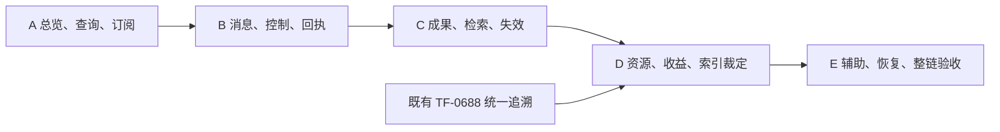

# 会话协作中心规划

本计划把用户要求的会话间信息共享落实为一个共用模块。目标是让用户和 agent 直接查看其他会话正在处理的任务、实际动作、消息结果、可复用结论和资源归属。实施分为五个阶段、二十五个执行或决策叶；本地 Task Forest 记录当前状态和正式依赖。

本计划基于 2026-11-24 的源码核对及 Codex/Claude Code 官方资料。规划文档是后续实施合同；当前行为仍以已有源码入口和具名验收为准。

## 设计决定

1. 扩展 SessionActivity 的批量读模型，TaskSystem 与各运行/资源 owner 保持写入权威。
2. 在现有系统总控与项目/Workspace Agents 入口挂接一个共用协作模块，保留独立 worker 阅读页。
3. 会话发现、只读详情与发送优先扩展现有工具；有条件等待补最小订阅原语。
4. 当前 sessions.steer 继续明确中断后发送；同一运行追加输入消费已有 guide 机制。
5. 共享材料使用任务上下文与证据引用，完整历史按需读取；旧 WorkingContext 桥接需要单独核对。
6. 模型费用按唯一调用/attempt 归因，session/task/host 统计范围与 held/spent 分开。
7. 索引先由 D5 基于消费者与实测复核；本计划不直接实施索引或多机 SessionStore。
8. 每个实施会话只推进一个就绪叶；同候选验收使用 agent 驱动路径与真实来源回执。

本周期覆盖本机已配置、现有授权可读的项目/工作区及 OpenClaw 会话。跨主机执行、外部 Codex/Claude 会话适配和产品默认值变化分别形成后续决策。外部来源适配必须区分 Codex 会话树根 ID 与 ClawX 物理 generation，复用公开 API/CLI 和明确来源身份。

## 权威与模块边界

| 信息 | 写入/接受 owner | 协作模块读取内容 |
| --- | --- | --- |
| 会话、运行与来源 | session store / 原运行 registry | sessionKey、generation、runId、fork/spawn/handoff |
| 任务目标、领取与验收 | TaskSystemStore | task owner、revision、epoch、checkpoint、evidence |
| 跨 owner 展示 | SessionActivity | scope、availability、capturedAt、只读摘要 |
| 消息投递 | 现有 sessions_send / sendWorker / intervention 路径 | messageId、payload digest、接受/排队/送达/回复 |
| 进程、终端、端口与预算 | 各 supervisor / terminal / tracker / provider owner | 进程树、样本时间、held/spent、waiters |
| 成果材料与采用 | Task context / 既有材料与经验 owner | source ref、版本/哈希、有效性、实际消费 run |

Runtime/Gateway 提供会话、任务、消息和运行事件的共用查询；Main 补桌面终端、Git 与本地资源投影。Renderer 通过 typed host-api 的 host:invoke 调用 Main；Main 持有 Gateway WebSocket。投影数据不授予控制权，也不创建第二份任务、会话或资源状态。

来源锚点包括 shared/types/session-activity.ts、electron/services/session-activity-api.ts、src/stores/session-activity.ts、openclaw_runtime/src/gateway/server-methods/session-activity.ts、shared/task-system/types.ts、shared/task-system/trace.ts、shared/task-system/runtime.ts、electron/services/usage-api.ts、shared/long-session-resource-reclamation.ts、openclaw_runtime/src/agents/tools/sessions-list-tool.ts、sessions-send-tool.ts、sessions-history-tool.ts 和 sessions.run-control.ts。进入每叶前重新读取相关 owner 及其当前合同。

## 读取、消息和成果合同

会话引用携带既有 workspace/project 映射、agent、sessionKey、物理 generation；运行使用 ScopedRunId。任务引用标明 owner、taskNodeId、revision/epoch，执行根从现有 execution-domain/checkout owner 读取。一个会话可处理不同任务，一个任务可由多个只读观察会话引用；列表关联不推导真实父子关系。

总览返回有界的目标、当前动作、任务引用、真实状态、最近成果入口、资源摘要、来源时间与 availability。详情按需读取；empty、unavailable、stale、unknown 分别表达。当前动作优先从原始轨迹/工具事件投影，不为普通刷新调用摘要模型。

消息用途与执行动作分别编码。消息信封包含稳定意图 ID 与内容摘要、源/目标身份和代次、replyTo、任务/证据引用、用途及有效条件。接受、入队、交给 agent、回复、拒绝、过期和未知各自读取原 owner 回执。内容改动产生新意图，同 ID 异 payload 拒绝；未知结果先核实，不盲目发送替代请求。

订阅携带目标身份、generation、条件、游标、取消/时限。run 终态、会话空闲和任务验收通过是三个不同事件。重连补读原 owner 状态后重订阅，同事件只通知一次。消息仍保持 inter_session 来源，不能替接收者改变权限或替任务 owner 完成任务。

共享材料常驻相关摘要和引用，任务上下文与原证据按需读取，完整 transcript 使用历史入口。条目区分 fact/claim/decision/artifact/conflict/handoff，保存来源 run、任务 revision、内容/产物哈希、敏感性、时间与适用条件。过期、替代、撤销、冲突和缺失状态可回读；旧 WorkingContext 只在确认桥接后消费。

资源总览分开会话累计、task subtree、唯一模型调用、进程样本和 host/project/session 预算。按调用/attempt 或进程/owner 去重，held 与 spent 不相加，未测量的共享进程保留 shared/unknown。额外摘要和协作 turn 标记 coordination，检索候选、展示、引用和实际采用分别记录。

## 用户阅读与操作路径

系统总控入口增加会话协作视图；项目/工作区视图带明确范围进入同一模块。现有 WorkspaceAgentsPanel 和 worker 独立页继续作为详情消费者。采用“总览→选中会话→消息/成果/资源详情”的渐进阅读，避免让全部技术字段占据列表。

| 视图 | 常见问题 | 默认内容 | 下钻动作 |
| --- | --- | --- | --- |
| 会话总览 | 谁在做什么、为什么等待 | 目标、实际动作、状态、来源关系、资源摘要 | 原会话、任务合同与 worker 历史 |
| 消息 | 请求到哪一步、谁回复 | 用途、源/目标、接受/送达/回复状态 | 原回执、回复与证据 |
| 成果 | 谁已有结论、适用哪个版本 | 事实/主张/决策/产物摘要及有效状态 | task revision、原文件/哈希和实际使用 |
| 资源 | 消耗多少、哪里争用 | token/费用、协调开销、进程与预算范围 | 唯一调用、阶段时长、owner 样本 |

复用现有 design token、字体和中性色。所有新文案覆盖 en/zh/ja/ru；状态带文字/图标，键盘焦点可见，异步更新不移焦点，通知用单一有语境的状态描述，避免每个计数争抢 live region。保留筛选、选中、草稿和滚动位置，宽窄/Light/Dark/reduced-motion 由 Electron 旅程检查。渐进阅读沿用仓库会话 UI 合同；ui-ux-pro-max 的有效检索用于实时状态、焦点及避免重复输入。

## 既有节点复用

| 当前节点 | 承接关系 |
| --- | --- |
| TF-0664 | 本模块主父目标；新阶段不改既有任务完成标准 |
| TF-0673、TF-0843、TF-0864 | 身份、强任务、执行域与检出实例前置 |
| TF-0656、TF-0908 | 已有项目/会话导航与连续性控件的消费 |
| TF-0687、TF-0891 | 现有经验接受/撤销和实际采用归因的消费 |
| TF-0688 | 统一追溯底座仍由原节点交付；D1 直接依赖并消费 |
| TF-0837、TF-0865 | 原自适应资源与 writer/lease 准入的消费 |
| TF-0866 | 原执行环境迁移与恢复的消费 |
| TF-0647 | B1 历史索引决定；D5 依据新证据单独复核 |

本周期的根节点主挂 TF-0664，并向 TF-0862 的可靠并发协作及 TF-0669 的复用/追溯目标贡献。TF-0010 已 deprecated，旧收敛入口不用于新立项。TF-0910/TF-0911/TF-0912 等在做节点的进程、工作树、写集与证据保持；实施时再核对共享文件归属。

## 阶段与关键路径

每个实施会话只推进一个就绪叶。A1 先接身份和 owner 合同，后续叶按声明顺序串行；外部未完成前置只阻止相应消费者。本轮不启动这些实现任务。

| 阶段 | 交付 | 退出条件 |
| --- | --- | --- |
| A 接通跨会话总览、查询与事件等待 | 让 UI 和 agent 从同一份有来源的投影知道其他会话的目标、动作、状态和资源入口。 | A1–A5 按各自合同完成并回读 |
| B 建立可靠消息和明确的会话控制 | 让消息接受、送达、回复与运行控制可分别核实，重启和重复请求能够恢复。 | B1–B5 按各自合同完成并回读 |
| C 让任务结论、上下文和证据跨会话复用 | 把已有任务材料变成按需可发现、版本可核对的共享成果。 | C1–C5 按各自合同完成并回读 |
| D 统一资源归因并量化协作收益 | 准确查看模型、进程、预算与协调开销，用配对证据决定优化与索引需求。 | D1–D5 按各自合同完成并回读 |
| E 接齐协作辅助、恢复和整链验收 | 消费已有任务与资源 owner 的事实，验证完整协作场景、越界拒绝和交付质量。 | E1–E5 按各自合同完成并回读 |

## 二十五个实施或决策叶

### A1 统一跨会话身份和活动读取合同

目的：把逻辑会话、物理代次、运行、任务和执行域绑定到现有 owner，避免跨会话读取串线。

前置：TF-0673、TF-0843、TF-0864。职责复杂度：high。窄实施规范：harness/specs/tasks/session-collaboration-identity-read-model.md。

写集/消费者：shared/types/session-activity.ts；openclaw_runtime/src/gateway/server-methods/session-activity.ts；electron/services/session-activity-api.ts；shared/host-api/contract.ts；src/lib/host-api.ts。实现前标“拟新增”的路径由该叶建立；已有路径先核对 owner 与在做工作。

验收：

- 两独立会话与一个子代理保留各自 workspace/project/sessionKey/generation/run/task owner 身份，并能从原 owner 回读。
- 同 key 跨工作区、旧 generation、旧绑定 revision、来源缺失和读取期间 reset 均返回对应 unavailable/stale/unknown；不回退到当前会话。
- 查询不修改任务、会话、模型配置或资源 owner；前后 owner 状态与现有准入不变。
- Host 使用 typed host:invoke，Main 保持 Gateway WebSocket owner；新增合同通过 contract 检查与定向类型检查。

检查入口：tests/unit/session-collaboration-identity.test.ts；tests/unit/session-activity-store-scope.test.ts；tests/unit/session-family-read-model.test.ts。新文件测试在对应实现叶建立；继承必要的类型、contract/comms 和 Harness 检查。精选证据落 harness/specs/fixtures/session-collaboration-center/A1/，记录输入、原事件、命令/退出/计数、源/候选/产物哈希、来源状态与 actor；原始跑次走 D:/tmp。

失败与回退：撤回本叶新增字段与投影调用，继续使用既有单会话 activity 入口；原 owner 数据保留。

### A2 扩展会话发现与共用详情查询

目的：按目标、会话和工作区发现相关工作，并让 UI 与模型工具获得一致的轻量摘要。

前置：A1。职责复杂度：medium。窄实施规范：harness/specs/tasks/session-collaboration-a2.md（实施前建立）。

写集/消费者：openclaw_runtime/src/agents/tools/sessions-list-tool.ts；openclaw_runtime/src/agents/tools/session-status-tool.ts；electron/services/session-activity-api.ts；src/lib/session-read-model.ts；shared/host-api/contract.ts。实现前标“拟新增”的路径由该叶建立；已有路径先核对 owner 与在做工作。

验收：

- 现有 sessions_list 与只读 session_status 可取得目标、任务引用、实际动作、状态、来源和详细查询入口。
- 分页、过滤、字段选择和详情加载有明确界限；列表查询不扫描全部会话完整 transcript。
- UI 与 agent 对同一请求得到一致身份与事实；受现有 sessions visibility/A2A/工作区读取策略约束。
- 空任务、不可读取、过期观测和真实空闲分别表达；跨项目发现不隐式切换活动工作区。

检查入口：tests/unit/session-collaboration-query.test.ts；tests/unit/session-summary-bounded-read.test.ts。新文件测试在对应实现叶建立；继承必要的类型、contract/comms 和 Harness 检查。精选证据落 harness/specs/fixtures/session-collaboration-center/A2/，记录输入、原事件、命令/退出/计数、源/候选/产物哈希、来源状态与 actor；原始跑次走 D:/tmp。

失败与回退：关闭聚合字段消费后回到现有 sessions_list/history/status；不迁移或清空原会话。

### A3 订阅运行终态和任务回执并支持重连

目的：等待真实事件时停止重复询问模型，连接恢复后能核对缺口。

前置：A2。职责复杂度：high。窄实施规范：harness/specs/tasks/session-collaboration-a3.md（实施前建立）。

写集/消费者：openclaw_runtime/src/agents/tools/sessions-watch-tool.ts（拟新增）；openclaw_runtime/src/gateway/server-methods/session-activity.ts；shared/host-api/contract.ts；electron/services/session-activity-api.ts；src/stores/session-activity.ts。实现前标“拟新增”的路径由该叶建立；已有路径先核对 owner 与在做工作。

验收：

- 按目标 generation、事件游标和明确条件等待 run 终态、任务验收回执或阻塞变化；闲置与任务完成分别返回。
- 订阅超时、取消、断线、重连、重复事件和目标换代有可回读状态；重连按 owner 事实补读后重新订阅。
- 重复投递只产生一次有效通知，失去来源时保留 unknown/stale；窗口卸载后监听资源释放。
- 被动等待及 UI 刷新在目标会话的模型调用数为 0；语义通知只在已有授权和预算内交给接收者。

检查入口：tests/unit/session-collaboration-watch.test.ts；tests/e2e/session-collaboration-watch.spec.ts。新文件测试在对应实现叶建立；继承必要的类型、contract/comms 和 Harness 检查。精选证据落 harness/specs/fixtures/session-collaboration-center/A3/，记录输入、原事件、命令/退出/计数、源/候选/产物哈希、来源状态与 actor；原始跑次走 D:/tmp。

失败与回退：取消本叶订阅并返回既有按需状态读取；保留已提交消息和任务回执，未知操作不重放。

### A4 在系统与项目入口呈现会话协作总览

目的：提供专门的协作模块，并复用现有会话阅读、worker 详情和项目导航。

前置：A3、TF-0656。职责复杂度：high。窄实施规范：harness/specs/tasks/session-collaboration-a4.md（实施前建立）。

写集/消费者：src/components/agents/SessionCollaborationPanel.tsx（拟新增）；src/components/agents/SystemPortfolioPanel.tsx；src/components/file-preview/WorkspaceAgentsPanel.tsx；src/components/file-preview/WorkspaceSubagentPanel.tsx；shared/i18n/locales/**/agents.json；src/styles/globals.css。实现前标“拟新增”的路径由该叶建立；已有路径先核对 owner 与在做工作。

验收：

- 系统总控与项目/工作区入口消费同一协作模块；独立会话和子代理都可见，真实关系保持可追溯。
- 每行显示目标、当前实际动作、状态、最近结果与资源摘要；展开后可打开原会话、worker 历史和任务回执。
- 后台变化保留筛选、选中、草稿、滚动与键盘焦点；状态不依赖颜色，不自动切换当前会话。
- 完成 en/zh/ja/ru、Light/Dark、390/960/1440 宽度、键盘及 reduced-motion 的 Electron 检查，使用现有设计 token。

检查入口：tests/unit/session-collaboration-panel.test.tsx；tests/e2e/session-collaboration-overview.spec.ts。新文件测试在对应实现叶建立；继承必要的类型、contract/comms 和 Harness 检查。精选证据落 harness/specs/fixtures/session-collaboration-center/A4/，记录输入、原事件、命令/退出/计数、源/候选/产物哈希、来源状态与 actor；原始跑次走 D:/tmp。

失败与回退：移除新增模块挂接，保留 SystemPortfolio 和 WorkspaceAgentsPanel 原入口及会话数据。

### A5 验收总览查询并记录会话规模基线

目的：证明第一段在真实 owner 路径上成立，同时取得后续索引与性能门槛的基线。

前置：A4。职责复杂度：medium。窄实施规范：harness/specs/tasks/session-collaboration-a5.md（实施前建立）。

写集/消费者：tests/e2e/session-collaboration-overview.spec.ts；tests/e2e/fixtures/session-collaboration.ts（拟新增）；harness/specs/fixtures/session-collaboration-center/A5/**（拟新增）。实现前标“拟新增”的路径由该叶建立；已有路径先核对 owner 与在做工作。

验收：

- 至少两独立会话、一个真实子会话和两个已配置工作区通过 UI 与 Gateway 读取旅程；断线、旧代和来源缺失反例可回读。
- 对 2/20/100/500 会话规模记录来源、读取次数、列表/详情 p50/p95、峰值与采样方式；合成规模如实标 agent 驱动。
- 被动观测模型调用为 0，整个列表不按每行轮询完整 snapshot；焦点和历史加载状态保持。
- 在扩展前固定查询开销、通知延迟和缓存容量的验收目标，并记录数值的基线依据。

检查入口：tests/e2e/session-collaboration-overview.spec.ts；tests/e2e/session-collaboration-watch.spec.ts。新文件测试在对应实现叶建立；继承必要的类型、contract/comms 和 Harness 检查。精选证据落 harness/specs/fixtures/session-collaboration-center/A5/，记录输入、原事件、命令/退出/计数、源/候选/产物哈希、来源状态与 actor；原始跑次走 D:/tmp。

失败与回退：失败用例与原始回执保留；只修本阶段入口或投影，复测同一冻结场景。

### B1 定义带来源和稳定身份的协作消息

目的：让每条消息可定位、可去重、可判断适用的任务与会话代次。

前置：A5。职责复杂度：high。窄实施规范：harness/specs/tasks/session-collaboration-b1.md（实施前建立）。

写集/消费者：openclaw_runtime/src/agents/tools/sessions-send-tool.ts；openclaw_runtime/src/sessions/input-provenance.ts；shared/types/session-activity.ts；shared/host-api/contract.ts。实现前标“拟新增”的路径由该叶建立；已有路径先核对 owner 与在做工作。

验收：

- 沿现有发送 owner 定义 messageId/idempotencyKey、payload digest、replyTo、用途、源/目标 generation、任务引用和有效条件。
- finding/status/request/handoff/result 的用途与执行动作分开；来源由运行上下文绑定，消息文本不能伪造来源或授权。
- 同 ID 不同 payload、错误目标代次、失效任务引用和不可见会话被明确拒绝。
- 普通消息、现有 worker 回交和等待回复路径保持兼容；新增字段有版本化合同。

检查入口：tests/unit/session-collaboration-message-envelope.test.ts。新文件测试在对应实现叶建立；继承必要的类型、contract/comms 和 Harness 检查。精选证据落 harness/specs/fixtures/session-collaboration-center/B1/，记录输入、原事件、命令/退出/计数、源/候选/产物哈希、来源状态与 actor；原始跑次走 D:/tmp。

失败与回退：旧发送协议保持可用；新信封不通过时拒绝该意图，原回执与来源不改写。

### B2 持久确认消息投递并恢复未知结果

目的：让重连和重试核对原操作，避免重复启动会话或重复产生效果。

前置：B1。职责复杂度：high。窄实施规范：harness/specs/tasks/session-collaboration-b2.md（实施前建立）。

写集/消费者：electron/services/sessions-api.ts；openclaw_runtime/src/gateway/server-methods/sessions.run-control.ts；openclaw_runtime/src/agents/tools/sessions-send-tool.ts；src/components/file-preview/WorkspaceSubagentPanel.tsx。实现前标“拟新增”的路径由该叶建立；已有路径先核对 owner 与在做工作。

验收：

- 消息持久接受、排队、交给 agent、回复、拒绝、过期与未知分别从相应 owner 回读。
- 在持久接受、入队、启动和回包后分别注入中断，重启后复用原 messageId/operationId 查询与恢复。
- 重复投递只消费一次执行意图，同 ID 异 payload 拒绝；尚未结算的发送不盲目重试。
- 接收者 reset/删除后，旧消息不影响新代次；发送者与接收者的运行和任务状态保持独立。

检查入口：tests/unit/session-collaboration-delivery.test.ts；tests/e2e/session-collaboration-delivery-recovery.spec.ts。新文件测试在对应实现叶建立；继承必要的类型、contract/comms 和 Harness 检查。精选证据落 harness/specs/fixtures/session-collaboration-center/B2/，记录输入、原事件、命令/退出/计数、源/候选/产物哈希、来源状态与 actor；原始跑次走 D:/tmp。

失败与回退：停用新投递入口并按原 ID 对账；保留已接受记录和 pending/unknown，不生成替代请求。

### B3 区分消息、引导、中断和上下文操作

目的：让会话间指挥的按钮、工具和后端行为一致可核实。

前置：B2。职责复杂度：high。窄实施规范：harness/specs/tasks/session-collaboration-b3.md（实施前建立）。

写集/消费者：openclaw_runtime/src/gateway/server-methods/sessions.run-control.ts；electron/services/sessions-api.ts；shared/host-api/contract.ts；src/components/file-preview/WorkspaceSubagentPanel.tsx；docs/dev/session-lifecycle-control-matrix.md。实现前标“拟新增”的路径由该叶建立；已有路径先核对 owner 与在做工作。

验收：

- 建立具体动作表：消息通知、活动运行输入、停止后发送、stop、truncate、compact、fork、接力和环境迁移分别消费原 owner。
- 保留并明确当前 sessions.steer 的中断后发送语义；同一运行追加输入仅路由到已有 guide/输入机制。
- 动作请求绑定目标 generation/run；不支持的能力禁用并说明，旧动作回执不覆盖新选择。
- 状态消息不完成任务、不移动 writer claim、不回答授权问题；越界请求由原边界拒绝。

检查入口：tests/unit/session-collaboration-control-semantics.test.ts；tests/e2e/session-collaboration-controls.spec.ts。新文件测试在对应实现叶建立；继承必要的类型、contract/comms 和 Harness 检查。精选证据落 harness/specs/fixtures/session-collaboration-center/B3/，记录输入、原事件、命令/退出/计数、源/候选/产物哈希、来源状态与 actor；原始跑次走 D:/tmp。

失败与回退：恢复原动作入口与标签映射；已执行操作通过既有 operation 状态核实，不逆写 owner 历史。

### B4 显示可查询的消息记录和回复结果

目的：用户与 agent 都能追踪一段协作交流的来源和实际进展。

前置：B3。职责复杂度：medium。窄实施规范：harness/specs/tasks/session-collaboration-b4.md（实施前建立）。

写集/消费者：src/components/agents/SessionCollaborationPanel.tsx（拟新增）；src/components/file-preview/WorkspaceSubagentPanel.tsx；src/stores/session-activity.ts；shared/i18n/locales/**/agents.json。实现前标“拟新增”的路径由该叶建立；已有路径先核对 owner 与在做工作。

验收：

- 消息详情显示发件/收件会话、用途、关联任务、实际投递状态、回复地址与证据入口。
- 分页和按任务过滤不读取全量原文；缺失回执、失败和未知可展开核对。
- 发送草稿在切换、失败和重连后保留；明确接受后清空，重复点击复用原意图。
- 四语、键盘、焦点、宽窄窗口和消息来源预览通过 Electron 旅程。

检查入口：tests/unit/session-collaboration-message-view.test.tsx；tests/e2e/session-collaboration-message-view.spec.ts。新文件测试在对应实现叶建立；继承必要的类型、contract/comms 和 Harness 检查。精选证据落 harness/specs/fixtures/session-collaboration-center/B4/，记录输入、原事件、命令/退出/计数、源/候选/产物哈希、来源状态与 actor；原始跑次走 D:/tmp。

失败与回退：移除消息视图挂接并保留原收发入口；已持久消息可由原 owner 查询。

### B5 限制重复通知和无效会话往返

目的：更多通信能够合并变化和停止回环，并把协调消耗明确记录。

前置：B4。职责复杂度：high。窄实施规范：harness/specs/tasks/session-collaboration-b5.md（实施前建立）。

写集/消费者：openclaw_runtime/src/agents/tools/sessions-send-tool.a2a.ts；openclaw_runtime/src/agents/tools/sessions-send-helpers.ts；openclaw_runtime/src/agents/embedded-agent-runner/run/attempt.model-call-usage.ts；src/stores/session-activity.ts。实现前标“拟新增”的路径由该叶建立；已有路径先核对 owner 与在做工作。

验收：

- 重复内容、同任务突发状态和已失效通知按稳定身份合并；通知列表的普通刷新不发模型请求。
- 现有队列、A2A 回环和 provider/resource budget 的决定保持原 owner；超限有明确结束/等待原因。
- 每次额外模型摘要或协作 turn 带 coordination 归因，可查实际 token/费用与未知记录。
- 测试慢速往返、重复完成通知、取消与迟到回包，确认无重复任务效果及无限自动唤醒。

检查入口：tests/unit/session-collaboration-message-budget.test.ts；tests/e2e/session-collaboration-message-budget.spec.ts。新文件测试在对应实现叶建立；继承必要的类型、contract/comms 和 Harness 检查。精选证据落 harness/specs/fixtures/session-collaboration-center/B5/，记录输入、原事件、命令/退出/计数、源/候选/产物哈希、来源状态与 actor；原始跑次走 D:/tmp。

失败与回退：停用额外自动通知或摘要触发；保留手动发送与已有消息回执，不清除预算账本。

### C1 接齐当前任务上下文与旧工作材料的读取

目的：复用已接入的 TaskSystem 合同、checkpoint 和 evidence，核对旧 WorkingContext 的桥接。

前置：B5、TF-0687。职责复杂度：high。窄实施规范：harness/specs/tasks/session-collaboration-c1.md（实施前建立）。

写集/消费者：shared/task-system/runtime.ts；shared/task-system/store.ts；electron/services/task-system-service.ts；electron/services/task-ledger-working-context.ts；shared/types/task-ledger.ts。实现前标“拟新增”的路径由该叶建立；已有路径先核对 owner 与在做工作。

验收：

- 按明确 task owner/revision 与会话 generation 读取目标、约束、已完成工作、未决项、下一步和证据。
- TaskSystem 是当前任务事实来源；旧 WorkingContext 只通过已验证的关联桥接，缺失桥接明确不可用。
- 只读观察者与执行者的上下文区分，读取不取得 claim 或写权限。
- 交接、版本修订、空讨论任务与 owner 不可用的用例返回准确范围和状态。

检查入口：tests/unit/session-collaboration-task-context.test.ts。新文件测试在对应实现叶建立；继承必要的类型、contract/comms 和 Harness 检查。精选证据落 harness/specs/fixtures/session-collaboration-center/C1/，记录输入、原事件、命令/退出/计数、源/候选/产物哈希、来源状态与 actor；原始跑次走 D:/tmp。

失败与回退：回到现有 TaskSystem 上下文恢复；旧 Ledger 材料保留，不进行隐式迁移。

### C2 发布可引用的事实、决策候选与产物

目的：其他会话能够发现有来源的结论，并辨认主张与已核实事实。

前置：C1。职责复杂度：high。窄实施规范：harness/specs/tasks/session-collaboration-c2.md（实施前建立）。

写集/消费者：openclaw_runtime/src/agents/orchestration-blackboard.ts；openclaw_runtime/src/agents/orchestration-runtime-blackboard.ts；shared/task-system/store.ts；shared/task-system/types.ts。实现前标“拟新增”的路径由该叶建立；已有路径先核对 owner 与在做工作。

验收：

- 共享条目带类型、来源会话/run、任务 revision、内容/产物哈希、适用条件、时间、敏感性和 evidenceRefs。
- 复用 fact/claim/decision/artifact/conflict/handoff 契约；确认状态由对应证据与接受 owner 提供。
- 条目存入已有任务/材料 owner，协作中心只消费引用和投影。
- 伪造来源、无证据确认、跨工作区原文及外来配置修改请求被拒绝或保留为未确认主张。

检查入口：tests/unit/session-collaboration-shared-material.test.ts。新文件测试在对应实现叶建立；继承必要的类型、contract/comms 和 Harness 检查。精选证据落 harness/specs/fixtures/session-collaboration-center/C2/，记录输入、原事件、命令/退出/计数、源/候选/产物哈希、来源状态与 actor；原始跑次走 D:/tmp。

失败与回退：撤回新发布入口并保留已有条目与原证据；不撤销由其他 owner 接受的历史。

### C3 按任务、文件和主题查找相关成果

目的：会话可直接回答谁研究过问题、结论适用于哪个版本，并按需取证。

前置：C2。职责复杂度：high。窄实施规范：harness/specs/tasks/session-collaboration-c3.md（实施前建立）。

写集/消费者：openclaw_runtime/src/agents/tools/sessions-list-tool.ts；openclaw_runtime/src/knowledge/retrieval/task-context-hint.ts；electron/services/task-ledger-api.ts；src/components/agents/SessionCollaborationPanel.tsx（拟新增）。实现前标“拟新增”的路径由该叶建立；已有路径先核对 owner 与在做工作。

验收：

- 通过现有查询入口检索任务、文件、主题和证据引用，返回来源会话与当前材料版本。
- 常驻内容仅含相关摘要/引用，原文和完整历史按需加载，并记录截断/预算状态。
- 先用已有有界查询和关键词；远端 embedding 若另行需要，遵循指定模型、维度和 space 合同。
- 留出查询同时覆盖正确成果、无结果、权限拒绝、过期材料与同名不同任务，结果可按原证据复算。

检查入口：tests/unit/session-collaboration-material-query.test.ts；tests/e2e/session-collaboration-material-search.spec.ts。新文件测试在对应实现叶建立；继承必要的类型、contract/comms 和 Harness 检查。精选证据落 harness/specs/fixtures/session-collaboration-center/C3/，记录输入、原事件、命令/退出/计数、源/候选/产物哈希、来源状态与 actor；原始跑次走 D:/tmp。

失败与回退：退回任务和会话原查询入口；清理仅限本叶可重建缓存，不删除成果 owner 数据。

### C4 处理成果过期、替代和相互冲突

目的：共享更多信息时仍能确定当前适用结论及其变化原因。

前置：C3。职责复杂度：high。窄实施规范：harness/specs/tasks/session-collaboration-c4.md（实施前建立）。

写集/消费者：shared/task-system/types.ts；shared/task-system/trace.ts；openclaw_runtime/src/agents/orchestration-blackboard.ts；src/components/agents/SessionCollaborationPanel.tsx（拟新增）。实现前标“拟新增”的路径由该叶建立；已有路径先核对 owner 与在做工作。

验收：

- 任务修订、source hash/产物改变、撤销、TTL 到期与来源缺失触发相应 stale/superseded/revoked/unknown 状态。
- 矛盾材料保留双方来源，不以最新时间或模型自信自动覆盖已确认决策。
- 订阅者收到一次有来源的失效通知；已使用旧材料的任务仍可追溯原版本。
- 删除来源会话后，受保护任务证据按既有 retention 可读；不可读时明确缺口。

检查入口：tests/unit/session-collaboration-material-lifecycle.test.ts；tests/e2e/session-collaboration-material-lifecycle.spec.ts。新文件测试在对应实现叶建立；继承必要的类型、contract/comms 和 Harness 检查。精选证据落 harness/specs/fixtures/session-collaboration-center/C4/，记录输入、原事件、命令/退出/计数、源/候选/产物哈希、来源状态与 actor；原始跑次走 D:/tmp。

失败与回退：关闭自动失效通知并保留已有版本与冲突记录；按原证据入口核对。

### C5 记录共享成果的实际使用并验证复用效果

目的：分开记录查到、展示、引用和实际采用，证明共享是否减少重复研究。

前置：C4、TF-0891。职责复杂度：high。窄实施规范：harness/specs/tasks/session-collaboration-c5.md（实施前建立）。

写集/消费者：shared/task-system/trace.ts；openclaw_runtime/src/agents/embedded-agent-runner/run/attempt.ts；src/components/agents/SessionCollaborationPanel.tsx（拟新增）；harness/specs/fixtures/session-collaboration-center/C5/**（拟新增）。实现前标“拟新增”的路径由该叶建立；已有路径先核对 owner 与在做工作。

验收：

- 检索候选、界面展示、实际 prompt 使用与产生结果分别记录来源版本和消费 run。
- 两独立会话以同任务材料完成可核验的复用旅程，记录重复读取/探索变化及任务结果。
- 被拒、过期或撤销材料不进入后续实际使用；来源链断裂不冒充已采用。
- 原经验接受、撤销和记忆写回仍由现有 owner 决定，不新增自动全量记忆写入。

检查入口：tests/unit/session-collaboration-material-adoption.test.ts；tests/e2e/session-collaboration-material-reuse.spec.ts。新文件测试在对应实现叶建立；继承必要的类型、contract/comms 和 Harness 检查。精选证据落 harness/specs/fixtures/session-collaboration-center/C5/，记录输入、原事件、命令/退出/计数、源/候选/产物哈希、来源状态与 actor；原始跑次走 D:/tmp。

失败与回退：停用新使用归因消费并保留原 Task Trace/经验接受事实与已记录证据。

### D1 统一会话、任务和运行的模型消耗归因

目的：在协作视图准确呈现 token、费用和父子任务消耗。

前置：C5、TF-0688。职责复杂度：high。窄实施规范：harness/specs/tasks/session-collaboration-d1.md（实施前建立）。

写集/消费者：shared/task-system/trace.ts；electron/services/usage-api.ts；electron/services/session-activity-api.ts；shared/types/session-activity.ts；shared/types/usage.ts。实现前标“拟新增”的路径由该叶建立；已有路径先核对 owner 与在做工作。

验收：

- 消费 TF-0688 统一追溯结果，将会话累计、task subtree 与唯一模型调用/attempt 的范围分别显示。
- 父子、fork 历史和重试按调用身份去重；transcript 与 Task Trace 是替代来源，不相加重复计费。
- 价格版本、known subtotal、unknown calls、缓存输入/输出和 coordination 消耗可回读。
- 伪 usage、缺价、迟到结算及冲突观测分别保留 unknown/conflict，不显示为免费或零消耗。

检查入口：tests/unit/session-collaboration-cost-attribution.test.ts；tests/unit/task-model-usage.test.ts；tests/unit/usage-live-scope.test.ts。新文件测试在对应实现叶建立；继承必要的类型、contract/comms 和 Harness 检查。精选证据落 harness/specs/fixtures/session-collaboration-center/D1/，记录输入、原事件、命令/退出/计数、源/候选/产物哈希、来源状态与 actor；原始跑次走 D:/tmp。

失败与回退：退回既有会话用量与 Task Trace 原报告；原调用和价格记录不重写。

### D2 按真实 owner 显示进程和资源占用

目的：看清哪个会话持有进程、终端、端口、worktree 和等待资格。

前置：D1、TF-0837。职责复杂度：high。窄实施规范：harness/specs/tasks/session-collaboration-d2.md（实施前建立）。

写集/消费者：shared/long-session-resource-reclamation.ts；electron/services/long-session-resource-reclamation.ts；electron/services/resource-tracker-api.ts；electron/services/session-activity-api.ts；src/components/chat/ResourceChip.tsx。实现前标“拟新增”的路径由该叶建立；已有路径先核对 owner 与在做工作。

验收：

- 消费原 owner 的进程树、CPU/RSS、permits/waiters、终端/端口/worktree、provider held/spent 记录，附来源和采样时间。
- 同进程或共享 Gateway 资源只计一次；无法按会话测量的共享资源保持共享/unknown。
- PID 重用、owner 代次改变、读取失败和陈旧快照不制造存活/已释放事实。
- 打开总览或详情不回收资源、不改变准入；释放动作仍经原 owner 合同。

检查入口：tests/unit/session-collaboration-resource-owner.test.ts；tests/unit/resource-metrics-owner.test.ts；tests/e2e/session-collaboration-resources.spec.ts。新文件测试在对应实现叶建立；继承必要的类型、contract/comms 和 Harness 检查。精选证据落 harness/specs/fixtures/session-collaboration-center/D2/，记录输入、原事件、命令/退出/计数、源/候选/产物哈希、来源状态与 actor；原始跑次走 D:/tmp。

失败与回退：撤回总览资源投影并使用原 ResourceChip/owner 列表；保持原运行和资源租约。

### D3 呈现预算、排队和协调开销

目的：解释资源等待原因和实际消耗，避免把预留与已花费混为一谈。

前置：D2。职责复杂度：medium。窄实施规范：harness/specs/tasks/session-collaboration-d3.md（实施前建立）。

写集/消费者：src/components/agents/SessionCollaborationPanel.tsx（拟新增）；src/components/chat/ResourceChip.tsx；shared/types/session-activity.ts；electron/services/session-activity-api.ts。实现前标“拟新增”的路径由该叶建立；已有路径先核对 owner 与在做工作。

验收：

- host/project/session 的 spent、held、activeCalls、unknown 分范围呈现，不将不同层级范围相加。
- 排队、执行、验证、恢复时长以及 coordination token/费用可下钻到原记录。
- 队列拒绝、预算未知、来源过期与真实空闲分别显示，控制与配置仍由现有 owner 负责。
- 四语、表格/详情的宽窄布局及键盘查询通过 Electron 回归。

检查入口：tests/unit/session-collaboration-budget-view.test.tsx；tests/e2e/session-collaboration-budget-view.spec.ts。新文件测试在对应实现叶建立；继承必要的类型、contract/comms 和 Harness 检查。精选证据落 harness/specs/fixtures/session-collaboration-center/D3/，记录输入、原事件、命令/退出/计数、源/候选/产物哈希、来源状态与 actor；原始跑次走 D:/tmp。

失败与回退：移除预算总览消费并保留原 provider/resource API 与账本。

### D4 配对测量重复工作、等待和协作收益

目的：以固定任务验证信息共享是否降低重复探索和协调成本。

前置：D3。职责复杂度：high。窄实施规范：harness/specs/tasks/session-collaboration-d4.md（实施前建立）。

写集/消费者：harness/specs/fixtures/session-collaboration-center/D4/**（拟新增）；tests/e2e/session-collaboration-benefit.spec.ts（拟新增）；harness/specs/guides/session-collaboration-center-plan.md。实现前标“拟新增”的路径由该叶建立；已有路径先核对 owner 与在做工作。

验收：

- 基线/候选使用相同任务、输入、模型/价格范围、执行根和资源窗口；重复工作定义与质量判据在运行前固定。
- 记录结果正确性、重复探索/读取、通知/排队延迟、p50/p95、资源峰值和实际 coordination 成本，保留失败及未知。
- 结构化脚本与 live 模型数据分别标注；所有自动旅程 driven_by:agent，数值可从磁盘记录复算。
- 对无收益或退化维度给出保留/简化/优化裁决和具体依据，不以总平均分掩盖错误关联。

检查入口：tests/e2e/session-collaboration-benefit.spec.ts。新文件测试在对应实现叶建立；继承必要的类型、contract/comms 和 Harness 检查。精选证据落 harness/specs/fixtures/session-collaboration-center/D4/，记录输入、原事件、命令/退出/计数、源/候选/产物哈希、来源状态与 actor；原始跑次走 D:/tmp。

固定脚本输入位于 `harness/specs/fixtures/session-collaboration-center/D4/benchmark.json`。旅程逐组保存 `benefit-raw-pairs.json`，按任务回应、原调用、终态通知和 Main RSS 样本对照；同目录 `summarize.mjs` 读取原始记录并计算同对样本的 p50/p95。派发到启动和 Task Trace 排队时长各自保留。脚本组标明本地替身 provider，live 模型收益由同候选的独立运行提供。

失败与回退：保留第一轮失败和对照材料，只优化对应消费点；不改变冻结输入或补填未观测指标。

### D5 裁定本周期是否需要可重建会话索引

目的：用实际消费者和查询规模复核 B1 的索引条件，保持查询层简洁。

前置：D4、TF-0647。职责复杂度：medium。窄实施规范：harness/specs/tasks/session-collaboration-d5.md（实施前建立）。

写集/消费者：harness/specs/guides/session-collaboration-center-plan.md；harness/specs/fixtures/session-collaboration-center/D5/**（拟新增）。实现前标“拟新增”的路径由该叶建立；已有路径先核对 owner 与在做工作。

验收：

- 按 B1 的重开条件核对具体查询、消费者、会话规模和现有读取上限，形成有依据的 GO/NO-GO 决定。
- NO-GO 时明确继续使用现有查询；GO 时形成单独的 derived-index 写集、owner、重建/失效与验收提案。
- 索引仅缓存已有来源并可重建，不成为任务/会话/资源状态 owner。
- 保留 TF-0647 的历史判定，本决定不启用多机 SessionStore、能力预设或全量上下文再注入。

检查入口：A5 与 D4 的规模、延迟、读取次数和消费结果回读。新文件测试在对应实现叶建立；继承必要的类型、contract/comms 和 Harness 检查。精选证据落 harness/specs/fixtures/session-collaboration-center/D5/，记录输入、原事件、命令/退出/计数、源/候选/产物哈希、来源状态与 actor；原始跑次走 D:/tmp。

失败与回退：索引复核材料保留；默认继续现有有界查询，不启动未规划的索引实施。

### E1 从任务依赖和资源事实提供协作提示

目的：帮助 agent 识别重复任务、写入争用与真正需要等待的工作。

前置：D5、TF-0865。职责复杂度：high。窄实施规范：harness/specs/tasks/session-collaboration-e1.md（实施前建立）。

写集/消费者：shared/task-system/project-coordinator.ts；openclaw_runtime/src/agents/orchestration-resource-scheduler.ts；src/components/agents/SessionCollaborationPanel.tsx（拟新增）。实现前标“拟新增”的路径由该叶建立；已有路径先核对 owner 与在做工作。

验收：

- 提示引用明确任务依赖、writer/lease 和 resource owner 状态，显示建议理由与证据入口。
- 同文件观察与实际写入资格分开；缺 owner 时不宣称争用、已占用或可安全并行。
- 建议动作通过已有任务领取/派发/停止路径，执行前重新验证代次与资格。
- 新会话不会因为摘要相似自动复制任务或提升写权限，状态提示不触发默认全局调度。

检查入口：tests/unit/session-collaboration-coordination-hints.test.ts；tests/e2e/session-collaboration-coordination-hints.spec.ts。新文件测试在对应实现叶建立；继承必要的类型、contract/comms 和 Harness 检查。精选证据落 harness/specs/fixtures/session-collaboration-center/E1/，记录输入、原事件、命令/退出/计数、源/候选/产物哈希、来源状态与 actor；原始跑次走 D:/tmp。

失败与回退：关闭提示计算/展示，原任务调度与 writer/lease 规则继续运行。

### E2 把协作材料接到分支、接力和执行环境迁移

目的：跨会话继续任务时保留上下文、消息与资源的准确归属。

前置：E1、TF-0866、TF-0908。职责复杂度：high。窄实施规范：harness/specs/tasks/session-collaboration-e2.md（实施前建立）。

写集/消费者：electron/services/sessions-api.ts；shared/task-system/runtime.ts；src/pages/Chat/session-continuity.ts；src/components/agents/SessionCollaborationPanel.tsx（拟新增）。实现前标“拟新增”的路径由该叶建立；已有路径先核对 owner 与在做工作。

验收：

- Fork 可继承允许的只读材料/任务引用，claim、权限和资源 lease 由原 owner 独立授予。
- 接力草稿、创建/首发与同逻辑会话环境迁移分别显示来源和操作阶段。
- 迁移后消息和使用归因对应正确 run/generation/checkout，旧代迟到请求被拒绝。
- 失败恢复复用原 operationId 和已确认材料，草稿与受保护证据保留，不重复创建目标。

检查入口：tests/e2e/session-collaboration-continuity.spec.ts；tests/unit/session-handoff-recovery.test.ts。新文件测试在对应实现叶建立；继承必要的类型、contract/comms 和 Harness 检查。精选证据落 harness/specs/fixtures/session-collaboration-center/E2/，记录输入、原事件、命令/退出/计数、源/候选/产物哈希、来源状态与 actor；原始跑次走 D:/tmp。

失败与回退：回到现有 Fork/Handoff/迁移入口，保留本次操作状态并按原 owner 回读恢复。

### E3 验证跨会话协作的重启和故障恢复

目的：证明消息、订阅、材料与资源投影在中断后能恢复一致状态。

前置：E2。职责复杂度：high。窄实施规范：harness/specs/tasks/session-collaboration-e3.md（实施前建立）。

写集/消费者：tests/e2e/session-collaboration-recovery.spec.ts（拟新增）；tests/e2e/fixtures/session-collaboration.ts（拟新增）；harness/specs/fixtures/session-collaboration-center/E3/**（拟新增）。实现前标“拟新增”的路径由该叶建立；已有路径先核对 owner 与在做工作。

验收：

- 在订阅、发送、接收、回复、材料更新、源/目标 reset、页面重载与 Gateway 重启边界注入故障。
- 恢复后按原 owner 与已确认游标/ID 核对；旧代不污染新会话，无重复通知、模型执行或任务效果。
- 来源消失和未知资源保持准确缺口；一个项目不可读不阻止其他已授权项目查询。
- 每个失败位置有原始事件、操作状态和恢复后回读，第一轮失败单独保留。

检查入口：tests/e2e/session-collaboration-recovery.spec.ts。新文件测试在对应实现叶建立；继承必要的类型、contract/comms 和 Harness 检查。精选证据落 harness/specs/fixtures/session-collaboration-center/E3/，记录输入、原事件、命令/退出/计数、源/候选/产物哈希、来源状态与 actor；原始跑次走 D:/tmp。

失败与回退：停止未结算新增意图并核实原回执；不重放未知外部效果，不停止其他会话。

### E4 验证消息来源、读取范围与证据留存反例

目的：让共享信息始终受原会话与任务边界约束，并保留可追溯成果。

前置：E3。职责复杂度：high。窄实施规范：harness/specs/tasks/session-collaboration-e4.md（实施前建立）。

写集/消费者：tests/unit/session-collaboration-boundary.test.ts（拟新增）；tests/e2e/session-collaboration-boundary.spec.ts（拟新增）；harness/specs/fixtures/session-collaboration-center/E4/**（拟新增）。实现前标“拟新增”的路径由该叶建立；已有路径先核对 owner 与在做工作。

验收：

- 覆盖跨工作区读取、冒充发件人/授权、拒绝操作转交、消息中配置/命令文本、陈旧任务/代次及伪造回执。
- 消息继承 inter_session/工具级来源，不改变接收者权限、冻结配置或任务完成判定。
- 来源会话删除、产物篡改与 retained/missing/stale 反例保留原证据与失效原因。
- 精选产物凭据扫描为零，并绑定真实 actor、版本、源/目标 scope 和原始输入哈希。

检查入口：tests/unit/session-collaboration-boundary.test.ts；tests/e2e/session-collaboration-boundary.spec.ts。新文件测试在对应实现叶建立；继承必要的类型、contract/comms 和 Harness 检查。精选证据落 harness/specs/fixtures/session-collaboration-center/E4/，记录输入、原事件、命令/退出/计数、源/候选/产物哈希、来源状态与 actor；原始跑次走 D:/tmp。

失败与回退：保留拒绝和留存回执，撤回有问题的共享消费点；原权限与 retention owner 不变。

### E5 完成会话协作中心同候选整链验收

目的：将总览、通信、共享成果和资源归因作为一个完整模块交付。

前置：E4。职责复杂度：high。窄实施规范：harness/specs/tasks/session-collaboration-e5.md（实施前建立）。

写集/消费者：harness/specs/fixtures/session-collaboration-center/E5/**（拟新增）；docs/modules/sessions.md；docs/modules/multi-agent-and-tasks.md；docs/modules/resources-and-observability.md；README.md；README.zh-CN.md；README.ja-JP.md。实现前标“拟新增”的路径由该叶建立；已有路径先核对 owner 与在做工作。

验收：

- 在一个干净候选上完成 A–E 全部合同和必要的旧能力回归，Task Forest 节点与磁盘证据一致。
- 两独立会话与子代理完成发现→订阅→消息→成果复用→资源回读→中断恢复整链；错误关联、重复效果和越界接受为 0。
- 四语、Light/Dark、宽窄与键盘 E2E、类型、契约、通信回放/比较、构建与相应 Harness 通过。
- 独立脚本或 agent 回读输入、事件、价格/用量、候选/产物哈希和负例；模型审查/子代理使用 ccs-workbuddy/deepseek-v4.1-flash。
- 源码文档和实际行为同步，形成具名能力/性能/恢复验收结论；Task Forest 提案、validate、完整历史 export 与最终回读完成。

检查入口：完整类型/contract/comms/Harness 门禁；本计划全部新增与受影响 unit/Electron 旅程；真实本地 Gateway + agent 驱动 provider 旅程。新文件测试在对应实现叶建立；继承必要的类型、contract/comms 和 Harness 检查。精选证据落 harness/specs/fixtures/session-collaboration-center/E5/，记录输入、原事件、命令/退出/计数、源/候选/产物哈希、来源状态与 actor；原始跑次走 D:/tmp。

失败与回退：按失败维度撤回对应挂接或自动触发；保持原收发、任务、资源与证据路径并保留失败记录。

## 验收矩阵与证据分层

| 场景 | 正向判据 | 必须覆盖的反例 | 主要叶 |
| --- | --- | --- | --- |
| 发现工作 | 两独立会话和子代理返回各自目标、身份和来源 | 同 key 跨 scope、缺 owner、旧 generation | A1/A2/A5 |
| 观察等待 | 根据游标得到原运行/任务事件，目标模型观测调用为 0 | 重复事件、断线、换代、取消监听 | A3/A5 |
| 消息往返 | 原 ID 的接受、排队、消费与回复可回读 | 异 payload、未知重试、旧目标、回环 | B1–B5 |
| 成果复用 | 当前任务材料有证据，实际消费绑定原版本 | 无证据 claim、冲突、撤销、过期、跨 scope | C1–C5 |
| 资源归因 | 调用、进程、预算范围各自准确，未知单列 | 双计、缺 usage/单价、共享进程、PID 复用 | D1–D3 |
| 收益评估 | 固定基线/候选/输入，质量和协调消耗可配对复算 | 改分母、丢失败、把模拟当 live | D4 |
| 索引决定 | 对应消费者与实测数据形成明确裁决 | 无数据建索引、缓存成为状态 owner | D5 |
| 连续性 | 原操作恢复，目标和证据归属可追溯 | Fork 复制权限、迁移未确认、迟到旧消息 | E2/E3 |
| 完整交付 | 同一干净候选完成模块整链和受影响回归 | 跨候选混证据、stdout 自述替回读、缺错误链 | E4/E5 |

A5 记录规模与查询基线，再固定后续的延迟/开销目标；D4 使用配对任务记录结果正确性、重复探索、读取次数、通知/排队 p50/p95、CPU/RSS、token/费用和未知比例。本计划不把未测量数值填写成实际结果。

A5 的可执行规模入口为 tests/e2e/session-collaboration-scale.spec.ts，保留 2/20/100/500 的原始列表与详情样本、扫描次数、进程 RSS 样本及 owner/model 读前读后计数。真实 owner 会话与 agent 合成 metadata 分开标记；验收延期期间不生成基线或阈值结论。

源码检查、结构/Mock、真实本地 Gateway 和 live 模型证据分开记录。模拟一律 driven_by: agent；独立审查/子代理按用户指定使用 ccs-workbuddy/deepseek-v4.1-flash，保存请求路由及实际返回身份。用户不提供真人操作或真人数据。

节点完成需满足自身全部 acceptance，并读取磁盘证据；应用提案前核对 base_graph_hash，应用后 validate 与完整历史 export，最后通过 CLI 和派生产物回读。任务图/交接保留本地，正式合同与精选最终证据纳入源码。

## 资源、估时与失败策略

规划阶段不启动模型、构建或产品验收。实施窗口依 Task Forest 当前 ready 叶与既有资源 owner 准入；TEMP/TMP 和大日志写 D:/tmp。复杂度表示本计划对接缝的判断，工期与模型金额由首叶和 A5 的实测补齐，不把未知消耗预填为零。

读模型失败保留同范围旧观测并标 stale/unknown；发送未知先查原操作；材料失效保留来源；资源读取失败不推断释放。回退仅撤回对应新增挂接/触发，既有会话、任务、消息、证据与资源账本保留。发布、公开产物和冻结默认值改变由独立决策负责。

## 官方设计依据

- [Codex App Server](https://learn.chatgpt.com/docs/app-server)：Thread/Turn/Item、读取/分页、fork、steer/interrupt、目标/用量与事件。
- [Codex Python SDK](https://github.com/openai/codex/blob/main/sdk/python/docs/api-reference.md)：ExternalMessage 的工具级来源、活动 turn 加入与流式读取。
- [Claude Code 会话消息](https://code.claude.com/docs/en/cross-session-messaging)：发现、发送、接收状态与下次空闲通知。
- [Claude Code Agent Teams](https://code.claude.com/docs/en/agent-teams)：独立上下文、任务依赖、邮箱和领取锁；当前仍为 experimental。
- [Claude Code Agent View](https://code.claude.com/docs/en/agent-view)：专门总览、查看/回复/attach、JSON 查询与后台 supervisor。
- [Claude Code Monitoring](https://code.claude.com/docs/en/monitoring-usage)：token、费用、活动时间与来源属性。

