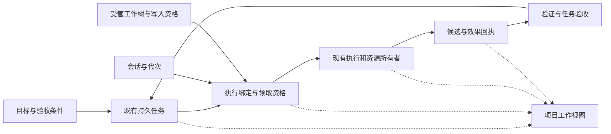

**交付目标：多个 agent 并行开发时，执行资格唯一、资源归属清楚、故障可恢复、结果可追溯；用户围绕目标和结果工作，常规协调由系统完成。**

日期：2026-11-08。研究由 VerseSearch 的 Exa Search/Contents 路线完成，Codex 行为另外核对官方 OpenAI 文档。两名指定 `ccs-workbuddy/deepseek-v4.1-flash` 子代理分别盘点 ClawX 与 VerseGit/JJ/STS。所有研究与探针标记 `driven_by: agent`。本文是实施方案，功能交付由各实施节点的当前候选证据决定。

本方案接入既有自治项目系统，优先复用任务、恢复、资源、UI 和仓库事实所有者。研发节点与活动会话的对应表保存在本地 Task Forest 及本次私有对齐记录中；产品运行不读取研发 TF。

**用户看到一项工作，系统维护完整身份链。**

任务保存目标，会话承载交流，工作树提供可替换执行资源，run/attempt 表示一次执行。当前 UI 焦点只影响查看哪个对象。会话迁移保持逻辑身份，Fork 创建新身份；任务 writer 转移和会话接力稿分别使用自己的明确动作。

**参考项目和论文抽取为具体机制。**

| 来源 | 经原文核对的机制 | 本方案采用方式 |
|---|---|---|
| [Codex Worktrees](https://developers.openai.com/codex/app/worktrees) | 独立检出支持并行；Handoff 移动 chat 与工作；受管检出删除前保存恢复快照，会话历史可以继续保留 | 会话与执行位置分离，创建/迁移/归档/恢复是完整旅程；保留策略依据本项目任务和资源引用制定 |
| [Codex App Server](https://developers.openai.com/codex/app-server) | 面向客户端的 thread/turn/item 与类型化事件/API | 复用 host API 和 Runtime owner，以任务/运行/工具事实驱动 UI |
| [Claude Code Worktrees](https://code.claude.com/docs/en/worktrees) | 会话可进入、离开及恢复到独立工作树 | 普通目录与受管检出的选择、设置和恢复具有显式状态 |
| [Claude Code Agent Teams](https://code.claude.com/docs/en/agent-teams) | 共享任务列表、依赖与领取锁；团队功能为实验态，恢复和任务同步存在已知限制 | 借鉴职责划分和依赖拉取；继续使用本项目已有持久领取和恢复，不把进程内协作扩写成持久保证 |
| [Claude Code 并行方式](https://code.claude.com/docs/en/agents) | 团队协调和工作树隔离是不同能力；团队本身不自动隔离每位成员的文件 | 任务分配、写集、工作树占用和实际执行必须联合准入 |
| [Chubby，OSDI 2006](https://www.usenix.org/legacy/event/osdi06/tech/full_papers/burrows/burrows_html/) | advisory lock 与目标端 sequencer 校验区分；迟到请求需要 fencing | 在受管效果入口验证 session generation、claim epoch、binding revision 与资源实例 |
| [Sagas，Garcia-Molina/Salem，1987](https://www.cs.princeton.edu/research/techreps/598) | 长事务拆成可恢复步骤，部分执行通过语义补偿处理 | 跨任务库/会话库/Git 的迁移保存步骤日志；优先继续已确认步骤，只执行明确允许的补偿 |
| [GitHub Git 存储架构](https://github.blog/engineering/architecture-optimization/inside-githubs-new-git-storage-architecture/) | 内容持久化与引用发布分离，维护从请求路径拆出 | 候选/回执先保存，资格与引用后发布；维护独立准入 |
| [Kanban Guide](https://kanbanguides.org/the-kanban-guide/) | 显式工作流、WIP 控制、按容量拉取及流动指标 | 开始新任务前核对可用执行/验证容量；等待与暂停的归属、占用分别记录 |
| [HSE 交班原则](https://www.hse.gov.uk/humanfactors/topics/shift-handover.htm) | 交班准备、信息交换、接手方复核 | agent 交接包包含目标版本、候选、未决效果、下一步；接手方从 owner 回读并确认 |
| [NASA 配置管理](https://www.nasa.gov/reference/6-5-configuration-management/) | 唯一配置标识、基线、变更控制、状态记账和审计 | 目标修订→源码候选→验证输入→回执→验收→集成结果形成可反查链 |
| [Google SRE 过载治理](https://sre.google/sre-book/handling-overload/) | 按资源测量容量、配额、重要性和过载处理 | 优先使用既有资源治理；限制队列、重试和后台维护，保留取消/恢复控制通道 |
| [NN/g 渐进披露](https://www.nngroup.com/articles/progressive-disclosure/) | 主要选项优先，复杂细节按需展开 | 工作卡展示目标、状态原因、结果和下一步；技术身份和租约放入诊断详情 |

上述管理方法转译为自动可执行的系统契约。交接、复核和验收由 agent/脚本完成，不新增真人值班、人工填表或真人数据前置。

**现有所有者继续承担各自事实，统一契约连接它们。**

| 事实 | 唯一所有者 | 需要接齐的关系 |
|---|---|---|
| 目标、约束、依赖、验收和任务领取 | TaskSystemStore / 产品 Task Ledger | 所有运行引用 taskNodeId、contractRevision、claimEpoch |
| 会话、代次和生命周期准入 | Runtime session owner / SessionAdmissionRegistry | 环境迁移和清理消费同一 generation 与准入结果 |
| 当前执行环境 | 演进既有 coordinator binding | 一份受控绑定；Runtime 可验证，UI 保留投影；禁止两处独立授予执行位置 |
| 检出与工作树归属 | 既有 WorktreeService 与宿主 Git owner | 持久注册、实例代次、来源、保留/恢复策略及跨进程写入资格 |
| 进程、终端、浏览器、端口 | 既有工具/资源 owner | 句柄绑定 execution identity，退出和清理回执可被回读 |
| 执行恢复决定 | 既有 RecoveryAuthority | 统一迁移协议调用恢复决定，不再添加一个恢复调度器 |
| 仓库内容、候选和验证事实 | Git/JJ/VG/STS 各自领域 owner | 保留原生版本、manifest、覆盖、环境和检查身份 |
| 当前状态和运维解释 | SessionActivity、Storage、项目视图 | 来源修订、可用性与陈旧状态明确；投影不授予资格 |

既有 Mission 在受管持久任务模式下引用 TaskContract 的目标版本和领取资格，负责推进执行；任务验收仍回到 Task owner。独立 Mission 的旧模式保留明确标识，避免 objective/acceptance 被两个所有者无声改写。

绑定权威的具体落盘位置由第一实施叶在现有 Main/Runtime 边界内定案。目标是一个可信写入口、Runtime 无 Renderer 时仍可校验、退出旧写路径；迁移使用已有存储和 schema，不长期双写。

本轮盘点发现，实际开发目录包含多个不同 Git common-dir。现有 TaskSystemStore 的唯一领取只在一个 common-dir 域内成立。受管项目需要显式登记任务 authority 与各 clone/checkout 的关联，使用本机既有宿主入口路由到同一任务 owner；未加入该项目的独立 clone 保持独立。相同 remote URL、目录名或标题不能自动合并任务域，也不能靠复制 SQLite 文件实现协调。第一叶只落定本机身份与路由合同，涉及跨机器服务部署的选择另作决策。

登记记录绑定 authority locator、登记 actor/时间、预期项目修订和实例代次。locator 不可用或身份/修订不匹配时返回明确的 unavailable/rejected，不能静默建立第二任务 owner。任务 authority 可达与 checkout 可写分别判断；registry 负责注册和观察，整合与回收仍由原有资源所有者执行。

**四种资格分别判断，合在执行入口核验。**

1. 会话准入：当前物理代次允许产生新副作用。
2. 任务领取：当前执行者有资格实现该目标版本。
3. 工作树写入资格：该执行作用域有资格修改指定检出实例。
4. 容量资格：进程、内存、终端、测试和维护预算允许开始。

这些资格不是同一个 lease。任务责任可在暂停时保留，资源占用则在完成检查点和排空后按策略释放。租约到期不证明旧进程已经停止；过期进入恢复核对，目标端拒绝旧凭证。

受管并发路径优先采用一个 checkout 一个写入作用域、多只读观察者。作用域内子任务继续使用现有路径级锁。独立 writer 共享目录须具备作用域声明、实际写集和组合候选证据。此选择在试点配置中显式启用；冻结默认值调整保持既有决策流程。

**工作树从“存在一个目录”升级为可恢复资源。**

持久记录包含仓库域、checkoutId、incarnation、后端/原生身份、位置、受管来源、创建操作、当前绑定引用和保留策略。路径复用产生新实例；相同路径字符串不能接续旧资格。Git/JJ 仍决定实际检出状态，管理记录只保存其无法推导的受管事实。

创建先保存操作意图，再执行原生创建，核对后发布 ready；重启根据意图与原生事实对账。发现无来源目录时保留并展示 discovered/unowned；缺失路径标 missing。所有权缺失不授权删除。

Runtime cleanup、存储页移除与 Git API 移除统一路由到既有资源 owner 的释放协议。删除必须核对活动绑定、任务/候选引用、在途效果、进程终态、未提交/未跟踪/忽略文件以及恢复需要。归档会话、移除 UI 工作区、释放进程、删除检出保持独立语义。

**跨所有者操作使用持久步骤日志与受控发布。**

迁移、恢复、归档和删除都携带 operationId、请求摘要、预期版本、actor 与 traceId。同 ID 同内容回读既有结果，同 ID 异内容拒绝。日志记录步骤和回执引用，不复制业务状态。

迁移顺序为：记录意图 → 关闭源准入 → 排空旧运行与子资源 → 预留目标检出 → 保存检查点/产物 → 更新任务资格和绑定 → 回读一致 → 开放目标执行 → 释放旧占用。

任务库、会话库和 Git 之间不假定共同事务。部分成功时双方保持准入约束，按原 operationId 继续已确认步骤；未知效果先查询既有 owner，不能盲目重做。自动补偿仅限释放本次预留等已证明可逆动作；不能用重置工作目录“回滚”并发开发成果。

实际 shell 进程和外部编辑器不会因数据库 epoch 变化停止写磁盘。交接必须拿到 owner 的退出/隔离回执，开放目录的外部写入使内容证据重新观察。

**追溯链让完成结论能够反查。**

每项受管工作可沿以下引用查询：

`目标来源 → task/revision → session/generation → attempt/run → binding/checkout incarnation → tool/effect receipt → candidate/input digest → validation → acceptance → integration/retention receipt`

事件追加保留事实，当前视图按各 owner 的序号重建；消费采用持久游标并识别重复。源修订后通知受影响的下游，接收、确认和实际使用分别记账；最终执行仍核验预期版本。

Git/JJ 原生版本、工作目录 manifest、测试环境、工具链和计划身份分别保存。上一轮实测已证明 HEAD/refs/index 不变时工作目录仍可变化。优先复用不可变候选上的验证；watcher 只辅助失效，溢出/重启/覆盖不完整时重建观察。STS selected/full 和未知/未运行状态保持原义。

并发候选先在隔离集成候选上验证组合，再通过现有宿主发布路径更新引用。VG 的 host mode 保持既有 M1–M3 边界；当前整合方案不授予 M4 broker 发布权。真正多父、删除语义等未覆盖能力需要具体验收后才能宣称支持。

**把管理智慧落实到低打扰的日常操作。**

| 管理原则 | 自动执行方式 | 用户看到什么 |
|---|---|---|
| 明确责任与分工 | 项目负责人保持任务责任；执行者持有可迁移 claim；核验角色消费真实回执 | 当前负责人、执行状态、结果和下一步 |
| 拉取式工作与 WIP | 依赖满足且容量可用才派发；任务完成前的验证排队也计入在制工作 | 等待的具体原因与系统下一步，不显示假运行 |
| 标准交接与接手复核 | 生成版本化交接包；接手者回读目标、产物、未知效果并确认 | 同一工作继续推进，无需重述目标和手动辨认旧工作树 |
| 配置基线与变更控制 | 目标、接口、候选和验证各有版本；变更使依赖的旧证据失效 | 哪项变更影响了当前结论，以及需要补做什么 |
| 异常优先管理 | 已知恢复自动执行；同一事故合并通知；只升级真实决策 | 一条可行动的提醒，包含推荐动作与影响 |
| 渐进披露 | 主视图显示少量任务事实；按需展开资源、epoch、日志与证据 | 默认看目标与结果，诊断时可进入完整技术链 |

状态至少区分待执行、进行中、已暂停、恢复中、待验收、已完成、已取消；资源未知以原因和可用性字段表达，不被投影成空闲。归档是可见性/保留操作，不作为任务完成状态。界面复用现有项目、会话、活动和存储入口，不另建一套控制台。

所有阈值先取实际资源与工作量基线再冻结。队列有界；重试共享预算；验证和后台维护不能耗尽取消、排空和恢复所需资源。限额拒绝或排队，不靠杀掉其他会话腾位置。

**新增研发工作以接缝为边界，现有实施线作为唯一实现来源。**

每个缺口登记 requirementId、唯一实施节点、责任边界、写集、依赖、证据与消费节点。一个能力只由一个节点实施；其他节点通过 depends_on/contributes_to 消费。跨仓节点引用必须带 workspace，不把相同 TF 编号视为同一任务。

每次实施前重新读取当前节点、相关工作树/分支、当前源码和已落盘证据；先识别已完成、进行中、待验收和计划。相似任务标题只触发比对，不自动合并。当前工作树有修改时回查来源，不创建同范围第二实现。

实施启动记录至少保存：节点与需求 ID、实施会话、工作树/common-dir、基线提交、声明写集、所消费上游证据版本、当前状态与更新时间。任务图保留研发推进权威，实际分支/owner 回执校验活动事实；冲突进入待对齐状态。新会话先认领已有实施，再决定是否新增。上游交付后下游重新核对来源摘要，接收消息本身不意味着已完成整合。

新主线只负责以下尚需联合证明的接缝：执行身份与准入组合、工作树持久归属与迁移、跨域回收条件、候选/证据身份接入、低负担工作视图及联合故障验收。任务持久化、通用恢复、容量调度、进程控制、会话树和 STS 算法继续由已有主线交付。

实施每次选择一个 ready 叶子。需要改写既有节点合同的部分以保留原验收的增补方式落图；依赖未完成的消费者保持 proposed。即使各组件各自完成，联合候选仍须跑下面的跨层旅程。

**验收同时衡量稳定、追溯和操作负担。**

| 维度 | 必测旅程/反例 | 判断方式 |
|---|---|---|
| 稳定性 | 同任务争抢、不同任务争同树、跨树并发、暂停/恢复、旧 writer 迟到 | 有效 writer 唯一；陈旧执行拒绝；独立树可以并行 |
| 重启恢复 | 每个持久步骤后终止进程、回应丢失、未知效果、租约过期 | 回读原操作；不重复效果；保留产物与未知状态 |
| 回收 | 删除与领取竞争、活跃候选引用、忽略文件、缺失/重建路径、archive/restore | 无跨 owner 误删；实例不混淆；恢复回执成立 |
| 可追溯 | 目标修订、环境变更、候选漂移、回执重复/冲突、事件断档 | 从完成结论反查到精确输入；错误关联为零 |
| 协作质量 | 各自通过但组合失败、接口修改与依赖方同时开发 | 合成候选验证发现失配，失效通知可回读 |
| 操作负担 | 新任务、继续、跨树迁移、崩溃恢复、归档恢复的脚本旅程 | 统计手动身份选择、跨页跳转、重复确认、重述字段和重复提醒；与现状配对比较 |
| 容量与性能 | 普通/拥塞混合负载、验证排队、维护、控制请求 | p50/p95、工作年龄、队列长度、资源峰值、恢复时间与回收残留；预算在候选评测前冻结 |

首个联合场景：两个会话争抢同一任务 → 胜出者在 A 执行 → 保存检查点与候选 → A→B 迁移中断 → 重启回读 → 同一逻辑工作在 B 继续 → A 的旧资格被拒绝 → 精确候选验收 → 引用解除后回收 A → 用户从原工作卡查看完整结果。

用户操作负担采用 agent 驱动的标准旅程指标；不把这些指标写成人类认知实验结论。源码与安装包、真实 owner 与替身、历史与当前候选分别记录。联合主线完成依赖实际证据，不以新建节点或文档完成代替实现。
