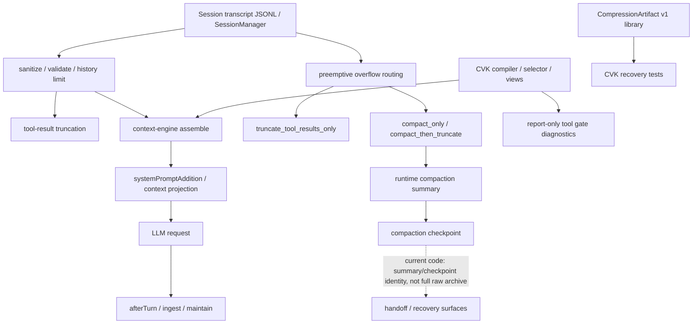
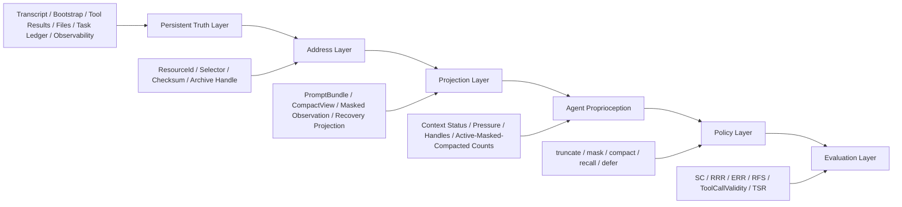

# Agent Context Runtime 现状报告

日期：2026-07-07

## 1. 范围与证据口径

这份报告只描述当前仓库中能从本地代码、测试、任务 spec、设计文档直接验证到的事实。重点覆盖：

- agent 上下文截断、溢出预检、压缩与恢复；
- bootstrap / system prompt / skills / project rules 引导注入；
- active run steering、follow-up、long-task queue、queue drain；
- `context-engine` 插件化上下文生命周期；
- Context Runtime Kit / CVK 的协议、编译、视图、selector、report-only gate、recovery 现状；
- `CompressionArtifact v1`、compaction checkpoint、handoff/recovery Host API 的接入边界；
- 这些组件之间当前是闭环、半连接，还是基本独立存在。

主要代码证据来自：

- `openclaw_runtime/src/agents/embedded-agent-runner/**`
- `openclaw_runtime/src/context-engine/**`
- `openclaw_runtime/packages/agent-core/src/harness/compaction/**`
- `shared/types/context-runtime-kit.ts`
- `shared/host-api/contract.ts`
- `electron/services/sessions-api.ts`
- `src/pages/Chat/**`
- `harness/specs/tasks/context-runtime-kit*.md`
- `harness/specs/tasks/token-dense-recovery-compression-v1.md`
- `docs/context-runtime-kit/**`
- `docs/superpowers/plans/2026-07-06-context-runtime-kit.md`

结论里会明确区分：

- **生产路径**：正常 agent run 或 Gateway/UI 已经调用的能力。
- **默认/可用但保守路径**：已注册或默认解析，但行为受限、report-only 或只追加诊断。
- **协议/库/测试层**：类型、编译器、resolver、评估、单元测试存在，但未证明主运行路径完整闭环。
- **设计/spec 层**：文档明确规划，但代码中没有发现对应运行时调用。

## 2. 总览结论

当前系统不是一个单一的 Context Runtime，而是一组围绕 transcript、prompt、compaction、queue、CVK projection 的分层机制。

最真实的结构可以概括为：

当前强项：

- 对工具结果膨胀有多层防护：live cap、prompt-time truncation、transcript rewrite truncation、aggregate truncation。
- 溢出路由已经存在：`fits`、`truncate_tool_results_only`、`compact_only`、`compact_then_truncate`。
- compaction 是生产路径，并且有手动、阈值、overflow、timeout recovery、hook、安全超时、checkpoint。
- bootstrap 注入有文件选择、hook override、per-file/total budget、continuation-skip、truncation warning。
- `context-engine` 抽象已存在，并且内置 `legacy` 和 `context-runtime-kit` engine。
- CRK/CVK 的核心协议类型、compiler、resolver、view generator、tool-call gate、eval report、recovery projection 都已经有代码和测试。
- UI/Host API 已经暴露 compaction status、history、manual compact、queue drain、long-task control 等控制面。

当前关键不足：

- **无损归档尚未完成**。compaction checkpoint 当前保存的是摘要、token、pre/post transcript identity，不是完整“被压缩原文块 + handle”的归档。
- **Observation Masking 还不是一档路由策略**。现有路由里没有 masking；工具结果要么保留/截断，要么触发 compaction。
- **Context Status / Proprioception 没有作为系统提示稳定注入**。UI 和 session store 有 pressure/status，但 agent prompt 内没有统一的 `[Context Status]` 面板。
- **token 计量仍大量依赖字符估算**。代码里有多处 `chars / 4`、CJK char estimate、safety margin，不是模型 tokenizer 精确计数。
- **CVK 目前更像 selector-backed prompt diagnostics/navigation layer**。默认 engine 会追加受限 `systemPromptAddition`，但不替换 transcript，不主动恢复原文，不主动阻断 tool call。
- **CRK compact 当前委托回原 runtime compaction**，不是 CVK 自己的 lossless/context OS compaction。
- **CompressionArtifact v1 的库和 Host API contract 存在，但主 Gateway handler / 主 compaction 写入闭环未在当前代码搜索中确认**。因此不能把它当成完全上线的生产恢复闭环。

## 3. 当前 Context Runtime 组件清单

### 3.1 Transcript 与 SessionManager

生产上下文的基础仍然是 session transcript 和 `SessionManager`。

相关证据：

- `openclaw_runtime/src/agents/sessions/agent-session.ts`
- `openclaw_runtime/src/agents/embedded-agent-runner/run.ts`
- `openclaw_runtime/src/agents/embedded-agent-runner/transcript-rewrite.ts`
- `openclaw_runtime/src/gateway/session-compaction-checkpoints.ts`

它承担：

- 存储 session messages；
- 支持 branch/leaf；
- 支持 rewrite transcript entries；
- 支持 compaction entry；
- 支持 compaction checkpoint 记录 pre/post session identity；
- 支持 session ownership / write lock / transcript mutation 防护。

当前 transcript 是事实源之一，但不是“无损 context archive”。当工具结果被 transcript rewrite truncation 改写后，旧 payload 不会自动保存为可 recall 的原始块。checkpoint 记录也不是完整原文归档。

### 3.2 Tool Result Truncation

实现文件：

- `openclaw_runtime/src/agents/embedded-agent-runner/tool-result-truncation.ts`

当前策略：

- 默认 live tool result cap：`16_000` chars。
- 大上下文 `>= 100_000` tokens：`32_000` chars。
- 超大上下文 `>= 200_000` tokens：`64_000` chars。
- 单个 tool result 额外限制为上下文窗口约 `30%`。
- 支持 head-only 和 head+tail。若尾部像 error、exception、exit code、JSON 结束、summary/result 等，会保留尾部。
- 支持 aggregate tool result budget，优先压缩旧工具结果，使新工具输出尽量完整。
- 支持两种作用域：
  - `truncateOversizedToolResultsInMessages(...)`：只改本次 prompt message snapshot。
  - `truncateOversizedToolResultsInSessionManager(...)` / `truncateOversizedToolResultsInSession(...)`：改 active branch 或 transcript file。

关系判断：

- 它是当前最成熟的“低成本降 token”生产策略。
- 它不是 masking。被截断的文本替换为裁剪文本和 notice，而不是保留 tool call 结构并把 result 全量移出 prompt、按需恢复。
- 它不生成可用于 `recall_original(handle)` 的 handle。

### 3.3 Preemptive Overflow Routing

实现文件：

- `openclaw_runtime/src/agents/embedded-agent-runner/run/preemptive-compaction.ts`
- `openclaw_runtime/src/agents/embedded-agent-runner/run/preemptive-compaction.types.ts`

当前 route：

- `fits`
- `truncate_tool_results_only`
- `compact_only`
- `compact_then_truncate`

估算输入包括：

- assembled messages；
- unwindowed messages；
- system prompt；
- current prompt；
- rendered LLM boundary pressure（如果上游提供）；
- context token budget；
- reserve tokens；
- tool-result reducible chars。

路由逻辑：

- 如果没有 overflow，则 `fits`。
- 如果 tool result 无可缩减空间，则 `compact_only`。
- 如果 tool result 可缩减空间足够覆盖 overflow 加 buffer，则 `truncate_tool_results_only`。
- 否则 `compact_then_truncate`。

关系判断：

- 这是当前截断与压缩之间的主决策器。
- 用户提出的 observation masking 应插入在 `truncate_tool_results_only` 和 `compact_only` 之间，但当前代码没有这一档。

### 3.4 Runtime Compaction

主要实现：

- `openclaw_runtime/src/agents/embedded-agent-runner/compact.ts`
- `openclaw_runtime/src/agents/embedded-agent-runner/compact.runtime.ts`
- `openclaw_runtime/src/agents/sessions/agent-session.ts`
- `openclaw_runtime/packages/agent-core/src/harness/compaction/compaction.ts`
- `openclaw_runtime/src/agents/compaction.ts`

当前 compaction 是生产路径。

能力包括：

- 手动 compaction；
- 自动 threshold compaction；
- overflow recovery compaction；
- timeout recovery compaction；
- safety timeout；
- abort signal；
- hooks：before/after/post compaction；
- model fallback / thinking fallback；
- chunked/staged summarization；
- oversized-message fallback；
- partial summary fallback；
- identifier preservation instructions；
- split-turn prefix summary；
- optional transcript rotation；
- compaction checkpoint persistence。

核心行为：

- 使用 LLM 生成结构化 summary；
- summary 作为 compaction entry / compaction checkpoint 的兼容字段继续被消费；
- result details 当前主要是 `readFiles` / `modifiedFiles` 等 compaction details；
- overflow recovery 最多受控重试，不会无限循环。

关系判断：

- 当前 compaction 是**有损摘要**，不是无损归档。
- 它与 CRK 的关系是：`context-runtime-kit` engine 的 `compact()` 通过 `delegateCompactionToRuntime(...)` 回调这套原 runtime compaction。
- 因此 CRK 当前没有替换 compaction 算法。

### 3.5 Compaction Checkpoint

实现文件：

- `openclaw_runtime/src/gateway/session-compaction-checkpoints.ts`

checkpoint 记录：

- `checkpointId`
- `sessionKey`
- `sessionId`
- `createdAt`
- `reason`
- `tokensBefore`
- `tokensAfter`
- `summary`
- `firstKeptEntryId`
- `preCompaction.sessionId`
- `preCompaction.sessionFile`（可选）
- `preCompaction.leafId`
- `postCompaction.sessionId`
- `postCompaction.sessionFile`
- `postCompaction.leafId`
- `postCompaction.entryId`

关键事实：

- `captureCompactionCheckpointSnapshotAsync(...)` 的注释说明它捕获的是 stable pre-compaction identity，而不是复制完整 transcript。
- `persistSessionCompactionCheckpoint(...)` 在缺少 snapshot file 且缺少 post fork source 时会跳过。
- checkpoint 有数量和字节清理策略：最多 `25` 个，每 session checkpoint artifact 预算 `128 MiB`。

关系判断：

- checkpoint 是恢复/历史的索引层，不是完整无损归档层。
- 它可以成为未来 lossless archive 的 handle 入口，但现在并没有 `recall_original(handle)`。

### 3.6 Bootstrap / Guidance 注入

主要实现：

- `openclaw_runtime/src/agents/bootstrap-files.ts`
- `openclaw_runtime/src/agents/bootstrap-budget.ts`
- `openclaw_runtime/src/agents/bootstrap-cache.ts`
- `openclaw_runtime/src/agents/bootstrap-hooks.ts`
- `openclaw_runtime/src/agents/embedded-agent-runner/system-prompt.ts`
- `openclaw_runtime/src/agents/embedded-agent-runner/run/attempt.bootstrap-context.ts`
- `openclaw_runtime/src/agents/embedded-agent-runner/run/attempt-system-prompt.ts`

当前能力：

- 从 workspace setup files 加载 bootstrap 文件，例如 `AGENTS.md`、`TOOLS.md`、`SOUL.md`、`USER.md`、`HEARTBEAT.md`、`BOOTSTRAP.md`。
- 支持 session 过滤和 hook override。
- 支持 context mode：
  - `full`
  - `lightweight`
- 支持 run kind：
  - `default`
  - `heartbeat`
  - `cron`
- 支持 context injection mode：
  - `always`
  - `continuation-skip`
  - `never`
- 支持 per-file / total budget。
- 支持 bootstrap warning dedupe。
- continuation-skip 会扫描 transcript tail 里的 full bootstrap marker，避免安全 continuation 反复注入。
- 如果 bootstrap 被截断，runtime 会给 agent 可见的 warning。

关系判断：

- 当前 bootstrap 仍然是相对 flat file injection，不是完整 hierarchical bootstrap。
- 已经有 mode/filter/budget/continuation-skip，但没有严格的 Core / Session / On-demand 三层协议。
- bootstrap 内容会作为 `projectContextFiles` 进入 context-engine assemble，因此 CVK engine 可以把已选 project context files 编译成 `project_rule` 资源和 selector 视图。

### 3.7 System Prompt Assembly

主要实现：

- `openclaw_runtime/src/agents/embedded-agent-runner/system-prompt.ts`
- `openclaw_runtime/src/agents/embedded-agent-runner/run/attempt.prompt-helpers.ts`
- `openclaw_runtime/src/agents/system-prompt-cache-boundary.ts`

输入包括：

- workspace；
- agent id；
- provider/model/runtime；
- tools；
- skills prompt；
- docs/source paths；
- sandbox；
- command guidance；
- user time/timezone；
- bootstrap context files；
- provider-specific prompt contribution；
- context-engine `systemPromptAddition`。

关系判断：

- context-engine 的输出主要通过 `systemPromptAddition` 进入 system prompt。
- CVK 当前就是通过这一机制把 registry、compact selectors、required tool selectors、report-only diagnostics 塞入 prompt。
- 这不是无损上下文恢复，而是 bounded diagnostic/projection。

### 3.8 Context Engine 抽象

核心类型：

- `openclaw_runtime/src/context-engine/types.ts`

注册/解析：

- `openclaw_runtime/src/context-engine/init.ts`
- `openclaw_runtime/src/context-engine/registry.ts`
- `openclaw_runtime/src/context-engine/legacy.registration.ts`
- `openclaw_runtime/src/context-engine/cvk/registration.ts`

生命周期接口：

- `bootstrap`
- `maintain`
- `ingest`
- `ingestBatch`
- `afterTurn`
- `assemble`
- `compact`
- `prepareSubagentSpawn`
- `onSubagentEnded`
- `dispose`

`AssembleResult` 支持：

- `messages`
- `contextItems`
- `estimatedTokens`
- `promptAuthority`
- `systemPromptAddition`
- `contextProjection`

`ContextEngineRuntimeContext` 支持：

- `tokenBudget`
- `currentTokenCount`
- `promptCache`
- `allowDeferredCompactionExecution`
- `rewriteTranscriptEntries`
- `llm.complete`

默认解析策略：

- 如果 `plugins.slots.contextEngine` 显式设置，则使用该 slot。
- 如果 slot 缺失且 `runtime.contextRuntimeKit.enabled !== false`，则默认解析为 `context-runtime-kit`。
- 如果 CRK disabled 或显式 legacy，则使用 `legacy`。
- 非默认 engine 出错会 quarantine 并 fallback 到默认 legacy。

关系判断：

- `context-engine` 是当前最接近“Context Runtime”总线的抽象。
- 但它本身是接口层，不保证实现方具有无损归档、masking、精确 token、selector recovery。

### 3.9 Legacy Context Engine

实现文件：

- `openclaw_runtime/src/context-engine/legacy.ts`

行为：

- `ingest` no-op。
- `assemble` pass-through，返回原 messages。
- shadow flag 开启时可生成 `contextItems` 诊断。
- `afterTurn` no-op。
- `compact` 调用 `delegateCompactionToRuntime(...)`。

关系判断：

- legacy engine 是兼容层，不改变已有 prompt/compaction 行为。
- 它让 runtime 可以通过同一个 `ContextEngine` contract 调用旧路径。

### 3.10 Context Runtime Kit / CVK Engine

主要实现：

- `shared/types/context-runtime-kit.ts`
- `openclaw_runtime/src/context-engine/cvk/engine.ts`
- `openclaw_runtime/src/context-engine/cvk/compiler.ts`
- `openclaw_runtime/src/context-engine/cvk/runtime-adapter.ts`
- `openclaw_runtime/src/context-engine/cvk/views.ts`
- `openclaw_runtime/src/context-engine/cvk/resolver.ts`
- `openclaw_runtime/src/context-engine/cvk/tool-call-gate.ts`
- `openclaw_runtime/src/context-engine/cvk/recovery.ts`
- `openclaw_runtime/src/context-engine/cvk/recovery-default.ts`
- `openclaw_runtime/src/context-engine/cvk/eval-report.ts`
- `openclaw_runtime/src/context-engine/cvk/codebase-index.ts`

协议类型已经存在：

- `ResourceId`
- `Selector`
- `CvkChecksum`
- `Chunk`
- `CompactView`
- `CvkEvidenceRef`
- `RetrievalTraceEntry`
- `PromptBundle`
- `VerificationResult`

CVK compiler 当前支持的 source：

- `toolset`
- `skill`
- `project_rule`

它会生成：

- resources；
- chunks；
- compact views；
- selector index；
- checksums；
- build report；
- metrics：SC、RRR、AR 等。

runtime adapter 会从当前运行时输入构造 CVK source：

- active tools -> `toolset:runtime-tools@active`
- selected project context files -> `project_rule`
- selected skills metadata -> `skill`

CVK engine `assemble(...)` 当前行为：

- 编译 fixture/runtime source；
- 生成 registry view 和 compact selector view；
- 收集 active tool required selectors；
- 运行 report-only tool gate diagnostics；
- 生成最多约 `8_000` chars 的 `systemPromptAddition`；
- 返回原始 `params.messages`，不改 transcript。

CVK engine `compact(...)` 当前行为：

- 调用 `delegateCompactionToRuntime(params)`；
- 即委托给原 runtime compaction。

关系判断：

- CVK 已经不是纯文档，它有真实代码、默认 engine 注册、单元测试。
- 但当前 CRK/CVK 在主运行路径里主要是**有界 prompt 追加 + selector diagnostic**。
- 它不主动把旧 transcript 替换成 selector-backed projection。
- 它不主动调用 resolver 恢复 raw chunks。
- tool-call gate mode 当前只有 `report_only`，没有 active blocking。

### 3.11 CVK Tool-Call Gate

实现文件：

- `openclaw_runtime/src/context-engine/cvk/tool-call-gate.ts`

当前 gate family：

- `required`
- `enum`
- `type`
- `default`
- `nullable`
- `permission`
- `side_effect`

当前 mode：

- `report_only`

行为：

- 收集某个 tool 需要的 selector；
- 对比 retrieved selectors；
- 缺失时产出 `would_block` diagnostic；
- 不阻断实际 tool call。

关系判断：

- 这与用户提出的“tool schema selector expansion before call”方向一致。
- 但现在只是诊断，不是强制 gate。

### 3.12 CVK Recovery

实现文件：

- `openclaw_runtime/src/context-engine/cvk/recovery.ts`
- `openclaw_runtime/src/context-engine/cvk/recovery-default.ts`

能力：

- 从 `CompressionArtifact.requiredSelectors` 读取 selector refs；
- 用 CVK artifact resolver 解析 chunk；
- 识别 stale refs；
- 生成 recovery projection：
  - resourceMap；
  - requiredSelectors；
  - resolvedChunks；
  - unverifiedClaims；
  - blockers；
  - failedAttemptsToAvoid；
  - nextAction；
  - diagnostics；
  - rollback strategy。

默认 recovery 只有在：

- `CompressionArtifact` 有 CVK refs；
- eval report Level 2 gate pass；
- selector resolution 成功；

才返回 `context-runtime-kit` mode；否则 fallback 到 `legacy` mode。

关系判断：

- 这是正确方向，但当前主要通过单元测试和库函数验证。
- 没有在主 agent run 中发现 `recall_original(handle)` 或自动 recovery tool。

### 3.13 CompressionArtifact v1

主要实现：

- `openclaw_runtime/packages/agent-core/src/harness/compaction/compression-artifact.ts`
- `tests/unit/compression-artifact.test.ts`
- `tests/unit/context-runtime-kit-compression-artifact.test.ts`
- `tests/unit/context-runtime-kit-recovery-context.test.ts`
- `tests/unit/context-runtime-kit-recovery-default.test.ts`

结构包括：

- objective；
- constraints；
- currentState；
- done / inProgress / blocked；
- decisions；
- filesTouched；
- testsRun；
- failedAttempts；
- deviations；
- nextAction；
- reviewNeeded；
- evidenceRefs；
- unverifiedClaims；
- quality；
- 可选 CRK 字段：
  - `retrievedContext`
  - `requiredSelectors`
  - `capabilityActivations`
  - `staleReferences`
  - `retrievalTrace`

能力：

- `buildDeterministicCompressionArtifact(...)`
- `renderCompressionArtifactSummary(...)`
- `renderRecoveryContextProjection(...)`
- `normalizeCompressionArtifact(...)`
- `calculateCompressionEvidenceRetentionRate(...)`

文档/spec 状态：

- `harness/specs/tasks/token-dense-recovery-compression-v1.md` 明确要求 compaction 保存结构化 artifact。
- `docs/clawx-design-overview.md` 也描述 `sessions.compressionArtifact` 和 `sessions.recoveryContext`。
- `shared/host-api/contract.ts` 和 `electron/services/sessions-api.ts` 有 Host API / Electron service 映射。

当前代码核查到的限制：

- 在 `openclaw_runtime/src/agents/embedded-agent-runner/compact.ts` 中，没有发现主 compaction 写入路径调用 `buildDeterministicCompressionArtifact(...)`。
- 在 `openclaw_runtime/src/gateway/server-methods/sessions.ts` 中，当前搜索没有发现 `sessions.compressionArtifact` / `sessions.recoveryContext` handler。
- Electron service 会调用 Gateway RPC `sessions.compressionArtifact` / `sessions.recoveryContext`，但 Gateway handler 是否已在别处注册未从当前搜索确认。

关系判断：

- `CompressionArtifact v1` 作为库、类型、测试、Host API contract 是真实存在的。
- 它和 CVK 的字段级集成也真实存在。
- 但它是否已经作为主生产 compaction artifact 持久化并由 Gateway 可查询，当前证据不足，报告中不能当作完整闭环。

### 3.14 Queueing / Steering / Long-Task Control

主要实现：

- `openclaw_runtime/src/agents/sessions/agent-session.ts`
- `openclaw_runtime/src/agents/embedded-agent-runner/runs.ts`
- `openclaw_runtime/src/agents/embedded-agent-runner/run/attempt.queue-message.ts`
- `openclaw_runtime/src/agents/user-message-queue.ts`
- `openclaw_runtime/src/agents/long-task-control/store.ts`
- `openclaw_runtime/src/gateway/server-methods/sessions.ts`
- `src/pages/Chat/index.tsx`
- `src/pages/Chat/ChatInput.tsx`

active run 中：

- 新 prompt 默认会被拒绝，除非指定 streaming behavior。
- `steer`：注入到 active run，在下一次 LLM call 前进入上下文。
- `followUp`：排队到 agent 没有更多 tool calls / steering messages 后。

embedded active run queue：

- `queueEmbeddedAgentMessageWithOutcomeAsync(...)` 检查 active run、streaming、compacting、delivery mode、transcript commit wait support。
- 可能返回：
  - `no_active_run`
  - `not_streaming`
  - `compacting`
  - `source_reply_delivery_mode_mismatch`
  - `transcript_commit_wait_unsupported`
  - `runtime_rejected`

long-task user queue：

- `enqueueUserMessage(...)`
- `drainUserMessages(...)`
- `completeDrainedUserMessages(...)`
- `restoreDrainingUserMessages(...)`
- `failDrainingUserMessages(...)`
- `peekUserMessageCount(...)`
- `clearUserMessageQueue(...)`

Gateway/UI：

- `sessions.longTaskControlStatus`
- `sessions.longTaskControlHistory`
- `sessions.resumeCheckpoints`
- `sessions.queueDrain`
- Chat UI 显示 queued count，并可 drain queue。

关系判断：

- queueing 是运行控制层，不是 context compression 本身。
- 但它与 compaction 有直接交互：active compaction 时 queue 不会强行注入；active run 清空后可触发 queue drain。
- 它也是未来 sleeptime/background compaction 可以利用的 idle window。

### 3.15 Deferred / Background Maintenance

实现文件：

- `openclaw_runtime/src/agents/embedded-agent-runner/context-engine-maintenance.ts`

能力：

- context engine 可声明 `turnMaintenanceMode: "background"`。
- turn maintenance 可以被调度到 deferred lane。
- deferred maintenance 等 session lane idle 后执行。
- 支持 detached task 状态、进度、失败、取消。
- runtime context 里可附加 `rewriteTranscriptEntries`。
- background 模式下 transcript rewrite 会 defer 到 session lane。

关系判断：

- 这已经提供了 sleeptime 模式的基础设施。
- 但当前内置 CRK engine 没有实现 `maintain()`，legacy 也没有主动后台 compaction。
- 所以“异步后台 compaction”作为实际策略尚未落地；但调度/维护框架已经存在。

### 3.16 UI / Host API 控制面

主要实现：

- `shared/host-api/contract.ts`
- `electron/services/sessions-api.ts`
- `src/lib/host-api.ts`
- `src/pages/Chat/index.tsx`
- `src/pages/Chat/ChatInput.tsx`
- `src/pages/Chat/session-continuity.ts`
- `src/pages/Chat/rollback-plan.ts`

已确认控制面：

- `sessions.compactionStatus`
- `sessions.compactionHistory`
- `sessions.compact`
- `sessions.queueDrain`
- `sessions.longTaskControlStatus`
- `sessions.longTaskControlHistory`
- `sessions.resumeCheckpoints`

Host API contract / Electron service 还包含：

- `sessions.compressionArtifact`
- `sessions.recoveryContext`

但如上所述，Gateway handler 当前未在本次代码搜索中确认。

关系判断：

- UI 层已经有 context pressure、manual compaction、queue drain、handoff/recovery 相关显示和 fallback 概念。
- 但 UI 不等于 runtime 闭环；需要以 Gateway handler 和 agent run 调用链为准。

## 4. 组件关系矩阵

| 组件 | 当前成熟度 | 与其他组件关系 | 是否独立存在 |
|---|---:|---|---|
| Transcript / SessionManager | 生产路径 | 所有 run、compaction、rewrite、checkpoint 的基础 | 否，核心底座 |
| Tool result truncation | 生产路径 | 被 preemptive route、prompt guard、transcript rewrite 调用 | 否，已嵌入主 run |
| Preemptive overflow routing | 生产路径 | 决定 truncate / compact / compact+truncate | 否，主 run 调用 |
| Runtime compaction | 生产路径 | manual/auto/overflow/timeout 使用；CRK compact 委托它 | 否，核心压缩路径 |
| Compaction checkpoint | 生产路径 | compaction 后保存 summary 和 pre/post identity | 半独立，是恢复索引不是无损归档 |
| Bootstrap injection | 生产路径 | system prompt、context files、CVK project_rule 输入 | 否，prompt assembly 输入 |
| Context Engine contract | 生产路径接口 | legacy/CRK/plugin engines 都走它 | 否，是上下文总线接口 |
| Legacy engine | 生产兼容 | pass-through assemble，compact 委托 runtime | 否，fallback |
| CRK/CVK engine | 默认可解析/保守生效 | 追加 systemPromptAddition，不替换 transcript | 半独立，作为 projection/diagnostic layer |
| CVK compiler/resolver/views | 库+测试+engine 使用 | engine assemble 使用 compiler/views；resolver 用于 recovery tests | 半独立，未形成 recall tool |
| CVK tool gate | report-only | engine assemble 写入 diagnostics | 是，未阻断 tool execution |
| CVK recovery | 库+测试 | 消费 CompressionArtifact + CVK artifact | 是，未确认主 run 自动使用 |
| CompressionArtifact v1 | 库+测试+Host contract | 可携带 CRK refs；可生成 recovery projection | 半独立，主 runtime 持久化未确认 |
| Long-task queue | 生产路径 | active run 清空后 drain；UI 可触发 | 否，运行控制层 |
| Deferred maintenance | 基础设施 | context engine 可选择 background maintain | 半独立，内置 engine 未明显使用 |

## 5. 与用户提出七个方向的对照

### 方向 1：无损归档 + 按需恢复

当前状态：**尚未实现**。

已有基础：

- transcript JSONL 是原始记录源；
- compaction checkpoint 记录 pre/post identity；
- CVK 有 `resourceId + selector + checksum`；
- resolver 可校验 selector/chunk；
- CompressionArtifact 可携带 `requiredSelectors`、`retrievedContext`、`retrievalTrace`。

缺口：

- compaction 时未保存“被压缩原始消息块完整 payload + handle”到结构化存储；
- 没有 `recall_original(handle)`；
- checkpoint 不等于 raw archive；
- tool-result truncation 改写后没有自动 raw payload handle。

推荐落点：

- 不要新建平行事实系统；应把 archive handle 接到 session transcript / state SQLite / checkpoint metadata。
- handle 应包括：sessionKey、sessionId、entry id range、checksum、storage pointer、privacy/redaction state。

### 方向 2：Observation Masking

当前状态：**未作为路由档位存在**。

已有基础：

- tool call 结构和 tool result 是可识别 message；
- transcript rewrite 已有安全接口；
- preemptive routing 已有插入点；
- context-engine `assemble()` 可返回不同 message projection。

缺口：

- 没有 `observation_masking` route；
- 没有 `[tool_result masked, re-run tool to recover]` 标准占位；
- 没有原始 payload handle，因此 masking 后恢复仍缺底座。

推荐插入点：

- 在 `preemptive-compaction.types.ts` 增加 route；
- 在 `preemptive-compaction.ts` 的 truncate/compact 选择之间插入；
- 实现 projection-only masking，第一阶段不 rewrite transcript；
- 等 lossless archive 有 handle 后，再允许 transcript rewrite masking。

### 方向 3：Agent Proprioception / Context Status

当前状态：**UI 和 store 有压力状态，agent prompt 内没有统一面板**。

已有基础：

- `SessionContextBudgetStatus`；
- `sessions.compactionStatus`；
- `contextBudgetStatus`；
- pre-prompt route、estimated tokens、overflow tokens；
- checkpoint history；
- CRK prompt addition。

缺口：

- agent 看不到统一的 `[Context Status]`；
- compacted/masked/archive handles 没有统一 runtime projection；
- bootstrap truncation、tool results active/masked count 没有系统化暴露。

推荐落点：

- 在 context-engine assemble 后、system prompt cache boundary 前追加轻量 context status；
- 只放状态和 handles，不放大 payload；
- 避免让 UI-only status 与 runtime truth 分叉。

### 方向 4：精确 Token 计量

当前状态：**大量启发式估算**。

代码事实：

- `estimateTokens` 使用字符估算；
- preemptive route 用 `estimateStringChars / charsPerToken / safety margin`；
- CVK prompt addition token estimate 用 stable JSON length / 4；
- tool result route 用 chars/token 转换。

已有优势：

- 有 reserve tokens；
- 有 min prompt budget；
- 有 safety margin；
- 有 rendered LLM boundary pressure 可覆盖本地估算。

缺口：

- 关键路由没有模型 tokenizer 精确计量；
- effective context threshold 没有统一收敛到 50-60% 策略；
- 长上下文有效性衰减未建模。

推荐落点：

- 在 pre-prompt route、bootstrap budget、CVK projection budget、compaction trigger 上接入 tokenizer；
- 保留 chars heuristic 作为 fallback；
- 把 `effectiveWindowTokens` 与 `nominalContextTokens` 分开记录。

### 方向 5：Sleeptime / Background Compaction

当前状态：**有 background maintenance 框架，未形成默认后台 compaction 策略**。

已有基础：

- `turnMaintenanceMode: "background"`；
- deferred turn maintenance lane；
- detached task status；
- idle wait；
- background transcript rewrite；
- queue drain 机制。

缺口：

- 内置 CRK/legacy 没有后台 `maintain()` compaction；
- compaction summary draft/confirm 流程不存在；
- active reasoning chain 中断避免策略还不是一等政策。

推荐落点：

- 先实现“后台分析/计划”，不直接 rewrite；
- 生成 draft compaction/masking plan；
- 下一次 agent 激活时通过 context status 暴露可用 plan。

### 方向 6：Hierarchical Bootstrap

当前状态：**有 budget/filter/continuation-skip，但仍偏 flat injection**。

已有基础：

- bootstrap files；
- context mode；
- run kind；
- session filter；
- per-file/total budget；
- truncation warning；
- continuation-skip；
- CRK 可把 project context files 编译成 selectors。

缺口：

- Core/Session/On-demand tiers 没有严格协议；
- `AGENTS.md` 仍可能作为大块注入；
- on-demand tier 缺少 recall/selector expansion tool。

推荐落点：

- Core tier：硬规则和 persona，小于上下文 5%；
- Session tier：当前任务/模式相关文件；
- On-demand tier：CVK resource map + selector recall。

### 方向 7：RL / 自适应上下文管理

当前状态：**中长期，不应作为 MVP**。

已有基础：

- CVK eval report；
- evidence retention metric；
- compaction quality；
- tool gate diagnostics；
- context budget status；
- route logs。

缺口：

- 没有失败驱动 policy learner；
- 没有上下文管理 action space；
- 没有基于 replay 的 reward/eval 闭环。

推荐落点：

- 先做可观测和评估；
- 用 replay/eval 训练或优化策略；
- 在 hard-coded threshold 之后引入 policy adapter。

## 6. “本地 CVK viewer / 持久内容不反复塞上下文”的现状理解

从当前代码看，CVK 的已有思路已经接近“viewer / navigation layer”：

- registry view：告诉 agent 有哪些 resource；
- compact view：告诉 agent 哪些 selector 是硬约束入口；
- raw chunk selector：可作为未来按需展开的地址；
- checksum：让 hard claim 可验证；
- prompt addition：只放导航和诊断，不放大块原文。

但还缺 viewer 闭环：

- 没有 agent-facing `recall_original` 或 `expand_selector` tool；
- 没有统一持久化 artifact store；
- 没有把 bootstrap 大文件、工具输出、transcript 历史都变成 addressable resources；
- 没有 UI/agent 共享的 context dashboard payload。

所以当前 CVK 是 viewer 的底层协议雏形，不是完整 viewer runtime。

## 7. 建议的 Context Runtime vNext 分层

基于现有代码，最稳妥的演进不是替换所有组件，而是把它们纳入一个统一 Context Runtime。

推荐边界：

阶段建议：

1. **Lossless Archive MVP**
   - compaction 前保存原始 message range；
   - tool-result truncation 前保存原始 payload；
   - 生成 stable handle；
   - 不改变 prompt 行为。

2. **Projection-Only Observation Masking**
   - 在 prompt assembly 中 mask 旧 tool results；
   - 保留 assistant tool call 和 tool metadata；
   - 不 rewrite transcript；
   - masked placeholder 指向 archive handle。

3. **Context Status Injection**
   - 注入轻量状态：
     - used/effective budget；
     - compacted blocks；
     - masked tool results；
     - bootstrap truncation；
     - recall handles。

4. **Recall / Expand Tool**
   - `recall_original(handle)`；
   - `expand_selector(resourceId, selector, checksum?)`；
   - 先只读，不允许 mutation。

5. **Hierarchical Bootstrap**
   - Core tier 常驻；
   - Session tier 条件注入；
   - On-demand tier 只给 resource map/selectors。

6. **Sleeptime Maintenance**
   - background maintenance 先产出 plan；
   - 下一轮确认后再执行 rewrite/compaction；
   - 与 queue idle window 结合。

7. **Exact Token Accounting**
   - route critical path 使用 tokenizer；
   - 保存 nominal/effective 两套 token budget；
   - eval 中比较实际 provider usage。

8. **Adaptive Policy**
   - 以 replay/eval 数据训练或优化路由；
   - 初期用规则策略 + shadow policy；
   - 后期再接 RL/失败驱动优化。

## 8. 当前最需要澄清/修复的事实缺口

1. `CompressionArtifact v1` 的生产闭环需要专项核查。
   - 类型、库、测试、Host API contract 已存在。
   - 但当前主 compaction path 未发现 artifact builder 调用。
   - Gateway handler `sessions.compressionArtifact` / `sessions.recoveryContext` 未在 `server-methods/sessions.ts` 搜到。

2. CRK default-on 与实际 prompt 影响需要用测试/日志确认。
   - registry 解析默认会选 `context-runtime-kit`。
   - CRK assemble 会追加 prompt diagnostics。
   - 需要在真实 run 中确认 `systemPromptAddition` 大小、内容和 provider boundary 行为。

3. compaction checkpoint 不应被误认为无损归档。
   - 它是 pre/post identity + summary。
   - 如果要做 LCM/VISTA-style recovery，需要新增 archive store。

4. observation masking 需要先依赖 archive handle。
   - 否则 masking 只是丢信息，不是可恢复投影。

5. bootstrap hierarchical 化最好复用 CVK resource/selector。
   - 不建议另建 `.cvk` 或 `.trellis` 平行真相目录。
   - 仓库规则明确要求不要引入平行 durable source of truth。

## 9. 最短可执行路线

如果目标是把现有系统推进到“真实 Context Runtime”，建议按下面顺序推进：

1. 写一个 `context-runtime-vnext-lossless-archive` task spec。
2. 给 compaction/truncation 增加 archive handle，但不改变 prompt。
3. 给 Context Status 注入做 shadow-only / diagnostic 版本。
4. 加 `observation_masking` route，但第一版只 projection，不 rewrite。
5. 实现 `recall_original(handle)` 只读工具。
6. 把 CVK selector expansion 和 archive recall 统一到同一个 read-only recovery surface。
7. 用 replay/eval 证明：token 降低不降低 evidence retention / recovery fidelity。

核心原则：

> Context Runtime 不应该是“更会压缩的摘要器”，而应该是“可寻址、可验证、可恢复的上下文操作系统”。Prompt 只是当前投影，原始证据和 selector-backed truth 必须在 prompt 之外保持可恢复。

