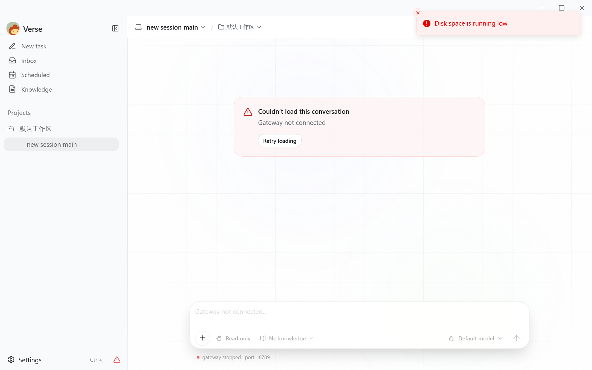
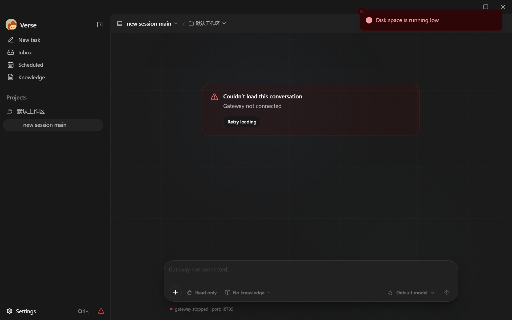
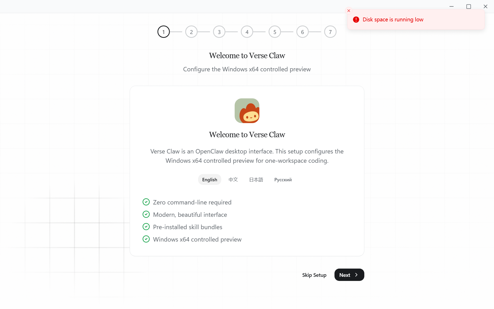
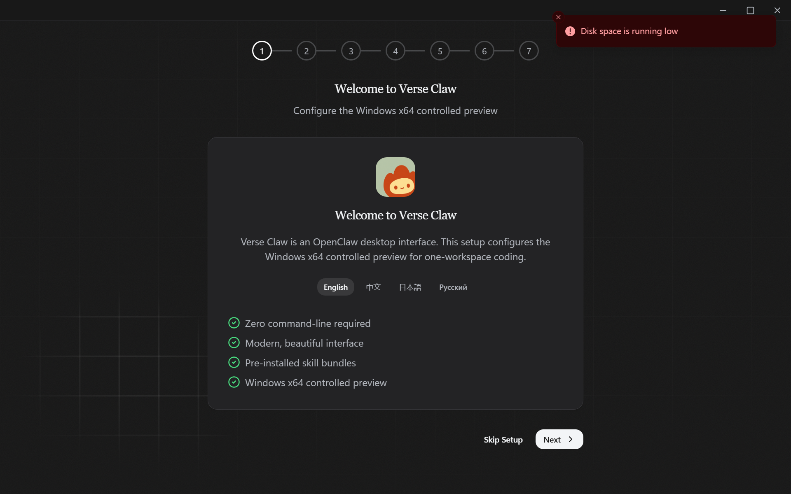

# B2 接入验证 — 2026-10-06

用户选定的 B2 已用于侧栏、初始化页、静态启动页、favicon、四语 README 页首和桌面图标生成输入。启动页曾遗漏旧 logo 引用，本轮已补齐，并移除不再需要的深浅双图片切换。

验证基于 Windows 当前源码构建，由 agent 自动驱动，`actor: codex-b2-handoff`。这是本地品牌接入验证；工作树含其他任务的修改，没有生成新的安装器或发布。

| 验证 | 结果 |
| --- | --- |
| `pnpm run build:vite` | exit 0 |
| `pnpm run typecheck` | exit 0 |
| BrandLogo 与品牌 E2E 定向 ESLint | exit 0，0 warnings |
| `tests/e2e/brand-logo.spec.ts` | 4 passed / 0 failed / 0 skipped |
| `tests/e2e/startup-loading-experience.spec.ts` | 6 passed / 0 failed / 0 skipped |
| `tests/unit/startup-loading-experience.test.tsx` | 6 passed / 0 failed / 0 skipped |
| 资源核对 | 6 张原始候选及提示词、18 份 README 资产摘要匹配；7 种 PNG 尺寸与浅深 ICO/ICNS 可解码 |

品牌 E2E 覆盖两种主题下的启动页到侧栏／初始化页交接、favicon 来源、28／64 CSS 像素尺寸，以及重载后的图片身份与加载成功。最初两轮失败分别来自相对／绝对 URL 字符串比较，以及 `64.000015px` 的浮点测量；修正断言后四项全部通过。启动流程的六项在第一轮组合运行中通过，结果未被失败重试覆盖。[verification.json](verification.json) 保存各轮结果、源码摘要与截图摘要；原始日志保留在 `.local/logo-20261006-handoff/`。

## 实际界面截图

以下四图直接来自隔离配置的 Electron 测试，逐张检查后原样保存。品牌测试没有启动 Gateway，侧栏截图中的离线状态及机器真实的磁盘空间提醒保留；它们只证明品牌显示，不代表已连接模型或完成对话。旧版 README 图集保持拍摄时原貌，并另行标明品牌变更。

| 浅色 | 深色 |
| --- | --- |
|  |  |
|  |  |

macOS／Linux 运行、安装器与已安装应用的系统图标刷新不在本次验证中。
