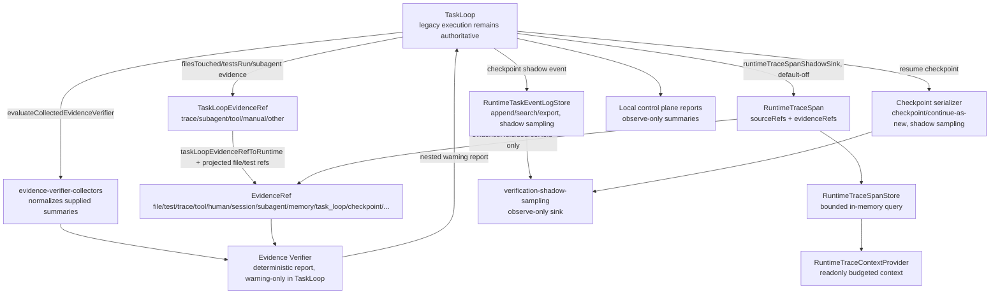

# Line C Planning: Evidence / Trace Grounding Spine

Status: accepted

## Purpose

Line C plans a shared grounding spine for already accepted Evidence Verifier,
Trace Context, event-log, checkpoint, test/tool/file refs, and future code
source refs. This is a planning handoff only. It does not implement runtime
code, change default behavior, add a completion gate, or make evidence/trace
data authoritative.

The spine is a readonly/shadow coordination layer:

- normalize references to evidence, trace spans, source locations, tests, tools,
  checkpoints, events, memory episodes, and future symbol/patch anchors;
- query those references without retaining raw payloads or full trace dumps;
- provide one common source map for Runtime Memory, AgentMap/Symbol, and a
  future AST Patch Planner;
- keep TaskLoop, Gateway, provider ordering, verifier decisions, retry policy,
  permissions, and runtime authority unchanged.

## Inputs Read

- `AGENTS.md`
- `C:\Users\27933\.codex\RTK.md`
- `openclaw_runtime/AGENTS.md`
- `runtime-research/agent-runtime-index.md`
- `runtime-research/implementation-roadmap.md`
- `runtime-research/migration-execution-plan.md`
- `runtime-research/agent-runtime-core-spec.md`
- `runtime-research/handoffs/phase-5-evidence-verifier/synthesis.md`
- `harness/specs/tasks/phase-5-evidence-verifier.md`
- `runtime-research/handoffs/phase-6-trace-context-provider/synthesis.md`
- `harness/specs/tasks/phase-6-trace-context-provider.md`
- `runtime-research/opentelemetry/trace-model.md`
- `runtime-research/opentelemetry/query-and-source-mapping.md`
- `runtime-research/opentelemetry/useful-tests.md`
- `runtime-research/temporal/workflow-semantics.md`
- `runtime-research/openhands/runtime-events.md`

Implementation files inspected:

- `openclaw_runtime/src/runtime-core/evidence.ts`
- `openclaw_runtime/src/runtime-core/evidence-verifier.ts`
- `openclaw_runtime/src/runtime-core/evidence-verifier-collectors.ts`
- `openclaw_runtime/src/runtime-core/trace-context.ts`
- `openclaw_runtime/src/runtime-core/trace-context-store.ts`
- `openclaw_runtime/src/context-engine/trace-context-provider.ts`
- `openclaw_runtime/src/agents/task-loop-controller.ts`
- `openclaw_runtime/src/runtime-core/event-log.ts`
- `openclaw_runtime/src/runtime-core/checkpoint-serializer.ts`
- `openclaw_runtime/src/runtime-core/verification-shadow-sampling.ts`
- focused evidence/trace/event-log/TaskLoop tests under `tests/unit/`

## Current Relationship Map



Key reading:

- `EvidenceRef` is the widest common runtime ref type today. It already covers
  file, test, trace, tool, human, session, subagent, memory, task loop,
  checkpoint, manual, and other refs.
- `RuntimeTaskEvent` already carries both `traceContext` and `evidenceRefs`.
- `RuntimeTraceSpan` already carries `sourceRefs` and `evidenceRefs`; trace
  summaries preserve links but do not replace verifier evidence.
- `EvidenceVerifierInput` is built from already supplied evidence, tool results,
  event replay summaries, checkpoint diagnostics, trace refs, and human refs.
- TaskLoop integration is intentionally warning-only and records
  `legacyDecisionUnaffected: true`.
- Event-log/checkpoint verification sampling is observe-only and sink-failure
  tolerant.

## Unified vs Dispersed Refs

Already mostly unified:

- Canonical `EvidenceRef` shape and validation live in
  `openclaw_runtime/src/runtime-core/evidence.ts`.
- Context/tool/runtime events use `EvidenceRef[]` through `ContextItem`,
  `ToolCallResult.evidence`, `RuntimeError.evidenceRefs`, `RuntimeTaskEvent`,
  and checkpoints.
- Trace spans use `RuntimeTraceSourceRef[]` plus `EvidenceRef[]`, and trace
  provider output turns spans into readonly `ContextItem(kind: "trace")`.
- Evidence verifier collector dedupes and sanitizes refs, separates untrusted
  renderer evidence into projected refs, and treats trace evidence as supplied
  evidence rather than authority.
- Event-log and checkpoint surfaces have stable schema markers and diagnostics
  that can be represented as evidence source material.

Still dispersed:

- `TaskLoopEvidenceRef` is narrower than canonical `EvidenceRef`; it only
  accepts `trace`, `subagent`, `tool`, `manual`, and `other`. File/test refs are
  projected separately from `filesTouched` and `testsRun`.
- Source refs exist only on trace spans today. There is no shared source-ref
  type that AgentMap/Symbol, memory, verifier input, and future patch planning
  can all use.
- Evidence ref metadata conventions are local to each producer. There is no
  shared `source`, `trust`, `projection`, `sanitized`, `origin`, or `authority`
  convention.
- Trace query keys and event-log search keys overlap conceptually but are not
  expressed as one readonly grounding query shape.
- Checkpoint/resume evidence refs are converted through TaskLoop-specific
  helpers before reaching canonical runtime refs.
- Memory episode/fact source refs exist in later memory files, but Line C should
  treat them as a consumer of grounding refs, not as a source of verified truth.
- Future AgentMap/Symbol refs and AST Patch Planner refs need file/symbol/test
  anchors that do not currently have one common normalized envelope.

## Grounding Spine Boundary

Accepted boundary for the next planning/implementation spec:

- readonly/shadow only;
- local in-process query/normalization only;
- no default runtime behavior change;
- no completion blocking gate;
- no TaskLoop/Gateway/runtime cutover;
- no provider ordering default cutover;
- no OpenTelemetry exporter, collector, daemon, listener, external database, or
  service;
- no raw prompt, raw trace dump, full payload, full checkpoint, full tool args,
  full tool output, env, or secret retention;
- no evidence/trace authority over security policy, retry policy, tool
  permission, verifier completion, or runtime state;
- renderer/Main/host-api/api-client boundary remains unchanged;
- durable claims must be rejected or marked proposed until backed by verifier or
  human-approved evidence.

The spine should be expressed as normalized readonly records and query helpers,
not as a new executor:

```text
GroundingRef:
  kind: evidence | trace | source | event | checkpoint | memory | symbol | test | tool | patch
  id
  evidenceRef?
  traceRef?
  sourceRef?
  trust: verified | supplied | projected | untrusted
  authority: none
  sanitized: true
  metadata

GroundingQuery:
  taskId?
  traceId?
  spanId?
  eventId?
  checkpointId?
  file?
  symbol?
  testCommand?
  toolCallId?
  evidenceType?
  timeRange?
  tokenBudget?
```

This shape is only a planning target. The next implementation spec should first
inventory existing fields and prove that such a normalized view can be derived
without changing producers.

## Consumers

Runtime Memory:

- Use grounding refs as source material for episodes and fact proposals.
- Durable facts require verified/human-approved grounding, not raw trace or raw
  chat content.
- Invalidation should point to new evidence/event/checkpoint/source refs.
- Memory remains default-off unless a separate cutover spec accepts it.

AgentMap / Symbol:

- Use file/symbol/test grounding refs to explain why a code context item was
  selected.
- Prefer source refs that can carry file, range, symbol, commit, and diff hash.
- Keep AgentMap/Symbol selection readonly; no provider ordering cutover from
  Line C.
- Feed trace/evidence refs into ranking only as context, not as runtime policy.

Future AST Patch Planner:

- Before preview/apply, build an evidence plan: affected files/symbols, expected
  tests, relevant trace/verifier/checkpoint refs, and drift checks.
- Patch preview can consume grounding refs to explain scope and risk.
- Apply remains blocked until a future planner spec defines verifier-ready
  evidence and human/operator confirmation rules.
- No AST planner work should start from raw trace or unverified durable claims.

## Next Parallel Lanes

See `parallel-lanes.md` for lane details.

Recommended sequencing:

1. Inventory lane: map all current ref producers/consumers and trust boundaries.
2. Evidence ref normalization lane: propose readonly derived normalization,
   especially TaskLoop/file/test/checkpoint/memory/source ref alignment.
3. Trace/source query lane: design one query surface over trace/store/event-log
   source anchors without persistence/export.
4. Validation/docs/synthesis lane: run focused proof, scans, and closeout.

## Validation Snapshot

Commands run during this planning pass:

- `node harness/src/cli.mjs validate --spec harness/specs/tasks/phase-5-evidence-verifier.md`
  - pass: spec is valid.
- `node harness/src/cli.mjs validate --spec harness/specs/tasks/phase-6-trace-context-provider.md`
  - pass: spec is valid.
- `node node_modules/vitest/vitest.mjs run tests/unit/runtime-evidence-verifier-contracts.test.ts tests/unit/runtime-evidence-verifier-collectors.test.ts tests/unit/runtime-trace-context-contracts.test.ts tests/unit/runtime-trace-context-store.test.ts tests/unit/runtime-trace-context-provider.test.ts tests/unit/runtime-event-log-store.test.ts tests/unit/task-loop-controller.test.ts`
  - pass: 7 files, 92 tests.
- Renderer pages/components boundary scan:
  - `rg -n "window\.electron\.ipcRenderer\.invoke|ipcRenderer\.invoke\(|127\.0\.0\.1:18789|localhost:18789|new WebSocket\(" src/pages src/components --glob '!**/*.md'`
  - pass: no matches.
- Touched evidence/trace service/exporter/listener scan:
  - no matches for server/listener/WebSocketServer/OTLP/collector/exporter/Temporal/express patterns in the focused evidence/trace files.
- Raw trace/payload retention scan:
  - reviewed. Matches were trace sanitizer denylist regexes, bounded token budget terms, existing TaskLoop sensitive-task detection, and source file path strings. No raw trace dump, exporter, full payload retention, or external service addition found in the focused surfaces.

Environment note: `rtk` was requested by local RTK instructions, but `rtk` was
not on this PowerShell PATH. Commands used `node`, `rg`, and the Git executable
available under `C:\Program Files\Git\bin\git.exe` where needed.

## Acceptance Criteria For The Next Spec

- The spec says readonly/shadow only and repeats all rejected boundaries above.
- The inventory lists every current producer/consumer of `EvidenceRef`,
  `RuntimeTraceSourceRef`, `RuntimeTraceSpan`, `RuntimeTaskEvent`,
  `Checkpoint`, `TaskLoopEvidenceRef`, memory episode/fact refs, and
  AgentMap/Symbol refs.
- The normalization plan is derived from existing refs without changing
  TaskLoop, Gateway, event-log, checkpoint, verifier, trace provider, memory, or
  provider ordering behavior.
- All refs include explicit trust/projection/sanitization semantics.
- The query plan is bounded and token-budgeted.
- Durable memory facts are not accepted from unverified claims.
- Focused evidence/trace tests, harness validate for Phase 5/6, renderer
  boundary scan, service/exporter/listener scan, and raw retention scan are
  required proof before synthesis.
