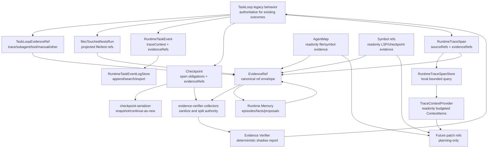

# Lane A Inventory: Evidence / Trace Grounding Spine

This is a readonly/shadow inventory for Line C. It locates current producers,
consumers, trust boundaries, and ref-drift points. It does not implement runtime
code and does not make evidence or trace data authoritative for completion,
security, retry, permission, provider ordering, or runtime state.

## Producer / Consumer Inventory

| Surface | Current producers | Current consumers | Trust classification | Authority boundary | File/function/test evidence |
| --- | --- | --- | --- | --- | --- |
| `EvidenceRef` | Canonical contract and fixtures in runtime-core; TaskLoop conversion helpers; verifier collectors; trace/memory/AgentMap/Symbol providers add refs to context items. | `ContextItem.evidenceRefs`, `ToolCallResult.evidence`, `RuntimeError.evidenceRefs`, `RuntimeTaskEvent.evidenceRefs`, `Checkpoint.evidenceRefs`, verifier reports, trace spans, memory facts, AgentMap/Symbol outputs. | `supplied` for runtime-owned refs; `verified` only when backed by verifier/promotion evidence; `projected` for synthesized file/test/trace/checkpoint refs; `untrusted` for renderer/external/subagent claims; `unknown` for metadata without origin. | Ref carrier only. It is not a completion, security, retry, permission, provider-ordering, or runtime authority. | `openclaw_runtime/src/runtime-core/evidence.ts:14`, `openclaw_runtime/src/runtime-core/evidence.ts:33`, `openclaw_runtime/src/runtime-core/types.ts:236`, `openclaw_runtime/src/runtime-core/events.ts:76`, `openclaw_runtime/src/runtime-core/evidence-verifier.ts:146`, `tests/unit/runtime-evidence-verifier-contracts.test.ts:24`, `tests/unit/runtime-evidence-verifier-collectors.test.ts:186`. |
| `TaskLoopEvidenceRef` | TaskLoop run records, structured subagent extraction, `evidenceFromResult()`, and normalization from TaskLoop result payloads. | TaskLoop context text, resume checkpoint conversion, canonical `EvidenceRef` conversion, standalone verifier shadow report, lifecycle/checkpoint shadow events. | `supplied` when generated by TaskLoop; `untrusted` when coming from subagent evidence blocks; `projected` when file/test evidence is derived from `filesTouched` / `testsRun`. | Legacy TaskLoop behavior remains authoritative for TaskLoop outcomes; Line C only observes and normalizes refs. | `openclaw_runtime/src/agents/task-loop-context.ts:25`, `openclaw_runtime/src/agents/task-loop-context.ts:87`, `openclaw_runtime/src/agents/task-loop-controller.ts:260`, `openclaw_runtime/src/agents/task-loop-controller.ts:449`, `openclaw_runtime/src/agents/task-loop-controller.ts:792`, `openclaw_runtime/src/agents/task-loop-controller.ts:1056`, `openclaw_runtime/src/agents/task-loop-controller.ts:1202`, `openclaw_runtime/src/agents/task-loop-controller.ts:1214`, `tests/unit/task-loop-controller.test.ts:344`, `tests/unit/task-loop-controller.test.ts:833`, `tests/unit/task-loop-controller.test.ts:870`. |
| `RuntimeTraceSourceRef` | Trace span contract and TaskLoop lifecycle/checkpoint span shadows supply file/range/symbol anchors. | Trace query, trace summaries, trace context provider, future source grounding consumers. | `supplied` for runtime-created source anchors; `projected` when derived from file/symbol context; external trace context is not trusted as a local source ref. | Evidence link only. Source refs do not replace verifier evidence. | `openclaw_runtime/src/runtime-core/trace-context.ts:65`, `openclaw_runtime/src/runtime-core/trace-context.ts:88`, `openclaw_runtime/src/runtime-core/trace-context.ts:111`, `openclaw_runtime/src/runtime-core/trace-context-store.ts:100`, `openclaw_runtime/src/context-engine/trace-context-provider.ts:339`, `tests/unit/runtime-trace-context-provider.test.ts:156`. |
| `RuntimeTraceSpan` | Trace contract fixtures, sanitized TaskLoop trace shadow sink, checkpoint/lifecycle trace shadow emission, local trace store append. | `RuntimeTraceSpanStore`, trace query/summary helpers, trace context provider, verifier collectors as trace evidence refs. | `supplied` when appended through runtime store; `untrusted` only for external trace context metadata after sanitization; `projected` when trace evidence refs are derived from `traceId:spanId`. | Observe-only and default-off in TaskLoop/provider paths. No exporter, service, completion gate, or runtime authority. | `openclaw_runtime/src/runtime-core/trace-context.ts:88`, `openclaw_runtime/src/runtime-core/trace-context.ts:435`, `openclaw_runtime/src/runtime-core/trace-context-store.ts:75`, `openclaw_runtime/src/runtime-core/trace-context-store.ts:137`, `openclaw_runtime/src/context-engine/trace-context-provider.ts:45`, `openclaw_runtime/src/agents/task-loop-controller.ts:1860`, `openclaw_runtime/src/agents/task-loop-controller.ts:1928`, `openclaw_runtime/src/agents/task-loop-controller.ts:2024`, `tests/unit/runtime-trace-context-contracts.test.ts:324`, `tests/unit/runtime-trace-context-store.test.ts:243`, `tests/unit/task-loop-controller.test.ts:660`. |
| `RuntimeTaskEvent` | Runtime event contract fixtures and TaskLoop lifecycle/checkpoint/error/blocked shadow emission. | Event-log envelopes/store/search/export, checkpoint event payloads, verification shadow sampling, local diagnostics. | `supplied` after contract validation; structurally valid events are evidence material, not proof of completion. | Event log is append/search/export observability; sink failures must not alter TaskLoop outcomes. | `openclaw_runtime/src/runtime-core/events.ts:52`, `openclaw_runtime/src/runtime-core/events.ts:56`, `openclaw_runtime/src/runtime-core/events.ts:76`, `openclaw_runtime/src/runtime-core/events.ts:87`, `openclaw_runtime/src/runtime-core/event-log.ts:60`, `openclaw_runtime/src/runtime-core/event-log.ts:175`, `openclaw_runtime/src/runtime-core/event-log.ts:187`, `openclaw_runtime/src/agents/task-loop-controller.ts:1873`, `tests/unit/runtime-event-log-store.test.ts:51`, `tests/unit/task-loop-event-log-shadow.test.ts:132`, `tests/unit/task-loop-controller.test.ts:911`, `tests/unit/task-loop-controller.test.ts:1209`. |
| `Checkpoint` | Canonical checkpoint contract, TaskLoop checkpoint shadows, long-task resume checkpoint conversion, checkpoint serializer snapshots and compaction shadow. | Checkpoint serializer/deserializer, RuntimeTaskEvent checkpoint payload, verifier collector input, long-task resume/recovery, event-log shadow write. | `supplied` for runtime-created checkpoints; `verified` only as structurally valid serialized/deserialized records; `projected` for synthesized checkpoint refs from resume state. | Recovery material only. Checkpoint/evidence refs do not become verifier or runtime authority. | `openclaw_runtime/src/runtime-core/evidence.ts:41`, `openclaw_runtime/src/runtime-core/checkpoint-serializer.ts:50`, `openclaw_runtime/src/runtime-core/checkpoint-serializer.ts:71`, `openclaw_runtime/src/runtime-core/checkpoint-serializer.ts:155`, `openclaw_runtime/src/runtime-core/checkpoint-serializer.ts:199`, `openclaw_runtime/src/agents/task-loop-controller.ts:1017`, `openclaw_runtime/src/agents/task-loop-controller.ts:2024`, `openclaw_runtime/src/agents/long-task-control/store.ts:254`, `openclaw_runtime/src/agents/long-task-control/store.ts:274`, `tests/unit/runtime-checkpoint-serializer.test.ts:14`, `tests/unit/task-loop-controller.test.ts:1820`. |
| Memory refs | `RuntimeMemorySourceRef`, episode source/evidence refs, fact candidate refs, accepted fact promotion evidence, invalidation evidence, proposal shadow, memory store/persistence adapters. | Memory store query/summaries, memory context provider, future grounding spine as source material; accepted facts require promotion evidence. | `verified` for accepted facts with verifier/human/deterministic promotion; `supplied` for sanitized episodes; `projected` for candidates/proposals; `untrusted` or rejected for raw chat/log/trace/tool I/O; `unknown` for unsourced external summaries. | Memory remains readonly/default-off/provider-gated. Durable claims must not come from raw trace/chat or unverified candidates. | `openclaw_runtime/src/runtime-core/memory-context.ts:136`, `openclaw_runtime/src/runtime-core/memory-context.ts:157`, `openclaw_runtime/src/runtime-core/memory-context.ts:178`, `openclaw_runtime/src/runtime-core/memory-context.ts:185`, `openclaw_runtime/src/runtime-core/memory-context.ts:201`, `openclaw_runtime/src/runtime-core/memory-context.ts:210`, `openclaw_runtime/src/runtime-core/memory-context.ts:710`, `openclaw_runtime/src/runtime-core/memory-store.ts:92`, `openclaw_runtime/src/context-engine/memory-context-provider.ts:48`, `openclaw_runtime/src/runtime-core/memory-proposal-shadow.ts:102`, `tests/unit/runtime-memory-context-contracts.test.ts:239`, `tests/unit/runtime-memory-store.test.ts:349`, `tests/unit/runtime-memory-context-provider.test.ts:285`, `tests/unit/runtime-memory-runtime-integration.test.ts:197`. |
| AgentMap refs | AgentMap tag evidence refs, ranking reason refs, result evidence, included file selections, readonly extraction/ranking/rendering. | AgentMap context provider emits `ContextItem(kind: "symbol")` and summary diagnostics; future symbol/patch grounding can consume file/symbol anchors. | `projected` from readonly parser/ranker and active-file/mention heuristics; `supplied` as readonly result evidence; not `verified` unless separately backed by tests/verifier. | Shadow-only code context. It cannot decide prompt authority, provider ordering, or runtime behavior. | `openclaw_runtime/src/runtime-core/agent-map.ts:71`, `openclaw_runtime/src/runtime-core/agent-map.ts:102`, `openclaw_runtime/src/runtime-core/agent-map.ts:120`, `openclaw_runtime/src/runtime-core/agent-map.ts:131`, `openclaw_runtime/src/runtime-core/agent-map.ts:156`, `openclaw_runtime/src/runtime-core/agent-map.ts:175`, `openclaw_runtime/src/runtime-core/agent-map.ts:644`, `openclaw_runtime/src/runtime-core/agent-map.ts:651`, `openclaw_runtime/src/runtime-core/agent-map.ts:838`, `openclaw_runtime/src/context-engine/agent-map-context-provider.ts:31`, `openclaw_runtime/src/context-engine/agent-map-context-provider.ts:185`, `tests/unit/runtime-agent-map-contracts.test.ts:89`, `tests/unit/runtime-agent-map-context-provider.test.ts:16`. |
| Symbol refs | `RuntimeSymbolEvidence = EvidenceRef`, symbol nodes/overview/references/checkpoints, readonly symbol provider context items and diagnostics. | Symbol context provider; future patch planner range drift and symbol checkpoint consumers. | `supplied` from readonly LSP/fallback contract; `projected` for symbol checkpoints/range relocation; `unknown` when LSP fallback cannot prove source truth. | Readonly operations only. No symbol mutation, prompt authority, tool authority, or runtime authority. | `openclaw_runtime/src/runtime-core/symbols.ts:4`, `openclaw_runtime/src/runtime-core/symbols.ts:36`, `openclaw_runtime/src/runtime-core/symbols.ts:72`, `openclaw_runtime/src/runtime-core/symbols.ts:86`, `openclaw_runtime/src/runtime-core/symbols.ts:99`, `openclaw_runtime/src/runtime-core/symbols.ts:111`, `openclaw_runtime/src/runtime-core/symbols.ts:125`, `openclaw_runtime/src/runtime-core/symbols.ts:323`, `openclaw_runtime/src/runtime-core/symbols.ts:474`, `openclaw_runtime/src/runtime-core/symbols.ts:494`, `openclaw_runtime/src/context-engine/symbol-context-provider.ts:38`, `openclaw_runtime/src/context-engine/symbol-context-provider.ts:258`, `tests/unit/runtime-symbol-tool-contracts.test.ts:28`, `tests/unit/runtime-symbol-tool-readonly.test.ts:171`, `tests/unit/runtime-symbol-context-provider.test.ts:48`. |
| Future patch refs | Planning docs only: AST Patch Planner, ast-grep patch flow, Serena `SymbolEditPlan`, OpenTelemetry source mapping. | Future readonly patch planner may consume AgentMap/Symbol/source/evidence/test refs and produce reviewable diff/range anchors. | `unknown` until implemented; `projected` only after readonly scan, match evidence, diff hash, formatter/test/diagnostic evidence. | Not implemented. No apply authority and no runtime authority; future apply must remain behind a fresh spec and operator rules. | `runtime-research/implementation-roadmap.md:251`, `runtime-research/implementation-roadmap.md:257`, `runtime-research/implementation-roadmap.md:260`, `runtime-research/implementation-roadmap.md:300`, `runtime-research/ast-grep/patch-flow.md:31`, `runtime-research/ast-grep/patch-flow.md:45`, `runtime-research/serena/symbol-api.md:56`, `runtime-research/opentelemetry/query-and-source-mapping.md:37`. |

## Relationship Map

Relationship notes:

| Edge | Current meaning | Boundary evidence |
| --- | --- | --- |
| TaskLoop -> `TaskLoopEvidenceRef` -> `EvidenceRef` | TaskLoop has a narrower local ref type and converts it to canonical runtime refs for shadow consumers. | `openclaw_runtime/src/agents/task-loop-controller.ts:1056`, `openclaw_runtime/src/agents/task-loop-controller.ts:1374`, `openclaw_runtime/src/agents/task-loop-controller.ts:1375`. |
| TaskLoop -> verifier | TaskLoop standalone verifier report is warning-only and records legacy decision unaffected. | `openclaw_runtime/src/agents/task-loop-controller.ts:1310`, `openclaw_runtime/src/agents/task-loop-controller.ts:1366`, `tests/unit/task-loop-controller.test.ts:1574`, `tests/unit/task-loop-controller.test.ts:1630`. |
| TaskLoop -> `RuntimeTaskEvent` -> event log | Lifecycle/checkpoint events are shadow writes; event-log failures are ignored. | `openclaw_runtime/src/agents/task-loop-controller.ts:1873`, `openclaw_runtime/src/runtime-core/event-log.ts:187`, `tests/unit/task-loop-event-log-shadow.test.ts:100`, `tests/unit/task-loop-event-log-shadow.test.ts:174`. |
| TaskLoop/checkpoint -> checkpoint serializer | Canonical checkpoints can be serialized/deserialized with version markers and diagnostics. | `openclaw_runtime/src/runtime-core/checkpoint-serializer.ts:155`, `openclaw_runtime/src/runtime-core/checkpoint-serializer.ts:199`, `tests/unit/runtime-checkpoint-serializer.test.ts:14`, `tests/unit/runtime-checkpoint-serializer.test.ts:158`. |
| Trace spans -> trace store/provider | Spans are sanitized, bounded, queried, summarized, and emitted as readonly context items. | `openclaw_runtime/src/runtime-core/trace-context-store.ts:75`, `openclaw_runtime/src/runtime-core/trace-context-store.ts:137`, `openclaw_runtime/src/context-engine/trace-context-provider.ts:312`, `tests/unit/runtime-trace-context-provider.test.ts:97`. |
| Source refs -> evidence refs | Source refs explain file/symbol anchors but do not replace verifier evidence. | `openclaw_runtime/src/context-engine/trace-context-provider.ts:339`, `openclaw_runtime/src/context-engine/trace-context-provider.ts:340`, `openclaw_runtime/src/context-engine/trace-context-provider.ts:341`, `tests/unit/runtime-trace-context-provider.test.ts:156`. |
| Memory/AgentMap/Symbol -> context items | These providers wrap refs as readonly context/diagnostic material only. | `openclaw_runtime/src/context-engine/memory-context-provider.ts:355`, `openclaw_runtime/src/context-engine/agent-map-context-provider.ts:185`, `openclaw_runtime/src/context-engine/symbol-context-provider.ts:258`, `tests/unit/runtime-memory-context-provider.test.ts:32`, `tests/unit/runtime-agent-map-context-provider.test.ts:16`, `tests/unit/runtime-symbol-context-provider.test.ts:48`. |

## Trust Classification By Source

| Source class | Trust | Rule for this inventory | Evidence |
| --- | --- | --- | --- |
| Verifier report over supplied evidence | `verified` | Verified only as the deterministic report output over sanitized input; TaskLoop integration remains warning-only. | `openclaw_runtime/src/runtime-core/evidence-verifier.ts:414`, `openclaw_runtime/src/runtime-core/evidence-verifier.ts:679`, `tests/unit/runtime-evidence-verifier-contracts.test.ts:114`, `tests/unit/task-loop-controller.test.ts:1574`. |
| Accepted memory facts with promotion evidence | `verified` | Accepted temporal facts require verified/human/deterministic promotion evidence; candidates do not become durable facts by looking verified. | `openclaw_runtime/src/runtime-core/memory-context.ts:178`, `openclaw_runtime/src/runtime-core/memory-context.ts:201`, `tests/unit/runtime-memory-context-contracts.test.ts:154`, `tests/unit/runtime-memory-runtime-integration.test.ts:197`. |
| Runtime-created events, trace spans, checkpoints, tool/test refs, AgentMap/Symbol outputs | `supplied` | Produced by runtime contracts and sanitizers, usable as evidence material, but not proof by itself. | `openclaw_runtime/src/runtime-core/events.ts:76`, `openclaw_runtime/src/runtime-core/trace-context-store.ts:75`, `openclaw_runtime/src/runtime-core/checkpoint-serializer.ts:155`, `openclaw_runtime/src/runtime-core/agent-map.ts:175`, `openclaw_runtime/src/runtime-core/symbols.ts:36`. |
| File/test refs derived from TaskLoop evidence gate | `projected` | `filesTouched` and `testsRun` are converted into canonical evidence refs by helper functions, not canonical at source. | `openclaw_runtime/src/agents/task-loop-controller.ts:1202`, `openclaw_runtime/src/agents/task-loop-controller.ts:1214`, `tests/unit/task-loop-controller.test.ts:833`, `tests/unit/task-loop-controller.test.ts:903`. |
| Trace/checkpoint refs derived from ids | `projected` | Trace and checkpoint ids can be wrapped as evidence refs; that projection links records but does not verify behavior. | `openclaw_runtime/src/runtime-core/evidence-verifier-collectors.ts:237`, `openclaw_runtime/src/agents/long-task-control/store.ts:254`, `tests/unit/runtime-trace-context-store.test.ts:170`, `tests/unit/runtime-checkpoint-serializer.test.ts:80`. |
| Renderer-collected evidence and external trace context | `untrusted` | Renderer evidence is separated from authoritative input; external trace context is rejected or marked untrusted. | `openclaw_runtime/src/runtime-core/evidence-verifier-collectors.ts:340`, `openclaw_runtime/src/runtime-core/trace-context.ts:454`, `tests/unit/runtime-evidence-verifier-collectors.test.ts:186`, `tests/unit/runtime-trace-context-contracts.test.ts:324`. |
| Structured subagent evidence blocks and raw memory inputs | `untrusted` | Subagent evidence is prompt data; raw chat/log/trace/payload/tool I/O memory is rejected. | `openclaw_runtime/src/agents/task-loop-context.ts:87`, `openclaw_runtime/src/runtime-core/memory-context.ts:710`, `tests/unit/task-loop-controller.test.ts:404`, `tests/unit/runtime-memory-context-contracts.test.ts:239`. |
| Future patch refs and unsourced metadata | `unknown` | No implemented patch planner ref contract exists yet; unsourced metadata cannot be trusted. | `runtime-research/implementation-roadmap.md:251`, `runtime-research/ast-grep/patch-flow.md:31`, `runtime-research/serena/symbol-api.md:56`. |

## Unified vs Dispersed

Already unified:

- Canonical `EvidenceRef` and `Checkpoint` live in `openclaw_runtime/src/runtime-core/evidence.ts:33` and `openclaw_runtime/src/runtime-core/evidence.ts:41`.
- Runtime events, context items, tool results, runtime errors, checkpoints, trace spans, memory records, AgentMap, and Symbol surfaces all can carry `EvidenceRef[]`.
- `RuntimeTraceSpan` already binds `sourceRefs` to `evidenceRefs` in one readonly span shape at `openclaw_runtime/src/runtime-core/trace-context.ts:88`.
- Event-log and checkpoint serializer surfaces wrap canonical `RuntimeTaskEvent` / `Checkpoint` records with validation and diagnostics at `openclaw_runtime/src/runtime-core/event-log.ts:60` and `openclaw_runtime/src/runtime-core/checkpoint-serializer.ts:71`.
- Trace, memory, AgentMap, and Symbol context providers return readonly `ContextItem` material with evidence refs rather than runtime commands.

Still dispersed:

- `TaskLoopEvidenceRef` is narrower than `EvidenceRef`; file/test refs are projected locally from `filesTouched` / `testsRun` rather than being canonical at source.
- `RuntimeTraceSourceRef` and `RuntimeMemorySourceRef` are separate source-ref shapes; AgentMap/Symbol also carry their own file/range/namePath/checkpoint fields.
- Trace queries, event-log search, memory fact queries, and future patch queries overlap but are not one shared grounding query surface.
- Resume checkpoints and TaskLedger use local conversion helpers before reaching canonical runtime refs: `openclaw_runtime/src/agents/long-task-control/store.ts:254`, `openclaw_runtime/src/agents/long-task-control/task-ledger.ts:25`, `openclaw_runtime/src/agents/long-task-control/task-ledger.ts:280`.
- Evidence metadata has no shared `trust`, `projection`, `source`, `sanitized`, `origin`, or `authority: none` convention today.
- Future patch refs are planning-only. No implemented patch ref contract exists in runtime-core/context-engine yet.

## Gaps For Later Lanes

- Normalize `TaskLoopEvidenceRef`, projected file/test refs, checkpoint refs, and trace refs into a derived readonly grounding envelope without changing producers.
- Keep renderer evidence, external trace headers, subagent evidence, and raw memory inputs untrusted or rejected.
- Align source anchors across trace, memory, AgentMap, Symbol, and future patch planning without making source refs replace verifier evidence.
- Add trust/projection metadata as derived view data only; do not mutate canonical runtime producers in this lane.
- Any future AST Patch Planner must prove readonly scan evidence, match ranges, diff hash, file hashes, formatter/tests/diagnostics, and drift handling before apply behavior is specified.

## Evidence References

Focused code references:

- Evidence and checkpoints: `openclaw_runtime/src/runtime-core/evidence.ts:14`, `openclaw_runtime/src/runtime-core/evidence.ts:33`, `openclaw_runtime/src/runtime-core/evidence.ts:41`, `openclaw_runtime/src/runtime-core/events.ts:76`.
- Verifier and collectors: `openclaw_runtime/src/runtime-core/evidence-verifier.ts:146`, `openclaw_runtime/src/runtime-core/evidence-verifier.ts:171`, `openclaw_runtime/src/runtime-core/evidence-verifier.ts:414`, `openclaw_runtime/src/runtime-core/evidence-verifier-collectors.ts:32`, `openclaw_runtime/src/runtime-core/evidence-verifier-collectors.ts:105`, `openclaw_runtime/src/runtime-core/evidence-verifier-collectors.ts:340`.
- Trace and trace provider: `openclaw_runtime/src/runtime-core/trace-context.ts:65`, `openclaw_runtime/src/runtime-core/trace-context.ts:88`, `openclaw_runtime/src/runtime-core/trace-context.ts:454`, `openclaw_runtime/src/runtime-core/trace-context-store.ts:53`, `openclaw_runtime/src/runtime-core/trace-context-store.ts:75`, `openclaw_runtime/src/context-engine/trace-context-provider.ts:45`, `openclaw_runtime/src/context-engine/trace-context-provider.ts:312`.
- Event-log/checkpoint/TaskLoop: `openclaw_runtime/src/runtime-core/event-log.ts:60`, `openclaw_runtime/src/runtime-core/event-log.ts:187`, `openclaw_runtime/src/runtime-core/checkpoint-serializer.ts:50`, `openclaw_runtime/src/runtime-core/checkpoint-serializer.ts:155`, `openclaw_runtime/src/agents/task-loop-controller.ts:1056`, `openclaw_runtime/src/agents/task-loop-controller.ts:1310`, `openclaw_runtime/src/agents/task-loop-controller.ts:1860`, `openclaw_runtime/src/agents/task-loop-controller.ts:1873`, `openclaw_runtime/src/agents/task-loop-controller.ts:2024`.
- Memory/AgentMap/Symbol: `openclaw_runtime/src/runtime-core/memory-context.ts:136`, `openclaw_runtime/src/runtime-core/memory-context.ts:178`, `openclaw_runtime/src/runtime-core/memory-context.ts:710`, `openclaw_runtime/src/context-engine/memory-context-provider.ts:48`, `openclaw_runtime/src/runtime-core/agent-map.ts:71`, `openclaw_runtime/src/context-engine/agent-map-context-provider.ts:31`, `openclaw_runtime/src/runtime-core/symbols.ts:36`, `openclaw_runtime/src/context-engine/symbol-context-provider.ts:38`.
- Future patch planning: `runtime-research/implementation-roadmap.md:251`, `runtime-research/ast-grep/patch-flow.md:31`, `runtime-research/serena/symbol-api.md:56`, `runtime-research/opentelemetry/query-and-source-mapping.md:37`.

Focused test references:

- Verifier/evidence: `tests/unit/runtime-evidence-verifier-contracts.test.ts:24`, `tests/unit/runtime-evidence-verifier-contracts.test.ts:114`, `tests/unit/runtime-evidence-verifier-contracts.test.ts:231`, `tests/unit/runtime-evidence-verifier-collectors.test.ts:41`, `tests/unit/runtime-evidence-verifier-collectors.test.ts:186`.
- Trace: `tests/unit/runtime-trace-context-contracts.test.ts:26`, `tests/unit/runtime-trace-context-contracts.test.ts:82`, `tests/unit/runtime-trace-context-contracts.test.ts:324`, `tests/unit/runtime-trace-context-store.test.ts:170`, `tests/unit/runtime-trace-context-provider.test.ts:156`.
- Event-log/checkpoint/TaskLoop: `tests/unit/runtime-event-log-store.test.ts:51`, `tests/unit/runtime-event-log-store.test.ts:78`, `tests/unit/runtime-checkpoint-serializer.test.ts:14`, `tests/unit/task-loop-event-log-shadow.test.ts:100`, `tests/unit/task-loop-controller.test.ts:590`, `tests/unit/task-loop-controller.test.ts:760`, `tests/unit/task-loop-controller.test.ts:911`, `tests/unit/task-loop-controller.test.ts:1209`, `tests/unit/task-loop-controller.test.ts:1820`.
- Memory: `tests/unit/runtime-memory-context-contracts.test.ts:36`, `tests/unit/runtime-memory-context-contracts.test.ts:239`, `tests/unit/runtime-memory-store.test.ts:349`, `tests/unit/runtime-memory-context-provider.test.ts:32`, `tests/unit/runtime-memory-proposal-shadow.test.ts:73`, `tests/unit/runtime-memory-runtime-integration.test.ts:339`.
- AgentMap/Symbol: `tests/unit/runtime-agent-map-contracts.test.ts:20`, `tests/unit/runtime-agent-map-contracts.test.ts:89`, `tests/unit/runtime-agent-map-context-provider.test.ts:16`, `tests/unit/runtime-symbol-tool-contracts.test.ts:28`, `tests/unit/runtime-symbol-tool-readonly.test.ts:171`, `tests/unit/runtime-symbol-context-provider.test.ts:48`.

Status: accepted
