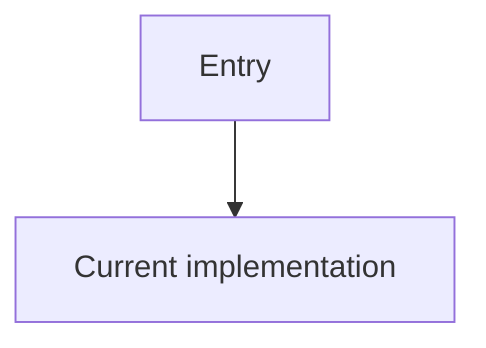

# <LANE_ID>: <LANE_TITLE>

## Scope Confirmation

- Lane:
- Output file:
- Files/directories searched:
- Commands run:

## Executive Summary

Write 5-10 bullets summarizing the current implementation surface, highest-risk legacy paths, and safest first migration seam.

## Evidence Table

| Claim | Evidence Type | Path / Command | Symbol / Lines | Notes |
|---|---|---|---|---|
|  | file |  |  |  |

Evidence Type values:

- `file`
- `test`
- `command`
- `config`
- `missing-after-search`

## Current Flow

Describe the current flow. Include a mermaid diagram if useful.



## Legacy Surface

| Legacy Path | Why It Is Immature | Current Owner / Layer | Replacement Target |
|---|---|---|---|
|  |  |  |  |

Replacement Target examples:

- `AgentMap`
- `Runtime Context Provider`
- `Symbol Tool Layer`
- `Tool Invocation Protocol`
- `Workflow Checkpoint Engine`
- `Evidence Verifier`
- `Trace Context Provider`
- `Runtime Memory Provider`
- `AST Patch Planner`

## Migration Seams

| Seam | Adapter Shape | Can Shadow First | Feature Flag Candidate | Rollback |
|---|---|---|---|---|
|  |  | yes/no |  |  |

## Existing Tests And Gaps

| Behavior | Existing Test / Harness | Coverage Quality | Missing Test |
|---|---|---|---|
|  |  | strong/partial/none |  |

## Design Conflicts

Record conflicts between current implementation and `runtime-research` design. If none were found, write `none found with current evidence`.

| Conflict | Current Evidence | Design Target | Proposed Resolution |
|---|---|---|---|
|  |  |  |  |

## Recommended Next Slice

Define exactly one smallest implementation slice for this lane.

```text
Slice:
New code path:
Legacy path wrapped:
Feature flag:
Tests:
Rollback:
Done when:
```

## Open Questions

| Question | Why It Matters | Who Can Decide | Blocking |
|---|---|---|---|
|  |  | user/maintainer/agent | yes/no |

## Handoff Notes

Any details the synthesis agent must not miss.
