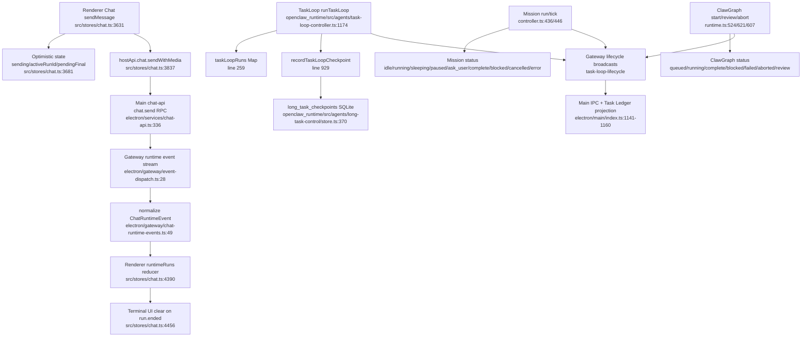

# lane-a-task-loop-state: Task loop, lifecycle, status, cancellation, resume hooks

## Scope Confirmation

- Lane: `lane-a-task-loop-state` / Task loop, lifecycle, status, cancellation, resume hooks.
- Output file: `runtime-research/handoffs/phase-1-runtime-surface-inventory/submissions/lane-a-task-loop-state.md`.
- Files/directories searched: `src/`, `electron/`, `shared/`, `openclaw_runtime/src/`, `openclaw_runtime/AGENTS.md`, `tests/`, `harness/specs/tasks/`, and required `runtime-research/` planning docs.
- Required docs read/checked: `runtime-research/agent-runtime-index.md`, `runtime-research/migration-execution-plan.md`, `runtime-research/implementation-roadmap.md`, `runtime-research/agent-runtime-core-spec.md`, `runtime-research/handoffs/phase-1-runtime-surface-inventory/README.md`, `runtime-research/handoffs/phase-1-runtime-surface-inventory/submission-template.md`, `runtime-research/handoffs/phase-1-runtime-surface-inventory/parallel-lanes.md`, plus `C:/Users/27933/.codex/RTK.md`.
- Commands run:
  - `rtk rg -n "^#|^##" runtime-research/handoffs/phase-1-runtime-surface-inventory/submission-template.md`
  - `rtk rg -n "lane-a-task-loop-state|OUTPUT_FILE|Submission" runtime-research/handoffs/phase-1-runtime-surface-inventory/README.md runtime-research/handoffs/phase-1-runtime-surface-inventory/parallel-lanes.md`
  - `rtk rg -n 'phase: "(plan|execute|collect_evidence|self_check|repair|verify|blocked|complete|error)"|status: "(running|complete|blocked|error)"|TaskLoopRunRecord|creates a Task Ledger root|records evidence gate checkpoint|records evidence gate reasons' openclaw_runtime/src/agents/task-loop-controller.ts tests/unit/task-loop-controller.test.ts tests/integration/loop-stability-check.test.ts`
  - `rtk rg -n 'MissionStatus|status: "(idle|running|sleeping|paused|ask_user|complete|blocked|cancelled|error)"|function createMission|function pauseMission|function resumeMission|function cancelMission|async function (runMission|tickMission)|pauses, resumes, and cancels|persists reviewer control' openclaw_runtime/src/agents/mission-control/types.ts openclaw_runtime/src/agents/mission-control/controller.ts shared/types/mission-control.ts tests/unit/mission-control-loop.test.ts tests/integration/loop-stability-check.test.ts`
  - `rtk rg -n 'GatewayStatus|GatewayLifecycleState|async start\(|async stop\(|state: .reconnecting.|gatewayReady|task-loop-lifecycle|mission-lifecycle|clawgraph-lifecycle|chat:runtime-event|gateway:ready' electron/gateway/manager.ts electron/gateway/process-policy.ts electron/gateway/event-dispatch.ts electron/main/index.ts tests/unit/gateway-event-dispatch.test.ts tests/unit/gateway-ready-fallback.test.ts tests/unit/gateway-process-policy.test.ts tests/unit/gateway-events.test.ts`
  - `rtk rg -n 'async sendMessage|sending: true|pendingFinal|activeRunId|abortChatRunViaHostApi|applyRuntimeEventToRuns|applyChatRuntimeEvent|rpc\(\\x27chat\\.send\\x27|rpc\(\\x27chat\\.abort\\x27|ChatRuntimeEvent' src/stores/chat.ts src/stores/chat/runtime-graph.ts electron/services/chat-api.ts electron/gateway/chat-runtime-events.ts shared/chat-runtime-events.ts tests/unit/chat-runtime-event-handlers.test.ts tests/e2e/chat-run-state-events.spec.ts tests/unit/gateway-events.test.ts tests/unit/gateway-event-dispatch.test.ts`
  - `rtk rg -n 'recordLongTaskCheckpoint|RuntimeResumeCheckpoint|buildResumeCheckpoint|resumeCheckpoints|longTaskControlStatus|prepareHandoff|recoveryContext|queueDrain|revise-goal|interrupt|queue|guide' openclaw_runtime/src/agents/long-task-control/store.ts shared/types/long-task-control.ts electron/services/sessions-api.ts tests/unit/long-task-control.test.ts tests/unit/host-services.test.ts tests/unit/user-message-queue.test.ts`
  - `rtk rg -n 'transcriptPath|loadSessionTranscript|history: async|delete: async|sweepSessionArtefacts|trajectory|jsonl|sessions\\.fork|history-transcript-fallback|hard delete|observability trajectory|trajectory-path' electron/services/sessions-api.ts electron/utils/session-files.ts electron/services/observability-trajectory.ts src/stores/chat/history-transcript-fallback.ts harness/specs/tasks/hard-delete-session-jsonl.md tests/unit/observability-trajectory.test.ts tests/unit/host-services.test.ts`
  - `rtk rg -n 'ClawGraphRunStatus|statusForRun|const runs = new Map|events array is authoritative|function emit|startClawGraphRun|maybeFinishRun|abortClawGraphRun|reviewClawGraphRun|clawgraph\\.run|clawgraph\\.status|clawgraph\\.events|clawgraph\\.abort|clawgraph\\.review|agent:clawgraph-lifecycle|clawgraph-lifecycle|lists workflows|shows DAG|review' shared/types/clawgraph.ts openclaw_runtime/src/agents/clawgraph/types.ts openclaw_runtime/src/agents/clawgraph/runtime.ts openclaw_runtime/src/gateway/server-methods/clawgraph-methods.ts electron/services/clawgraph-api.ts src/pages/ClawGraph/index.tsx tests/e2e/clawgraph.spec.ts`
  - `rtk rg -n 'RuntimeTaskEvent|TaskEventLog|runtime task event|runtime event log|append-only event log|replayRuntime|runtime reducer' src electron shared openclaw_runtime tests`
  - `rtk rg -n 'fetch\\(.http://127\\.0\\.0\\.1:18789|fetch\\(.http://localhost:18789' src`
  - `rtk rg -n 'status:\\s*["'']created["'']|status === ["'']created["'']|\\bcreated\\b.*TaskLoopStatus|\\bcreated\\b.*MissionStatus|\\bcreated\\b.*ClawGraphRunStatus' src electron shared openclaw_runtime/src tests`
  - `rtk rg -n 'waiting_permission|waiting_tool|waiting_external|assembling_context|applying_changes|status:\\s*["'']verifying["'']|status === ["'']verifying["'']' src electron shared openclaw_runtime/src tests`

## Executive Summary

- Current task/run state is not a single runtime state machine. Chat uses renderer-owned optimistic fields (`sending`, `activeRunId`, `pendingFinal`) in `src/stores/chat.ts:3631` and Gateway-originated `ChatRuntimeEvent` projections in `src/stores/chat.ts:4390`.
- Backend process lifecycle is separate from task lifecycle: Gateway owns `stopped|starting|running|error|reconnecting` in `electron/gateway/process-policy.ts:84`, while runtime task systems own their own status taxonomies.
- TaskLoop state is OpenClaw runtime-owned but in-memory first: `taskLoopRuns = new Map` in `openclaw_runtime/src/agents/task-loop-controller.ts:259`, with `TaskLoopStatus = running|complete|blocked|error` at line 60 and checkpoints written through `recordTaskLoopCheckpoint` at line 929.
- Mission Control has the richest lifecycle vocabulary (`idle|running|sleeping|paused|ask_user|complete|blocked|cancelled|error`) in `openclaw_runtime/src/agents/mission-control/types.ts:11`, but `resumeMission` is a paused-to-sleeping transition in `controller.ts:758`, not event-log replay.
- ClawGraph has its own in-memory run map and event list in `openclaw_runtime/src/agents/clawgraph/runtime.ts:51` and `runtime.ts:74`, with statuses `queued|running|complete|blocked|failed|aborted|review` in `shared/types/clawgraph.ts:14`.
- Resume/checkpoint data currently comes from long-task SQLite checkpoints (`recordLongTaskCheckpoint` in `openclaw_runtime/src/agents/long-task-control/store.ts:370`) plus legacy transcript/trajectory readers in Main (`electron/services/sessions-api.ts:735`, `electron/services/observability-trajectory.ts:34`).
- Task Ledger is a projection of lifecycle events, not the execution source of truth: Main maps TaskLoop/Mission/ClawGraph statuses into `TaskLedgerNodeStatus` in `electron/main/index.ts:197`, `415`, and `634`.
- No implementation named `RuntimeTaskEvent`, `TaskEventLog`, runtime reducer, or runtime event-log replay was found in `src electron shared openclaw_runtime tests`; the only matches are in `runtime-research` planning docs.
- Safest first seam: add a shadow-only adapter/reducer around TaskLoop lifecycle events and long-task checkpoints, behind `runtimeTaskEventLogShadow`, with no behavior changes.

## Evidence Table

| Claim | Evidence Type | Path / Command | Symbol / Lines | Notes |
|---|---|---|---|---|
| Chat run creation starts in renderer with optimistic UI state. | file | `src/stores/chat.ts` | `sendMessage` at `3631`, `sending: true` at `3681`, `pendingFinal` at `3687` | Renderer marks a send active before the runtime event stream is authoritative. |
| Chat backend send goes through Main/Gateway RPC, not direct renderer HTTP. | file | `electron/services/chat-api.ts` | `gatewayManager.rpc('chat.send', ...)` at `336` | Main service proxies `chat.send` into Gateway. |
| Chat abort is renderer-first cleanup plus Gateway abort RPC. | file | `src/stores/chat.ts` | `abortChatRunViaHostApi` at `1778`, cleanup at `3940`, call at `3944` | UI clears active state before runtime confirms `run.ended(status='aborted')`. |
| Structured chat lifecycle statuses are `run.started` and `run.ended(completed|error|aborted)`. | file | `shared/chat-runtime-events.ts` | `ChatRuntimeEvent` at `8`, status union at `15` | This is chat-specific and does not model created/planning/waiting/verifying. |
| Gateway normalizes raw lifecycle phases into chat runtime events. | file | `electron/gateway/chat-runtime-events.ts` | `normalizeGatewayChatRuntimeEvent` at `49`; completed/error/aborted branches at `68`, `83`, `99` | Non-terminal lifecycle phases are intentionally not treated as `run.ended`. |
| Renderer projects runtime events into `runtimeRuns` and clears active UI on terminal events. | file | `src/stores/chat.ts` | `handleRuntimeEvent` at `4390`; `applyRuntimeEventToRuns` at `4397`; terminal clear at `4456-4470` | Current chat status is split between event projection and UI flags. |
| Chat runtime event handling has focused unit/E2E coverage. | test | `tests/unit/chat-runtime-event-handlers.test.ts`; `tests/e2e/chat-run-state-events.spec.ts` | unit expectations around `activeRunId`/`pendingFinal` at `132`, `273`, `462`; E2E test at `15` | Covers current renderer behavior, not durable replay. |
| Gateway process lifecycle is independent of task lifecycle. | file | `electron/gateway/process-policy.ts`; `electron/gateway/manager.ts` | `GatewayLifecycleState` at `84`; `GatewayStatus` at `71`; `start` at `427`; `stop` at `586`; reconnect at `1453` | `gatewayReady` gates runtime surface readiness, not individual task completion. |
| Gateway event dispatch bridges runtime streams into Main/renderer event names. | file | `electron/gateway/event-dispatch.ts`; `electron/main/index.ts` | `chat:runtime-event` at `28`; `gateway:ready` at `39`; lifecycle cases at `50-56`; Main sends at `1120`, `1142`, `1151`, `1160` | Main fans out `chat`, `task-loop`, `mission`, and `clawgraph` lifecycle events. |
| TaskLoop status source is runtime-owned, in memory, with checkpoints as recovery artifacts. | file | `openclaw_runtime/src/agents/task-loop-controller.ts` | `TaskLoopStatus` at `60`; `taskLoopRuns` at `259`; `recordTaskLoopCheckpoint` at `929`; `runTaskLoop` at `1174` | Primary live state is the map; checkpoint rows are derived during progress. |
| TaskLoop phases/status transitions cover plan/execute/evidence/self-check/repair/blocked/complete/error. | file | `openclaw_runtime/src/agents/task-loop-controller.ts` | phase assignments at `1260`, `1273`, `1326`, `1364`, `1447`; complete at `1415-1423`; blocked at `1433-1463`, `1467-1475`; error at `1485-1495` | No current TaskLoop statuses named `created`, `waiting_permission`, `waiting_tool`, `verifying`, or `cancelled`. |
| TaskLoop tests cover ledger root and checkpoint/evidence recovery data. | test | `tests/unit/task-loop-controller.test.ts` | tests at `403`, `922`, `961` | Strong coverage for current checkpoint metadata, not for event-log replay. |
| Mission Control status source includes pause/resume/cancel and user-wait states. | file | `openclaw_runtime/src/agents/mission-control/types.ts`; `controller.ts` | `MissionStatus` at `types.ts:11`; `createMission` at `367`; `runMission` at `436`; `tickMission` at `446`; pause/resume/cancel at `747`, `758`, `769` | `ask_user`, `sleeping`, and `paused` are the closest current waiting states. |
| Mission reviewer decisions drive terminal/intervention status. | file | `openclaw_runtime/src/agents/mission-control/controller.ts` | reviewer set at `581-588`; checkpoint at `617-624`; status branches at `658`, `662`, `667`, `671`, `680` | Reviewer `complete|blocked|ask_user|sleep|repair` decisions are projected into mission status. |
| Mission tests cover lifecycle/checkpoint control signals and pause/resume/cancel. | test | `tests/unit/mission-control-loop.test.ts`; `tests/e2e/mission-control-panel.spec.ts` | unit tests at `190`, `272`; E2E at `143`, `264` | Covers API/UI behavior, not full durable resume from checkpoints. |
| Long-task resume/checkpoint store is SQLite/Kysely-backed. | file | `openclaw_runtime/src/agents/long-task-control/store.ts` | `RuntimeResumeCheckpoint` at `46`; Kysely table union at `130`; `recordLongTaskCheckpoint` at `370`; user queue at `557` | This is the strongest existing persistence seam for resume metadata. |
| Host sessions API exposes long-task control, resume checkpoints, queue drain, and handoff assembly. | file | `electron/services/sessions-api.ts` | `longTaskControlStatus` at `1050`; `resumeCheckpoints` at `1103`; `queueDrain` at `1126`; `prepareHandoff` at `1185`; checkpoint fetch at `1236` | Main combines Gateway recovery, checkpoints, transcript, ledger, git, and observability. |
| Resume checkpoint and queue tests cover normalized checkpoint data and idempotency. | test | `tests/unit/long-task-control.test.ts`; `tests/unit/user-message-queue.test.ts`; `tests/unit/host-services.test.ts` | tests at `82`, `126`, `174`, `1096`, `1240` | Good for current handoff/checkpoint behavior; no reducer replay tests. |
| Session history still reads local `.jsonl` transcripts and delete sweeps transcript/trajectory sidecars. | file | `electron/services/sessions-api.ts`; `electron/utils/session-files.ts` | transcript resolution at `723-745`; `history` at `884`; delete at `751`, sweep call at `794`; sidecar list at `session-files.ts:11-18`, sweep at `188-244` | Existing transcript/trajectory files are current compatibility/data sources. |
| Trajectory reader loads adjacent and pointer `.trajectory.jsonl` files. | file/test | `electron/services/observability-trajectory.ts`; `tests/unit/observability-trajectory.test.ts` | path builders at `34-42`; pointer schema at `70`; test at `70` | Useful diagnostic evidence, but not a canonical task state replay log. |
| ClawGraph state is runtime-owned but in-memory with a per-run event list. | file | `openclaw_runtime/src/agents/clawgraph/runtime.ts` | `runs = new Map` at `51`; `emit` at `74`; `statusForRun` at `82`; `startClawGraphRun` at `524`; `abortClawGraphRun` at `607`; `reviewClawGraphRun` at `621` | Gateway comments say broadcasts are best-effort and events are available via `clawgraph.events`. |
| ClawGraph statuses are separate from Chat/TaskLoop/Mission. | file/test | `shared/types/clawgraph.ts`; `tests/e2e/clawgraph.spec.ts` | status union at `14`; E2E workflow/review test at `110` | Has `review` and `aborted`; uses `complete`/`failed` instead of core `completed`/`cancelled`. |
| Task Ledger records lifecycle projections, not execution authority. | file | `shared/types/task-ledger.ts`; `electron/main/index.ts` | ledger status union at `11`; TaskLoop mapping at `197`; Mission mapping at `415`; ClawGraph mapping at `634`; lifecycle recorders at `207`, `431`, `652` | It can become a shadow projection sink but cannot currently resume tasks. |
| No runtime-core event log implementation was found outside planning docs. | missing-after-search | `rtk rg -n 'RuntimeTaskEvent|TaskEventLog|runtime task event|runtime event log|append-only event log|replayRuntime|runtime reducer' src electron shared openclaw_runtime tests` | no output, exit `1` | Confirms target `RuntimeTaskEvent`/reducer/replay layer is not implemented in current code/tests. |
| No current implementation status literal named `created` was found for this lane's searched task systems. | missing-after-search | `rtk rg -n 'status:\\s*["'']created["'']|status === ["'']created["'']|\\bcreated\\b.*TaskLoopStatus|\\bcreated\\b.*MissionStatus|\\bcreated\\b.*ClawGraphRunStatus' src electron shared openclaw_runtime/src tests` | no output, exit `1` | Current code uses creation timestamps/initial states instead of a shared `created` status. |
| No target waiting/verifying status literals were found in current source/tests. | missing-after-search | `rtk rg -n 'waiting_permission|waiting_tool|waiting_external|assembling_context|applying_changes|status:\\s*["'']verifying["'']|status === ["'']verifying["'']' src electron shared openclaw_runtime/src tests` | no output, exit `1` | Current waiting equivalents are subsystem-specific (`pendingFinal`, `sleeping`, `ask_user`, `review`). |
| No direct renderer fetch to Gateway port 18789 was found. | missing-after-search | `rtk rg -n 'fetch\\(.http://127\\.0\\.0\\.1:18789|fetch\\(.http://localhost:18789' src` | no output, exit `1` | Renderer/Main API boundary appears respected for this lane's searched surface. |
| Target design requires append-only event-log replay and canonical statuses. | config | `runtime-research/agent-runtime-core-spec.md`; `runtime-research/implementation-roadmap.md`; `runtime-research/migration-execution-plan.md` | core statuses at `142-149`; event-log replay at `167`; roadmap event-log line `136`; execution-plan event-log line `214` | Current code diverges by using subsystem-specific live state and status names. |
| OpenClaw-owned future runtime state should not add JSON/JSONL sidecars. | config | `openclaw_runtime/AGENTS.md` | SQLite/storage policy at `75-83` | Existing transcript/trajectory sidecars should be treated as legacy/product artifacts, not the new steady-state runtime store. |

## Current Flow

The current flow is four overlapping lifecycle systems plus a projection layer:

- Chat/conversation lifecycle: `src/stores/chat.ts:3631` creates renderer optimistic state, `electron/services/chat-api.ts:336` sends `chat.send` through Gateway, `electron/gateway/chat-runtime-events.ts:49` normalizes runtime events, and `src/stores/chat.ts:4390` applies those events to `runtimeRuns`.
- Gateway process lifecycle: `electron/gateway/manager.ts:427`, `586`, and `1453` own start/stop/reconnect state. This only says whether the runtime surface is available, not whether a task is running or complete.
- OpenClaw task lifecycles: TaskLoop (`openclaw_runtime/src/agents/task-loop-controller.ts:1174`), Mission Control (`openclaw_runtime/src/agents/mission-control/controller.ts:436`), and ClawGraph (`openclaw_runtime/src/agents/clawgraph/runtime.ts:524`) each own their live status.
- Recovery/history layer: long-task checkpoints are SQLite rows (`openclaw_runtime/src/agents/long-task-control/store.ts:370`), while session transcript and trajectory history are still read from `.jsonl` files (`electron/services/sessions-api.ts:735`; `electron/services/observability-trajectory.ts:34`).
- Projection layer: Main converts TaskLoop/Mission/ClawGraph lifecycle events into Task Ledger nodes in `electron/main/index.ts:197`, `415`, and `634`.



Status-source notes:

- `created`: target design status only; current code mostly uses `createdAt` timestamps and immediate `sending`/`idle`/`queued` state. No current implementation status named `created` was found for this lane.
- `running`: renderer chat `sending`, ChatRuntimeEvent `run.started`, TaskLoop `running`, Mission `running`, ClawGraph `running`, and Gateway `running` all exist but mean different layers.
- `waiting`: current equivalents are chat `pendingFinal`/tool events, Mission `sleeping|ask_user|paused`, and ClawGraph `review`; there is no shared `waiting_permission|waiting_tool|waiting_external` taxonomy.
- `complete/failed/error/blocked/cancelled`: Chat uses `completed|error|aborted`; TaskLoop uses `complete|blocked|error`; Mission uses `complete|blocked|cancelled|error`; ClawGraph uses `complete|failed|aborted|blocked|review`.
- `resume`: current resume hooks are `resumeMission` (`paused -> sleeping`) and checkpoint/handoff reads through `sessions.resumeCheckpoints`; no event-log replay implementation was found.

## Legacy Surface

| Legacy Path | Why It Is Immature | Current Owner / Layer | Replacement Target |
|---|---|---|---|
| Renderer optimistic chat state: `sending`, `activeRunId`, `pendingFinal` in `src/stores/chat.ts:3631`, `4390` | UI state is created before runtime confirmation and abort clears UI before runtime terminal event (`src/stores/chat.ts:3940`, `3944`). | Renderer | Workflow Checkpoint Engine / `RuntimeTaskEvent` projection |
| Chat-specific `ChatRuntimeEvent` contract in `shared/chat-runtime-events.ts:8` | Good event shape for chat UI, but status vocabulary is only `completed|error|aborted` and lacks target task states. | Shared + Gateway + Renderer | Workflow Checkpoint Engine |
| TaskLoop `taskLoopRuns` process map in `openclaw_runtime/src/agents/task-loop-controller.ts:259` | Live state is process memory; checkpoints exist but do not rebuild the full task from an append-only event log. | OpenClaw runtime | Workflow Checkpoint Engine |
| Mission `resumeMission` in `openclaw_runtime/src/agents/mission-control/controller.ts:758` | Resume is a lifecycle toggle (`paused` to `sleeping`), not replay from checkpoint or persisted tool results. | OpenClaw runtime | Workflow Checkpoint Engine |
| ClawGraph `runs = new Map` and event list in `openclaw_runtime/src/agents/clawgraph/runtime.ts:51`, `74` | Events are useful for UI/polling but remain in memory; Gateway broadcasts are best-effort (`clawgraph-methods.ts:81-83`). | OpenClaw runtime + Gateway | Workflow Checkpoint Engine |
| Session transcript fallback in `electron/services/sessions-api.ts:735` and `src/stores/chat/history-transcript-fallback.ts:4` | `.jsonl` transcript is a compatibility/history source, not structured runtime state. | Main + Renderer | Runtime Memory Provider |
| Trajectory sidecars in `electron/services/observability-trajectory.ts:34` and `electron/utils/session-files.ts:181` | Diagnostic file sidecars are not a canonical event-log replay store. | Main + OpenClaw artifact readers | Trace Context Provider |
| Task Ledger projection in `electron/main/index.ts:197`, `415`, `634` | Ledger normalizes display statuses but does not own execution or resume. | Main | Workflow Checkpoint Engine |

## Migration Seams

| Seam | Adapter Shape | Can Shadow First | Feature Flag Candidate | Rollback |
|---|---|---|---|---|
| TaskLoop lifecycle -> `RuntimeTaskEvent` shadow adapter | Convert `task-loop-lifecycle` payloads from `electron/main/index.ts:1151` and TaskLoop phases from `task-loop-controller.ts:1260-1495` into a shadow event stream. | yes | `runtimeTaskEventLogShadow` | Disable adapter; legacy TaskLoop and Task Ledger continue unchanged. |
| Long-task checkpoints -> reducer seed | Read `recordLongTaskCheckpoint`/`sessions.resumeCheckpoints` records (`store.ts:370`, `sessions-api.ts:1103`) as resume metadata linked to shadow events. | yes | `runtimeCheckpointShadowRead` | Stop shadow reads; keep existing checkpoint APIs untouched. |
| ChatRuntimeEvent -> normalized task status projection | Adapt `run.started`, `run.ended`, `tool.*`, and `approval.updated` from `shared/chat-runtime-events.ts:8` into target status candidates without changing `src/stores/chat.ts`. | yes | `chatRuntimeEventShadowProjection` | Remove projection; renderer still uses `runtimeRuns`. |
| Mission lifecycle -> normalized waiting/cancel statuses | Map `sleeping|paused|ask_user|cancelled` from `MissionStatus` (`types.ts:11`) into target waiting/cancel states. | yes | `missionRuntimeEventShadow` | Disable Mission adapter; current `mission.*` RPCs continue. |
| ClawGraph events -> normalized review/abort statuses | Convert `clawgraph.events`/lifecycle snapshots (`clawgraph-methods.ts:172`, `runtime.ts:74`) into target events. | yes | `clawGraphRuntimeEventShadow` | Disable adapter; polling/status UI remains unchanged. |
| Transcript/trajectory compatibility reader | Treat `.jsonl` transcript and trajectory files as read-only evidence sources while new event log is populated elsewhere. | yes | `runtimeLegacyHistoryReadCompat` | Keep current `sessions.history` and observability readers. |

## Existing Tests And Gaps

| Behavior | Existing Test / Harness | Coverage Quality | Missing Test |
|---|---|---|---|
| Chat runtime event projection and terminal UI clear | `tests/unit/chat-runtime-event-handlers.test.ts:132`, `273`, `462`; `tests/e2e/chat-run-state-events.spec.ts:15` | strong for current UI | Reducer replay from durable `RuntimeTaskEvent` log across reload. |
| Gateway event normalization and readiness | `tests/unit/gateway-event-dispatch.test.ts:16`, `51`, `77`; `tests/unit/gateway-ready-fallback.test.ts:30`; `tests/unit/gateway-events.test.ts:106`, `420` | strong for current Gateway bridge | Contract test that all runtime lifecycle streams produce normalized task events. |
| TaskLoop lifecycle/checkpoint/evidence | `tests/unit/task-loop-controller.test.ts:403`, `886`, `922`, `961`; `tests/integration/loop-stability-check.test.ts` | strong for current TaskLoop | Durable replay test that rebuilds phase/status from events and does not rely on `taskLoopRuns`. |
| Mission lifecycle pause/resume/cancel and checkpoint control signals | `tests/unit/mission-control-loop.test.ts:190`, `272`; `tests/e2e/mission-control-panel.spec.ts:143`, `264` | partial to strong | Resume-from-checkpoint test proving `resumeMission` or successor does not merely toggle state. |
| Long-task control checkpoint and queue persistence | `tests/unit/long-task-control.test.ts:82`; `tests/unit/user-message-queue.test.ts:126`, `174`; `tests/unit/host-services.test.ts:1096`, `1240` | strong for current checkpoint APIs | Event-log idempotency test for queued/interrupted/revise-goal flows. |
| Session transcript and trajectory recovery | `tests/unit/observability-trajectory.test.ts:70`, `122`; `harness/specs/tasks/hard-delete-session-jsonl.md:17-19`, `37-38` | partial | Migration test that transcript/trajectory are read-only compatibility sources after event log exists. |
| ClawGraph run/review/abort lifecycle | `tests/unit/clawgraph-runtime.test.ts:81`, `144`; `tests/e2e/clawgraph.spec.ts:110` | partial | Durable replay test for `queued -> running -> review/complete/blocked/aborted` without in-memory `runs`. |
| Task Ledger projection | `electron/main/index.ts:207`, `431`, `652` plus panel E2Es `tests/e2e/task-loop-panel.spec.ts:170`, `tests/e2e/mission-control-panel.spec.ts:140` | partial | Test that ledger projection is derived from normalized runtime events, not parallel status mapping. |

## Design Conflicts

| Conflict | Current Evidence | Design Target | Proposed Resolution |
|---|---|---|---|
| Current live state is split across renderer flags, Gateway process state, TaskLoop/Mission/ClawGraph memory maps, and Task Ledger projections. | `src/stores/chat.ts:3681`, `electron/gateway/process-policy.ts:84`, `task-loop-controller.ts:259`, `mission-control/controller.ts:367`, `clawgraph/runtime.ts:51`, `electron/main/index.ts:197` | `agent-runtime-core-spec.md:167` says reducers rebuild task state from append-only event logs and resume never depends on in-memory objects. | Introduce shadow `RuntimeTaskEvent` adapter/reducer first; keep legacy owners authoritative until parity is proven. |
| Status names and terminal semantics do not match target taxonomy. | Chat `completed|error|aborted` in `shared/chat-runtime-events.ts:15`; TaskLoop `running|complete|blocked|error` in `task-loop-controller.ts:60`; Mission statuses in `types.ts:11`; ClawGraph statuses in `shared/types/clawgraph.ts:14` | `agent-runtime-core-spec.md:142-149` targets `created -> planning -> assembling_context -> running -> waiting_* -> applying_changes -> verifying -> completed|failed|blocked|cancelled`. | Define a one-way compatibility mapping with loss markers before changing any legacy status. |
| Current resume hooks are checkpoints/handoff and lifecycle toggles, not event-log replay. | `resumeMission` at `mission-control/controller.ts:758`; `sessions.resumeCheckpoints` at `electron/services/sessions-api.ts:1103`; `prepareHandoff` at `1185` | `agent-runtime-core-spec.md:167`, `187-189` require replay and side-effect reuse without repeating completed mutating tool calls. | Start with TaskLoop shadow replay fixtures using checkpoints as metadata; do not claim full resume until tool-result idempotency exists. |
| Existing transcript/trajectory `.jsonl` files are active data sources, while future OpenClaw-owned runtime state should be SQLite/event-log based. | `sessions-api.ts:735`, `observability-trajectory.ts:34`, `session-files.ts:181-188`; storage policy in `openclaw_runtime/AGENTS.md:75-83` | `migration-execution-plan.md:222-239` references dual legacy transcript/session data and new event log; `openclaw_runtime/AGENTS.md:76` forbids new JSON/JSONL sidecars for steady-state runtime state. | Treat transcript/trajectory as legacy/product artifacts and write the new runtime event log to SQLite-backed storage. |
| Chat abort clears renderer state before the runtime terminal event confirms cancellation. | `src/stores/chat.ts:3940`, `3944`; terminal event handling at `4456-4470` | Target state machine has explicit `cancelled` terminal status in `agent-runtime-core-spec.md:149`. | Shadow adapter should record requested-cancel and confirmed-cancel separately before changing UI behavior. |

## Recommended Next Slice

Define exactly one smallest implementation slice for this lane.

```text
Slice:
Add a shadow-only TaskLoop RuntimeTaskEvent adapter/reducer that consumes existing task-loop lifecycle payloads and long-task checkpoint metadata, without changing TaskLoop execution, UI state, Gateway behavior, or checkpoint writes.

New code path:
Main/Gateway-side shadow adapter receives existing task-loop-lifecycle events from electron/main/index.ts:1151 and checkpoint metadata from sessions.resumeCheckpoints / recordLongTaskCheckpoint, normalizes them into in-memory test fixtures first, then optional SQLite-backed shadow storage in a later slice.

Legacy path wrapped:
openclaw_runtime/src/agents/task-loop-controller.ts runTaskLoop lifecycle events and openclaw_runtime/src/agents/long-task-control/store.ts recordLongTaskCheckpoint outputs.

Feature flag:
runtimeTaskEventLogShadow

Tests:
Unit test with a TaskLoop lifecycle sequence covering intake -> plan -> execute -> collect_evidence -> self_check -> complete; blocked/error variants; checkpoint association; and no mutation of existing TaskLoop result/status.

Rollback:
Disable runtimeTaskEventLogShadow and delete the shadow adapter/reducer; existing TaskLoop, Task Ledger, and long-task checkpoint paths remain authoritative.

Done when:
The shadow reducer can rebuild TaskLoop status/phase/checkpoint refs from recorded lifecycle fixtures, parity is asserted against existing TaskLoopRunRecord fields, and all current TaskLoop/chat/Gateway tests still pass with the feature flag off.
```

## Open Questions

| Question | Why It Matters | Who Can Decide | Blocking |
|---|---|---|---|
| Should `aborted` from Chat/ClawGraph map to target `cancelled`, target `failed`, or retain an `aborted` compatibility reason? | Current systems use `aborted` (`shared/chat-runtime-events.ts:15`, `shared/types/clawgraph.ts:14`) but target uses `cancelled` (`agent-runtime-core-spec.md:149`). | maintainer | yes |
| Is Mission Control part of the first runtime task event domain, or should TaskLoop land first and Mission adapt later? | Mission has richer waiting states (`mission-control/types.ts:11`) but also broader product behavior. | maintainer | no |
| Where should the future append-only event log live in SQLite schema ownership? | OpenClaw storage policy requires SQLite and no new sidecars (`openclaw_runtime/AGENTS.md:75-83`). | maintainer | yes |
| Should renderer optimistic chat abort expose both requested and confirmed cancellation states? | Current abort clears UI before runtime confirmation (`src/stores/chat.ts:3940`, `3944`). | maintainer | no |
| How long should transcript/trajectory readers remain as compatibility sources after event-log shadowing begins? | `sessions-api.ts:735` and `observability-trajectory.ts:34` are still used for history/diagnostics. | user/maintainer | no |

## Handoff Notes

- This submission is research-only; no runtime migration code was changed.
- The only intended file change for this lane is this output document.
- `RuntimeTaskEvent` is present in `runtime-research` design docs, but the implementation search across `src electron shared openclaw_runtime tests` returned no matches.
- Current evidence points to TaskLoop lifecycle + long-task checkpoint metadata as the smallest low-risk shadow seam; Chat and ClawGraph should wait until the status mapping question is settled.
