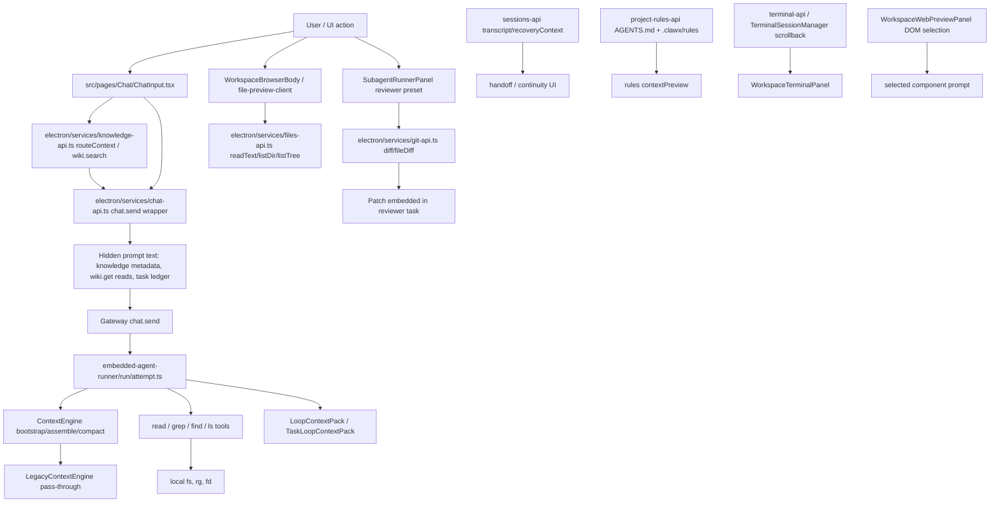

# lane-b-context-agentmap: Context collection, file reads, search, AgentMap replacement seams

## Scope Confirmation

- Lane: `lane-b-context-agentmap`
- Output file: `runtime-research/handoffs/phase-1-runtime-surface-inventory/submissions/lane-b-context-agentmap.md`
- Files/directories searched:
  - `runtime-research/*.md`
  - `runtime-research/handoffs/phase-1-runtime-surface-inventory/*.md`
  - `src/pages`, `src/components`, `src/lib`, `src/stores`
  - `electron/services`, `electron/utils`
  - `shared`
  - `openclaw_runtime/src/agents`, `openclaw_runtime/src/context-engine`, `openclaw_runtime/src/gateway`
  - `tests/unit`, `tests/e2e`, `tests/integration`
- Commands run:
  - `rtk powershell.exe -NoProfile -Command "Get-Content -Raw 'runtime-research/handoffs/phase-1-runtime-surface-inventory/submission-template.md'"`
  - `rtk powershell.exe -NoProfile -Command "Get-ChildItem 'runtime-research/handoffs/phase-1-runtime-surface-inventory/submissions' -Force | Select-Object Name,Length,LastWriteTime | Format-Table -AutoSize"`
  - `rtk rg -n "^#|^##|OUTPUT_FILE|lane-b|Context|AgentMap" runtime-research/handoffs/phase-1-runtime-surface-inventory/README.md runtime-research/handoffs/phase-1-runtime-surface-inventory/parallel-lanes.md runtime-research/agent-runtime-core-spec.md runtime-research/migration-execution-plan.md runtime-research/implementation-roadmap.md runtime-research/agent-runtime-index.md`
  - `rtk rg -n "context|Context|selectedCode|currentFile|readFile|readDirectory|grep|search|ripgrep|token|budget|truncate|repo map|repomap" src electron shared tests openclaw_runtime/src --glob '!openclaw_runtime/dist/**'`
  - `rtk rg -n "provider|ContextProvider|context provider|rules|diff|terminal|problems" src electron shared tests openclaw_runtime/src --glob '!openclaw_runtime/dist/**'`
  - `rtk rg -n "\bAgentMap\b|\bRepoMap\b|repomap|PageRank|runtime context provider|RuntimeContextProvider|ContextProviderRegistry|AgentMapProvider|SymbolProvider" openclaw_runtime/src src electron shared tests --glob '!openclaw_runtime/dist/**'`
  - `rtk rg -n "selectedKnowledgeRefs|knowledgeReferenceFromRow|routeKnowledgeForMessage|recordKnowledgeReferences|contextRange|sendMessage\(" src/pages/Chat/ChatInput.tsx`
  - `rtk rg -n "ROUTER_BUDGET|KNOWLEDGE_INTENT_PATTERN|shouldRouteKnowledge|routeCandidateFromRow|routeContext|wiki\.search|maxSnippetChars|maxReferences" electron/services/knowledge-api.ts tests/unit/knowledge-api.test.ts`
  - `rtk rg -n "applyKnowledgeMetadata|readSelectedKnowledgeReferences|applyKnowledgeReadCitations|applyTaskLedgerContext|capContextText|chat\.send|wiki\.get|maxRefs" electron/services/chat-api.ts tests/unit/chat-knowledge-scope.test.ts tests/unit/task-ledger-service.test.ts`
  - `rtk rg -n "MAX_TEXT_BYTES|MAX_BINARY_BYTES|MAX_TREE_DEPTH|MAX_TREE_NODES|readText|readBinary|listDir|listTree|readFile|readdir" electron/services/files-api.ts src/lib/file-preview-client.ts src/components/file-preview/WorkspaceBrowserBody.tsx tests/unit/file-preview-client.test.ts tests/e2e/workspace-git-panel.spec.ts`
  - `rtk rg -n "MAX_PATCH_CHARS|diff:|fileDiff|gitTextAt|workingTreeText|readCurrentGitStatus|hostApi\.git\.diff|Reviewer preset|current diff|readCurrentDiff|SubagentRunnerPanel|starts Reviewer preset|shows failure when Reviewer" electron/services/git-api.ts src/components/agents/SubagentRunnerPanel.tsx tests/e2e/lightweight-subagent-runner.spec.ts tests/unit/git-api.test.ts`
  - `rtk rg -n "readRecentTranscriptMessages|readAllTranscriptMessages|collectFileRefs|compactionStatus|recoveryContext|budgetTokens|contextRange|resolveContextWindow|transcript|jsonl" electron/services/sessions-api.ts electron/utils/context-window.ts tests/unit/context-window.test.ts tests/unit/chat-session-continuity.test.ts`
  - `rtk rg -n "createReadToolDefinition|readFile|truncateHead|offset|limit|maxBytes|maxChars" openclaw_runtime/src/agents/sessions/tools/read.ts`
  - `rtk rg -n "createGrepToolDefinition|ripgrep|rg|readFile|MAX_|maxMatches|truncate|context|before|after" openclaw_runtime/src/agents/sessions/tools/grep.ts`
  - `rtk rg -n "createFindToolDefinition|fd|glob|maxResults|DEFAULT|find|fast-glob|readdir" openclaw_runtime/src/agents/sessions/tools/find.ts openclaw_runtime/src/agents/sessions/tools/ls.ts`
  - `rtk rg -n "export interface ContextEngine|bootstrap|ingest|assemble|compact|tokenBudget|ContextEngineRegistry|registerContextEngine|quarantine|legacy|activeContextEngine" openclaw_runtime/src/context-engine/types.ts openclaw_runtime/src/context-engine/legacy.ts openclaw_runtime/src/context-engine/registry.ts openclaw_runtime/src/agents/embedded-agent-runner/run/attempt.ts`
  - `rtk rg -n "function assembleAttemptContextEngine|export async function assembleAttemptContextEngine|runAttemptContextEngineBootstrap|assembleAttemptContextEngine" openclaw_runtime/src/agents/embedded-agent-runner -g "*.ts"`
  - `rtk rg -n "buildLoopContextPack|token|budget|estimated|truncate|omittedItems|formatTaskLoopContextPackForReviewer|LoopContextPack|context pack" openclaw_runtime/src/agents/loop-context-pack.ts openclaw_runtime/src/agents/task-loop-context.ts tests/unit/loop-context-pack.test.ts tests/unit/task-loop-controller.test.ts tests/integration/loop-stability-check.test.ts`
  - `rtk rg -n "readAgentsFile|listRuleFiles|buildSnapshot|contextPreview|AGENTS\.md|\.clawx/rules|readFile|readdir" electron/services/project-rules-api.ts tests/unit/project-rules-api.test.ts tests/e2e/project-rules-center.spec.ts`
  - `rtk rg -n "CONTEXT\.md|getContext|setContext|topics|readFile|writeFile|mkdir" electron/services/topics-api.ts tests/unit/topics-api.test.ts src/pages/Chat/ChatInput.tsx`
  - `rtk rg -n "selectedCode|selectedText|currentFile|activeFile|currentSelection|editorSelection|searchResults|terminalOutput|terminalContext|problems|diagnostics" src/pages src/components src/lib src/stores electron/services shared openclaw_runtime/src/agents openclaw_runtime/src/context-engine tests --glob '!openclaw_runtime/dist/**'`
  - `rtk rg -n "\bAgentMap\b|\bRepoMap\b|repomap|PageRank|RuntimeContextProvider|ContextProviderRegistry|AgentMapProvider|SymbolProvider" openclaw_runtime/src src electron shared tests --glob '!openclaw_runtime/dist/**'`
  - `rtk rg -n "create(Read|Grep|Find|Ls)Tool|read tool|grep tool|find tool|ls tool|ripgrep|fd is not available" tests openclaw_runtime/src --glob "*.test.ts" --glob "*.spec.ts" --glob "*.vitest.ts"`
  - `rtk rg -n "selectedText|waitForQueuedUserMessage|requestUserInput|extractUserMessageText|consumeQueuedUserMessage" openclaw_runtime/src/agents/sessions/agent-session-runtime.ts tests/unit/user-message-queue.test.ts openclaw_runtime/src/agents/user-message-queue.ts`
  - `rtk rg -n "terminal|WorkspaceTerminal|WorkspaceTerminalPanel|read.*terminal|write.*terminal|terminal.*context|terminal.*output|hostApi.*terminal" src/components/file-preview/WorkspaceTerminalPanel.tsx src/stores/workspaces.ts shared/types/workspace.ts electron/services tests/e2e tests/unit`
  - `rtk rg -n "scrollback|stdout|stderr|trimOutput|terminal\.run|run:|status:|open:|TerminalSessionManager" electron/services/terminal-api.ts electron/services/terminal-session-manager.ts tests/unit/terminal-api.test.ts tests/e2e/workspace-terminal-panel.spec.ts`
  - `rtk rg -n "clawx.preview.selection|selectionEnabled|postMessage|Selected|preview\.selection|setSelection" src/components/file-preview/WorkspaceWebPreviewPanel.tsx electron/services/web-preview-api.ts electron/services/web-preview-manager.ts tests/e2e tests/unit`

## Executive Summary

- No named `AgentMap`, `RepoMap`, `PageRank`, `RuntimeContextProvider`, `ContextProviderRegistry`, `AgentMapProvider`, or `SymbolProvider` implementation was found in `openclaw_runtime/src`, `src`, `electron`, `shared`, or `tests`; the precise search command returned no matches.
- Current context assembly is split across legacy UI/Main/runtime paths: knowledge references, direct file preview reads, git diff reads, project rules, topics, transcript/recovery context, terminal scrollback, web-preview element selection, and runtime `read`/`grep`/`find`/`ls` tools.
- The strongest existing seam is `ContextEngine`: it has lifecycle methods for `bootstrap`, `ingest`, `assemble`, `compact`, and token budgets, but the default `LegacyContextEngine` is pass-through for assembly and delegates compaction back to the runtime.
- Knowledge context is already a bounded and well-tested migration seam: renderer selects or routes references, Main reads `wiki.get` for auto-read, caps hidden context blocks, then calls `chat.send`.
- Direct project/file discovery is still tool-first rather than map-first: runtime `read`, `grep`, `find`, and `ls` access local filesystem/ripgrep/fd directly with output caps but without a repository symbol graph.
- Git diff context is assembled by Main and renderer helper code, especially reviewer preset injection of staged and unstaged patches, bypassing any provider registry.
- Transcript and recovery context are read from local `.jsonl` files and Gateway `sessions.recoveryContext`; these are context sources, but not exposed through a common provider contract.
- Terminal and web-preview UI surfaces capture useful context (`scrollback`, selected DOM element prompt), but they are not currently normalized as Runtime Context Provider items.
- The safest first migration slice is a shadow-only `Runtime Context Provider` adapter for the existing chat knowledge injection path, because it is bounded, has unit tests, and can compare generated `ContextItem` metadata against the unchanged hidden prompt text.

## Evidence Table

| Claim | Evidence Type | Path / Command | Symbol / Lines | Notes |
|---|---|---|---|---|
| Migration design expects `AgentMap` and `Runtime Context Provider`, but as planned artifacts, not current code. | file | `runtime-research/agent-runtime-index.md`; `runtime-research/agent-runtime-core-spec.md`; `runtime-research/migration-execution-plan.md`; `runtime-research/implementation-roadmap.md` | index lines 52-53; core spec lines 61-85 and 234-248; migration plan lines 75-140 and 181-190; roadmap lines 35-63 and 98-104 | Required reading establishes target design. |
| No current named `AgentMap`/`RepoMap`/`RuntimeContextProvider` implementation was found. | missing-after-search | `rtk rg -n "\bAgentMap\b|\bRepoMap\b|repomap|PageRank|RuntimeContextProvider|ContextProviderRegistry|AgentMapProvider|SymbolProvider" openclaw_runtime/src src electron shared tests --glob '!openclaw_runtime/dist/**'` | command exit code 1, no output | This is a naming search, not proof that no analogous logic exists. Analogous direct reads are inventoried below. |
| `ContextEngine` is the existing lifecycle seam for context assembly/compaction. | file | `openclaw_runtime/src/context-engine/types.ts` | `ContextEngine` lines 238-354; `tokenBudget` lines 302-316 and 338-343 | Provides bootstrap/ingest/assemble/compact shape, but not provider registry or AgentMap ranking. |
| Default context engine is legacy pass-through for assembly. | file | `openclaw_runtime/src/context-engine/legacy.ts` | `LegacyContextEngine`; comments lines 15-20; `assemble` lines 39-49; `compact` lines 71-78 | Existing assemble returns pipeline messages rather than ranked context items. |
| Context engine registry supports owner registration, default `legacy`, quarantine, and fallback. | file | `openclaw_runtime/src/context-engine/registry.ts` | `registerContextEngineForOwner` lines 489-523; default slot comment line 877; quarantine lines 433-457 and 791-913 | Useful runtime seam for shadow comparison or provider orchestration, but current contract is engine-level. |
| Embedded runner calls context engine bootstrap and assemble, then falls back to pipeline messages on assemble failure. | file | `openclaw_runtime/src/agents/embedded-agent-runner/run/attempt.ts`; `openclaw_runtime/src/agents/embedded-agent-runner/run/attempt.context-engine-helpers.ts` | imports lines 343-350; bootstrap lines 2051-2065; assemble lines 3006-3051; helper aliases lines 12-13 | This is the safest runtime hook if provider outputs later need to affect model-message assembly. |
| Renderer chat input owns selected/suggested knowledge references and routes candidate refs before send. | file | `src/pages/Chat/ChatInput.tsx` | `knowledgeReferenceFromRow` line 252; `selectedKnowledgeRefs` line 469; `routeKnowledgeForMessage` lines 771-810; send paths lines 1587-1661 | Knowledge selection and auto-read are context-entry sources before Main sends to Gateway. |
| Knowledge router has local intent heuristics and hard caps. | file | `electron/services/knowledge-api.ts` | `ROUTER_BUDGET` lines 1114-1116; `KNOWLEDGE_INTENT_PATTERN` line 1119; `shouldRouteKnowledge` lines 1129-1136; `routeCandidateFromRow` lines 1171-1177; `wiki.search` lines 2049-2051 | Candidate context is selected by string heuristics and Gateway wiki search, not AgentMap. |
| Chat Main injects hidden knowledge metadata/read citations/task ledger context into message text before `chat.send`. | file | `electron/services/chat-api.ts` | `capContextText` line 79; `applyKnowledgeMetadata` lines 120-140; `readSelectedKnowledgeReferences` lines 170-181; `applyKnowledgeReadCitations` lines 201-207; `applyTaskLedgerContext` lines 214-241; `chat.send` line 336 | This is a direct prompt-text assembly path and should be shadowed before changing behavior. |
| Knowledge injection has unit coverage. | test | `tests/unit/chat-knowledge-scope.test.ts`; `tests/unit/knowledge-api.test.ts` | `wiki.get` expectations lines 83-122 and 135; route tests lines 421-484 | Tests cover selected refs, auto-read, bounded fragments, and routing behavior. |
| File preview API reads text/binary files and directories directly via Main. | file | `electron/services/files-api.ts` | text/binary caps lines 66-67; `fsP.readFile` lines 303-337; `fsP.readdir` lines 450-497 | Good migration seam for read-only file context, but currently not rank-aware. |
| Renderer file preview is a thin host-api wrapper over direct Main reads. | file | `src/lib/file-preview-client.ts`; `src/components/file-preview/WorkspaceBrowserBody.tsx` | wrappers lines 21-34; `readTextFile(node.absPath)` line 201 | This is user-visible preview, not automatic AgentMap context. |
| File preview wrappers have unit coverage only for host-api delegation. | test | `tests/unit/file-preview-client.test.ts` | calls/expectations lines 33-61 | Coverage does not validate provider inventory or context ranking. |
| Git diff context is assembled by Main and renderer helper, with patch caps. | file | `electron/services/git-api.ts`; `src/components/agents/SubagentRunnerPanel.tsx` | `MAX_PATCH_CHARS` line 65; `gitTextAt` line 142; `workingTreeText` line 148; `readCurrentGitStatus` line 417; `diff` lines 657-665; `readCurrentDiff` lines 178-181; reviewer use line 276 | Reviewer preset embeds current diff directly into a subagent task. |
| Current diff reviewer behavior has E2E coverage. | test | `tests/e2e/lightweight-subagent-runner.spec.ts`; `tests/unit/git-api.test.ts` | starts reviewer with diff line 107; no-diff failure line 204; `fileDiff` unit line 142 | Good regression target for a shadow provider preserving behavior. |
| Runtime session tools read/search filesystem directly. | file | `openclaw_runtime/src/agents/sessions/tools/read.ts`; `grep.ts`; `find.ts`; `ls.ts` | `createReadToolDefinition` lines 251-266 and reads lines 304/341; `createGrepToolDefinition` lines 143-162 and `rg` spawn lines 195-252; `createFindToolDefinition` lines 154-164 and `fd` lines 251-286; `createLsToolDefinition` lines 118-143 and `readdir` line 161 | These are direct tool surfaces that future AgentMap/Symbol Tool Layer should complement or mediate. |
| Direct tests for runtime read/grep/find/ls tool definitions were not found in the searched test globs. | missing-after-search | `rtk rg -n "create(Read|Grep|Find|Ls)Tool|read tool|grep tool|find tool|ls tool|ripgrep|fd is not available" tests openclaw_runtime/src --glob "*.test.ts" --glob "*.spec.ts" --glob "*.vitest.ts"` | command exit code 1, no output | Tool behavior may have indirect coverage elsewhere, but no direct matching test was found by this search. |
| LoopContextPack is an existing bounded context-pack implementation. | file | `openclaw_runtime/src/agents/loop-context-pack.ts`; `openclaw_runtime/src/agents/task-loop-context.ts` | budget/types lines 19-103 and 135-156; `buildLoopContextPack` lines 326-388; prompt format lines 407-428; `buildTaskLoopContextPack` lines 166-214; reviewer format lines 214-229 | This is context compression logic, not repo map / symbol context. |
| Loop context packing has unit and integration coverage. | test | `tests/unit/loop-context-pack.test.ts`; `tests/unit/task-loop-controller.test.ts`; `tests/integration/loop-stability-check.test.ts` | budget/truncation tests lines 33-70 and 87-133; task-loop context tests lines 253-327; integration untrusted/budget test lines 541-605 | Strong baseline for preserving context-pack output shape. |
| Session transcript and recovery context read `.jsonl` and Gateway recovery output. | file | `electron/services/sessions-api.ts`; `electron/utils/context-window.ts` | `readRecentTranscriptMessages` line 168; `readAllTranscriptMessages` line 198; `collectFileRefs` line 311; `compactionStatus` line 926; `recoveryContext` lines 1013-1032; handoff `budgetTokens: 1_800` lines 1198-1204; `resolveContextWindow` line 132 | Transcript-derived context is a major source but not normalized as provider items. |
| Context pressure / handoff decisions are tested. | test | `tests/unit/context-window.test.ts`; `tests/unit/chat-session-continuity.test.ts` | `resolveContextWindow` tests lines 57-101; high-pressure/truncated/recovery tests lines 52-159 | Tests cover decisions, not provider-level source accounting. |
| Project rules read `AGENTS.md` and `.clawx/rules/*.md` directly and produce a context preview. | file | `electron/services/project-rules-api.ts` | imports line 1; `AGENTS_FILE_NAME` line 16; `readAgentsFile` lines 137-200; `listRuleFiles` lines 230-266; `buildSnapshot` lines 364-406 | This path overlaps with future Runtime Context Provider for workspace rules. |
| Project rules UI has unit and E2E coverage. | test | `tests/unit/project-rules-api.test.ts`; `tests/e2e/project-rules-center.spec.ts` | missing/create tests lines 47-64; list rules test lines 67-86; E2E preview line 85 and context preview line 110 | Coverage is for rules center behavior, not model context injection. |
| Topics read and write `<workspace>/topics/<id>/CONTEXT.md`. | file | `electron/services/topics-api.ts`; `tests/unit/topics-api.test.ts` | module comment lines 4-7; `readFile` for index line 70; `writeFile` `CONTEXT.md` lines 133 and 182; `getContext` lines 210-220; test reads lines 53-59 | Topic context is a candidate provider source if topic state feeds prompts later. |
| UI terminal keeps scrollback/status, but search found no `terminalContext`/`terminalOutput` prompt provider. | file | `src/components/file-preview/WorkspaceTerminalPanel.tsx`; `electron/services/terminal-session-manager.ts`; `electron/services/terminal-api.ts` | host writes/status/open lines 99-180; scrollback fields lines 26-43 and append line 247; status includes scrollback lines 326-328; `terminal.run` output trims lines 67-120 | Terminal data is available to UI/API; it is not normalized into AgentMap/runtime context. |
| Web preview selected element can generate a prompt-like context block from DOM selection. | file | `src/components/file-preview/WorkspaceWebPreviewPanel.tsx`; `tests/e2e/workspace-web-preview-panel.spec.ts` | prompt builder lines 43-54; selection message guard line 58; selected element state lines 80-81 and 151-167; E2E postMessage lines 116-117 | This is a specialized UI context source, not a general Runtime Context Provider. |
| Searches for current editor file/selection context found only chat textarea selection, file-preview UI labels, web-preview element selection, and session queue `selectedText`. | command | `rtk rg -n "selectedCode|selectedText|currentFile|activeFile|currentSelection|editorSelection|searchResults|terminalOutput|terminalContext|problems|diagnostics" ...` and `rtk rg -n "selectedText|waitForQueuedUserMessage|requestUserInput|extractUserMessageText|consumeQueuedUserMessage" ...` | `agent-session-runtime.ts` lines 61 and 275-356; `ChatInput.tsx` textarea selection lines 1011-1014 and 1773-1816; `WorkspaceWebPreviewPanel.tsx` lines 43-58 and 80-167 | I did not find a VS Code-like current-file/current-selected-code provider in the searched ClawX app paths. |

## Current Flow

Current context flow is multi-source and mostly legacy prompt/tool assembly:



The model-affecting paths found in this lane are primarily `chat-api.ts` prompt text injection, `SubagentRunnerPanel.tsx` reviewer prompt construction, runtime `ContextEngine` assembly, runtime tools, and LoopContextPack. File preview, terminal scrollback, project rules, topics, and web preview expose context-like data but are not consistently connected to model-message assembly.

## Legacy Surface

| Legacy Path | Why It Is Immature | Current Owner / Layer | Replacement Target |
|---|---|---|---|
| `electron/services/chat-api.ts` `applyKnowledgeMetadata` / `readSelectedKnowledgeReferences` / `applyKnowledgeReadCitations` | Builds hidden prompt strings directly; source metadata is implicit in text and not normalized as context items. | Main host API chat service | `Runtime Context Provider` |
| `src/pages/Chat/ChatInput.tsx` `routeKnowledgeForMessage` plus `electron/services/knowledge-api.ts` `shouldRouteKnowledge` | Routing uses regex intent heuristics and bounded `wiki.search`, not a provider/ranker contract. | Renderer chat input + Main knowledge API | `Runtime Context Provider` |
| `src/components/agents/SubagentRunnerPanel.tsx` `readCurrentDiff` | Reads staged/unstaged diff and embeds patch directly in worker prompt. | Renderer subagent UI + Main git API | `Runtime Context Provider` |
| `electron/services/git-api.ts` `diff` / `fileDiff` / `gitTextAt` / `workingTreeText` | Diff/text reads are capped but independent of source ranking and evidence item accounting. | Main git service | `Runtime Context Provider` / `Symbol Tool Layer` |
| `electron/services/files-api.ts` `readText` / `listDir` / `listTree` | Direct file/directory reads for preview; useful source inventory but no AgentMap ranking or dedupe. | Main files service | `AgentMap` / `Runtime Context Provider` |
| Runtime `read` / `grep` / `find` / `ls` tools under `openclaw_runtime/src/agents/sessions/tools` | Direct filesystem, `rg`, and `fd` access; bounded output but no repository symbol graph or pre-ranked map. | OpenClaw runtime session tools | `AgentMap` / `Symbol Tool Layer` |
| `openclaw_runtime/src/context-engine/legacy.ts` `LegacyContextEngine.assemble` | Existing engine seam returns pipeline messages as-is and reports no meaningful context token estimate. | OpenClaw runtime context engine | `Runtime Context Provider` feeding `ContextEngine` |
| `openclaw_runtime/src/agents/loop-context-pack.ts` `buildLoopContextPack` | Strong budgeted pack, but inputs arrive from bespoke callers instead of provider registry. | OpenClaw task-loop runtime | `Runtime Context Provider` |
| `electron/services/sessions-api.ts` transcript/handoff/recovery context | Reads `.jsonl` transcript and Gateway recovery text directly; source refs are hand-assembled. | Main sessions service | `Runtime Context Provider` / `Trace Context Provider` |
| `electron/services/project-rules-api.ts` `readAgentsFile` / `listRuleFiles` | Rules preview directly reads specific files and local rule directory. | Main project rules service | `Runtime Context Provider` |
| `electron/services/topics-api.ts` `getContext` | Topic context is a workspace file convention, not registered source context. | Main topics service | `Runtime Context Provider` / `Runtime Memory Provider` |
| `electron/services/terminal-api.ts` and `TerminalSessionManager` scrollback | Terminal output is retained for UI/status but not exposed as queryable runtime context. | Main terminal service + renderer terminal panel | `Runtime Context Provider` / `Trace Context Provider` |
| `src/components/file-preview/WorkspaceWebPreviewPanel.tsx` DOM selection prompt builder | Specialized selected-element prompt is assembled locally, not normalized with other selected/current context. | Renderer web preview panel | `Runtime Context Provider` |

## Migration Seams

| Seam | Adapter Shape | Can Shadow First | Feature Flag Candidate | Rollback |
|---|---|---|---|---|
| Chat knowledge injection | Wrap `NormalizedKnowledgeReference` and `wiki.get` reads into `ContextItem[]` while preserving current hidden text output from `chat-api.ts`. | yes | `runtime.contextProviders.knowledgeShadow` | Disable flag; keep `applyKnowledgeMetadata`/`applyKnowledgeReadCitations` unchanged. |
| Knowledge router suggestions | Emit provider-source diagnostics for `routeContext` decisions and `wiki.search` rows without changing selected refs. | yes | `runtime.contextProviders.knowledgeRouterShadow` | Ignore shadow diagnostics. |
| Reviewer current diff | Add a `current_diff` provider adapter that returns staged/unstaged diff metadata and patch hash while renderer still embeds current patch. | yes | `runtime.contextProviders.gitDiffShadow` | Disable provider adapter; keep `readCurrentDiff`. |
| Runtime `read`/`grep`/`find`/`ls` | Add telemetry/shadow inventory around tool calls to compare direct reads with future AgentMap candidates. | yes | `runtime.agentMap.toolShadow` | Remove wrapper; existing tools continue direct execution. |
| `ContextEngine.assemble` | Let provider output be assembled into a `systemPromptAddition` or message projection only after shadow comparison passes. | yes | `runtime.contextEngine.providerAssemblyShadow` | Registry already falls back to `legacy`; disable custom engine/provider. |
| LoopContextPack input collection | Convert current pack sections into provider-labeled items while keeping `formatLoopContextPackForPrompt` output byte-for-byte stable. | yes | `runtime.contextProviders.loopPackShadow` | Keep existing pack builder and ignore provider labels. |
| Transcript/recovery context | Adapter reads existing transcript/recovery/handoff sources and emits source refs, token estimates, warnings. | yes | `runtime.contextProviders.transcriptShadow` | Disable adapter; continue direct `sessions-api.ts` handoff draft. |
| Project rules/topics | Adapter emits workspace rules/topic `CONTEXT.md` as provider items with path/source metadata. | yes | `runtime.contextProviders.workspaceDocsShadow` | Keep existing Rules Center and Topics API. |
| Terminal/web preview selected context | Adapter records terminal scrollback or selected DOM element as optional context items only when explicitly requested by UI. | yes | `runtime.contextProviders.uiSurfaceShadow` | UI continues current local prompt/status behavior. |

## Existing Tests And Gaps

| Behavior | Existing Test / Harness | Coverage Quality | Missing Test |
|---|---|---|---|
| Knowledge selected refs and auto-read prompt injection | `tests/unit/chat-knowledge-scope.test.ts` lines 83-135; `tests/unit/knowledge-api.test.ts` lines 421-484 | strong | Shadow provider parity test comparing `ContextItem` source ids/caps to current hidden prompt blocks. |
| File preview host-api wrappers | `tests/unit/file-preview-client.test.ts` lines 33-61 | partial | Main `files-api.ts` cap/list behavior and provider inventory tests. |
| Git diff and reviewer preset | `tests/unit/git-api.test.ts` line 142; `tests/e2e/lightweight-subagent-runner.spec.ts` lines 107 and 204 | partial | Shadow diff provider test proving staged+unstaged source ids, patch hashes, and no behavior change. |
| Runtime read/grep/find/ls tools | Search command for `create(Read|Grep|Find|Ls)Tool` in test globs returned no matches. | none | Direct unit tests for caps, missing tool fallback, context lines, and future AgentMap comparison telemetry. |
| LoopContextPack budget/truncation/reviewer format | `tests/unit/loop-context-pack.test.ts` lines 33-133; `tests/unit/task-loop-controller.test.ts` lines 253-327; `tests/integration/loop-stability-check.test.ts` lines 541-605 | strong | Provider-label parity tests so current pack sections remain stable after provider extraction. |
| Transcript recovery and context pressure | `tests/unit/context-window.test.ts` lines 57-101; `tests/unit/chat-session-continuity.test.ts` lines 52-159 | partial | Provider tests for transcript source refs, warnings, token budget, and missing transcript cases. |
| Project rules snapshot | `tests/unit/project-rules-api.test.ts` lines 47-86; `tests/e2e/project-rules-center.spec.ts` lines 85-110 | partial | Runtime provider inclusion/exclusion tests for `AGENTS.md` and `.clawx/rules/*.md`. |
| Topics workspace scoping | `tests/unit/topics-api.test.ts` lines 53-59 | partial | Provider test for topic context item path, workspace scoping, and missing `CONTEXT.md`. |
| Terminal UI/API scrollback | `tests/unit/terminal-api.test.ts` lines 93-170; `tests/e2e/workspace-terminal-panel.spec.ts` lines 25-100 | partial | Explicit "terminal output is not model context unless requested" provider test. |
| Web preview selected element prompt | `tests/e2e/workspace-web-preview-panel.spec.ts` lines 116-117; `WorkspaceWebPreviewPanel.tsx` lines 43-54 | partial | Provider item test for selected element metadata, redaction, and size cap. |

## Design Conflicts

Record conflicts between current implementation and `runtime-research` design. If none were found, write `none found with current evidence`.

| Conflict | Current Evidence | Design Target | Proposed Resolution |
|---|---|---|---|
| Current code has no named Runtime Context Provider registry even though the design expects one. | Missing search for `RuntimeContextProvider`, `ContextProviderRegistry`, `AgentMapProvider`, `SymbolProvider` returned no matches; `ContextEngine` exists in `openclaw_runtime/src/context-engine/types.ts` lines 238-354. | `runtime-research/agent-runtime-core-spec.md` lines 61-85 and 234-248; `migration-execution-plan.md` lines 75-99 and 181-190. | Introduce provider contract in shadow mode and feed/compare through existing `ContextEngine` lifecycle later. |
| Existing `ContextEngine` default does not assemble ranked or provider-labeled context. | `LegacyContextEngine` comments in `openclaw_runtime/src/context-engine/legacy.ts` lines 15-20 and assemble path lines 39-49. | Context assembled by providers, ranked and budgeted (`agent-runtime-core-spec.md` lines 61-85). | Keep `legacy` as rollback; add provider outputs as diagnostics first, then optional `systemPromptAddition` after parity tests. |
| Runtime code understanding starts from direct tools (`read`/`grep`/`find`/`ls`) instead of AgentMap/Symbol-first discovery. | Runtime tool definitions in `read.ts` lines 251-366, `grep.ts` lines 143-252, `find.ts` lines 154-286, `ls.ts` lines 118-161. | `AgentMap` with TypeScript/TSX symbol tags, PageRank, token-budgeted render (`implementation-roadmap.md` lines 35-63). | Add AgentMap shadow alongside tool calls; do not remove direct tools until ranking fixtures and tool parity exist. |
| Chat knowledge context is hidden prompt text, not structured context items with source refs. | `electron/services/chat-api.ts` `applyKnowledgeMetadata` lines 120-140 and `applyKnowledgeReadCitations` lines 201-207. | Provider output carries source evidence (`migration-execution-plan.md` lines 75-99). | Wrap selected refs/read citations into `ContextItem` shadow objects while preserving prompt text. |
| Git diff reviewer prompt bypasses provider/ranking layer. | `SubagentRunnerPanel.tsx` `readCurrentDiff` lines 178-181 and reviewer use line 276; `git-api.ts` diff lines 657-665. | Context provider registry owns context sources (`migration-execution-plan.md` lines 181-190). | Add `current_diff` provider shadow and compare to embedded patch. |

## Recommended Next Slice

Define exactly one smallest implementation slice for this lane.

```text
Slice:
Add a shadow-only Runtime Context Provider adapter for the existing chat knowledge injection path.

New code path:
When chat.send normalizes knowledgeReferences and optional wiki.get reads, also build a non-authoritative ContextItem[] snapshot with provider id "knowledge", source ids, attach kind, capped text length, and omission/truncation metadata. Log or expose it only in test/debug diagnostics; do not alter the message sent to Gateway.

Legacy path wrapped:
electron/services/chat-api.ts applyKnowledgeMetadata(), readSelectedKnowledgeReferences(), and applyKnowledgeReadCitations().

Feature flag:
runtime.contextProviders.knowledgeShadow

Tests:
Extend tests/unit/chat-knowledge-scope.test.ts to assert the shadow ContextItem[] matches current hidden prompt sources and caps. Add a no-flag assertion that chat.send payload remains byte-for-byte unchanged.

Rollback:
Disable runtime.contextProviders.knowledgeShadow; existing chat-api.ts hidden prompt text injection remains the only active path.

Done when:
The provider snapshot is produced in shadow mode for manual selected refs and auto-read refs, all existing knowledge tests pass unchanged, and no model-facing message content changes with the flag on or off.
```

## Open Questions

| Question | Why It Matters | Who Can Decide | Blocking |
|---|---|---|---|
| Should `Runtime Context Provider` live inside `openclaw_runtime/src/context-engine` or in a separate package shared by Electron Main and runtime? | Knowledge/git/project rules sources are Main-owned today, while model assembly is runtime-owned. | maintainer | yes |
| Should UI-only surfaces such as terminal scrollback and web-preview selected DOM be opt-in context providers or only explicit prompt actions? | These can leak sensitive or noisy runtime/UI data if automatically included. | maintainer | no |
| Should AgentMap shadow compare against runtime tool calls, chat prompt assembly, or both in the first AgentMap MVP? | Determines fixture scope and whether to instrument `read`/`grep` first or Main chat context first. | maintainer | no |
| What token estimator should provider shadow use before AgentMap has final budgeting? | Current caps are char/line based in several paths; LoopContextPack has token estimates. | maintainer | no |
| Is `ContextEngine` intended to subsume provider orchestration, or should providers feed `ContextEngine.assemble` as inputs? | Avoids building a parallel abstraction against the existing registry. | maintainer | yes |

## Handoff Notes

- This lane did not change runtime behavior or migration code; it only adds this submission document.
- `submissions/` contained only `README.md` before this file was written.
- There is a large dirty worktree unrelated to this lane; this investigation did not revert or edit existing source files.
- Treat `ContextEngine` as an existing lifecycle seam, not as a completed Runtime Context Provider design.
- Best first seam is knowledge context because it is bounded, heavily tested, and already source-like. Runtime tools and git diff are higher-impact but riskier because they affect code-review and filesystem/tool behavior.
- Searches found no VS Code-style "current file/current selected code" context provider in the ClawX app paths. Found related but different surfaces: chat textarea selection, web-preview DOM selection prompt, file preview selected node, and runtime queued user-message `selectedText`.
