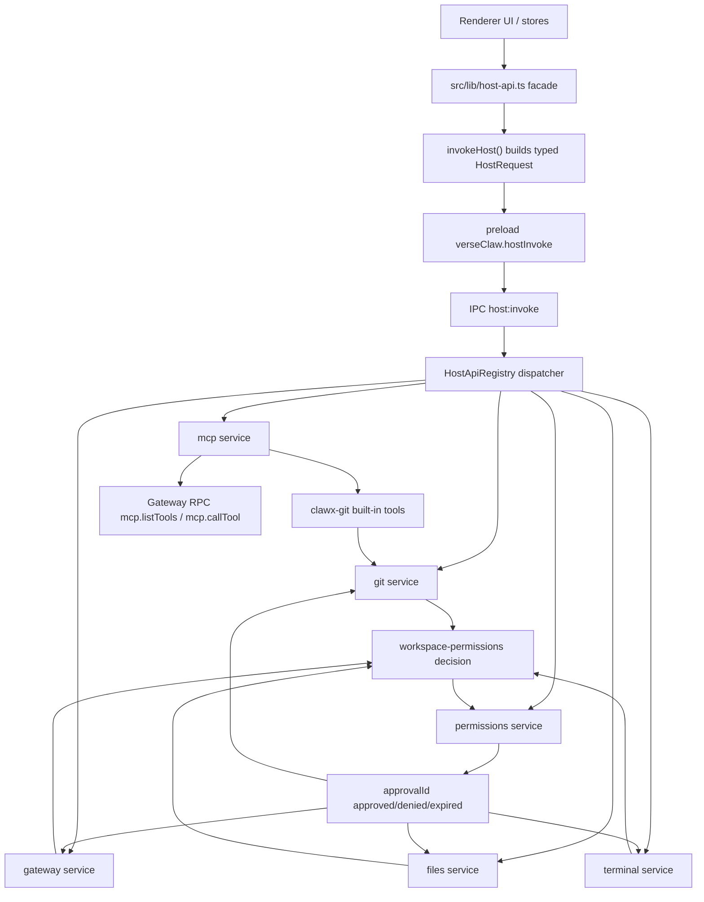

# lane-c-tool-invocation: Tool registration, invocation, permissions, host-api/Gateway boundary

## Scope Confirmation

- Lane: `lane-c-tool-invocation` / Tool registration, invocation, permissions, host-api/Gateway boundary.
- Output file: `runtime-research/handoffs/phase-1-runtime-surface-inventory/submissions/lane-c-tool-invocation.md`.
- Files/directories searched: `src`, `electron`, `shared`, `tests`, plus required `runtime-research` handoff/design docs.
- Commands run:
  - `rtk rg -n "tool|Tool|invoke|schema|permission|approval|policy|deny|cancel|host-api|api-client|gateway|MCP|mcp" src electron shared tests`
  - `rtk rg -n "callTool|listTools|McpCallTool|McpListTools|approvalRequired|approvalId|toolAllowlist|toolDenylist|permissionMode" shared/host-api/contract.ts shared/types/mcp.ts electron/services/mcp-api.ts electron/services/permissions-api.ts electron/main/ipc-handlers.ts src/lib/host-api.ts src/lib/host-api-client.ts tests/unit/mcp-api.test.ts tests/unit/permissions-api.test.ts tests/e2e/workspace-git-mcp-runtime.spec.ts`
  - `rtk rg -n -F "window.electron.ipcRenderer.invoke" src electron shared`
  - `rtk rg -n -F "fetch('http://127.0.0.1:18789" src electron shared`
  - `rtk rg -n 'fetch\("http://127\.0\.0\.1:18789' src electron shared`
  - `rtk rg -n -F "ToolCallResult" src electron shared tests`
  - `rtk rg -n -F "ToolCallRequest" src electron shared tests`
  - `rtk rg -n "createPermissionApproval|recordPermissionAudit|consumeApprovedPermissionApproval|approvalRequired|approvalId|blocked|risk|permissionMode" electron/services/git-api.ts electron/services/files-api.ts electron/services/gateway-api.ts electron/services/terminal-api.ts electron/utils/workspace-runtime-permissions.ts tests/unit/git-api.test.ts tests/unit/files-permissions-api.test.ts tests/unit/gateway-permissions-api.test.ts tests/unit/terminal-api.test.ts tests/unit/workspace-runtime-sync.test.ts`

## Executive Summary

- Renderer production host calls are centralized through `invokeHost()` and `window.verseClaw.hostInvoke`; no production `src/electron/shared` direct `window.electron.ipcRenderer.invoke(...)` callsite was found, only rule/i18n text.
- The main typed host boundary is `HostApiRegistry` plus `host:invoke`; all registered host services, including `gateway`, `mcp`, `git`, `files`, `terminal`, and `permissions`, enter through this registry.
- MCP tool registration is currently an electron-store backed server list plus one built-in `clawx-git` pseudo MCP server with hardcoded JSON-like `inputSchema` objects.
- MCP tool invocation has two paths: built-in `clawx-git` dispatches to `createGitApi()`; other MCP servers are delegated to Gateway RPC methods `mcp.listTools` and `mcp.callTool`.
- Tool-like host APIs are not normalized to the target `ToolCallResult` contract. Current shapes include `McpCallToolResult.success/error/blocked`, `GitOperationResult.success/blocked`, file writes with `{ ok, error }`, terminal results with `exitCode/stdout/stderr`, and raw `gateway.rpc` data.
- Permissions are policy-first but distributed: `workspace-permissions.ts` classifies command/file/Gateway risk, `permissions-api.ts` stores approval events, and each executor consumes `approvalId` itself.
- Permission decisions support `approved` and `denied`; no approval `cancelled` state exists in `shared/types/workspace.ts`, while the runtime target wants tool result status `cancelled`.
- Safest first migration seam is a host-side adapter around `mcp.callTool` and `gateway.rpc`, with read-only shadow normalization into `ToolCallRequest` / `ToolCallResult` while returning the legacy response unchanged.

## Evidence Table

| Claim | Evidence Type | Path / Command | Symbol / Lines | Notes |
|---|---|---|---|---|
| Renderer host calls use a typed host bridge instead of calling IPC directly. | file | `src/lib/host-api-client.ts` | `invokeHost`, lines 13-42 | Builds a typed request, calls `window.verseClaw?.hostInvoke`, throws on non-ok host response. |
| Preload exposes `verseClaw.hostInvoke` over the single `host:invoke` IPC channel. | file | `electron/preload/index.ts` | `verseClawAPI.hostInvoke`, lines 171-173 | Renderer-facing bridge calls `ipcRenderer.invoke('host:invoke', request)`. |
| Main dispatches typed host requests through a registry and wraps thrown errors as host errors. | file | `electron/main/ipc/host-invoke.ts` | `HostApiRegistry`, `createHostInvokeDispatcher`, `registerHostInvokeHandler`, lines 21-133 | Registry supports core and extension actions; dispatcher returns `VALIDATION`, `UNSUPPORTED`, or `INTERNAL`. |
| Core host services register `gateway`, `mcp`, `permissions`, `git`, `files`, and `terminal` in one boundary. | file | `electron/main/ipc-handlers.ts` | `registerTypedHostHandlers`, lines 150-224 | `hostApiRegistry.registerCoreServices` wires all candidate tool surfaces. |
| Public renderer facade exposes `gateway.rpc`, `mcp.listTools`, `mcp.callTool`, `permissions.*`, and Git methods through `invokeHost`. | file | `src/lib/host-api.ts` | `hostApi.gateway`, `hostApi.mcp`, `hostApi.permissions`, lines 446-489 | Adapter should wrap these facade-visible host modules rather than new renderer IPC. |
| MCP server registration stores allowlist, denylist, permission mode, sandbox profile, and network policy. | file | `electron/services/mcp-api.ts` | `buildServer`, `updateServer`, lines 501-565 | Current metadata is persisted but not yet a normalized `ToolProviderRegistry` manifest. |
| MCP context resolution is scope based and includes built-in `clawx-git`. | file | `electron/services/mcp-api.ts` | `matchesContext`, `resolveMcpServersForContext`, lines 588-620 | Global/agent/workspace scope controls registration visibility. |
| MCP create/update/delete trigger best-effort Gateway hot reload. | file | `electron/services/mcp-api.ts` | `dispatchReload`, `createServer`, `updateServer`, `deleteServer`, lines 851-910 | Sends `mcp.reload` with resolved server snapshot when Gateway is running. |
| Built-in Git MCP tool schemas are hardcoded JSON-like schemas. | file | `electron/services/mcp-api.ts` | `VERSE_CLAW_GIT_MCP_TOOLS`, lines 51-220 | Tool schema entries include `inputSchema` and `approvalId` fields for mutating tools. |
| Built-in Git MCP invocation dispatches directly to host Git API methods. | file | `electron/services/mcp-api.ts` | `callClawxGitTool`, lines 698-830 | Switch maps tool names to `gitApi.status/diff/stage/revertFile/push/prCreate`, etc. |
| MCP list/call first handles `clawx-git`, otherwise proxies to Gateway `mcp.listTools` / `mcp.callTool`. | file | `electron/services/mcp-api.ts` | `listTools`, `callTool`, lines 1005-1078 | Gateway-unavailable call returns `{ success:false, blocked:true, reason }`. |
| Current MCP result type is success/error/blocked, not target `ToolCallResult.status`. | file | `shared/types/mcp.ts` | `McpCallToolResult`, lines 79-89 | No `status: success \| error \| denied \| cancelled`, no evidence, no timing fields. |
| Host API contract exposes MCP and Gateway routes, but not a Tool Invocation Protocol route. | file | `shared/host-api/contract.ts` | `McpCallToolPayload`, lines 632-639; service registry lines 2307-2347 | `gateway.rpc` returns `unknown`; `mcp.callTool` returns `McpCallToolResult`. |
| Gateway RPC permission gate uses method/params hashing and approval consumption before calling Gateway. | file | `electron/services/gateway-api.ts` | `createGatewayApi().rpc`, lines 109-184 | Blocks mutating Gateway RPC with `approvalRequired`; approved request then calls `gatewayManager.rpc`. |
| Workspace policy classifies terminal commands, file writes, and Gateway RPCs. | file | `electron/services/workspace-permissions.ts` | `decideWorkspaceCommand`, `decideWorkspaceFileWrite`, `decideGatewayRpc`, lines 162-253 | Provides allow/approval/deny decisions by workspace permission mode and risk. |
| Permission approvals are persisted, listed, decided, and consumed once. | file | `electron/services/permissions-api.ts` | constants lines 42-49; `createPermissionApproval`, `consumeApprovedPermissionApproval`, `decideApproval`, lines 177-225 and 250-277 | Approval sources include terminal, gateway, mcp, file, remoteControl, git. |
| Git operations enforce permissions before running shell git commands. | file | `electron/services/git-api.ts` | `enforcePermission`, `withGitOperation`, lines 441-529 | Dangerous Git requires approval; write Git is blocked in plan/readOnly; fullAccess audits. |
| File writes enforce workspace/outside-workspace approval separately from Git and Gateway. | file | `electron/services/files-api.ts` | `writeText`, lines 353-410 | Returns `{ ok:false, error:'approvalRequired' }`, a different result shape. |
| Terminal commands enforce permission and return blocked terminal-shaped results. | file | `electron/services/terminal-api.ts` | `createTerminalApi().run`, lines 247-325 | Approval required returns `blocked`, `approvalRequired`, `cwd`, `command`, `stdout`, `stderr`. |
| Current permission model has no approval cancellation state. | file | `shared/types/workspace.ts` | `PermissionApprovalStatus`, `PermissionApprovalDecision`, lines 7-9 | Status is `pending/approved/denied/expired`; decision is only `approved/denied`. |
| No production direct renderer IPC invocation was found. | missing-after-search | `rtk rg -n -F "window.electron.ipcRenderer.invoke" src electron shared` | command output | Hits only i18n/rule text: `shared/i18n/.../settings.json:599`, `electron/services/project-rules-api.ts:358`. |
| No production direct renderer fetch to Gateway fixed URL was found for single- or double-quoted literals. | missing-after-search | `rtk rg -n -F "fetch('http://127.0.0.1:18789" src electron shared`; `rtk rg -n 'fetch\("http://127\.0\.0\.1:18789' src electron shared` | command output | Both commands exited with no matches. |
| Target protocol types are absent from implementation/test code. | missing-after-search | `rtk rg -n -F "ToolCallResult" src electron shared tests`; `rtk rg -n -F "ToolCallRequest" src electron shared tests` | command output | Both commands exited with no matches. |
| Unit tests cover host dispatcher success, validation, unsupported, thrown errors, and extension actions. | test | `tests/unit/host-invoke.test.ts` | tests lines 5-135 | Validates typed host dispatch but not tool-result normalization. |
| Unit tests cover MCP fallback and built-in Git MCP tool catalog/calls. | test | `tests/unit/mcp-api.test.ts` | tests lines 272-283, 286-346, 475-506 | Confirms `mcp.callTool` blocked fallback and `clawx-git` passthrough. |
| Gateway approval tests verify approval consumption and request hash binding. | test | `tests/unit/gateway-permissions-api.test.ts` | tests lines 80-140 | Approved Gateway request succeeds once and cannot be reused for different params. |
| File approval tests verify outside-workspace write approval is consumed once. | test | `tests/unit/files-permissions-api.test.ts` | tests lines 90-112 | Confirms separate file-shaped approval result. |
| Host facade tests assert selected legacy direct IPC channels are removed. | test | `tests/unit/host-api-facade.test.ts` | tests lines 766-872 | Guards against keeping covered legacy channels and legacy `api-client.ts`. |

## Current Flow



Current MCP call chain:

1. Renderer calls `hostApi.mcp.callTool(input)` in `src/lib/host-api.ts:486-487`.
2. `invokeHost()` sends `{ id, module:'mcp', action:'callTool', payload }` via `src/lib/host-api-client.ts:13-42`.
3. Preload bridges through `ipcRenderer.invoke('host:invoke', request)` at `electron/preload/index.ts:171-173`.
4. Main dispatcher resolves the action from `HostApiRegistry` at `electron/main/ipc/host-invoke.ts:88-133`.
5. `createMcpApiWithContext().callTool` either:
   - calls `callClawxGitTool()` for `serverId === 'clawx-git'` (`electron/services/mcp-api.ts:1035-1060`), or
   - proxies to Gateway `mcp.callTool` (`electron/services/mcp-api.ts:1062-1070`), or
   - returns blocked fallback (`electron/services/mcp-api.ts:1071-1077`).

## Legacy Surface

| Legacy Path | Why It Is Immature | Current Owner / Layer | Replacement Target |
|---|---|---|---|
| `electron/services/mcp-api.ts:createMcpApiWithContext().callTool` | Returns `McpCallToolResult` with `success/error/blocked`, no normalized status, timing, evidence refs, context items, retry policy, or idempotency key. | Main / MCP service | `Tool Invocation Protocol` |
| `electron/services/mcp-api.ts:VERSE_CLAW_GIT_MCP_TOOLS` | Hardcoded tool registry and schemas; no provider manifest abstraction or schema validation step visible before dispatch. | Main / MCP service / built-in Git bridge | `ToolProviderRegistry` |
| `electron/services/mcp-api.ts:callClawxGitTool` | Large switch dispatch to Git API; permission and result semantics depend on downstream Git return shape. | Main / built-in MCP compatibility path | `Tool Invocation Protocol` |
| `electron/services/gateway-api.ts:createGatewayApi().rpc` | Generic `method/params` RPC returns `unknown`; approval gate exists but tool result normalization is absent. | Main / Gateway proxy | `Tool Invocation Protocol` |
| `electron/services/git-api.ts:withGitOperation` | Tool-like side effects return Git-specific `{ success, stdout, stderr, exitCode, blocked }`; no unified tool evidence/idempotency. | Main / Git service | `Tool Invocation Protocol`, `Evidence Verifier` |
| `electron/services/files-api.ts:writeText` | File write result uses `{ ok, error }` and approval strings like `approvalRequired`, divergent from `ToolCallResult.error/status`. | Main / Files service | `Tool Invocation Protocol` |
| `electron/services/terminal-api.ts:createTerminalApi().run` | Terminal command execution is a separate tool path with its own blocked result shape and no normalized trace/evidence fields. | Main / Terminal service | `Tool Invocation Protocol`, `Trace Context Provider` |
| `electron/services/permissions-api.ts` approvals | Approval lifecycle supports pending/approved/denied/expired but not cancelled; each executor consumes approval separately. | Main / Permissions service | `Tool Invocation Protocol` permission evaluator |
| `src/lib/host-api.ts:gateway.rpc` | Renderer-visible escape hatch to arbitrary Gateway method string; safe only because Main gates it, but it bypasses typed tool names/schema. | Renderer facade / Main Gateway proxy | `ToolProviderRegistry`, `Tool Invocation Protocol` |

## Migration Seams

| Seam | Adapter Shape | Can Shadow First | Feature Flag Candidate | Rollback |
|---|---|---|---|---|
| Host `mcp.callTool` wrapper | Build `ToolCallRequest` from `serverId/toolName/args/approvalId/workspaceId/agentId`, call legacy `createMcpApiWithContext().callTool`, normalize returned legacy shape into shadow `ToolCallResult` while returning legacy result. | yes | `runtime.toolProtocol.mcpShadow` | Disable wrapper and call current MCP service directly. |
| Gateway RPC wrapper for tool-like methods | Wrap `gateway.rpc` after `decideGatewayRpc`; map blocked approval to `status:'denied'` or `status:'error'` shadow result and raw Gateway data to `status:'success'`. | yes | `runtime.toolProtocol.gatewayShadow` | Return current `gateway.rpc` response unchanged. |
| Built-in `clawx-git` tool provider adapter | Convert `VERSE_CLAW_GIT_MCP_TOOLS` into a compatibility provider manifest and map `callClawxGitTool` result to normalized result. | yes | `runtime.toolProvider.clawxGitCompat` | Keep hardcoded catalog/switch path. |
| Permission normalization layer | Convert `createPermissionApproval` / `consumeApprovedPermissionApproval` outcomes into `ToolCallResult.status` values without changing stored approval schema. | yes | `runtime.permissionResultShadow` | Preserve current per-service approval checks. |
| Tool evidence hook | Attach legacy host response, approval id, command/path/method, and source service as shadow evidence refs for later verifier work. | yes | `runtime.toolEvidenceShadow` | Drop shadow evidence collection; keep legacy host result. |

## Existing Tests And Gaps

| Behavior | Existing Test / Harness | Coverage Quality | Missing Test |
|---|---|---|---|
| Typed host dispatch and host error wrapping | `tests/unit/host-invoke.test.ts` tests lines 5-135 | strong for host dispatch | No assertion that tool-like actions normalize to a shared `ToolCallResult`. |
| Renderer facade uses `hostInvoke` and avoids selected legacy direct IPC channels | `tests/unit/host-api-facade.test.ts` tests lines 766-872 | partial | No broad test that all renderer pages/components avoid direct Gateway fetch/WebSocket. |
| MCP registered server fallback when Gateway has no tool RPC | `tests/unit/mcp-api.test.ts` lines 272-283 | partial | No structured `error/denied/cancelled` result taxonomy test. |
| Built-in Git MCP catalog and invocation | `tests/unit/mcp-api.test.ts` lines 286-346 and 475-506; `tests/e2e/workspace-git-mcp-runtime.spec.ts` lines 76-131 from search output | partial | No test for schema validation failure before dispatch; no idempotency/evidence assertions. |
| Gateway approval flow for mutating RPC | `tests/unit/gateway-permissions-api.test.ts` lines 80-140 | strong for approval consumption | No test mapping approval blocked/denied into normalized `ToolCallResult.status`. |
| File write approval flow | `tests/unit/files-permissions-api.test.ts` lines 90-112 | strong for file approval behavior | No cross-service consistency test for file/git/terminal/gateway approval result shapes. |
| Permission approval lifecycle | `tests/unit/permissions-api.test.ts` lines 51-88; `electron/services/permissions-api.ts` lines 250-277 | partial | No cancellation state; no test for `cancelled` tool result semantics. |
| Absence of implementation `ToolCallRequest` / `ToolCallResult` | `rtk rg -n -F "ToolCallResult" src electron shared tests`; `rtk rg -n -F "ToolCallRequest" src electron shared tests` | none | Need contract and adapter tests before behavior cutover. |

## Design Conflicts

| Conflict | Current Evidence | Design Target | Proposed Resolution |
|---|---|---|---|
| Current code has no `ToolCallRequest` / `ToolCallResult` implementation types. | No matches from `rtk rg -n -F "ToolCallResult" src electron shared tests` and `rtk rg -n -F "ToolCallRequest" src electron shared tests`. | `agent-runtime-core-spec.md` Tool Invocation Protocol requires normalized request/result. | Add contract types in a future implementation slice, then wrap legacy `mcp.callTool`/`gateway.rpc` in shadow mode. |
| Current MCP result type uses `success`, `blocked`, `approvalRequired`, and `error` instead of `status: success \| error \| denied \| cancelled`. | `shared/types/mcp.ts:McpCallToolResult`, lines 79-89. | `agent-runtime-core-spec.md` lines 101-119 define `ToolCallResult.status`. | Compatibility adapter should map legacy shapes to normalized statuses while preserving legacy response. |
| Permission lifecycle has no cancelled status. | `shared/types/workspace.ts`, lines 7-9; `electron/services/permissions-api.ts`, lines 46-47 and 250-277. | Target `ToolCallResult.status` includes `cancelled`. | Treat user denial/expired approvals as non-success legacy outcomes first; add explicit cancellation semantics only when runtime can emit/cancel tool calls. |
| Gateway RPC remains an arbitrary method-string escape hatch. | `src/lib/host-api.ts:gateway.rpc`, lines 459-468; `electron/services/gateway-api.ts:rpc`, lines 109-184. | Tool provider registry should validate schema, policy, span, execution, normalization. | Wrap `gateway.rpc` behind a compatibility tool provider for tool-like Gateway methods, starting with shadow normalization. |
| Tool schema validation is not visible before built-in Git MCP dispatch. | `electron/services/mcp-api.ts:VERSE_CLAW_GIT_MCP_TOOLS`, lines 51-220; `callClawxGitTool`, lines 698-830. | Tool invocation flow starts with `validate schema`. | Future adapter can validate against `inputSchema` before calling `callClawxGitTool`, initially shadow-only to avoid behavior change. |

## Recommended Next Slice

Define exactly one smallest implementation slice for this lane.

```text
Slice:
Add a shadow-only Tool Invocation Protocol adapter around host mcp.callTool.

New code path:
Main-side compatibility normalizer builds ToolCallRequest from McpCallToolPayload, calls existing createMcpApiWithContext().callTool behavior, and records/logs a ToolCallResult-shaped shadow object without changing the returned McpCallToolResult.

Legacy path wrapped:
electron/services/mcp-api.ts:createMcpApiWithContext().callTool, including built-in clawx-git and Gateway mcp.callTool fallback.

Feature flag:
runtime.toolProtocol.mcpShadow

Tests:
Unit tests for success, thrown/error, blocked approvalRequired, and Gateway-unavailable fallback mapping to ToolCallResult.status; existing tests/unit/mcp-api.test.ts should continue to pass unchanged.

Rollback:
Disable the feature flag or remove the wrapper registration so createMcpApiWithContext().callTool returns current legacy results directly.

Done when:
The shadow adapter emits normalized request/result objects for mcp.callTool with no renderer API changes, no behavior change, and tests cover success/error/denied-style blocked mapping.
```

## Open Questions

| Question | Why It Matters | Who Can Decide | Blocking |
|---|---|---|---|
| Should `approvalRequired` map to `ToolCallResult.status:'denied'`, `'error'`, or a separate waiting/permission event until the user decides? | Current target statuses lack `waiting_permission`, while current APIs return blocked pending approval. | maintainer | yes for final status taxonomy; no for shadow-only recording |
| Should arbitrary `gateway.rpc` remain renderer-visible after ToolProviderRegistry exists, or only compatibility providers should call it? | It is the broadest escape hatch and could bypass tool schema if future renderer code uses it directly. | maintainer | no for first MCP shadow slice |
| Should MCP `toolAllowlist` / `toolDenylist` be enforced in Electron before Gateway reload/call, or treated as Gateway-owned policy? | Current registration stores these fields, but invocation evidence did not show Electron-side enforcement before `mcp.callTool`. | maintainer | no for first MCP shadow slice |
| What should represent explicit user cancellation of a pending tool approval? | Current approval decisions only support approved/denied, but target tool results include cancelled. | maintainer | no for first MCP shadow slice |

## Handoff Notes

- Do not add renderer direct IPC or direct Gateway HTTP while implementing this lane; current evidence shows production renderer code is already routed through `hostApi` / `hostInvoke`.
- Adapter should start at Main service boundaries, not in UI components, because permissions and Gateway policy are Main-owned today.
- The first adapter should preserve all legacy return shapes to keep `tests/unit/mcp-api.test.ts`, `tests/unit/gateway-permissions-api.test.ts`, and existing E2E host mocks stable.
- Synthesis should treat `gateway.rpc`, `mcp.callTool`, `git`, `files.writeText`, and `terminal.run` as one family of tool-like surfaces with divergent legacy result shapes.
