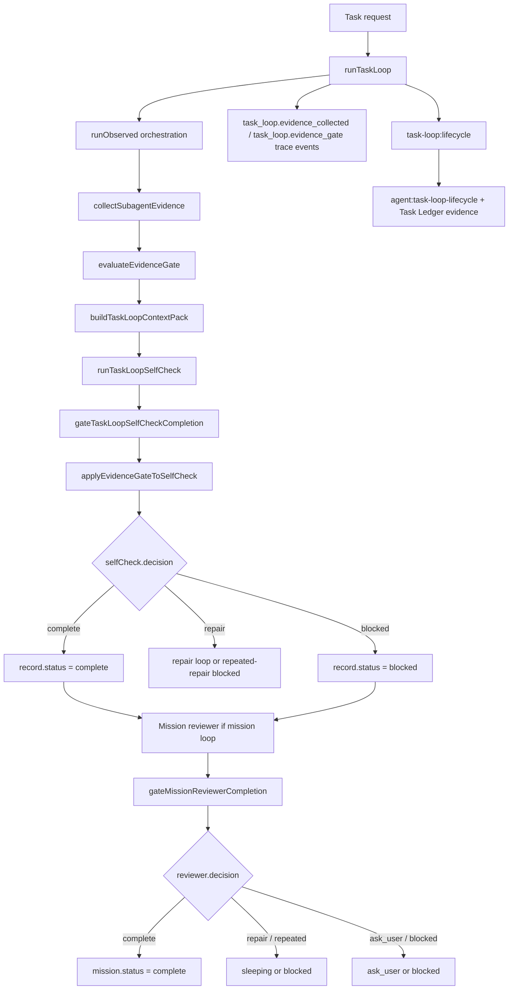

# lane-d-evidence-verifier: Evidence, tests, diagnostics, completion criteria

## Scope Confirmation

- Lane: `lane-d-evidence-verifier`
- Output file: `runtime-research/handoffs/phase-1-runtime-surface-inventory/submissions/lane-d-evidence-verifier.md`
- Files/directories searched: `openclaw_runtime/src/agents`, `electron`, `src`, `shared`, `harness`, `tests`, `package.json`, `README.md`, `AGENTS.md`
- Commands run:
  - `rtk rg -n -C 2 "TaskLoopSubagentEvidence|TaskLoopEvidenceGateResult|evaluateEvidenceGate|task_loop\\.evidence|runTaskLoop|record\\.status = \"complete\"|record\\.status = \"blocked\"" openclaw_runtime/src/agents/task-loop-controller.ts`
  - `rtk rg -n -C 2 "TaskLoopSelfCheckResult|enforceSelfCheckDecision|complete only|missingEvidence|validationState|acceptanceStatus" openclaw_runtime/src/agents/task-loop-self-check.ts`
  - `rtk rg -n -C 2 "TaskLoopEvidenceRef|formatEvidence|buildTaskLoopContextPack|Untrusted task-loop evidence|evidence" openclaw_runtime/src/agents/task-loop-context.ts`
  - `rtk rg -n -C 4 "missionHasOpenControlSignals|gateMissionReviewerCompletion|tickMission|reviewer\\.decision|record\\.status|blocked|complete|repair" openclaw_runtime/src/agents/mission-control/controller.ts`
  - `rtk rg -n -C 4 "runMissionReviewer|MissionReviewerResult|parse|heuristic|validation|acceptance|missingEvidence|verificationGaps" openclaw_runtime/src/agents/mission-control/reviewer.ts`
  - `rtk rg -n -C 3 "task-loop:lifecycle|agent:task-loop-lifecycle|recordTaskLoopLedgerLifecycle|taskLoopLedgerStatus|evidenceGateTags|evidenceGate" electron/main/index.ts shared/host-events/contract.ts`
  - `rtk rg -n -C 2 "filesTouched|testsRun|evidenceGate|selfCheckDecision|structured-evidence|legacy frozen|blocks|downgrades|blocked" tests/unit/task-loop-controller.test.ts`
  - `rtk rg -n -C 2 "missing validation|validationState|downgrad|repeated repair|complete|blocked|evidence gate|lifecycle" tests/integration/loop-stability-check.test.ts`
  - `rtk rg -n -C 2 "gate|downgrade|missingEvidence|verificationGaps|complete|blocked|ask_user|repair" tests/unit/mission-control-loop.test.ts tests/unit/mission-reviewer.test.ts`
  - `rtk rg -n -C 2 "\"lint\"|\"lint:check\"|\"typecheck\"|\"test\"|\"test:e2e\"|\"harness:ci\"|\"comms:replay\"|\"comms:compare\"|\"test:integration\"" package.json`
  - `rtk rg -n -C 3 "fast|comms|e2e|lint:check|typecheck|pnpm test|test:e2e|comms:replay|comms:compare" harness/src/profiles.mjs`
  - `rtk rg -n -C 3 "getChangedFiles|changedFiles|steps|failures|result|runStep|validate" harness/src/cli.mjs harness/src/git.mjs harness/src/rules.mjs`
  - `rtk rg -n -C 4 "runStep|spawn|stdout|stderr|exitCode|durationMs|status" harness/src/runner.mjs`
  - `rtk rg -n -C 3 "OpenClawDoctorResult|openClawDoctor|runOpenClawDoctor|doctor|stdout|stderr|exitCode|command|durationMs" shared/host-api/contract.ts src/lib/host-api.ts electron/utils/openclaw-doctor.ts electron/services/app-api.ts tests/unit/openclaw-doctor.test.ts`
  - `rtk rg -n -C 3 "createDiagnosticsApi|gatewaySnapshot|GatewayDiagnosticSnapshot|logTail|diagnostics|Run Doctor|copy" electron/services/diagnostics-api.ts src/pages/Channels/index.tsx tests/unit/host-services.test.ts tests/e2e/channels-health-diagnostics.spec.ts`
  - `rtk rg -n -C 3 "GitDiffResult|GitFileDiffPayload|GitDiffListResult|GitFileDiffResult|createGitApi|fileDiff|diff|patch|tooLarge|binary|original|modified" shared/types/git.ts shared/host-api/contract.ts electron/services/git-api.ts src/lib/host-api.ts tests/unit/git-api.test.ts tests/unit/workspace-git-panel.test.tsx tests/e2e/workspace-git-panel.spec.ts`
  - `rtk rg -n -C 3 "ObservabilityNodeDiagnostics|traceNodeDiagnostics|artifacts|redacted|events|attributes|diagnostics" shared/types/observability.ts electron/services/observability-api.ts tests/unit/observability-service.test.ts tests/e2e/observability-trace-graph.spec.ts`
  - `rtk rg -n "EvidenceVerifier|Evidence Verifier|evidence verifier|verifier decision" src electron shared openclaw_runtime tests harness`
  - `rtk rg -n "changedFiles" openclaw_runtime src electron shared tests harness`
  - `rtk rg -n -C 4 "collectRuntimeTurnEvidence|filesTouched|toolsUsed|approvals|evidenceRefs|addEvidenceRef|tool" src/stores/chat/turn-ledger-recorder.ts tests/unit/turn-ledger-recorder.test.ts`
  - `rtk rg -n -C 4 "evidenceRefs|filesTouched|testsRun|dependency handoffs include evidence|evidence_refs_exist" openclaw_runtime/src/agents/clawgraph/runtime.ts tests/unit/clawgraph-runtime.test.ts`

## Executive Summary

- Current completion gating is strongest in `runTaskLoop`: subagent evidence is collected, `evaluateEvidenceGate` returns `pass | repair | blocked`, self-check can still downgrade completion, and final task-loop status becomes `complete`, `blocked`, or `error` based on that combined gate.
- The current gate is not a standalone `EvidenceVerifier` artifact. A code-only search for `EvidenceVerifier|Evidence Verifier|evidence verifier|verifier decision` under `src electron shared openclaw_runtime tests harness` returned no matches.
- Evidence currently comes from child run handoff text/JSON and trace/subagent refs: `TaskLoopSubagentEvidence` records `filesTouched`, `testsRun`, `evidenceRefs`, spawn status, and completion status, but it does not normalize file diffs, command exit codes, or tool output into the target `EvidenceRef` taxonomy.
- Mission Control is a second completion gate. `gateMissionReviewerCompletion` downgrades reviewer `complete` when missing evidence, validation gaps, failed/missing validation, or missing/changed acceptance remain.
- Test command surfaces are script and harness driven: `package.json` exposes lint/typecheck/unit/e2e/comms scripts, `harness/src/profiles.mjs` maps profiles to commands, and `harness/src/cli.mjs` records `changedFiles`, selected `steps`, `failures`, and final `result`.
- Harness step execution currently uses `stdio: 'inherit'` and records only status, exitCode, and duration. It does not capture stdout/stderr as structured test evidence.
- File diff evidence is available through Main-owned Git APIs (`git.diff`, `git.fileDiff`) and Code Review Center diff bundles, but these are product/host API surfaces, not task-loop completion inputs.
- Diagnostic evidence is available from OpenClaw Doctor, Gateway diagnostics snapshots, and Observability trace node diagnostics. These paths capture exit/output/log/trace artifacts but are not centrally consumed by task completion.
- The safest first migration seam is a shadow Evidence Verifier adapter around `evaluateEvidenceGate` plus task-loop lifecycle metadata, using existing `filesTouched`, `testsRun`, `evidenceRefs`, Git diff, Doctor, and harness reports as read-only evidence sources.

## Evidence Table

| Claim | Evidence Type | Path / Command | Symbol / Lines | Notes |
|---|---|---|---|---|
| Task-loop records worker/verifier evidence fields. | file | `openclaw_runtime/src/agents/task-loop-controller.ts` | `TaskLoopSubagentEvidence`, lines 88-113 | Includes `spawnStatus`, `completionStatus`, `summary`, `filesTouched`, `testsRun`, `evidenceRefs`, `risks`, and `failureReason`. |
| Task-loop evidence gate returns pass/repair/blocked plus file/test summaries. | file | `openclaw_runtime/src/agents/task-loop-controller.ts` | `TaskLoopEvidenceGateResult`, lines 115-121; `evaluateEvidenceGate`, lines 792-815 | Gate reasons come from subagent evidence, then files/tests are aggregated. |
| Evidence gate reasons include permission, timeout, failed, unverifiable, empty worker evidence, and no worker evidence. | file | `openclaw_runtime/src/agents/task-loop-controller.ts` | `gateReasonsFromEvidence`, lines 771-789 | This is the closest current failure taxonomy for runtime completion evidence. |
| Task-loop stores evidence events in trace/observability. | file | `openclaw_runtime/src/agents/task-loop-controller.ts` | `runTaskLoop`, lines 1326-1348 | Emits `task_loop.evidence_collected` and `task_loop.evidence_gate` with evidence count, files touched count, tests run count, reasons, and blocking count. |
| Task-loop final status is gated by self-check after evidence gate application. | file | `openclaw_runtime/src/agents/task-loop-controller.ts` | `runTaskLoop`, lines 1379-1391 and 1415-1479 | Runs `runTaskLoopSelfCheck`, applies `gateTaskLoopSelfCheckCompletion` and `applyEvidenceGateToSelfCheck`; final branches set `complete`, `blocked`, or `error`. |
| Self-check explicitly downgrades completion with missing evidence, validation gaps, blocking control signals, failed/missing validation, or missing/changed acceptance. | file | `openclaw_runtime/src/agents/task-loop-self-check.ts` | `TaskLoopSelfCheckResult`, lines 26-38; `enforceSelfCheckDecision`, lines 224-282 | Prompt also says "Choose complete only when the objective appears satisfied by evidence" at lines 287-291. |
| Evidence context is treated as untrusted runtime data. | file | `openclaw_runtime/src/agents/task-loop-context.ts` | `TaskLoopEvidenceRef`, lines 25-30; `formatEvidence`, lines 114-137; `formatTaskLoopContextPackForReviewer`, lines 214-257 | Evidence refs support `trace | subagent | tool | manual | other`; prompt labels blocks as untrusted. |
| Mission Control has a second completion gate. | file | `openclaw_runtime/src/agents/mission-control/controller.ts` | `missionHasOpenControlSignals`, lines 231-241; `gateMissionReviewerCompletion`, lines 254-300 | Downgrades mission reviewer completion when missing evidence, validation, acceptance, or blocking signals remain. |
| Mission status transitions include complete, blocked, ask_user, sleeping/repair, and error. | file | `openclaw_runtime/src/agents/mission-control/controller.ts` | `tickMission`, lines 652-679 and 732-740 | Repeated repair blocks, reviewer complete completes, reviewer blocked blocks, reviewer ask_user asks user. |
| Mission reviewer prompt and enforcement require evidence-backed completion. | file | `openclaw_runtime/src/agents/mission-control/reviewer.ts` | `enforceMissionDecision`, lines 246-310; prompt lines 313-323; `runMissionReviewer`, lines 380-393 | Prompt says complete only when acceptance appears satisfied by evidence. |
| Task-loop lifecycle events expose evidence gate and file/test counts to renderer/Main. | file | `shared/host-events/contract.ts`; `electron/main/index.ts` | `TaskLoopLifecyclePayload.evidenceGate`, lines 152-158; event channel lines 275-276; `recordTaskLoopLedgerLifecycle`, lines 207-220; gateway forward lines 1150-1154 | Main writes Task Ledger lifecycle evidence with evidence-gate tags and trace refs. |
| Unit tests cover structured files/tests evidence extraction and evidence gate lifecycle payloads. | test | `tests/unit/task-loop-controller.test.ts` | structured evidence fixture lines 115-119; assertions lines 819-821, 881-883, 913-919 | Tests verify `filesTouched`, `testsRun`, legacy frozen text fallback, and lifecycle evidence gate payload. |
| Unit/integration tests cover blocked and downgraded task-loop completion. | test | `tests/unit/task-loop-controller.test.ts`; `tests/integration/loop-stability-check.test.ts` | Unit tests lines 584-655, 685-789; integration S2 lines 161-187, S10 lines 427-455 | Covers repeated repair, max iteration, worker failure, accepted worker without child result, permission/timeout blocking, and lifecycle validation state. |
| Mission tests cover reviewer and controller downgrade behavior. | test | `tests/unit/mission-reviewer.test.ts`; `tests/unit/mission-control-loop.test.ts`; `tests/integration/loop-stability-check.test.ts` | Reviewer tests lines 107-187; controller tests lines 240-269; integration MC2 lines 702-730 | Reviewer/model `complete` is downgraded when validation or acceptance evidence is missing. |
| E2E verifies task-loop panel displays evidence gate, files, tests, and trace. | test | `tests/e2e/task-loop-panel.spec.ts` | test `starts a task loop through gateway RPC and renders lifecycle state`, lines 4-164 | Mock lifecycle event includes `evidenceGate`, `filesTouched`, `testsRun`, and UI assertions for gate/files/tests/trace. |
| Package scripts expose core validation commands. | config | `package.json` | scripts lines 44-56 and 86 | Includes `lint`, `lint:check`, `typecheck`, `test`, `test:e2e`, `harness:ci`, `comms:replay`, `comms:compare`, `test:integration`. |
| Harness profiles map required profiles to concrete commands. | config | `harness/src/profiles.mjs` | `PROFILES`, lines 1-15 | `fast` runs extension bridge, lint check, typecheck, unit tests; `comms` runs replay/compare; `e2e` runs Electron E2E. |
| Harness validation/run records changed files, steps, failures, and result. | file | `harness/src/cli.mjs` | `validate`, lines 79-114; `run`, lines 141-205 | `run` writes report with `changedFiles`, `selectedProfiles`, `steps`, `failures`, and `result`. |
| Harness changed files come from git diff/cached/unstaged/untracked. | file | `harness/src/git.mjs` | `getChangedFiles`, lines 16-22 | This is a candidate changed-file evidence source for runtime verification. |
| Harness step runner does not capture stdout/stderr as structured evidence. | file | `harness/src/runner.mjs` | `runStep`, lines 3-19 | Uses `stdio: 'inherit'` and returns only status, exitCode, durationMs. |
| Harness reports are persisted as latest JSON and Markdown. | file | `harness/src/report.mjs` | `writeReport`, lines 7-16; `renderMarkdownReport`, lines 19-37 | A shadow verifier could ingest `artifacts/harness/latest.json` as test evidence. |
| Git API exposes repo diff and per-file diff evidence. | file | `shared/types/git.ts`; `shared/host-api/contract.ts`; `electron/services/git-api.ts`; `src/lib/host-api.ts` | `GitDiffResult`, lines 51-58; host contract lines 1922-1938; `createGitApi.diff/fileDiff`, lines 657-715; host API lines 434-438 | `fileDiff` returns path, mode, patch, original, modified, tooLarge, binary. |
| Git diff UI/API tests cover file diff behavior. | test | `tests/unit/git-api.test.ts`; `tests/e2e/workspace-git-panel.spec.ts` | Unit staged file diff lines 121-149; E2E diff mock/assertions lines 279-307 and 426-452 | Confirms diff content is available to UI, including copy patch. |
| Code Review Center converts diff files into Task Ledger evidence refs. | file | `electron/services/code-review-api.ts` | `evidenceRefsForFiles`, lines 188-193; diff collectors lines 215-221, 239-245, 260-266; review node refs lines 536-538 | This is changed-file evidence outside task-loop completion. |
| OpenClaw Doctor captures command, exit code, stdout, stderr, duration, timeout. | file | `shared/host-api/contract.ts`; `electron/utils/openclaw-doctor.ts`; `src/lib/host-api.ts`; `electron/services/app-api.ts` | contract lines 126-137; utility lines 70-205; host API lines 357-362; app route lines 10-16 | Candidate diagnostic evidence source. |
| Doctor tests verify stdout/stderr capture, truncation, exit code, and command. | test | `tests/unit/openclaw-doctor.test.ts` | tests lines 68-178 | Test at lines 161-177 expects plain `openclaw doctor` and args `['doctor']`. |
| Gateway diagnostics snapshot includes gateway status, channels, sandbox, and log tails. | file | `electron/services/diagnostics-api.ts`; `src/pages/Channels/index.tsx` | `createDiagnosticsApi.gatewaySnapshot`, lines 49-85; UI fetch lines 448-517; UI controls lines 673-705 | Candidate runtime/environment diagnostic evidence source. |
| Gateway diagnostics tests cover snapshot and E2E copy/view behavior. | test | `tests/unit/host-services.test.ts`; `tests/e2e/channels-health-diagnostics.spec.ts` | unit lines 845-911; E2E lines 62-207 | Verifies channel view, gateway log tail, sandbox, capabilities, copy diagnostics. |
| Observability diagnostics expose trace node events, artifacts, attributes, issues, and redaction. | file | `shared/types/observability.ts`; `electron/services/observability-api.ts` | `ObservabilityNodeDiagnostics`, lines 296-315; `traceNodeDiagnostics`, lines 112-118 | Candidate trace/tool evidence source. |
| Observability diagnostics tests cover unknown nodes, redaction, and UI tabs. | test | `tests/unit/observability-service.test.ts`; `tests/e2e/observability-trace-graph.spec.ts` | unit lines 177-254; E2E lines 340-399 | Confirms diagnostics events/artifacts/attributes are visible and raw prompt/output is redacted. |
| Chat turn ledger extracts runtime tool/file/approval evidence. | file | `src/stores/chat/turn-ledger-recorder.ts`; `tests/unit/turn-ledger-recorder.test.ts` | `collectRuntimeTurnEvidence`, lines 128-205; `withRuntimeEvidence`, lines 214-229; test lines 52-96 | Records tool refs, file refs, approvals, and files touched, but not as a completion gate. |
| ClawGraph has a handoff audit requiring evidence refs. | file | `openclaw_runtime/src/agents/clawgraph/runtime.ts`; `tests/unit/clawgraph-runtime.test.ts` | output contract lines 169-181; audit checks lines 281-307 and 439-456; test lines 56-78 | Evidence exists at subgraph/handoff level but is not the target runtime-wide verifier. |
| System prompt asks final answers to cite evidence or named blocker. | file | `openclaw_runtime/src/agents/system-prompt.ts` | prompt line 459 | This is prompt policy, not an enforceable verifier. |
| No current standalone EvidenceVerifier code artifact exists. | missing-after-search | `rtk rg -n "EvidenceVerifier|Evidence Verifier|evidence verifier|verifier decision" src electron shared openclaw_runtime tests harness` | no output, exit 1 | Design docs mention it, but current code paths use task-loop/mission gates and prompt policy. |

## Current Flow



Current task-loop flow:

1. `runTaskLoop` initializes `TaskLoopRunRecord` with empty `evidenceRefs` and `subagentEvidence` in `openclaw_runtime/src/agents/task-loop-controller.ts` lines 1174-1231.
2. It executes orchestration through `runObserved`, then `collectSubagentEvidence` parses child run completion output or failure records into `TaskLoopSubagentEvidence`.
3. `evaluateEvidenceGate` uses `gateReasonsFromEvidence` and returns `pass`, `repair`, or `blocked` with aggregated `filesTouched` and `testsRun`.
4. `runTaskLoopSelfCheck` receives a context pack containing untrusted evidence text, failures, validation state, control signals, and acceptance criteria.
5. `gateTaskLoopSelfCheckCompletion` plus `applyEvidenceGateToSelfCheck` force `repair` or `blocked` when completion evidence is insufficient.
6. Final status is set in `runTaskLoop`: `complete` only when self-check decision is complete; otherwise repair repeats or blocks; catch path sets `error`.
7. Lifecycle and ledger surfaces receive `evidenceGate`, `filesTouched`, `testsRun`, and trace evidence through `shared/host-events/contract.ts` and `electron/main/index.ts`.

Current mission flow:

1. `tickMission` runs `runTaskLoop`, converts task-loop result evidence into mission refs via `evidenceFromTaskLoop`, then calls `runMissionReviewer`.
2. `gateMissionReviewerCompletion` downgrades reviewer `complete` when open control signals remain.
3. Mission status becomes `complete`, `blocked`, `ask_user`, `sleeping`, or `error` in `tickMission` lines 652-679 and 732-740.

Current test/diagnostic flow:

1. Commands are declared in `package.json`.
2. `harness/src/profiles.mjs` maps profiles to concrete validation commands.
3. `harness/src/cli.mjs` validates specs against changed files, runs selected profile steps, and writes reports.
4. `harness/src/runner.mjs` records step pass/fail via exit code but does not capture stdout/stderr.
5. Diagnostic and diff evidence is available from host APIs: Doctor, Gateway diagnostics, Observability trace diagnostics, Git diff/fileDiff, Code Review diff bundles, and Chat turn ledger runtime evidence extraction.

## Legacy Surface

| Legacy Path | Why It Is Immature | Current Owner / Layer | Replacement Target |
|---|---|---|---|
| `openclaw_runtime/src/agents/task-loop-controller.ts:evaluateEvidenceGate` | Gate is local to task-loop subagent evidence and only checks worker statuses/summary/ref presence, not normalized file diff/test/tool/trace obligations. | OpenClaw runtime task-loop | `Evidence Verifier` |
| `openclaw_runtime/src/agents/task-loop-self-check.ts:runTaskLoopSelfCheck` | Completion is partly enforced by prompt/model JSON plus heuristic fallback; enforcement exists, but no standalone verifier decision artifact. | OpenClaw runtime reviewer | `Evidence Verifier` |
| `openclaw_runtime/src/agents/mission-control/controller.ts:gateMissionReviewerCompletion` | Mission gate duplicates evidence/validation/acceptance downgrade logic instead of consuming one shared verifier report. | Mission Control | `Evidence Verifier` |
| `openclaw_runtime/src/agents/task-loop-controller.ts:parseCompletionEvidence` | File and test evidence is extracted from child text/JSON sections, plus path-like regex fallback; no file hash/diff/exit-code validation. | OpenClaw runtime task-loop | `Evidence Verifier` |
| `openclaw_runtime/src/agents/clawgraph/runtime.ts:auditNodeHandoff` | Requires `evidenceRefs` and workspace-contained files, but does not verify tests or diagnostics before done. | ClawGraph runtime | `Evidence Verifier` |
| `openclaw_runtime/src/agents/system-prompt.ts` final-answer rule | Prompt says final answer needs evidence or named blocker, but prompt policy is not machine-enforced. | Agent prompt | `Evidence Verifier` |
| `harness/src/runner.mjs:runStep` | Test runs record pass/fail/duration only; stdout/stderr and output summaries are not structured evidence. | Harness | `Evidence Verifier` |
| `harness/src/cli.mjs:run` reports | Harness report has changed files, steps, failures, and result, but task-loop/mission completion does not ingest it. | Harness | `Evidence Verifier` |
| `electron/services/git-api.ts:diff/fileDiff` | Diff/patch evidence is available through Main host API, but not bound to runtime completion. | Main Git service | `Evidence Verifier` |
| `electron/utils/openclaw-doctor.ts:runOpenClawDoctor` and `electron/services/diagnostics-api.ts:gatewaySnapshot` | Diagnostic output is collected for UI/troubleshooting, not attached to task completion requirements. | Main diagnostics | `Evidence Verifier` |
| `src/stores/chat/turn-ledger-recorder.ts:collectRuntimeTurnEvidence` | Tool/file/approval evidence is projected into Task Ledger for chat turns, but a completed turn is not blocked by missing evidence. | Renderer chat store / Task Ledger | `Evidence Verifier` |

## Migration Seams

| Seam | Adapter Shape | Can Shadow First | Feature Flag Candidate | Rollback |
|---|---|---|---|---|
| `evaluateEvidenceGate` shadow wrapper | Normalize `TaskLoopSubagentEvidence` into a verifier input/report while preserving existing `TaskLoopEvidenceGateResult`. | yes | `runtime.evidenceVerifier.shadow` | Disable report emission and call `evaluateEvidenceGate` directly. |
| `applyEvidenceGateToSelfCheck` metadata hook | Attach verifier report refs/reasons to self-check metadata without changing decision. | yes | `runtime.evidenceVerifier.shadow` | Drop metadata, keep current self-check result. |
| Task-loop lifecycle event | Add optional verifier summary beside existing `evidenceGate`, `filesTouched`, and `testsRun`. | yes | `runtime.evidenceVerifier.lifecycle` | Ignore optional field in renderer/Main. |
| Harness report ingest | Read `artifacts/harness/latest.json` as test evidence with command/result/step refs. | yes | `runtime.evidenceVerifier.harnessEvidence` | Fall back to current `testsRun` strings only. |
| Git diff evidence | Use `hostApi.git.diff` / `git.fileDiff` shape as file evidence source, or Main-side equivalent for runtime-owned verifier. | yes | `runtime.evidenceVerifier.gitEvidence` | Stop collecting diff refs; keep `filesTouched`. |
| Doctor/Gateway diagnostics evidence | Convert `OpenClawDoctorResult` and `gatewaySnapshot` fields into diagnostic evidence refs. | yes | `runtime.evidenceVerifier.diagnosticEvidence` | Keep diagnostics UI only. |
| Observability trace diagnostics | Link `traceNodeDiagnostics` events/artifacts/attributes as trace/tool evidence. | yes | `runtime.evidenceVerifier.traceEvidence` | Keep trace graph UI only. |
| Chat turn ledger evidence | Reuse `collectRuntimeTurnEvidence` output shape for file/tool/approval evidence examples. | yes | `runtime.evidenceVerifier.turnEvidence` | Keep Task Ledger projection only. |

## Existing Tests And Gaps

| Behavior | Existing Test / Harness | Coverage Quality | Missing Test |
|---|---|---|---|
| Task-loop passes with structured subagent evidence and records files/tests. | `tests/unit/task-loop-controller.test.ts` lines 819-821; `tests/integration/loop-stability-check.test.ts` S1 lines 116-159 | strong | Standalone verifier report fixture using normalized file/test/tool/trace evidence. |
| Task-loop blocks/downgrades missing validation or repeated repair. | `tests/unit/task-loop-controller.test.ts` lines 584-655; `tests/integration/loop-stability-check.test.ts` S2 lines 161-187 | strong | Verify new shadow report does not alter legacy decision while flag is off. |
| Worker permission/timeout/unverifiable output blocks completion. | `tests/unit/task-loop-controller.test.ts` lines 685-789 | strong | Map these reasons to target verifier taxonomy `failed` vs `blocked` with explicit external dependency. |
| Mission reviewer/controller downgrades completion. | `tests/unit/mission-reviewer.test.ts` lines 141-187; `tests/unit/mission-control-loop.test.ts` lines 240-269 | strong | Shared verifier fixture to prevent duplicated mission/task-loop logic from diverging. |
| Task-loop evidence gate visible in UI. | `tests/e2e/task-loop-panel.spec.ts` lines 4-164 | partial | E2E for optional verifier summary after shadow field exists. |
| Harness command selection and report writing. | `harness/src/profiles.mjs`; `harness/src/cli.mjs`; `harness/src/report.mjs`; `pnpm run harness:ci` in `package.json` line 53 | partial | Test evidence fixture with captured command/output summary; runner currently inherits stdio. |
| Git diff/fileDiff evidence. | `tests/unit/git-api.test.ts` lines 121-149; `tests/e2e/workspace-git-panel.spec.ts` lines 279-307 and 426-452 | partial | Verifier test requiring changed file evidence to match actual diff. |
| Doctor diagnostics evidence. | `tests/unit/openclaw-doctor.test.ts` lines 68-178 | partial | Verifier test accepting Doctor result as diagnostic evidence and preserving command/exit/output summary. |
| Gateway diagnostics evidence. | `tests/unit/host-services.test.ts` lines 845-911; `tests/e2e/channels-health-diagnostics.spec.ts` lines 62-207 | partial | Runtime verifier fixture connecting gateway diagnostic snapshot to blocked/failed decisions. |
| Observability trace/tool diagnostics. | `tests/unit/observability-service.test.ts` lines 177-254; `tests/e2e/observability-trace-graph.spec.ts` lines 340-399 | partial | Verifier fixture linking trace events/artifacts to tool evidence refs. |
| Chat turn tool/file/approval evidence. | `tests/unit/turn-ledger-recorder.test.ts` lines 52-96 and 240-260 | partial | Completion-gate test; current recorder projects evidence but does not gate completion. |
| Standalone EvidenceVerifier class/module. | Search command `rtk rg -n "EvidenceVerifier|Evidence Verifier|evidence verifier|verifier decision" src electron shared openclaw_runtime tests harness` | none | Add contract and shadow-mode tests before behavior cutover. |

## Design Conflicts

| Conflict | Current Evidence | Design Target | Proposed Resolution |
|---|---|---|---|
| Target spec uses `RuntimeTaskResult.status: completed | failed | blocked | cancelled`, but current task-loop/mission use `complete`, `blocked`, `error`, plus mission `ask_user`/`sleeping`. | `runtime-research/agent-runtime-core-spec.md` section 1; `openclaw_runtime/src/agents/task-loop-controller.ts` lines 1415-1479; `openclaw_runtime/src/agents/mission-control/controller.ts` lines 652-679 | Unified runtime status taxonomy. | Add adapter mapping in shadow verifier first; do not rename legacy statuses in this phase. |
| Target spec says verifier decides `completed | failed | blocked`, with ordinary test failure as `failed`; current gate usually maps failures to `repair` until budget exhausted, then `blocked`. | `agent-runtime-core-spec.md` section 6; `task-loop-controller.ts:evaluateEvidenceGate` lines 792-815; `runTaskLoop` lines 1431-1469 | Failure/blocking taxonomy with blocked reserved for external dependency. | Introduce taxonomy in verifier report while preserving legacy `repair/blocked` behavior until cutover. |
| Project instruction says UI Doctor runs `openclaw doctor --json`, but current implementation/test uses plain `openclaw doctor`. | `AGENTS.md` line 50; `electron/utils/openclaw-doctor.ts` lines 11-12 and 70-76; `tests/unit/openclaw-doctor.test.ts` lines 161-177 | Doctor diagnostic evidence should be machine-readable when possible. | Record as compatibility conflict; decide whether to add `--json` in a separate diagnostics slice, not in this research lane. |
| Target Evidence Verifier expects file/test/tool/trace evidence refs; current task-loop evidence refs are `trace | subagent | tool | manual | other` and files/tests are string arrays, not typed refs. | `agent-runtime-core-spec.md` section 6; `task-loop-context.ts` lines 25-30; `task-loop-controller.ts` lines 88-121 | Normalized `EvidenceRef` kinds with file diff, test command/exit, trace span, tool status. | Shadow adapter should preserve legacy fields and emit normalized refs beside them. |
| Target asks for test output evidence, but harness runner inherits stdio and report lacks stdout/stderr. | `agent-runtime-core-spec.md` section 6; `harness/src/runner.mjs` lines 3-19; `harness/src/report.mjs` lines 7-37 | Test evidence includes command, exit code, output summary, timestamp. | First ingest harness `steps` as low-detail evidence; later change runner/report in its own harness slice. |

## Recommended Next Slice

```text
Slice:
Shadow-only EvidenceVerifier adapter for task-loop evidence.

New code path:
Create a verifier report from TaskLoopSubagentEvidence, TaskLoopEvidenceGateResult, filesTouched, testsRun, and evidenceRefs. Emit it only as optional lifecycle/checkpoint metadata.

Legacy path wrapped:
openclaw_runtime/src/agents/task-loop-controller.ts:evaluateEvidenceGate and applyEvidenceGateToSelfCheck.

Feature flag:
runtime.evidenceVerifier.shadow

Tests:
Extend tests/unit/task-loop-controller.test.ts to assert the shadow report contains normalized file/test/subagent/tool refs while legacy status remains unchanged. Add one integration assertion in tests/integration/loop-stability-check.test.ts that warning-only verifier metadata is emitted on both complete and blocked flows.

Rollback:
Disable the flag and stop emitting optional verifier metadata; existing evidenceGate/selfCheck behavior remains the source of truth.

Done when:
No completion behavior changes, existing task-loop and mission tests pass, and the emitted verifier report can identify missing test evidence, worker failure evidence, and files touched from current task-loop data.
```

## Open Questions

| Question | Why It Matters | Who Can Decide | Blocking |
|---|---|---|---|
| Should the first verifier status vocabulary mirror target `completed/failed/blocked/cancelled` or legacy `pass/repair/blocked` in shadow output? | Determines adapter mapping and future cutover noise. | maintainer | no |
| Should `OpenClawDoctorResult` switch to `openclaw doctor --json` before Evidence Verifier consumes it? | JSON output would be better diagnostic evidence, but current implementation/tests expect plain text. | maintainer | no |
| Should harness runner start capturing stdout/stderr summaries, or should verifier only ingest step status initially? | Captured output improves test evidence but changes harness behavior and report size. | maintainer | no |
| Should blocked require explicit external dependency immediately in shadow reports? | Target spec says blocked is only external dependency, while legacy paths use blocked for budget exhaustion and repeated repair. | maintainer | no |
| Should renderer Task Ledger turn evidence be treated as trusted enough for runtime completion? | Chat turn evidence is useful but collected in renderer and may be heuristic. | maintainer | no |

## Handoff Notes

- Do not treat current task-loop evidence gate as the completed target Evidence Verifier. It is a valuable seam with tests, but it lacks normalized file diff, command exit/output, trace span, and tool result obligations.
- The strongest immediate evidence inputs are already present: `TaskLoopSubagentEvidence.filesTouched`, `TaskLoopSubagentEvidence.testsRun`, `TaskLoopEvidenceRef`, harness report steps, Git fileDiff, Doctor result, Gateway snapshot, Observability node diagnostics, and Chat turn ledger runtime evidence.
- Preserve current behavior in the first slice. Current tests depend on `repair` and `blocked` legacy semantics, including repeated repair blocking and max-iteration blocking.
- The Doctor `--json` mismatch is real evidence of current-code vs project-instruction drift; keep it as a design conflict unless a separate diagnostics implementation slice is approved.
- A verifier cutover should wait until shadow reports prove that code-edit tasks with patch evidence but no test/diagnostic evidence can be identified without breaking existing task-loop and mission flows.
