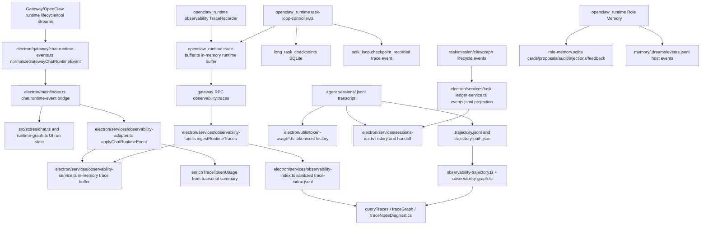

# lane-e-trace-event-memory: Runtime events, trace-like data, token/cost metrics, memory/history

## Scope Confirmation

- Lane: `lane-e-trace-event-memory`
- Output file: `runtime-research/handoffs/phase-1-runtime-surface-inventory/submissions/lane-e-trace-event-memory.md`
- Files/directories searched: `src`, `electron`, `shared`, `openclaw_runtime/src`, `tests`, `harness`, `runtime-research/opentelemetry`, `runtime-research/graphiti`, `runtime-research/temporal`, `runtime-research/openhands`
- Commands run:
  - `rtk rg -n "event|Event|trace|span|metrics|token|cost|usage|history|transcript|jsonl|memory|store|electron-store|session" src electron shared tests harness openclaw_runtime/src`
  - `rtk rg -n "OPENCLAW|trajectory|deleted|reset|usage_to_metrics|accumulated" src electron shared tests harness openclaw_runtime/src`
  - `rtk rg -n "extractSessionIdFromTranscriptFileName|parseUsageEntriesFromJsonl|summarizeUsageEntries|estimatedCostUsd|message\\.usage|usage" electron/utils/token-usage-core.ts tests/unit/token-usage-scan.test.ts tests/unit/token-usage-files.test.ts`
  - `rtk rg -n "listAgentIdsWithSessionDirs|listRecentSessionFiles|getRecentTokenUsageHistory|getTranscriptPathForSessionKey|getSessionTokenUsageSummary|contextRange|live" electron/utils/token-usage.ts electron/services/usage-api.ts src/lib/host-api.ts tests/unit/token-usage-scan.test.ts tests/unit/token-usage-files.test.ts`
  - `rtk rg -n "sweepSessionArtefacts|deleted\\.jsonl|trajectory-path|OPENCLAW_TRAJECTORY_DIR|removeSessionEntry|hard delete" tests harness/specs/tasks electron/utils/session-files.ts electron/services/sessions-api.ts`
  - `rtk rg -n "sweepSessionArtefacts" tests`
  - `rtk rg -n "ObservabilityTrace|ObservabilitySpan|ObservabilityTraceEvent|traceId|spanId|parentSpanId|tokenUsage|ObservabilityRuntimeEvent" shared/types/observability.ts`
  - `rtk rg -n "Traces are not persisted|upsertObservabilityTrace|getObservabilityTraceBuffer|buildObservabilityDashboardSnapshot|clearObservabilityTraces|subscribeObservabilityRuntimeEvents|emitObservabilityRuntimeEvent" electron/services/observability-service.ts tests/unit/observability-service.test.ts tests/unit/observability-mvp.test.ts`
  - `rtk rg -n "NOT persisted|storeRuntimeTrace|getRuntimeTraceBuffer|clearRuntimeTraceBuffer|trace buffer|reset" openclaw_runtime/src/observability/trace-buffer.ts tests/unit/observability-trace-buffer.test.ts`
  - `rtk rg -n "createObservabilityApi|setRuntimeTraceFetcher|ingestRuntimeTraces|dashboardSnapshot|queryTraces|traceGraph|traceNodeDiagnostics|clearTraces|observability\\.traces" electron/services/observability-api.ts electron/main/ipc-handlers.ts tests/unit/observability-mvp.test.ts tests/e2e/observability-trace-graph.spec.ts`
  - `rtk rg -n "applyChatRuntimeEvent|enrichTraceTokenUsage|chat:runtime-event|observability:runtime-event|on\\('chat:runtime-event'|gatewayManager\\.rpc.*observability\\.traces" electron/services/observability-adapter.ts electron/main/index.ts electron/main/ipc-handlers.ts tests/unit/observability-mvp.test.ts`
  - `rtk rg -n "export type ChatRuntimeEvent|run\\.started|run\\.ended|assistant\\.delta|thinking\\.delta|tool\\.started|tool\\.updated|tool\\.completed|command\\.output|tokenUsage" shared/chat-runtime-events.ts electron/gateway/chat-runtime-events.ts src/stores/chat/runtime-graph.ts src/stores/chat.ts tests/unit/chat-runtime-events.test.ts tests/unit/runtime-graph.test.ts`
  - `rtk rg -n "readTrajectoryEventsForSession|trajectoryEvent|trajectory-path|trajectory\\.jsonl|buildObservabilityTraceGraph|buildObservabilityNodeDiagnostics|sourceStatus|tokenHotspot|criticalPath" electron/services/observability-trajectory.ts electron/services/observability-graph.ts tests/unit/observability-trajectory.test.ts tests/unit/observability-graph.test.ts`
  - `rtk rg -n "DiagnosticTraceContext|parseDiagnosticTraceparent|formatDiagnosticTraceparent|createDiagnosticTraceContext|createChildDiagnosticTraceContext|traceparent|traceId|spanId|parentSpanId|traceFlags|message context" openclaw_runtime/src/infra/diagnostic-trace-context.ts openclaw_runtime/src/agents/embedded-agent-runner/run/attempt.model-diagnostic-events.ts openclaw_runtime/src/logging/logger.ts openclaw_runtime/src/hooks/message-hook-mappers.ts tests/unit tests/integration`
  - `rtk rg -n "spanLinks|span_links|SpanLink|linkedSpan|linked_span|resumeSpan|tracestate|TraceState|baggage|sourceRefs|sourceRef|source\\.file|diffHash|fileRange|symbolRange" shared/types/observability.ts electron/services/observability-api.ts electron/services/observability-adapter.ts electron/services/observability-graph.ts electron/services/observability-index.ts electron/services/observability-redaction.ts electron/services/observability-service.ts openclaw_runtime/src/observability tests/unit/observability-service.test.ts tests/unit/observability-index.test.ts tests/unit/observability-graph.test.ts tests/unit/observability-mvp.test.ts tests/e2e/observability-trace-graph.spec.ts`
  - `rtk rg -n "valid_at|invalid_at|validAt|invalidAt|reference_time|EntityEdge|fact edge" src electron shared openclaw_runtime/src tests harness`
  - `rtk rg -n "createRuntimeResumeCheckpoint|buildResumeCheckpoint|renderResumeCheckpointSummary|LongTaskCheckpointRecord|ResumeCheckpoint|recordLongTaskCheckpoint|listLongTaskCheckpoints|recordTaskLoopCheckpoint|recordCheckpointTraceEvent|storeRuntimeTrace" shared/types/long-task-control.ts openclaw_runtime/src/agents/long-task-control/store.ts openclaw_runtime/src/agents/task-loop-controller.ts tests/unit/long-task-control.test.ts tests/integration/loop-stability-check.test.ts tests/e2e/chat-long-task-control.spec.ts`
  - `rtk rg -n "recordTaskLoopLedgerLifecycle|recordMissionLedgerLifecycle|recordClawGraphLedgerLifecycle|trace|evidenceRefs|append|idempotency|TaskLedger" electron/main/index.ts electron/services/task-ledger-service.ts shared/types/task-ledger.ts tests/unit/task-ledger* tests/unit/execution-projection.test.ts`
  - `rtk rg -n "class RoleMemoryStore|RoleMemoryStore|recordMemoryInjection|recordMemoryFeedback|getMemoryUtilityReport|getMemoryDetail|clearMemoryCards|episode|memory/.dreams/events.jsonl|recorded|promotion applied|dream completed" openclaw_runtime/src/memory/memory-store.ts openclaw_runtime/src/memory/types.ts openclaw_runtime/src/memory-host-sdk/events.ts tests/unit/role-memory-v2.test.ts tests/unit/role-orchestration-methods.test.ts tests/e2e/role-memory-panel.spec.ts`
  - `rtk rg -n "append-only event log|RuntimeTaskEvent|Checkpoint:|valid_at|invalid_at|span link|source refs|RuntimeTraceContextProvider|RuntimeMemoryProvider|Trace Context Provider|Runtime Memory Provider" runtime-research/agent-runtime-core-spec.md runtime-research/migration-execution-plan.md runtime-research/implementation-roadmap.md runtime-research/opentelemetry/trace-model.md runtime-research/opentelemetry/query-and-source-mapping.md runtime-research/graphiti/temporal-knowledge-graph.md runtime-research/temporal/workflow-semantics.md runtime-research/openhands/runtime-events.md`

## Executive Summary

- Token/cost history is transcript-derived. `electron/utils/token-usage-core.ts` parses assistant `message.usage` and tool/detail usage from JSONL, then aggregates token and cost fields; it is not parsed from console logs.
- Session JSONL and trajectory sidecars are the strongest shared on-disk data sources for this lane. Session delete now sweeps `<id>.jsonl`, legacy `.deleted.jsonl`, `.jsonl.reset.*`, `.trajectory.jsonl`, `.trajectory-path.json`, and well-formed off-disk trajectory pointers.
- Gateway chat lifecycle/tool streams become typed `ChatRuntimeEvent` values, then Electron main forwards both `chat:runtime-event` and derived `observability:runtime-event`. Renderer runtime graph state is useful UI state, but it is not a canonical replay log.
- Observability already has trace/span/event/token structures plus runtime and Electron buffers. Both runtime and Electron comments say trace buffers are in-memory MVP state, while Electron also maintains a sanitized local `trace-index.jsonl` with retention and query APIs.
- Observability graphing fuses spans/events with trajectory files and produces critical path, token hotspot, source status, issue, and redacted diagnostics data. This is a good Trace Context Provider seam, but it is not yet a budgeted context provider.
- Long-task control has a persisted SQLite checkpoint surface (`long_task_checkpoints`) and records task-loop checkpoint trace events. That is narrower than the target generic append-only `RuntimeTaskEvent` log and reducer for all task/session state.
- Task Ledger is an append-only JSONL projection with trace/session evidence refs. It is a useful shared evidence source, but it is not the canonical runtime state store.
- Role Memory persists governed cards/proposals/audit/injections/feedback in SQLite and supports `episode` cards, plus memory host JSONL events. Current memory code does not expose Graphiti-style `valid_at`/`invalid_at` temporal fact edges.

## Evidence Table

| Claim | Evidence Type | Path / Command | Symbol / Lines | Notes |
|---|---|---|---|---|
| Token/cost history is parsed from transcript JSONL assistant/tool usage records. | file | `electron/utils/token-usage-core.ts` | `extractSessionIdFromTranscriptFileName` line 38; `parseUsageEntriesFromJsonl` line 292; assistant `message.usage` lines 316-318; details usage lines 338-343; `summarizeUsageEntries` line 364; `estimatedCostUsd` line 400 | Parser handles usage shapes and aggregates input/output/cache/total/cost. |
| Deleted/reset transcript names still resolve to a base session id for usage scans. | test | `tests/unit/token-usage-files.test.ts` | `deleted.jsonl` line 10; `.jsonl.reset.*` line 14; `.deleted.jsonl.reset.*` line 18; non-transcripts line 22 | Confirms token history includes reset/deleted transcript filename forms when present on disk. |
| Usage scanner includes configured agents and runtime agent directories on disk, then exposes recent/live summaries. | file/test | `electron/utils/token-usage.ts`; `tests/unit/token-usage-scan.test.ts` | `listAgentIdsWithSessionDirs` line 24; `listRecentSessionFiles` line 57; `getRecentTokenUsageHistory` line 98; `getTranscriptPathForSessionKey` line 123; `getSessionTokenUsageSummary` line 136; test line 41 and line 90 | This is the current cost/history inventory source for Models/Billing/Chat counters. |
| Usage history and context range are routed through host API. | file | `electron/services/usage-api.ts`; `src/lib/host-api.ts` | `recentTokenHistory` line 26; `live` line 27; `contextRange` line 57; `hostApi.usage.recentTokenHistory` line 871; `hostApi.usage.live` line 874; `hostApi.usage.contextRange` line 877 | Renderer has a host-api boundary for these metrics. |
| Session transcript storage is read directly from JSONL for history/handoff. | file | `electron/services/sessions-api.ts` | `readRecentTranscriptMessages` line 168; `readAllTranscriptMessages` line 198; `loadSessionTranscriptByKey` line 735; transcript host route line 889 | Transcript JSONL is a runtime memory/history source today. |
| Session hard delete sweeps transcript variants and trajectory sidecars. | file/config | `electron/utils/session-files.ts`; `electron/services/sessions-api.ts`; `harness/specs/tasks/hard-delete-session-jsonl.md` | `sweepSessionArtefacts` line 188; pointer name line 204; `.deleted.jsonl` line 207; `.jsonl.reset.*` line 210; `removeSessionEntry` line 261; `deleteSession` line 751; sweep call line 794; harness acceptance lines 17-19 and 37-38 | Delete behavior already knows trajectory sidecars and `OPENCLAW_TRAJECTORY_DIR` pointer semantics. |
| No direct test call was found for `sweepSessionArtefacts` under `tests`. | missing-after-search | `rtk rg -n "sweepSessionArtefacts" tests` | no matches, command exit 1 | Harness spec covers expected behavior, but direct unit coverage was not found in `tests`. |
| Handoff preparation merges transcript, recovery context, resume checkpoints, Task Ledger, observability, and evidence refs. | file/test | `electron/services/sessions-api.ts`; `tests/e2e/chat-session-handoff.spec.ts` | `prepareHandoff` line 1185; `sessions.recoveryContext` line 1198; `sessions.resumeCheckpoints` line 1236; transcript source line 1271; Task Ledger source line 1307; observability source line 1342; evidence refs line 1398; E2E fixture lines 105 and 124-127 | This is the current cross-source resume/handoff assembly point. |
| Chat runtime events are typed but not the planned `RuntimeTaskEvent` contract. | file/test | `shared/chat-runtime-events.ts`; `electron/gateway/chat-runtime-events.ts`; `tests/unit/gateway-event-dispatch.test.ts`; `tests/unit/gateway-events.test.ts` | `ChatRuntimeEvent` line 8; `run.ended` tokenUsage line 21; tool events lines 43-63; `normalizeGatewayChatRuntimeEvent` line 49; `readTokenUsage` line 37; tests lines 51, 77, 122, 215 | Covers gateway lifecycle/tool normalization and UI event semantics. |
| Electron main bridges gateway events to renderer and observability. | file | `electron/main/index.ts`; `electron/services/observability-adapter.ts` | gateway listener line 1120; `applyChatRuntimeEvent` line 1121; send `chat:runtime-event` line 1122; send `observability:runtime-event` line 1124; `enrichTraceTokenUsage` lines 1127-1128; adapter function line 61 | Current event fanout is bridge-based, not append-only replay. |
| Renderer runtime graph is UI projection state from events. | file/test | `src/stores/chat/runtime-graph.ts`; `src/stores/chat.ts`; `tests/unit/task-visualization.test.ts`; `tests/e2e/chat-run-state-events.spec.ts` | event status logic lines 19-21; tool event handlers lines 44-59; reducers from line 101; chat store handlers lines 456, 465, 2498, 2518, 4454; test runtime events lines 71-74; E2E name line 15 | Useful legacy surface for event mapping, but not durable checkpoint truth. |
| Observability types already model traces, spans, events, token usage, graph, queries, and runtime events. | file | `shared/types/observability.ts` | `ObservabilitySpan` line 27; `traceId` line 29; `parentSpanId` line 30; `tokenUsage` line 41; `ObservabilityTraceEvent` line 47; `ObservabilityTrace` line 57; runtime event union lines 439-445 | Strong local schema seed for Trace Context Provider. |
| Runtime observability recorder creates spans/events and aggregates token metrics. | file/test | `openclaw_runtime/src/observability/trace-recorder.ts`; `openclaw_runtime/src/observability/metrics.ts`; `tests/unit/observability-mvp.test.ts` | `ObservabilityTraceRecorder` line 64; `startSpan` line 104; `endSpan` line 128; `recordEvent` line 152; `complete` line 167; `addObservabilityTokenUsage` line 19; `aggregateTraceMetrics` line 33; `buildDashboardSnapshot` line 91; test name line 16 and token assertion line 43 | Runtime spans and token metrics exist, but are separate from a generic event log. |
| Runtime trace buffer is explicitly in-memory and resets on gateway restart. | file/test | `openclaw_runtime/src/observability/trace-buffer.ts`; `tests/unit/observability-trace-buffer.test.ts` | comment line 1; `NOT persisted` line 6; `storeRuntimeTrace` line 16; `getRuntimeTraceBuffer` line 34; `clearRuntimeTraceBuffer` line 50; test name line 19 and newest-first assertion line 27 | Important conflict with durable trace/context target. |
| Electron observability service has its own in-memory buffer and dashboard snapshot builder. | file/test | `electron/services/observability-service.ts`; `tests/unit/observability-service.test.ts` | not persisted comment line 9; `upsertObservabilityTrace` line 16; `getObservabilityTraceBuffer` line 29; `buildObservabilityDashboardSnapshot` line 86; test name line 6; max cap test line 62 | Separate from runtime process buffer; reset on app restart. |
| Electron trace index persists sanitized trace envelopes to `trace-index.jsonl` with retention/query. | file/test | `electron/services/observability-index.ts`; `electron/services/observability-redaction.ts`; `tests/unit/observability-index.test.ts` | `RETENTION_DAYS` line 26; `MAX_INDEX_TRACES` line 27; `trace-index.jsonl` line 51; `sanitizeTraceForPersistence` call line 145; `loadObservabilityIndex` line 265; `persistObservabilityTraceToIndex` line 293; `queryObservabilityTraces` line 402; redaction export line 107; test names lines 98, 125, 174 | This is durable but redacted/sanitized, not a raw event log. |
| Observability host API ingests runtime traces through gateway RPC and serves dashboard/query/graph/diagnostics. | file/test | `electron/services/observability-api.ts`; `electron/main/ipc-handlers.ts`; `tests/e2e/observability-trace-graph.spec.ts` | `setRuntimeTraceFetcher` line 34; `ingestRuntimeTraces` line 38; `createObservabilityApi` line 64; `dashboardSnapshot` line 67; `queryTraces` line 92; `traceGraph` line 97; `traceNodeDiagnostics` line 112; gateway RPC lines 209-213; E2E test line 320 | Strong seam for readonly Trace Context Provider. |
| Observability adapter maps chat runtime events and can enrich missing trace token usage from transcript summaries. | file | `electron/services/observability-adapter.ts` | `applyChatRuntimeEvent` line 61; `run.started` case line 63; `tool.started` line 67; `tool.completed` line 84; `run.ended` line 111; event token usage lines 119-123; `mapSummaryToTokenUsage` cost line 165; `enrichTraceTokenUsage` line 169 | Current bridge joins event stream and transcript-derived usage. |
| Trajectory sidecars are read from session-adjacent and pointer files, capped to newest 300 events. | file/test | `electron/services/observability-trajectory.ts`; `tests/unit/observability-trajectory.test.ts` | `MAX_TRAJECTORY_EVENTS` line 23; pointer schema lines 66-70; local cap line 103; `readTrajectoryEventsForTrace` line 106; pointer runtime file line 113; final cap line 127; tests lines 70, 122, 140 | Trajectory is a key shared data source for Trace Context Provider and Checkpoint Engine evidence. |
| Observability graph fuses trace and trajectory data into critical path, token hotspots, source status, coverage, issues, and diagnostics. | file/test | `electron/services/observability-graph.ts`; `tests/unit/observability-graph.test.ts` | `tokenHotspotNodeIds` line 267; `criticalPathNodeIds` line 283; `sourceStatus` line 294; coverage lines 322-330; `buildObservabilityTraceGraph` line 351; trajectory loop line 448; `buildObservabilityNodeDiagnostics` line 539; tests lines 124, 126, 136-142 | Good trace summary substrate, but not source refs/span links. |
| Diagnostic trace context supports W3C `traceparent`, logging fields, and plugin hook context propagation. | file/test | `openclaw_runtime/src/infra/diagnostic-trace-context.ts`; `openclaw_runtime/src/agents/embedded-agent-runner/run/attempt.model-diagnostic-events.ts`; `openclaw_runtime/src/logging/logger.ts`; `openclaw_runtime/src/hooks/message-hook-mappers.ts` | `DiagnosticTraceContext` line 14; `parseDiagnosticTraceparent` line 131; `formatDiagnosticTraceparent` line 163; `createDiagnosticTraceContext` line 180; `createChildDiagnosticTraceContext` line 196; header constant line 90; write header line 513; logger trace fields lines 364-372; hook fields lines 219-226 | This is diagnostic/request context, separate from ObservabilityTrace provider output today. |
| Current observability files do not expose source refs, source file/line/symbol ranges, diff hashes, baggage/tracestate, or span links. | missing-after-search | `rtk rg -n "spanLinks|span_links|SpanLink|linkedSpan|linked_span|resumeSpan|tracestate|TraceState|baggage|sourceRefs|sourceRef|source\\.file|diffHash|fileRange|symbolRange" shared/types/observability.ts electron/services/observability-api.ts electron/services/observability-adapter.ts electron/services/observability-graph.ts electron/services/observability-index.ts electron/services/observability-redaction.ts electron/services/observability-service.ts openclaw_runtime/src/observability tests/unit/observability-service.test.ts tests/unit/observability-index.test.ts tests/unit/observability-graph.test.ts tests/unit/observability-mvp.test.ts tests/e2e/observability-trace-graph.spec.ts` | no matches, command exit 1 | `KnowledgeSourceRef` exists elsewhere, but not in the observability trace surface searched here. |
| Long-task checkpoints persist to SQLite and task-loop records checkpoint trace events. | file/test | `openclaw_runtime/src/state/openclaw-state-schema.sql`; `openclaw_runtime/src/agents/long-task-control/store.ts`; `openclaw_runtime/src/agents/task-loop-controller.ts`; `tests/unit/long-task-control.test.ts`; `tests/integration/loop-stability-check.test.ts` | table line 1024; indexes lines 1041-1048; `buildRuntimeResumeCheckpoint` line 317; `recordLongTaskCheckpoint` line 370; insert line 457; idempotency conflict line 462; `listLongTaskCheckpoints` line 766; `recordTaskLoopCheckpoint` line 929; `recordCheckpointTraceEvent` line 999; `storeRuntimeTrace` line 1483; tests lines 83 and 147-151 | This is the current specialized Checkpoint Engine-adjacent surface. |
| Task Ledger is append-only JSONL projection with trace/session evidence refs and idempotency. | file/test | `shared/types/task-ledger.ts`; `electron/services/task-ledger-service.ts`; `electron/main/index.ts`; `tests/unit/execution-projection.test.ts` | evidence ref types line 39; session link trace id line 78; event type line 100; `events.jsonl` path line 42; `createTaskLedgerEvent` line 102; read log line 119; reducer projection line 157; append line 320; append file flag line 343; lifecycle projections lines 207, 428, 640; append calls lines 412, 625, 775; test line 88 | Useful evidence projection, not canonical runtime state. |
| Role Memory stores governed memory in SQLite and supports episode cards/evidence refs/injections/feedback. | file/test | `openclaw_runtime/src/memory/types.ts`; `openclaw_runtime/src/memory/memory-store.ts`; `tests/unit/role-memory-v2.test.ts`; `tests/e2e/role-memory-panel.spec.ts` | `episode` type line 8; `source` line 17; `evidenceRefs` line 54; card table line 236; proposal table line 293; audit table line 321; injection table line 332; feedback table line 380; `recordMemoryInjection` line 1762; `recordMemoryFeedback` line 1855; `getMemoryUtilityReport` line 1951; episode tests lines 291 and 312; E2E name line 3 | Related to Runtime Memory Provider, but current shape is governed cards/proposals, not temporal facts. |
| Memory host SDK has an append-only JSONL event log for recall/promotion/dream events. | file | `openclaw_runtime/src/memory-host-sdk/events.ts` | relative path `memory/.dreams/events.jsonl` line 8; `memory.recall.recorded` line 12; `memory.promotion.applied` line 26; `memory.dream.completed` line 42; `appendMemoryHostEvent` line 63; `readMemoryHostEvents` line 77 | Separate memory event stream that can seed future episodic memory. |
| Current code lacks Graphiti-style temporal fact fields. | missing-after-search | `rtk rg -n "valid_at|invalid_at|validAt|invalidAt|reference_time|EntityEdge|fact edge" src electron shared openclaw_runtime/src tests harness` | no matches, command exit 1 | Target design documents include these fields, but current code search did not find them. |
| Target runtime design expects append-only task events, trace source refs/span links, and temporal memory facts. | file | `runtime-research/agent-runtime-core-spec.md`; `runtime-research/implementation-roadmap.md`; `runtime-research/opentelemetry/trace-model.md`; `runtime-research/graphiti/temporal-knowledge-graph.md` | `RuntimeTaskEvent` line 32; append-only event log line 167; `RuntimeTraceContextProvider` line 78; `RuntimeMemoryProvider` line 79; trace fixture with resume span link line 228; roadmap source refs line 201; OTel span links line 15; Graphiti fields line 17 | Basis for Design Conflicts below. |

## Current Flow



Current shared data-source map:

- Trace Context Provider candidates: `shared/types/observability.ts`, `openclaw_runtime/src/observability/trace-recorder.ts`, `electron/services/observability-index.ts`, `electron/services/observability-graph.ts`, `electron/services/observability-trajectory.ts`, `openclaw_runtime/src/infra/diagnostic-trace-context.ts`.
- Runtime Memory Provider candidates: `openclaw_runtime/src/memory/memory-store.ts`, `openclaw_runtime/src/memory-host-sdk/events.ts`, transcript JSONL from `electron/services/sessions-api.ts`, Task Ledger evidence refs from `shared/types/task-ledger.ts`.
- Checkpoint Engine candidates: transcript JSONL, trajectory sidecars, `long_task_checkpoints` SQLite, Task Ledger `events.jsonl`, observability trace ids/spans/events, and role memory evidence refs.

## Legacy Surface

| Legacy Path | Why It Is Immature | Current Owner / Layer | Replacement Target |
|---|---|---|---|
| Transcript JSONL drives session history and token/cost history (`electron/utils/token-usage-core.ts`, `electron/services/sessions-api.ts`) | It is a chat/session artifact parsed after the fact, not a typed task event log with reducer state. | Electron Main utilities/services | `Workflow Checkpoint Engine`, `Runtime Memory Provider` |
| `ChatRuntimeEvent` bridge (`electron/gateway/chat-runtime-events.ts`, `electron/main/index.ts`, `src/stores/chat/runtime-graph.ts`) | Typed enough for UI streaming, but not persisted or replayable as canonical task state. | Gateway adapter, Main bridge, Renderer store | `Workflow Checkpoint Engine` |
| Runtime trace buffer (`openclaw_runtime/src/observability/trace-buffer.ts`) | Explicitly in-memory; resets on gateway restart. | OpenClaw runtime/gateway | `Trace Context Provider` |
| Electron observability buffer (`electron/services/observability-service.ts`) | Explicitly in-memory; separate from runtime process buffer and reset on app restart. | Electron Main | `Trace Context Provider` |
| Sanitized trace index (`electron/services/observability-index.ts`) | Durable and queryable, but redacted/sanitized envelope, not raw append-only runtime event log. | Electron Main | `Trace Context Provider` |
| Trajectory sidecar files (`electron/services/observability-trajectory.ts`, `electron/utils/session-files.ts`) | Valuable evidence, but stored beside transcripts or off-disk pointer; delete semantics are special-case. | Electron Main plus OpenClaw runtime sidecars | `Trace Context Provider`, `Workflow Checkpoint Engine` |
| Long-task checkpoint store (`openclaw_runtime/src/agents/long-task-control/store.ts`) | Persisted and idempotent, but scoped to long-task control rather than all runtime tasks. | OpenClaw runtime SQLite state | `Workflow Checkpoint Engine` |
| Task Ledger projection (`electron/services/task-ledger-service.ts`) | Append-only evidence projection, but best-effort lifecycle mirror, not canonical runtime truth. | Electron Main | `Workflow Checkpoint Engine`, `Evidence Verifier` |
| Role Memory SQLite (`openclaw_runtime/src/memory/memory-store.ts`) | Governed cards/proposals/audit/injections/feedback, but lacks temporal fact edges with `valid_at`/`invalid_at`. | OpenClaw runtime memory | `Runtime Memory Provider` |
| Diagnostic traceparent context (`openclaw_runtime/src/infra/diagnostic-trace-context.ts`) | Good request/log propagation, but not joined to ObservabilityTrace source mapping or provider output. | OpenClaw runtime infra/logging/hooks | `Trace Context Provider` |

## Migration Seams

| Seam | Adapter Shape | Can Shadow First | Feature Flag Candidate | Rollback |
|---|---|---|---|---|
| `ChatRuntimeEvent` to future `RuntimeTaskEvent` | Map existing run/tool/assistant/command/patch/approval events into a shadow append-only event record without changing renderer behavior. | yes | `runtimeEventLogShadow` | Disable shadow writer and keep current event bridge. |
| Observability trace/index to readonly trace context | Query `queryObservabilityTraces`, `traceGraph`, and `traceNodeDiagnostics`, then render a token-budgeted summary with trace/span ids and redacted diagnostics. | yes | `runtimeTraceContextProvider` | Disable provider; keep Observability UI/API unchanged. |
| Transcript plus trajectory evidence hydration | Read current transcript JSONL, token summaries, and trajectory sidecars into evidence refs for future checkpoint/replay fixtures. | yes | `runtimeEvidenceHydration` | Fall back to existing `sessions.prepareHandoff` and usage APIs. |
| Long-task checkpoints into generic checkpoint interface | Wrap `listLongTaskCheckpoints` and `recordLongTaskCheckpoint` as a compatibility provider for the future Checkpoint Engine. | yes | `checkpointEngineShadow` | Keep long-task control routes unchanged. |
| Task Ledger as projection input | Treat Task Ledger `events.jsonl` as evidence/projection only, never as canonical reducer state. | yes | `taskLedgerEvidenceProvider` | Drop Task Ledger from runtime context assembly while preserving UI ledger. |
| Role Memory episode adapter | Expose only evidence-backed `episode` cards and memory host events as read-only Runtime Memory Provider records; do not create facts yet. | yes | `runtimeMemoryEpisodesShadow` | Disable adapter; keep Role Memory panel and runtime memory unchanged. |

## Existing Tests And Gaps

| Behavior | Existing Test / Harness | Coverage Quality | Missing Test |
|---|---|---|---|
| Transcript usage parser handles assistant/tool usage, zero tokens, deleted/reset names. | `tests/unit/token-usage.test.ts`; `tests/unit/token-usage-files.test.ts`; `tests/unit/token-usage-scan.test.ts`; `tests/e2e/token-usage.spec.ts` | strong | A fixture that asserts cost aggregation remains stable when both transcript usage and observability enrichment exist. |
| Usage APIs route recent/live/context range data through host API. | `tests/unit/assistant-render-model.test.ts`; `tests/e2e/token-usage.spec.ts` | partial | Host API contract unit test for `usage.contextRange` edge cases after future provider adapter. |
| Session delete removes transcripts and trajectory sidecars. | `harness/specs/tasks/hard-delete-session-jsonl.md`; implementation in `electron/utils/session-files.ts` | partial | Direct unit test for `sweepSessionArtefacts` pointer-follow and ENOENT tolerance; search for `sweepSessionArtefacts` in `tests` found no test call. |
| Handoff pulls transcript, Task Ledger, observability, recovery context, resume checkpoints. | `tests/e2e/chat-session-handoff.spec.ts` | partial | Unit fixture for `prepareHandoff` when observability trace index has only rehydrated/sanitized traces. |
| Gateway lifecycle/tool event normalization and UI run state. | `tests/unit/gateway-event-dispatch.test.ts`; `tests/unit/gateway-events.test.ts`; `tests/e2e/chat-run-state-events.spec.ts`; `tests/unit/task-visualization.test.ts` | partial | Replay fixture proving a shadow `RuntimeTaskEvent` reducer reconstructs the same state as live `ChatRuntimeEvent` UI state. |
| Observability recorder, metrics, scorecard. | `tests/unit/observability-mvp.test.ts` | strong | Test for joining diagnostic `traceparent` context to ObservabilityTrace ids. |
| Runtime and Electron trace buffers. | `tests/unit/observability-trace-buffer.test.ts`; `tests/unit/observability-service.test.ts` | strong for current buffer behavior | Durability test intentionally absent because buffers are MVP in-memory; future provider needs restart/rehydration fixture. |
| Local observability trace index redaction/query/retention. | `tests/unit/observability-index.test.ts` | strong | Provider budget rendering fixture over indexed traces. |
| Observability graph, trajectory, diagnostics. | `tests/unit/observability-trajectory.test.ts`; `tests/unit/observability-graph.test.ts`; `tests/e2e/observability-trace-graph.spec.ts` | strong for UI graph | Source mapping fixture for file/line/symbol/diff hash once those fields exist. |
| Diagnostic trace context propagation. | Search found code in `openclaw_runtime/src/infra/diagnostic-trace-context.ts`, `attempt.model-diagnostic-events.ts`, `logger.ts`, and `message-hook-mappers.ts` | partial | Unit/integration test proving traceparent is sanitized or re-rooted before prompt/context provider use. |
| Long-task resume checkpoint storage and UI. | `tests/unit/long-task-control.test.ts`; `tests/integration/loop-stability-check.test.ts`; `tests/e2e/chat-long-task-control.spec.ts` | strong for long-task lane | Generic runtime checkpoint reducer fixture across ordinary chat/tool events. |
| Task Ledger projections. | `tests/unit/execution-projection.test.ts`; `tests/e2e/task-ledger.spec.ts` found by event searches | partial | Contract test that Task Ledger remains projection-only and cannot mark runtime completion by itself. |
| Role Memory governance, injection, utility. | `tests/unit/role-memory-v2.test.ts`; `tests/unit/role-orchestration-methods.test.ts`; `tests/e2e/role-memory-panel.spec.ts` | strong for current Role Memory | Temporal fact validity fixture (`valid_at`/`invalid_at`) is missing because current code has no such fields. |

## Design Conflicts

| Conflict | Current Evidence | Design Target | Proposed Resolution |
|---|---|---|---|
| Current ordinary sessions use transcript JSONL, realtime `ChatRuntimeEvent`, observability buffers, Task Ledger projections, and specialized long-task checkpoints instead of one canonical append-only task event log. | `electron/services/sessions-api.ts` lines 168, 735, 1185; `electron/main/index.ts` lines 1120-1128; `electron/services/task-ledger-service.ts` lines 320-343; `openclaw_runtime/src/agents/long-task-control/store.ts` line 370 | `runtime-research/agent-runtime-core-spec.md` line 167 says runtime writes an append-only event log and reducers rebuild task state. | Introduce a shadow event-log adapter over existing events first; do not remove transcript/session paths until replay fixtures match live state. |
| Current observability has `traceId`/`spanId`/`parentSpanId`, but no source refs, source file/line/symbol ranges, diff hashes, baggage/tracestate, or span links in the searched observability surface. | `shared/types/observability.ts` lines 27-71 and 439-445; missing search command for source refs/span links returned no matches | `runtime-research/implementation-roadmap.md` line 201 requires source refs; line 218 requires resume span link; `runtime-research/opentelemetry/trace-model.md` line 15 lists span links. | Extend schema behind compatibility adapters; keep existing Observability UI working with absent optional fields. |
| Runtime/Electron trace buffers are explicitly in-memory, while the Trace Context Provider needs queryable runtime behavior evidence. | `openclaw_runtime/src/observability/trace-buffer.ts` line 6; `electron/services/observability-service.ts` line 9; durable but sanitized index in `electron/services/observability-index.ts` lines 51 and 145 | `runtime-research/migration-execution-plan.md` Stage 7 and `agent-runtime-core-spec.md` line 78 expect a runtime trace context provider. | Use sanitized trace index for readonly summaries, but make future event log the canonical replay source. |
| Current Role Memory has governed cards and `episode` type but no Graphiti-style temporal fact validity. | `openclaw_runtime/src/memory/types.ts` lines 8, 17, 54; `openclaw_runtime/src/memory/memory-store.ts` tables lines 236, 293, 332, 380; missing search for `valid_at|invalid_at|reference_time` returned no current-code matches | `runtime-research/graphiti/temporal-knowledge-graph.md` lines 17, 21-22; `runtime-research/agent-runtime-core-spec.md` line 240 | Start Runtime Memory Provider with event-derived episodes only; add verified temporal facts after Evidence Verifier exists. |
| Diagnostic `traceparent` propagation exists separately from ObservabilityTrace provider output. | `openclaw_runtime/src/infra/diagnostic-trace-context.ts` lines 131, 163, 180, 196; `attempt.model-diagnostic-events.ts` lines 90 and 513; Observability missing search has no baggage/tracestate/source refs/span links | `runtime-research/agent-runtime-core-spec.md` line 228 expects trace fixture with parent/child span and resume span link. | Bridge diagnostic context into observability/event-log records with explicit trust/sanitization rules; avoid exposing raw external traceparent directly to prompts. |
| Hard delete now removes transcript and trajectory artifacts, but future event log, trace index, Task Ledger projection, and memory episodes need aligned deletion/retention policy. | `electron/utils/session-files.ts` lines 188-214; `harness/specs/tasks/hard-delete-session-jsonl.md` lines 17-19; current trace index path `electron/services/observability-index.ts` line 51; Task Ledger path `electron/services/task-ledger-service.ts` line 42 | Runtime memory/trace/checkpoint targets will add new evidence stores. | Before implementation, decide whether session deletion tombstones, redacts, or fully purges future event/memory/trace records. |

## Recommended Next Slice

Define exactly one smallest implementation slice for this lane.

```text
Slice: Trace/event evidence shadow inventory adapter
New code path: A readonly shadow mapper that converts existing ChatRuntimeEvent plus ObservabilityRuntimeEvent plus transcript/trajectory ids into draft RuntimeTaskEvent-shaped fixtures for tests only.
Legacy path wrapped: electron/gateway/chat-runtime-events.ts, electron/services/observability-adapter.ts, electron/services/observability-index.ts, electron/services/observability-trajectory.ts, electron/utils/token-usage-core.ts.
Feature flag: runtimeEventLogShadow
Tests: Unit fixtures for run.started/run.ended token usage, tool.started/tool.completed, command.output, transcript usage enrichment, trajectory event correlation, and long-task checkpoint event correlation.
Rollback: Disable runtimeEventLogShadow; no production behavior depends on the shadow mapper.
Done when: Shadow replay fixtures can reconstruct the same run/tool/token/trajectory/checkpoint summary as current UI/observability paths without changing runtime behavior.
```

## Open Questions

| Question | Why It Matters | Who Can Decide | Blocking |
|---|---|---|---|
| Should sanitized `trace-index.jsonl` be a first Trace Context Provider source, or should the future append-only event log be required before provider output is exposed to the agent? | The index is available now but redacted and derived; using it first is safer but may bake in non-canonical semantics. | maintainer | no for inventory, yes for implementation |
| What is the deletion policy for future event log, trace index, Task Ledger projection, and Runtime Memory episodes when a user hard-deletes a conversation? | Current delete behavior is precise for transcript and trajectory artifacts only. | user/maintainer | yes before persistent event/memory rollout |
| Can Role Memory `episode` cards seed Runtime Memory Provider output, or should Runtime Memory start from task event log episodes only? | Avoids mixing governed role cards with runtime-derived memory facts. | maintainer | no |
| Should diagnostic `traceparent` from model diagnostic requests be re-rooted before joining ObservabilityTrace, or preserved with trust metadata? | Impacts source mapping, privacy, and trace correlation. | maintainer | yes before trace provider implementation |

## Handoff Notes

- Do not treat current Observability as the finished Trace Context Provider. It has useful trace/span/event/token structures and graph APIs, but lacks provider output, source refs, and span links.
- Do not treat Role Memory as the finished Runtime Memory Provider. It has governed cards/proposals/injections/feedback and `episode` support, but not Graphiti-style temporal fact validity.
- Do not use Task Ledger as canonical runtime state. It is valuable evidence/projection data with trace/session refs.
- For synthesis `Last Known Pointers`, useful entries are `shared/types/observability.ts`, `openclaw_runtime/src/observability/trace-recorder.ts`, `electron/services/observability-index.ts`, `electron/services/observability-trajectory.ts`, `electron/utils/token-usage-core.ts`, `electron/services/sessions-api.ts`, `openclaw_runtime/src/agents/long-task-control/store.ts`, and `openclaw_runtime/src/memory/memory-store.ts`.
- The most important shared data sources for future Trace Context Provider, Runtime Memory Provider, and Checkpoint Engine are transcript JSONL, trajectory sidecars, observability traces/index, long-task checkpoints, Task Ledger events, and Role Memory evidence refs.
