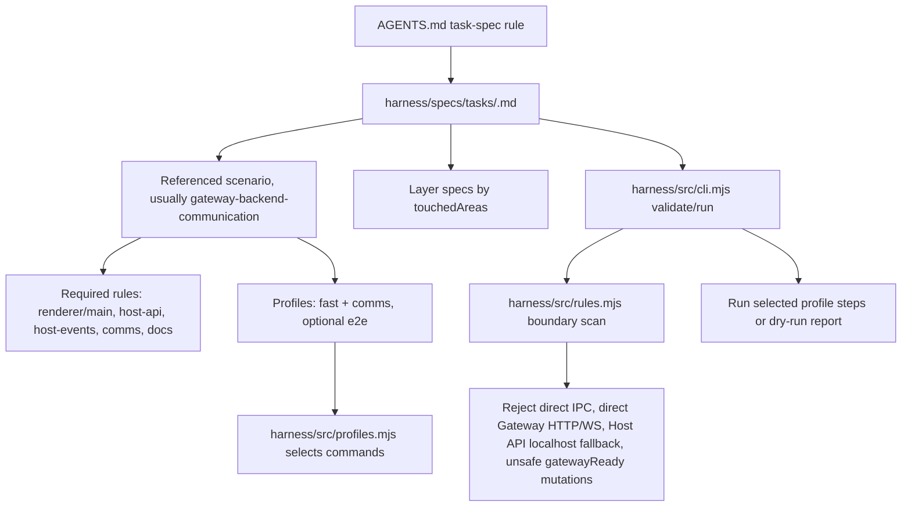

# lane-f-harness-safety: Harness specs, project rules, safety gates, migration validation

## Scope Confirmation

- Lane: `lane-f-harness-safety`
- Output file: `runtime-research/handoffs/phase-1-runtime-surface-inventory/submissions/lane-f-harness-safety.md`
- Files/directories searched: `harness/specs/**`, `harness/src/**`, `AGENTS.md`, `README.md`, `package.json`, selected `runtime-research/*.md`
- Commands run:
  - `rtk powershell -NoProfile -Command "Get-Content -LiteralPath 'runtime-research/agent-runtime-core-spec.md'"`
  - `rtk powershell -NoProfile -Command "Get-Content -LiteralPath 'runtime-research/handoffs/phase-1-runtime-surface-inventory/submission-template.md'"`
  - `rtk rg --files harness/specs`
  - `rtk rg -n "runtime|communication|gateway|host-api|api-client|tool|event|context|checkpoint|resume|verifier|evidence|trace" harness AGENTS.md README.md package.json`
  - `rtk rg -n "harness context|harness validate|harness run|comms:replay|comms:compare|test:e2e|typecheck|lint" harness AGENTS.md README.md package.json`
  - `rtk rg -n "Renderer backend calls|Gateway transport|Any communication|Ordinary Chat|LoopContextPack|Project rules remain" harness/specs/rules`
  - `rtk rg -n "requiredProfiles|requiredRules|ownedPaths|forbiddenPatterns|Allowed flow|Renderer code must not|Chat composer intent" harness/specs/scenarios/gateway-backend-communication.md`
  - `rtk rg -n 'build:runtime|lint|typecheck|test:e2e|harness|comms:replay|comms:compare' package.json`
  - `rtk rg -n "AgentMap|Symbol Tool|RuntimeContextProvider|ToolProviderRegistry|Event Log|Checkpoint|Evidence Verifier|Trace Context Provider|Runtime Memory Provider|AST Patch Planner|Stage 1|Stage 2|Stage 3|Stage 4|Stage 5|Stage 6|Stage 7|Stage 8|Stage 9|Stage 10" runtime-research/migration-execution-plan.md runtime-research/implementation-roadmap.md runtime-research/agent-runtime-core-spec.md`
  - `rtk rg -n "AgentMap|Symbol Tool|RuntimeContextProvider|ToolCallRequest|ToolCallResult|RuntimeTaskEvent|EvidenceVerifier|AST Patch Planner" harness/specs` returned no matches.
  - `rtk "C:\Program Files\nodejs\node.exe" harness/src/cli.mjs context --spec harness/specs/tasks/agent-task-loop-mvp.md`
  - `rtk "C:\Program Files\nodejs\node.exe" harness/src/cli.mjs validate --spec harness/specs/tasks/agent-task-loop-mvp.md --no-diff`
  - `rtk "C:\Program Files\nodejs\node.exe" harness/src/cli.mjs validate --spec harness/specs/tasks/role-first-memory-control-plane.md --no-diff`
  - Failed command evidence: `rtk Get-Content ...` cannot resolve PowerShell cmdlets; `rtk pnpm harness ...` and `rtk cmd /c pnpm ...` failed with `'"node"' is not recognized`; direct `node harness/src/cli.mjs ...` works.

## Executive Summary

- Current durable AI coding policy is already routed through `AGENTS.md` plus `harness/specs/**`; the implementation phase must not create another project-rule source of truth.
- The strongest existing safety gate is `gateway-backend-communication`: it owns renderer/Main/Gateway/OpenClaw boundary paths, requires `fast` and `comms`, lists forbidden direct renderer transports, and is enforced by `harness/src/rules.mjs`.
- Existing harness profiles map cleanly to migration validation: `fast` runs extension bridge, lint check, typecheck, and unit tests; `comms` runs replay/compare; `e2e` runs Electron Playwright.
- Existing task specs cover current product surfaces: task loop, Chat runtime events, `/loop` context pack, Mission Control, Observability traces, Task Ledger, role memory, ClawGraph, and editable `openclaw_runtime` startup.
- No harness task spec currently targets the new runtime-core artifacts by name: `AgentMap`, `Symbol Tool Layer`, `RuntimeContextProviderRegistry`, `ToolCallRequest` / `ToolCallResult`, `EvidenceVerifier`, or `AST Patch Planner`.
- Stage 0 can reuse existing inventory handoff docs plus `gateway-backend-communication`; Stages 1-4 need new task specs before implementation because they introduce new runtime contracts, context/tool registries, and provider ordering.
- Stages 5-8 can reuse existing `/loop`, Mission, Task Ledger, Observability, and role-memory specs as partial safety gates, but still need runtime-core specs for event-log replay, verifier semantics, trace-provider budget/redaction, and temporal memory facts.
- Stage 9 needs a new AST Patch Planner task spec; no current harness spec mentions ast-grep or structured patch planning.
- Design conflict found: several role-first specs reference `i18n-coverage`, but no `harness/specs/rules/i18n-coverage.md` exists; `harness validate --no-diff` still reports role-first memory spec as valid, so missing task-required rule resolution is not currently a validation failure.
- Windows command note: in this environment the `pnpm` shim is unreliable under `rtk`; direct `node harness/src/cli.mjs` produced the harness evidence.

## Evidence Table

| Claim | Evidence Type | Path / Command | Symbol / Lines | Notes |
|---|---|---|---|---|
| Durable project policy lives in `harness/specs/**`, with `AGENTS.md` as entry point. | file | `AGENTS.md` | lines 11-19, 60-61 | AGENTS directs task-spec work through `pnpm harness context`, says backend communication tasks must reference `gateway-backend-communication`, and says reusable constraints should become harness specs. |
| Renderer/Main/Gateway boundary is the central existing runtime safety gate. | file | `harness/specs/scenarios/gateway-backend-communication.md` | lines 5-37, 52-61 | Scenario owns renderer/Main/Gateway paths, requires `fast` and `comms`, lists forbidden direct IPC/Gateway HTTP/WS patterns, and defines allowed flow. |
| Renderer backend calls must go through host-api/api-client; Main owns Gateway transport. | file | `harness/specs/rules/backend-communication-boundary.md` | lines 11, 17, 23 | Rule also requires `comms` profile for communication changes and E2E for visible UI communication changes. |
| Gateway RPC transport is IPC-only for renderer-facing code. | file | `harness/specs/rules/api-client-transport-policy.md` | line 11 | Explicitly forbids renderer WebSocket/HTTP transports to OpenClaw Gateway. |
| Host API and HostEvents fallback policies are typed IPC-first. | file | `harness/specs/rules/host-api-fallback-policy.md`, `harness/specs/rules/host-events-fallback-policy.md` | host-api line 12; host-events line 11 | Host API requires typed facade/`host:invoke`; HostEvents must use IPC mappings, not SSE/EventSource fallback. |
| Communication changes must run replay/compare. | file | `harness/specs/rules/comms-regression.md`; `AGENTS.md`; `README.md` | comms rule line 11; AGENTS line 58; README lines 434-438 | Same requirement appears in rule, AGENTS, and README. |
| Ordinary Chat and `/loop` must remain separate control surfaces. | file | `harness/specs/rules/chat-loop-boundary.md` | lines 9, 13-24 | Ordinary Chat cannot silently create Task Ledger roots or loop state; `LoopContextPack` is only `/loop` recovery context generator. |
| Harness profiles define current reusable test command sets. | file | `harness/src/profiles.mjs` | lines 2-13, 17-23 | `fast`, `comms`, and `e2e` commands are selected by profile. |
| Harness run performs backend boundary scanning before selected profile steps. | file | `harness/src/cli.mjs`, `harness/src/rules.mjs` | cli lines 144-156; rules lines 5-10, 36-66, 74-79 | Scan catches direct IPC, Gateway HTTP/WS, Host API localhost, and page/component `gatewayReady` mutations. |
| `package.json` exposes the same validation scripts. | config | `package.json` | lines 38, 44-56 | Includes `build:runtime`, lint, typecheck, tests, harness, `harness:ci`, `comms:replay`, and `comms:compare`. |
| Current task-loop spec already covers bounded self-check loop and HostEvents path. | file | `harness/specs/tasks/agent-task-loop-mvp.md` | lines 6, 21-45 | Requires `fast` + `comms`, validates Gateway RPC path, self-check evidence, and no renderer-direct Gateway transport. |
| Chat runtime event spec covers Main-owned runtime events and tool event streaming. | file | `harness/specs/tasks/chat-tool-events-runtime-pipeline.md` | lines 3, 38, 44-64 | Requires Main-owned Gateway communication and active Execution Graph driven by streamed runtime events. |
| `/loop` ContextPack spec is a partial checkpoint/resume safety gate. | file | `harness/specs/tasks/loop-context-pack-contract.md` | lines 39-44, 57-73, 84-89 | Requires Task Ledger root, persisted interventions, bounded deterministic context pack, evidence refs, and E2E. |
| Mission Control spec is a partial event/checkpoint/evidence/memory safety gate. | file | `harness/specs/tasks/mission-control-loop-mvp.md` | lines 26-31, 42-61, 71-87 | Requires explicit terminal states, evidence-linked acceptance review, lifecycle events, memory proposals, and no renderer transport bypass. |
| Observability trace workbench is a partial Trace Context Provider safety gate. | file | `harness/specs/tasks/agent-trace-visualization-workbench.md` | lines 34-50 | Requires trace graph APIs through Host API and redacted diagnostics, but it is UI/workbench-oriented rather than runtime provider contract. |
| Role memory control plane is a partial Runtime Memory Provider safety gate. | file | `harness/specs/tasks/role-first-memory-control-plane.md` | lines 15-20, 27-38, 49-51 | Requires `memory.propose`, role-memory SQLite, structured Memory Context, and proposal-first automatic memory. |
| ClawGraph spec separates execution state from Task Ledger truth. | file | `harness/specs/tasks/clawgraph-runtime-v1.md` | lines 24-28, 36-44, 58 | Useful for workflow/event evidence, but not a generic runtime-core event-log spec. |
| Migration plan defines Stages 1-10 and dependencies. | file | `runtime-research/migration-execution-plan.md` | lines 75, 110, 142, 175, 208, 241, 273, 307, 338, 371, 413-416 | Evidence for mapping new/reused harness specs to migration phases. |
| Runtime core spec names target artifacts and fixture classes. | file | `runtime-research/agent-runtime-core-spec.md` | lines 64, 76, 165-172, 221, 234-253 | Names provider contract, AgentMap, checkpoint, fixtures, implementation order, and final artifacts. |
| No exact harness specs exist for named runtime-core artifacts. | missing-after-search | `rtk rg -n "AgentMap|Symbol Tool|RuntimeContextProvider|ToolCallRequest|ToolCallResult|RuntimeTaskEvent|EvidenceVerifier|AST Patch Planner" harness/specs` | no output, exit 1 | Existing specs do not cover new runtime-core contracts by these names. |
| `i18n-coverage` is referenced by tasks but no matching rule file exists. | missing-after-search | `rtk rg -n "id: i18n-coverage|i18n-coverage" harness/specs` | matches only task files | Matches: `role-first-memory-control-plane.md`, `role-first-memory-governance-v3.md`, `role-first-end-to-end.md`, `role-first-memory-v2-governance.md`; no `rules/i18n-coverage.md`. |
| Harness context for task-loop reads scenario, rules, guides, and layers. | command | `rtk "C:\Program Files\nodejs\node.exe" harness/src/cli.mjs context --spec harness/specs/tasks/agent-task-loop-mvp.md` | output: read order includes task, `gateway-backend-communication`, active-config/api-client/backend/comms/docs/gateway/host rules, guides, electron-main/openclaw-runtime/renderer layers | Confirms current context routing works when run through Node directly. |
| Existing task specs validate structurally without diff checks. | command | `rtk "C:\Program Files\nodejs\node.exe" harness/src/cli.mjs validate --spec harness/specs/tasks/agent-task-loop-mvp.md --no-diff`; same for `role-first-memory-control-plane.md` | output: `Spec is valid: ...` | Structural validation passes; note missing `i18n-coverage` rule is not caught for role-first memory. |
| `pnpm` harness commands were not usable through `rtk` in this shell. | command | `rtk pnpm harness context --spec ...`; `rtk cmd /c "C:\Users\27933\AppData\Roaming\npm\pnpm.cmd" harness ...` | output: `'"node"' is not recognized`; direct `node harness/src/cli.mjs` works | Implementation-stage validation may need shell/PATH care on Windows. |

## Current Flow

Current harness routing and validation flow:



Stage-to-safety-gate mapping from current evidence:

| Migration Stage | Current Reusable Spec / Command | Gap |
|---|---|---|
| Stage 0 Inventory and Baseline | This handoff, `gateway-backend-communication`, `pnpm harness context/validate`, `fast`, `comms` | Need synthesis to create first runtime-core task spec candidates. |
| Stage 1 Contract Layer Without Behavior Change | Reuse `gateway-backend-communication`; partial coverage from `chat-tool-events-runtime-pipeline` and `agent-task-loop-mvp` | Need new `runtime-contract-layer-spike` task spec for `RuntimeTaskEvent`, `ContextItem`, `ToolCallRequest`, `ToolCallResult`, `EvidenceRef`, `Checkpoint`. |
| Stage 2 AgentMap Shadow Mode | No current harness spec found by AgentMap/RepoMap search | Need new AgentMap task spec with fixture tests and shadow comparison metrics. |
| Stage 3 Symbol Tool Layer Readonly Cutover | No current harness spec found by Symbol Tool/SymbolProvider search | Need new Symbol Tool Layer task spec with find/overview/references/diagnostics and fallback rules. |
| Stage 4 Provider and Tool Registry Cutover | Reuse `backend-communication-boundary`, `api-client-transport-policy`, `chat-tool-events-runtime-pipeline`; weak provider evidence in `chat-work-provider-v1.md` line 88 | Need new registry task spec for provider/tool manifests, allow/ask/deny policy, normalized result status, and renderer no-bypass gate. |
| Stage 5 Event Log and Checkpoint Default-On | Reuse `loop-context-pack-contract`, `mission-control-loop-mvp`, `workspace-task-ledger`, `clawgraph-runtime-v1` | Need runtime event-log reducer spec for replay, idempotency, side-effect reuse, and continue-as-new. |
| Stage 6 Evidence Verifier as Completion Gate | Reuse `agent-task-loop-mvp`, `mission-control-loop-mvp`, `chat-loop-boundary` | Need verifier task spec for file/test/tool/trace evidence refs and blocked/failed/completed taxonomy. |
| Stage 7 Trace Context Provider | Reuse `agent-trace-visualization-workbench` and Observability tests | Need provider contract spec for token budget, redaction, query keys, and source refs; current spec is UI/graph oriented. |
| Stage 8 Runtime Memory Provider | Reuse `role-first-memory-control-plane` and Mission memory proposal rules | Need temporal facts task spec with valid_at/invalid_at, source evidence refs, idempotent episodes, and verifier-approved fact promotion. |
| Stage 9 AST Patch Planner Pilot | No current harness spec found by ast-grep/AST Patch search | Need new AST Patch Planner task spec with readonly scan, rule validation, preview diff, overlapping range rejection, and resume drift checks. |
| Stage 10 Legacy Removal | Reuse `prune-host-api-covered-legacy-ipc`, `remove-host-api-server-and-renderer-gateway-transports`, `gateway-backend-communication` style removal gates | Need each removal task to prove default-on soak, docs sync, and no legacy bypasses. |

## Legacy Surface

| Legacy Path | Why It Is Immature | Current Owner / Layer | Replacement Target |
|---|---|---|---|
| Generic communication tasks rely on broad `gateway-backend-communication` rather than runtime-core-specific specs. | It catches transport hazards but does not validate `RuntimeTaskEvent`, `ToolCallResult`, context evidence, verifier taxonomy, or checkpoint replay. | `harness/specs/scenarios/gateway-backend-communication.md`; `harness/src/rules.mjs` | Tool Invocation Protocol; Workflow Checkpoint Engine; Evidence Verifier |
| Task specs encode product slices instead of reusable runtime-core migration phases. | Existing specs are strong for task loop, Mission, Observability, etc., but AgentMap/Symbol/AST runtime phases have no matching task specs. | `harness/specs/tasks/*.md` | AgentMap; Symbol Tool Layer; AST Patch Planner |
| Harness validation does not verify that every task-level `requiredRules` id exists. | `role-first-memory-control-plane` references `i18n-coverage`, no rule file was found, yet `validate --no-diff` returned valid. | `harness/src/context.mjs`; `harness/src/rules.mjs`; `harness/specs/tasks/role-first-memory-control-plane.md` | Migration safety gate / project rules |
| `pnpm` command path is brittle under `rtk` on this Windows shell. | Recommended validation commands can fail before reaching harness logic with `'"node"' is not recognized`. | User shell / npm shim; `package.json` scripts | Migration validation reliability |
| `fast` profile always includes full unit tests via `pnpm test`. | Useful baseline, but later runtime-core fixture specs may need narrower required tests to keep phase validation practical. | `harness/src/profiles.mjs` | Stage-specific harness profiles |

## Migration Seams

| Seam | Adapter Shape | Can Shadow First | Feature Flag Candidate | Rollback |
|---|---|---|---|---|
| New runtime-core task specs beside current product specs | Add `harness/specs/tasks/runtime-contract-layer-spike.md`, then AgentMap/Symbol/registry/checkpoint/verifier task specs; keep existing scenario/rules. | yes | `runtimeCoreHarnessSpecsOnly` or no runtime flag for spec-only slice | Remove or mark new task spec draft before implementation starts. |
| Backend boundary scan extension | Add patterns for new renderer bypasses only after a spec requires them; keep current direct IPC/Gateway/Host API scans. | yes | none, validation-only | Revert scan addition; existing boundary rules remain. |
| Stage-specific required profiles | Add optional profile names or task-level required tests for runtime-core fixtures; keep `fast` + `comms` for Gateway-facing work. | yes | none, harness-only | Task can fall back to `fast`, `comms`, `e2e`. |
| `i18n-coverage` rule materialization | Add `harness/specs/rules/i18n-coverage.md` or remove task references; update context validation expectations. | yes | none, spec-only | Revert rule file or task references. |
| Windows validation wrapper | Document direct `node harness/src/cli.mjs` fallback when `pnpm` shim fails; do not change runtime code. | yes | none | Return to documented `pnpm harness ...` once PATH/shim is fixed. |

## Existing Tests And Gaps

| Behavior | Existing Test / Harness | Coverage Quality | Missing Test |
|---|---|---|---|
| Renderer/Main/Gateway transport boundary | `gateway-backend-communication`; `backend-communication-boundary`; `api-client-transport-policy`; `harness/src/rules.mjs` scan | strong | Add runtime-core-specific forbidden patterns only when new bypasses appear. |
| General implementation validation | `fast` profile: `ext:bridge`, `lint:check`, `typecheck`, `pnpm test`; `package.json` lines 44-53 | strong | Stage-specific smaller fixture commands for AgentMap/Symbol/Verifier may be needed. |
| Communication regression | `comms` profile and `comms-regression`; `pnpm run comms:replay`, `pnpm run comms:compare` | strong for comms | No runtime-core shadow metric profile yet. |
| User-visible UI validation | `e2e` profile and AGENTS UI rule | partial | Each UI-visible migration slice still needs targeted Electron E2E spec. |
| Task loop lifecycle and evidence self-check | `agent-task-loop-mvp`; tests: `task-loop-controller.test.ts`, `host-events.test.ts` | partial | Does not validate generic `RuntimeTaskEvent` append-only event log replay. |
| Chat tool/runtime event stream | `chat-tool-events-runtime-pipeline`; unit/e2e tests listed in spec | partial | Does not guarantee normalized `ToolCallResult` for all built-in/MCP/Gateway tool classes. |
| `/loop` resume context | `loop-context-pack-contract`; `loop-context-pack.test.ts`, `long-task-control.test.ts`, `chat-long-task-control.spec.ts` | partial | Does not cover generic checkpoint reducer or side-effect idempotency. |
| Mission completion gate | `mission-control-loop-mvp`; `mission-reviewer.test.ts`, `mission-control-loop.test.ts`, E2E | partial | Runtime-wide Evidence Verifier still needs standalone taxonomy fixtures. |
| Trace visualization | `agent-trace-visualization-workbench`; Observability unit/E2E tests | partial | Trace Context Provider budgeted prompt source and redaction contract missing. |
| Runtime memory | `role-first-memory-control-plane`; role memory unit tests | partial | Temporal fact invalidation and verifier-approved fact promotion missing. |
| AgentMap | No exact harness spec found by `rg` | none | Add AgentMap fixture: active file, mentioned identifier, token budget, no duplicate prompt files. |
| Symbol Tool Layer | No exact harness spec found by `rg` | none | Add symbol overview/find/references/diagnostics and LSP unavailable structured-error fixture. |
| AST Patch Planner | No exact harness spec found by `rg` | none | Add ast-grep rule validation, readonly scan, preview diff, overlap rejection, resume drift fixture. |

## Design Conflicts

| Conflict | Current Evidence | Design Target | Proposed Resolution |
|---|---|---|---|
| Runtime migration plan expects first harness task spec candidates in Stage 0, but exact runtime-core artifact task specs do not exist yet. | `runtime-research/migration-execution-plan.md` lines 75, 445; `rtk rg -n "AgentMap|Symbol Tool|RuntimeContextProvider|ToolCallRequest|ToolCallResult|RuntimeTaskEvent|EvidenceVerifier|AST Patch Planner" harness/specs` returned no output. | Stage 0 deliverables include first harness task spec candidates; later phases should validate before implementation. | Add spec-only Stage 1 task first, then one task spec per runtime-core phase before code changes. |
| Some tasks reference missing `i18n-coverage` rule, but validation still passes. | `rtk rg -n "id: i18n-coverage|i18n-coverage" harness/specs` finds only task references; `node harness/src/cli.mjs validate --spec harness/specs/tasks/role-first-memory-control-plane.md --no-diff` prints `Spec is valid`. | Task-required rules should resolve through `harness/specs/rules/**` or be removed. | Add `harness/specs/rules/i18n-coverage.md` or update validator to report missing task-required rules during `validate`, not only `context`. |
| Recommended `pnpm harness ...` commands are not reliable in this `rtk` PowerShell path. | `rtk pnpm harness context ...` and full `pnpm.cmd` path fail with `'"node"' is not recognized`; direct `node harness/src/cli.mjs ...` succeeds. | AGENTS/README recommend `pnpm harness context/validate/run`. | Document Windows fallback or repair pnpm shim/PATH before implementation validation; do not change migration design because direct CLI works. |

## Recommended Next Slice

Define exactly one smallest implementation slice for this lane.

```text
Slice: Runtime Contract Layer harness task spec
New code path: harness/specs/tasks/runtime-contract-layer-spike.md (spec first; future implementation paths declared but not implemented in this slice)
Legacy path wrapped: current gateway-backend-communication product specs and existing Chat/task-loop/Mission event surfaces
Feature flag: none for spec-only slice; future runtime implementation can use runtimeContractAdapters
Tests: node harness/src/cli.mjs context --spec harness/specs/tasks/runtime-contract-layer-spike.md; node harness/src/cli.mjs validate --spec harness/specs/tasks/runtime-contract-layer-spike.md --no-diff; then normal pnpm harness commands once Windows shim is healthy
Rollback: remove the new task spec before implementation begins; existing harness rules/scenarios remain unchanged
Done when: Stage 1 has a validated task spec referencing gateway-backend-communication, fast, comms, docs-sync, runtime owned paths, required fixtures for RuntimeTaskEvent/ContextItem/ToolCallRequest/ToolCallResult/EvidenceRef/Checkpoint, and explicit non-goals that forbid behavior migration in the spec-only PR
```

## Open Questions

| Question | Why It Matters | Who Can Decide | Blocking |
|---|---|---|---|
| Should runtime-core migration get a new scenario spec, or continue under `gateway-backend-communication`? | New contracts may touch `openclaw_runtime/**` without renderer/Main changes; forcing `comms` every time may be noisy, but boundary safety is valuable. | maintainer | no |
| Should `i18n-coverage` be added as a real rule or removed from task specs? | Missing rule ids weaken harness context trust and make validation less explicit. | maintainer | no |
| Should harness gain a `runtime-core` profile for AgentMap/Symbol/Verifier fixtures? | `fast` runs all unit tests; a focused profile could make early migration slices cheaper and more precise. | maintainer | no |
| Should Windows docs include `node harness/src/cli.mjs ...` fallback? | Current RTK+pnpm shim failed before reaching harness; implementers may need a reliable local command. | maintainer | no |

## Handoff Notes

- Synthesis should treat current harness as strong for communication safety but incomplete for runtime-core semantic safety.
- Do not count Observability/Task Ledger/Mission specs as full replacements for Trace Context Provider, Workflow Checkpoint Engine, or Evidence Verifier; they are partial product-surface gates.
- The first safe follow-up for this lane is spec-only: create the Stage 1 Runtime Contract Layer task spec before any runtime migration code.
- Keep AGENTS/README hard rules in implementation review: no renderer direct IPC/Gateway transport, comms replay/compare for communication changes, E2E for user-visible UI, docs sync after functional/architecture changes, and promote recurring constraints into `harness/specs/**`.
